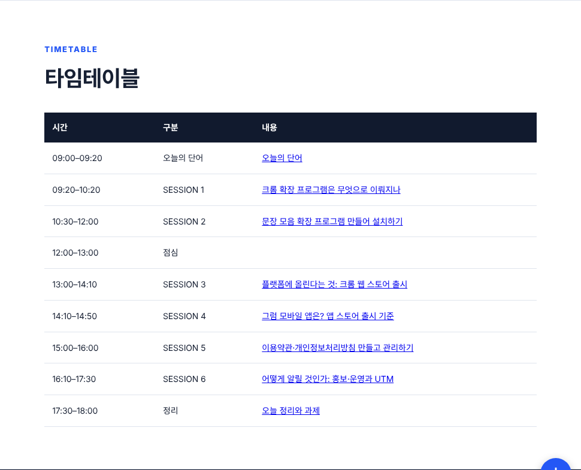
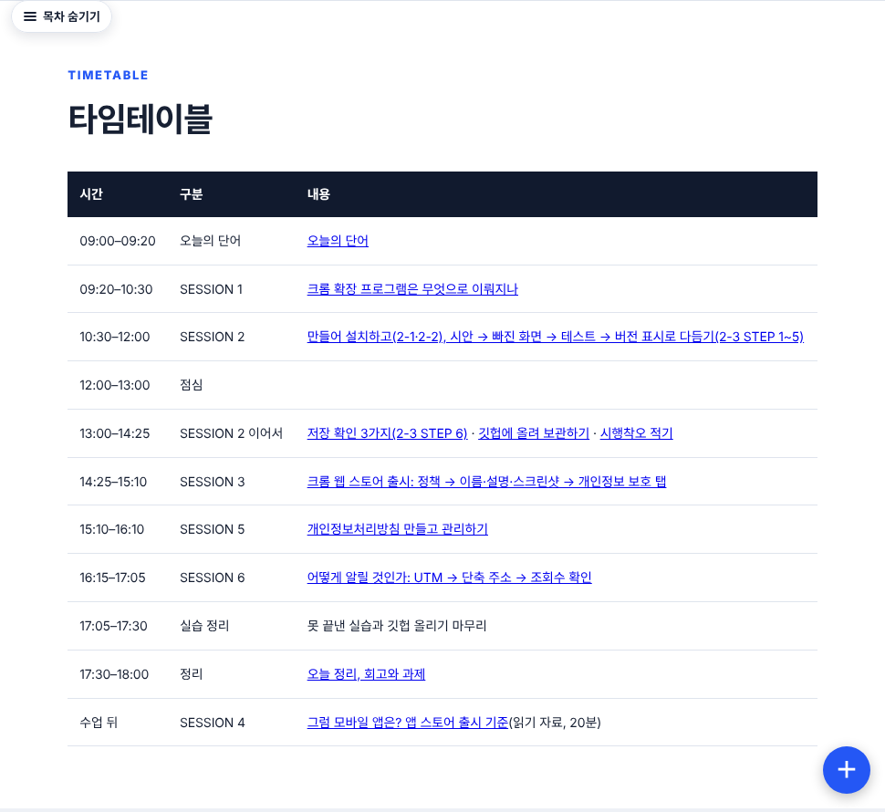
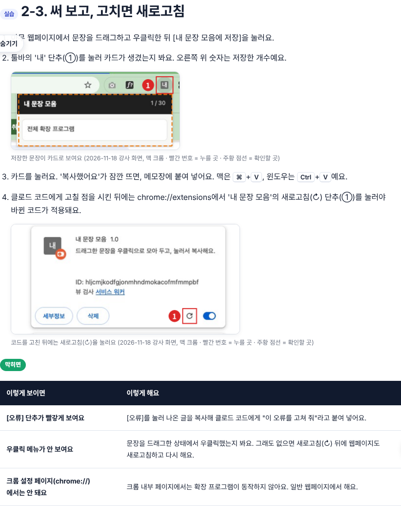
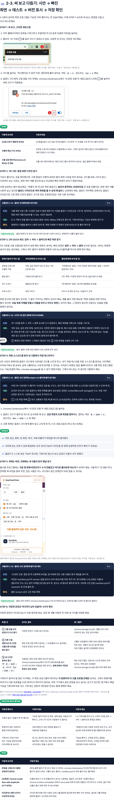
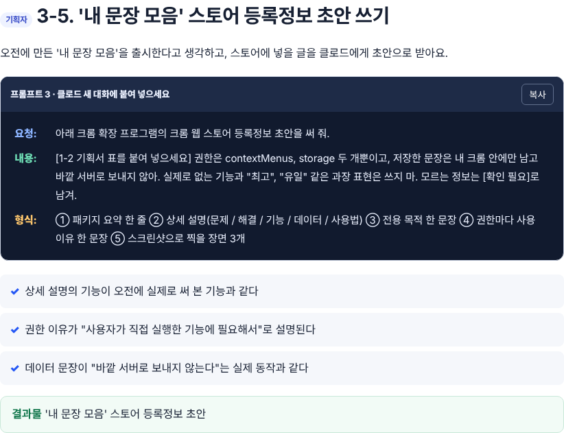
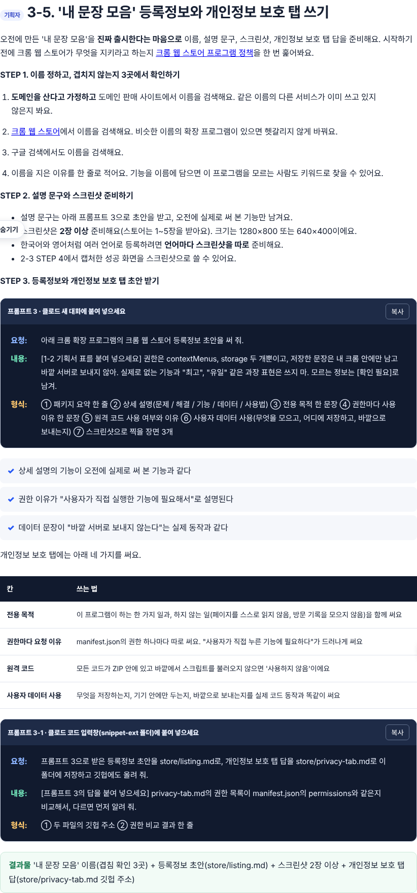
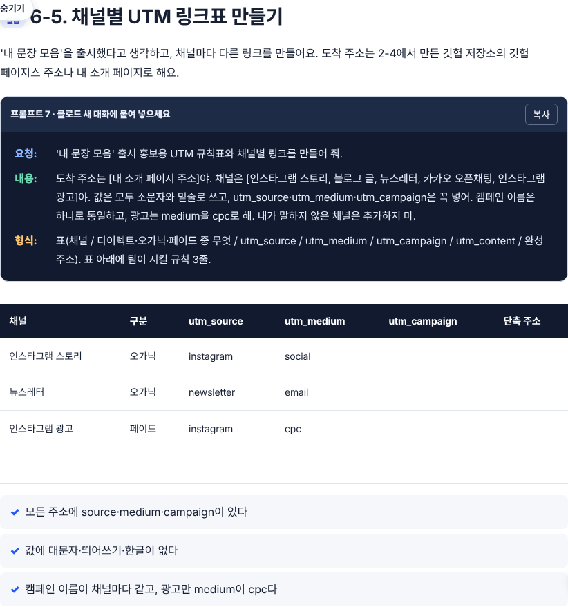
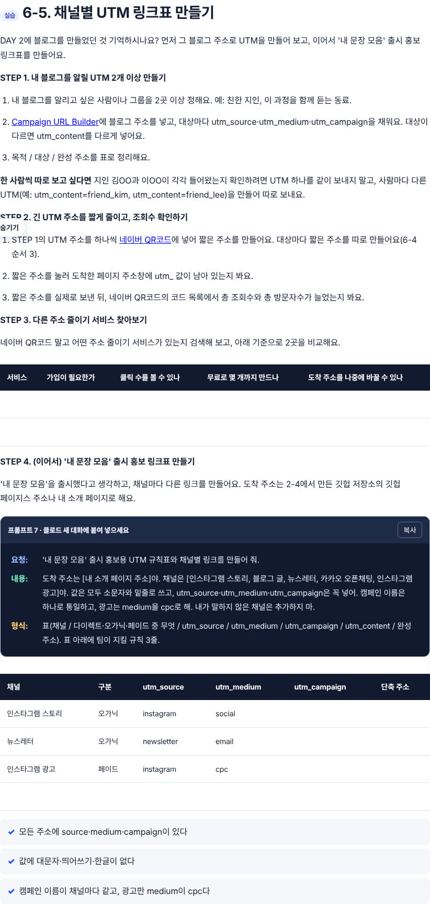
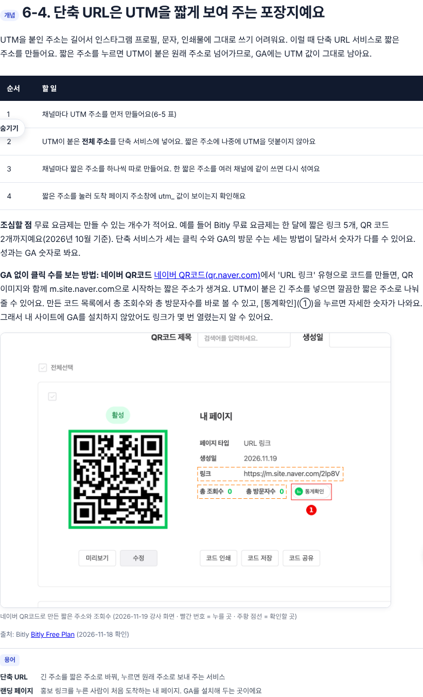
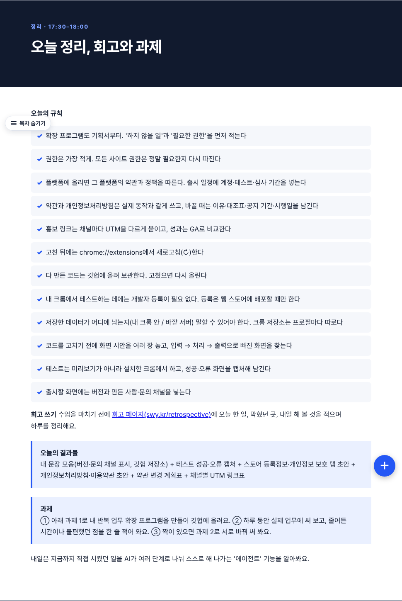

# PR #218 · 4주차 DAY4 교안 — 11/19 수업 슬랙 기준 보충

교안: https://loreenkim0301.github.io/swy-lecturenote/261116-ai-pm-week4/d4-chrome-extension.html
(브랜치 파일: https://github.com/loreenkim0301/swy-lecturenote/blob/week4-d4-slack-supplement-261119/261116-ai-pm-week4/d4-chrome-extension.html)

다음 기수 재수업용으로, 11/19 수업에서 강사가 실제로 진행한 실습·예시·링크를 진행한 자리에 넣었어요. 수강생 결과물은 넣지 않았어요.

| 장면 | 전 | 후 |
|---|---|---|
| 타임테이블 |  |  |
| 2-3 STEP 1~6 |  |  |
| 3-5 |  |  |
| 6-5 |  |  |
| 6-4 네이버 QR | – |  |
| 정리·회고 | – |  |
| 2-3 모바일 390px | – |  |

## 확인 못 한 것
- 원티드 화면의 [인기순] 정렬·검색 위치: 강사 수업 진행 기준으로 썼고 화면 캡처는 없음
- 크롬 [세부정보] → [시크릿 모드에서 허용] 메뉴 이름: 공식 문서·수업 확인 기준, 강사 화면 캡처 없음
- 클로드 디자인으로 '여러 화면 시안' 요청 → 실제 결과 화면 캡처 없음
- 윈도우 캡처 단축키(Win+Shift+S)는 윈도우 실PC 미확인
