# 1~4주차 교안 ✓ 체크 목록 정리 (2026-11-20)

## 무엇을 바꿨나
로린님 요청: "체크로 되어 있는 부분은 의미가 특별히 없으므로 삭제. 오히려 중요한 팁이었다면 박스팁 표시."

1~4주차 교안 26개 파일의 `ul.checklist`(✓ 목록) **176개를 모두 없앴어요.** 남은 ✓ 목록은 0개예요.

| 처리 | 개수 | 기준 |
|---|---|---|
| 삭제 | 139 | 실습 뒤 "~했다/~나요?" 확인 목록. 앞의 '확인할 점' 표시도 같이 지움(56곳) |
| 팁 상자로 바꿈 | 20 | 오늘의 규칙 15 + 출시 전 PM 질문 + 크롤링 확인 질문 + PRD 쓰는 법 + GA 사례에서 배울 점 + GA 점검에서 발견할 점 |
| 보통 목록으로 둠 | 17 | 과제·준비물·STEP 안의 따라 할 순서 (체크 표시만 뺌) |
| 지운 목록 속 중요한 한 줄을 팁으로 살림 | 9 | 비용(Paid 모델), 이미지 속 글자 오류, 중복 삭제 한계, GA 데모 권한, Pages index.html 규칙, 지운 파일 복구, 프롬프트의 한계, 폴더 안내 파일, 시안과 실제 팝업 비교 |

로린님이 예로 든 4주차 목요일 3-5·5-2의 "[확인 필요] 자리를 채우기 전에는 게시하지 않는다" 같은 목록은 **삭제**했어요.

### 같이 바꾼 것
- 팁 상자 스타일(`.tip-box`)을 팁을 쓰는 페이지 `<head>`에 넣었어요. 초록 왼쪽 선 + 초록 제목 배지.
- 1주차 금요일 "5-3. 결과 확인 체크리스트" 제목을 "5-3. 결과 확인하기"로 바꿨어요(목차 포함).
- `common/lecture-rules.md` 4장의 "실습마다 결과 확인 체크리스트를 두어요"를 고치고, **19장(✓ 체크 목록은 쓰지 않고, 중요한 것만 팁 상자로)**을 새로 넣었어요.
- 규칙 14장대로 `keep_phrase_linebreak.py`를 바꾼 파일 모두에 돌렸어요. 줄바꿈 공백(nbsp)이 들어가서 diff 줄 수가 커 보여요. 글자는 바뀌지 않았어요.
- 태그 검사: 바꾼 26개 파일 모두 열고 닫는 태그 오류 0. 모바일(390px) 가로 넘침 없음.

### 파일별 처리 수
| 파일 | 삭제 | 팁 상자 | 팁 추가 | 보통 목록 |
|---|---|---|---|---|
| w1/d1-ot.html | 5 | 0 | 0 | 1 |
| w1/d2-ai-governance.html | 7 | 0 | 0 | 1 |
| w1/d3-github-agile.html | 19 | 1 | 1 | 2 |
| w1/d4-python-1.html | 17 | 0 | 0 | 1 |
| w1/d4-web-basics.html | 8 | 0 | 0 | 2 |
| w1/d5-first-deploy.html | 7 | 0 | 1 | 2 |
| w1/d5-python-2.html | 17 | 0 | 0 | 0 |
| w1/index.html | 0 | 0 | 0 | 1 |
| w2/d1-problem-artifact.html | 0 | 1 | 0 | 0 |
| w2/d2-claude-flow.html | 0 | 1 | 0 | 0 |
| w2/d3-deploy-localdb.html | 0 | 1 | 0 | 0 |
| w2/d4-vibe-tools-bolt.html | 0 | 1 | 0 | 0 |
| w2/d5-google-firebase.html | 0 | 1 | 0 | 0 |
| w2/index.html | 0 | 0 | 0 | 1 |
| w3/d1-sheet-appsscript.html | 11 | 2 | 2 | 1 |
| w3/d2-web-crawling.html | 3 | 2 | 0 | 1 |
| w3/d3-ai-studio-books.html | 19 | 1 | 1 | 0 |
| w3/d4-claude-code-chatbot.html | 9 | 1 | 3 | 0 |
| w3/d5-chatbot-api.html | 5 | 2 | 0 | 0 |
| w3/index.html | 0 | 0 | 0 | 1 |
| w4/d1-claude-code-chatbot.html | 3 | 1 | 0 | 1 |
| w4/d2-api.html | 3 | 2 | 0 | 0 |
| w4/d3-dev-env.html | 1 | 1 | 0 | 0 |
| w4/d4-chrome-extension.html | 4 | 1 | 1 | 1 |
| w4/d5-agent.html | 1 | 1 | 0 | 0 |
| w4/index.html | 0 | 0 | 0 | 1 |

## 캡처 (전 → 후)
| 위치 | 전 | 후 |
|---|---|---|
| 4주차 목 5-2 개인정보처리방침 (로린님 예시 목록) | 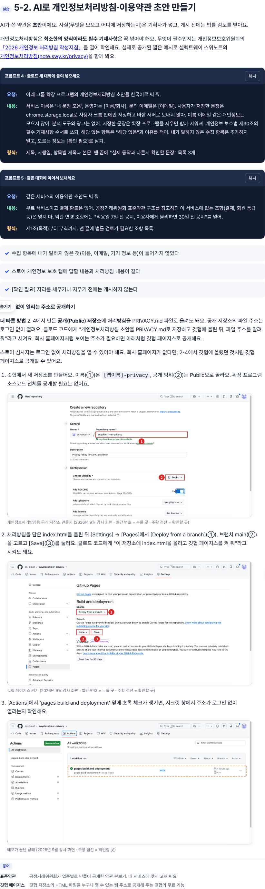 | 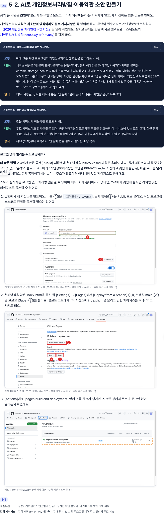 |
| 4주차 목 오늘 정리 (오늘의 규칙 → 팁 상자) | 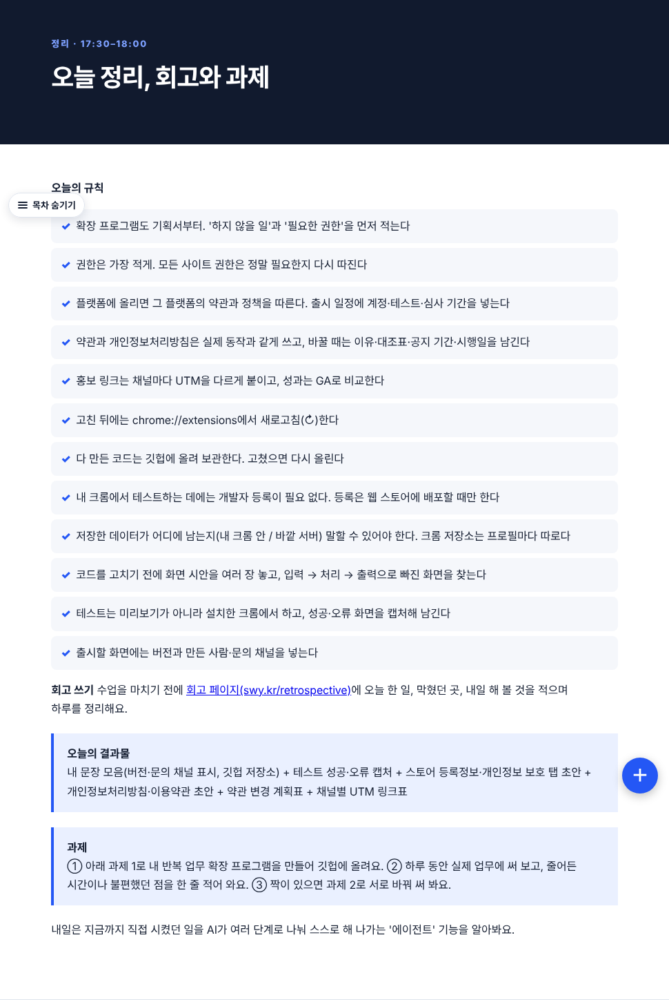 | 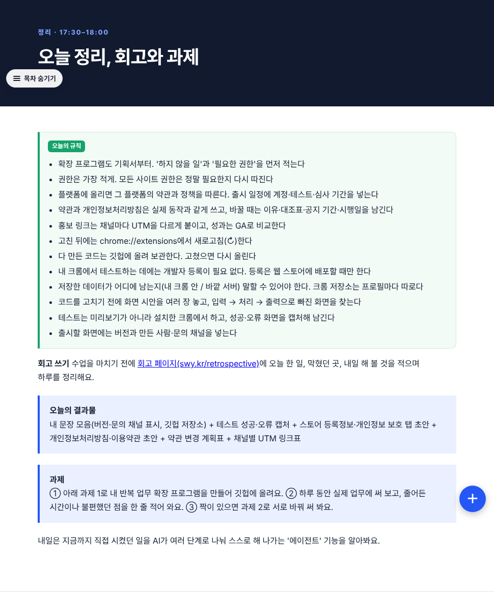 |
| 3주차 월 5-3 GA 사례 (배울 점 → 팁 상자) | 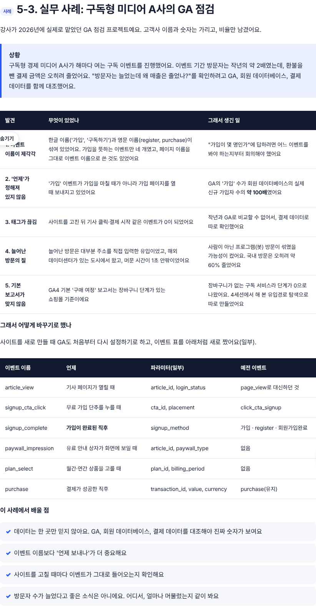 | 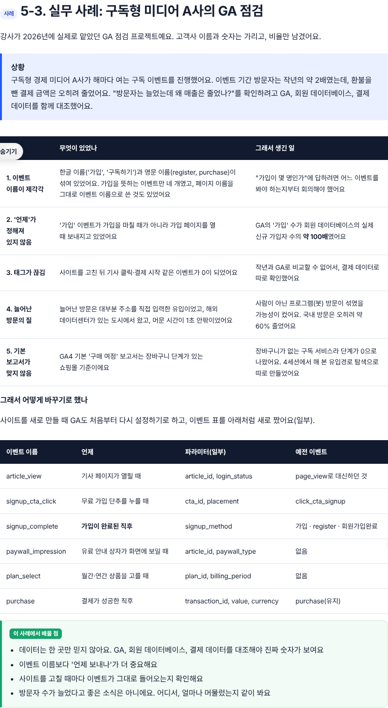 |
| 3주차 수 5-4 프롬프트 비교 (한 줄 팁으로 살림) | 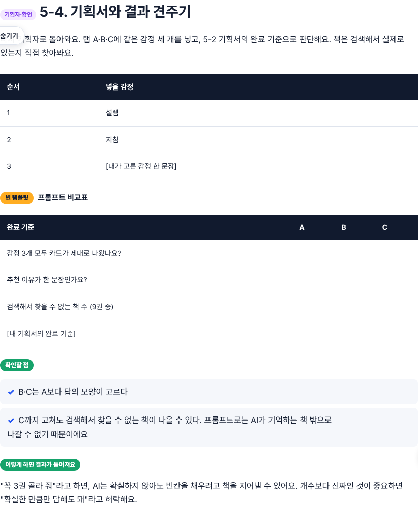 | 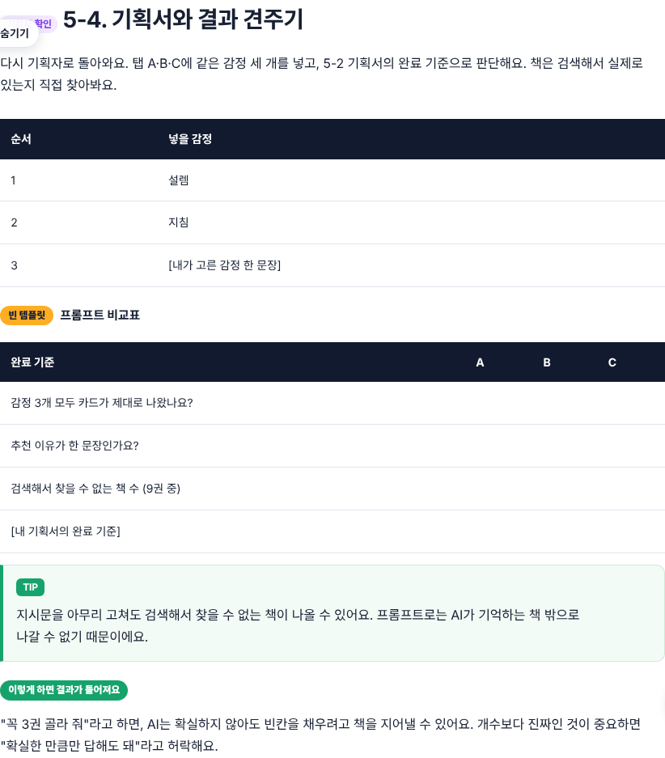 |
| 1주차 수 7-5 출시 전 PM 질문 (팁 상자) | 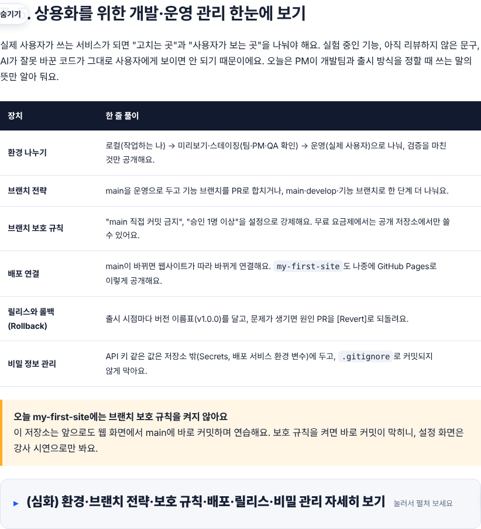 | 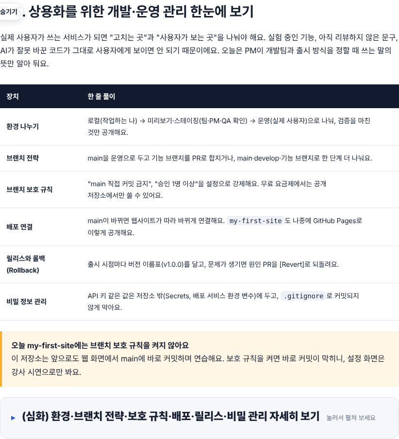 |
| 4주차 목 오늘 정리 · 모바일 390px | | 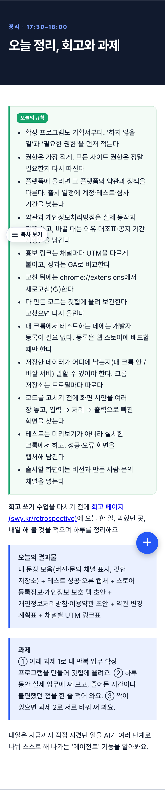 |

## 로린님이 확인할 것
- 팁 상자로 살린 20개 + 한 줄 팁 9개가 적절한지(빼거나 더할 것).
