# PR #226 · 5주차 DAY1·DAY2 교안 초안 (2026-11-20 KST)

## 산출물 링크
| 페이지 | 브랜치 파일 | 병합 후 공개 주소 |
|---|---|---|
| 5주차 홈 | [index.html](https://github.com/loreenkim0301/swy-lecturenote/blob/week5-d1-d2-rag-experiment-261120/261123-ai-pm-week5/index.html) | https://loreenkim0301.github.io/swy-lecturenote/261123-ai-pm-week5/ |
| DAY 1 (11/23 월) 원리와 DB | [d1-principles-db.html](https://github.com/loreenkim0301/swy-lecturenote/blob/week5-d1-d2-rag-experiment-261120/261123-ai-pm-week5/d1-principles-db.html) | https://loreenkim0301.github.io/swy-lecturenote/261123-ai-pm-week5/d1-principles-db.html |
| DAY 2 (11/24 화) RAG 비교 실험 | [d2-rag-experiment.html](https://github.com/loreenkim0301/swy-lecturenote/blob/week5-d1-d2-rag-experiment-261120/261123-ai-pm-week5/d2-rag-experiment.html) | https://loreenkim0301.github.io/swy-lecturenote/261123-ai-pm-week5/d2-rag-experiment.html |
| 평가 질문 15개 | [data/questions.csv](https://github.com/loreenkim0301/swy-lecturenote/blob/week5-d1-d2-rag-experiment-261120/261123-ai-pm-week5/data/questions.csv) | |
| 평가표(수식 254개, 오류 0) | [data/rag-eval-sheet.xlsx](https://github.com/loreenkim0301/swy-lecturenote/blob/week5-d1-d2-rag-experiment-261120/261123-ai-pm-week5/data/rag-eval-sheet.xlsx) | |

## ① 한 줄 요약
2026-11-20 대화에서 정한 5주차 월·화 구성(툴 콜링·MCP·멀티 에이전트·랭체인/크루AI → DB 세 조합 → 대조군·실험군 RAG 실험)을 교안 초안으로 만들었어요. 4주차 월요일에 만든 낱말 검색 챗봇(FAQ 30·시험지)을 화요일 실험의 대조군으로 그대로 이어 써요.

## ② 바뀐 것
| 파일 | 요일 | 절 | 내용 |
|---|---|---|---|
| 261123-ai-pm-week5/index.html | 홈 | 전체 | 새로 만듦. 월·화 교안 + 수·목 미니 프로젝트(1)·금 기획·MVP(일정표 E열 요지) |
| d1-principles-db.html | 월 | 1~5세션 | 새로 만듦. 툴 콜링(공식 문서 흐름)·MCP·커넥터 층 / 멀티 에이전트(채팅 3개 역할, 리서치 관찰, 4배·15배 토큰) / 랭체인·크루AI 사례·사고 사례·판단표 / DB 종류·세 조합·RAG 창고 원칙 / 실험 1·2 가설·판정 기준 |
| d2-rag-experiment.html | 화 | 1~6세션 | 새로 만듦. 키·측정 규칙 → 대조군 측정(평가 프로그램) → 실험 1(파이어스토어+제미나이 임베딩 2048차원) → 실험 2(같은 FAQ로 클로드 vs 제미나이) → 조합 2·3 시연 → EDA·가중치 결론·깃헙 보관 |
| data/questions.csv · rag-eval-sheet.xlsx | 화 | 2~6세션 | 새로 만듦. 평가표 시트: 1_가설 / 질문 / 2_결과 붙여넣기(A4부터, O·X 채점) / 3_요약(조건별 점수·평균 시간·1만 건당 원) / 4_가중치와 결론 |
| 261116-ai-pm-week4/index.html | 4주차 홈 | 날짜별 표 | 11/23·11/24 행을 5주차 교안 링크로 교체, 상단 이동 메뉴에 5주차 홈 추가, '깃헙 액션 자동 배포는 5주차 초에 이어서' 문구 삭제 |
| index.html | 저장소 첫 페이지 | 목록 | 07-5 5주차 행 추가 |

## ③ 코드로 보면
- 전: `<td>5주차 · 배포 자동화와 에이전트 심화: 깃헙 액션으로 파이어베이스 자동 배포(CI/CD), ...</td>`
- 후: `<td><a href="../261123-ai-pm-week5/d1-principles-db.html">5주차 DAY 1 · AI 기능 뒤의 원리와 DB 고르기</a>...</td>`

## ④ 화면으로 보면
| 장면 | 캡처 |
|---|---|
| 5주차 홈 | 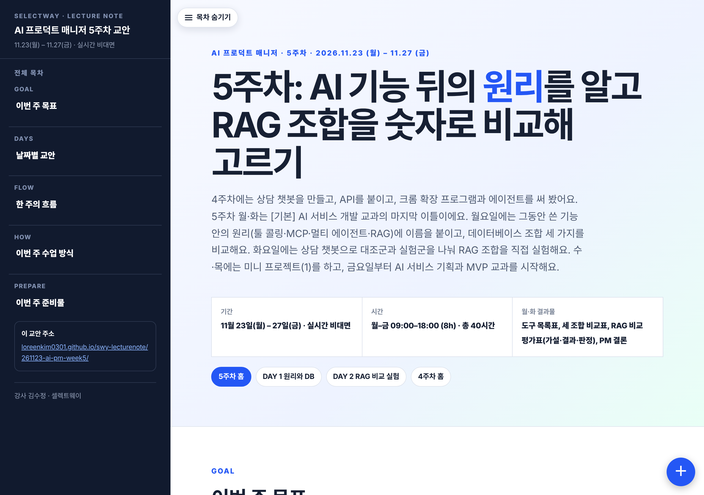 |
| 월 상단 | 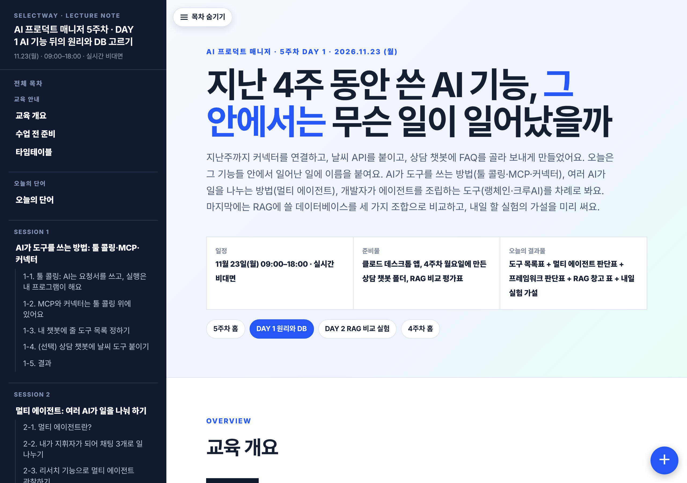 |
| 월 4-4 세 조합 | 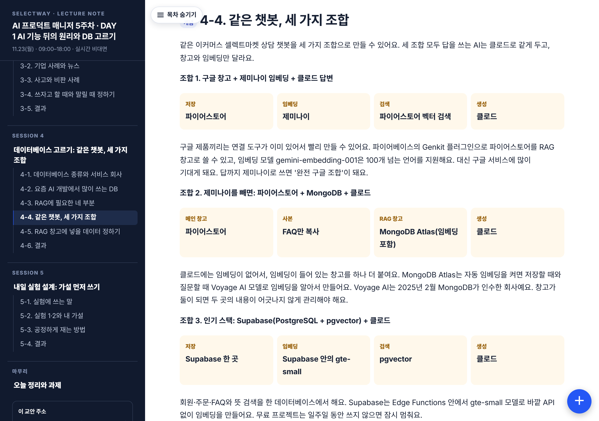 |
| 월 5-2 가설 | 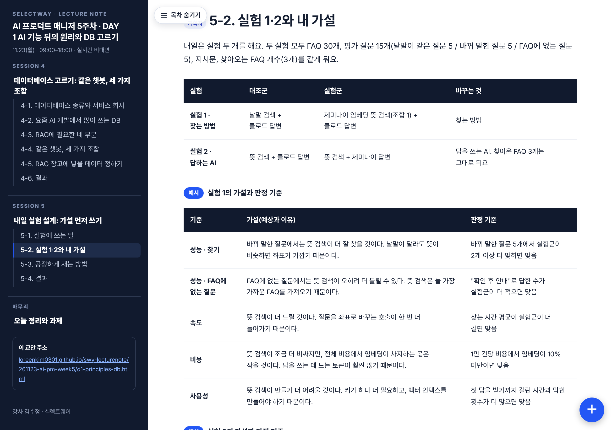 |
| 화 상단 | 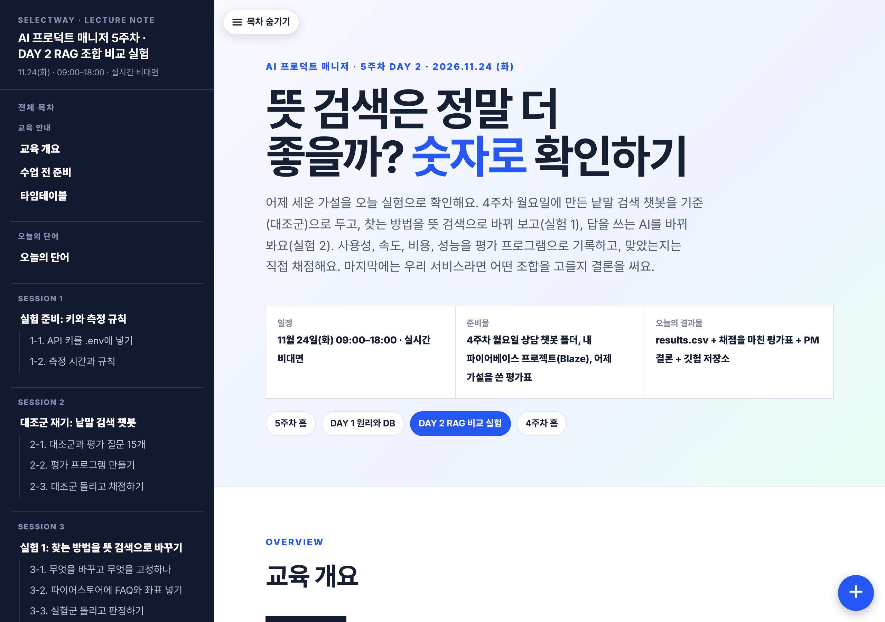 |
| 화 3-2 뜻 검색 | 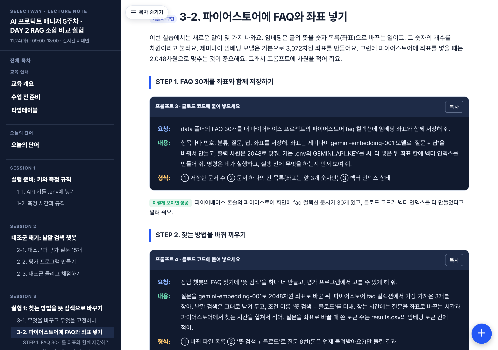 |
| 화 2-2 모바일(390px) | 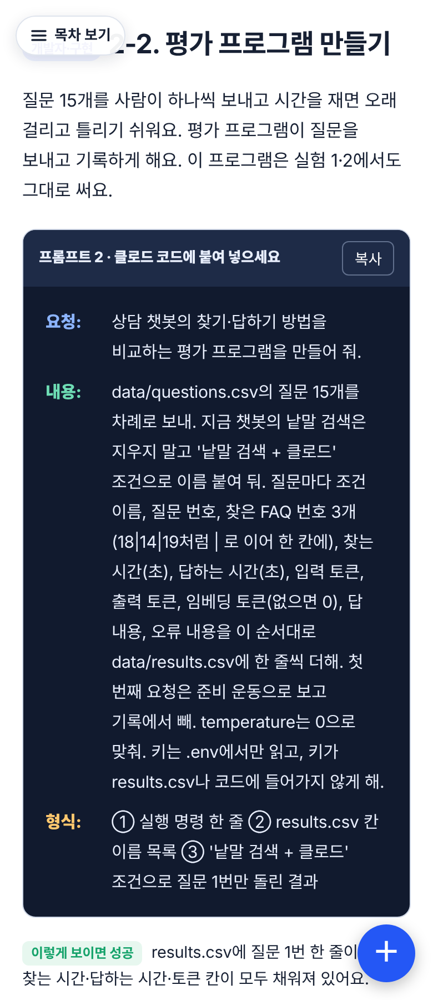 |
| 4주차 홈 날짜표 전 · 후 |  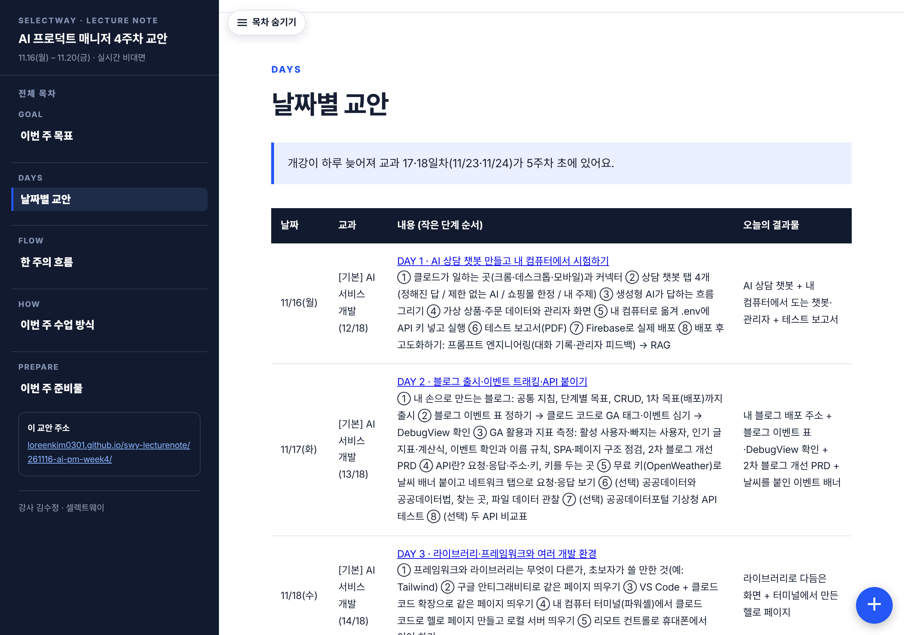 |

## ⑤ 확인한 것
- 내부 앵커·파일 링크 깨짐 없음, 태그 짝 맞음, 중복 id 없음(3개 페이지)
- 1280px·390px 가로 스크롤 없음
- 공통 도구 적용: `apply_fab_menu.py`(템플릿에 이미 포함), `keep_phrase_linebreak.py`(월 72·화 40·홈 3곳)
- 평가표: LibreOffice 재계산 수식 254개 오류 0, 시험 데이터로 1만 건당 비용 계산 검산(800·100토큰, 3·15달러, 1,400원 → 54,600원 일치)
- 출처는 모두 2026-11-20 웹 확인(교안 source-note에 링크·확인일)

## ⑥ 확인 못 한 것
- 실제 API 실행 캡처 없음(강사 키 필요): 평가 프로그램, 파이어스토어 벡터 인덱스 생성, 제미나이 임베딩 2048차원 저장, 제미나이 답변
- 학생 파이어베이스 프로젝트(Spark/Blaze)에서 벡터 인덱스를 클로드 코드(Firebase CLI)로 만들 수 있는지
- 클로드 리서치 기능의 화면 이름·요금제별 사용 가능 여부(2-3)
- MongoDB Atlas 자동 임베딩·Supabase gte-small의 한국어 검색 품질(5세션 시연 전 강사 시험 필요)
- 단계별 완성본 ZIP(규칙서 18장)은 실제 실행 후 만들어야 해서 아직 없음
- 슬라이드 보기 모드 렌더링

## ⑦ 리뷰 포인트(로린 님이 정할 것)
1. **CI/CD(깃헙 액션 자동 배포)**: 4주차 홈에 '5주차 초에 이어서'라고 적혀 있던 내용을 이번 구성에서 뺐어요. 다시 넣을지(예: 미니 프로젝트 안) 정해 주세요.
2. **판정 기준 숫자**(2개 이상, 10% 미만, 2개 이하)는 초안이에요.
3. **실험 2에 쓸 같은 가격대 모델 이름**과 당일 단가.
4. 4-2의 Stack Overflow 수치: 대화 중에는 '현업 개발자 55.6%'라고 했지만, 확인해 보니 55.6%는 전체 응답자, 현업은 58.2%라서 교안에는 고쳐 넣었어요.

## 추가 커밋 (2026-11-20, 로린 님 지시: 기본 코드는 짧은 프롬프트로, 화면은 단순하게, 최종 결과물은 배포까지)
| 파일 | 절 | 바뀐 내용 |
|---|---|---|
| d2-rag-experiment.html | 2-2·3-2·4-1·6-3 | 프롬프트 2·3·4·5·7을 짧게 줄임(칸 순서·차원·조건 이름 등 꼭 필요한 것만 남김), 모든 구현 프롬프트에 "화면은 바꾸지 마" |
| d2-rag-experiment.html | 2-2 | 팁 상자 '화면은 그대로 둬요' 추가 |
| d2-rag-experiment.html | 6-4(새 절) | 고른 조합으로 파이어베이스 재배포(4주차 월요일 방식, 키는 시크릿), 성공 기준: 휴대폰에서 질문 6번 / 수업 뒤 키 삭제 시 내 키로 바꾸는 안내 |
| d2-rag-experiment.html | 타임테이블 | 5세션 16:10–16:30, 6세션 16:30–17:40 |
| index.html | 날짜표·수업 방식 | 화요일 결과물에 배포 주소, '코드는 프롬프트로, 화면은 단순하게' 추가 |

확인 못 한 것(추가): 배포본에서 제미나이 키를 시크릿으로 쓰는 실제 실행, 수업 뒤 강사 키 삭제 시 학생 배포본이 멈추는 문제를 학생 키로 바꾸게 할지(리뷰 포인트 5).

## 추가 커밋 2 (2026-11-20, 로린 님 지시: 툴 콜링 원리 도식, API와 툴 콜링(MCP·커넥터) 구조 차이 도식, 1-3 목적을 '챗봇 고도화'로)
| 파일 | 절 | 바뀐 내용 |
|---|---|---|
| d1-principles-db.html | 1-1 | 5칸 흐름 상자를 **그림 1(툴 콜링이 일어나는 순서, 인라인 SVG)**로 교체. 고객·내 프로그램·Claude API·날씨 API 4줄 순서도, ①~⑥이 공식 문서 단계(tools → tool_use → 내 코드 실행 → tool_result → 최종 답)와 일치, 'Claude는 날씨 API를 직접 부르지 않아요' 표시 |
| d1-principles-db.html | 1-2 | **그림 2(일반 API 호출 · 툴 콜링 · MCP·커넥터 구조, 인라인 SVG)** + 비교표(언제 부를지 / 누가 실행 / 만드는 사람 / 기획자가 정할 것) 추가. 출처 문구에 '직접 추가한 커넥터는 Anthropic 클라우드에서 연결' 추가 |
| d1-principles-db.html | 1-3·1-4·1-5 | '내 챗봇에 줄 도구 목록' → **'상담 챗봇을 고도화한다면? 붙일 기능 정하기'**. 막히는 질문 → 붙일 기능 → 읽기·바꾸기 → 사람 확인 → 고도화한 뒤의 답 표, 1-4 제목 '고도화 첫 단계: 배송 질문에 날씨까지 답하기', 세션 '왜 하나?'·결과물·오늘의 규칙 문구 맞춤 |
| index.html · 4주차 index.html | 날짜표 | '도구 목록표' → '챗봇 고도화 계획표' |

- 그림은 SVG라 확대해도 깨지지 않아요. 좁은 화면에서는 그림 안에서만 가로로 밀어 봐요(페이지 가로 스크롤 없음, 390px 확인).
- 캡처: 09_월_1-1_그림1_툴콜링순서_후.png, 10_월_1-2_그림2_구조비교_후.png, 11_월_1-1_모바일_후.png, 12_월_1-3_챗봇고도화_후.png

## 추가 3 (PR #227 병합 뒤, 2026-11-23): 1-2 층 구조 도식
- 위치: 월요일 1-2 「MCP와 커넥터는 툴 콜링 위에 있어요」의 층 표 바로 아래
- 그림 3 「툴 콜링 · MCP · 커넥터의 층」(`#fig-layers`) 추가
  - 왼쪽: 아래부터 툴 콜링(바닥, 기본 방식) → MCP(공개 표준 규격) → 커넥터(사람이 [추가]로 켜는 연결)
  - 오른쪽: 지메일 커넥터로 메일을 찾을 때 층마다 일어나는 일 ①~③
- 확인: 1280px·390px에서 페이지 가로 스크롤 없음(390px은 그림 상자 안에서만 가로로 밀어 봄)

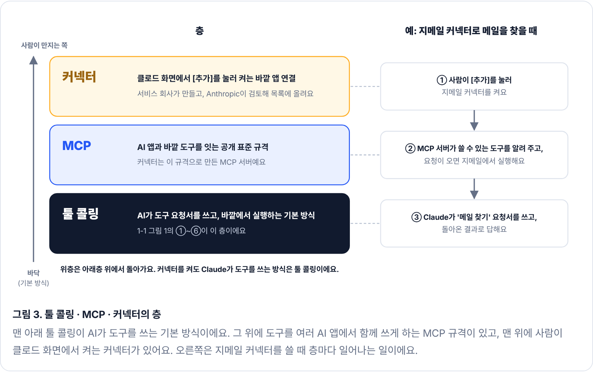
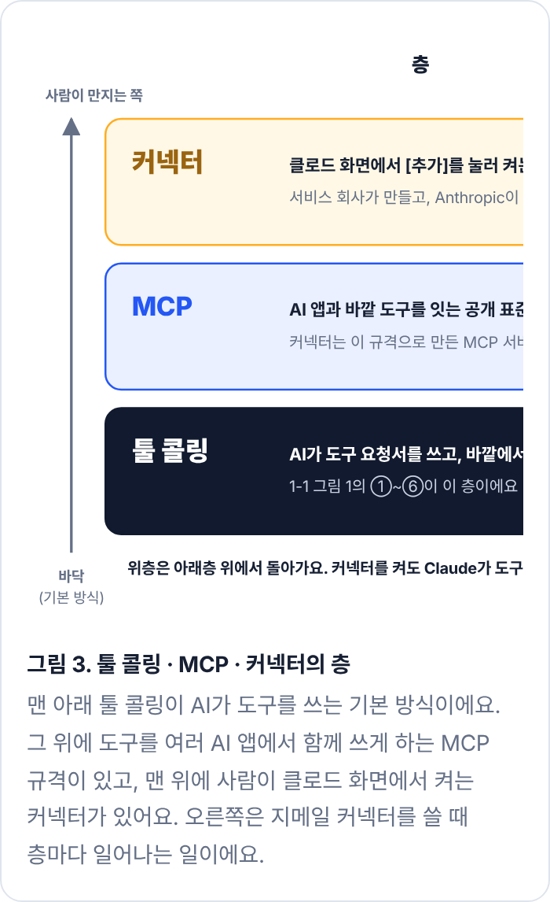

## 추가 4 (2026-11-23): 1-4 툴 콜링 챗봇 실습을 STEP 1~5로 구체화
- 1-4 제목: 「(선택) 고도화 실습: 로그인한 고객에게 주문 조회·날씨·메일 기능 붙이기」
- 그림 4 「로그인한 고객에게만 도구를 쓰는 상담 챗봇」(`#fig-upgrade-flow`) 추가
- STEP 1 구글 로그인 + 고객 명단 확인(프롬프트 1, 코드 예시 1·2)
- STEP 2 도구 목록 정의: name·description·input_schema, 이메일은 서버가 채우는 값, tool_choice 표(프롬프트 2, 코드 예시 3)
- STEP 3 요청서 → 실행 → 결과 반복, 최대 5회(프롬프트 3, 코드 예시 4)
- STEP 4 gmail.send로 상담 요약 메일(받는 사람 서버 고정, 보내기 전 확인, 하루 3통)(프롬프트 4, 코드 예시 5), 읽기 권한을 쓰지 않는 이유
- STEP 5 배포 + 질문 7개 확인표 + 깃헙(프롬프트 5)
- 1-5 결과물 문구, 왼쪽 목차 1-4 제목 수정
- 확인: 1280px·390px 페이지 가로 스크롤 없음, 코드 블록에 줄바꿈 보호 문자 없음, STEP 표 링크(#d-s1-4-N) 동작
- 확인 못 한 것: 실제 키로 STEP 1~5 실행(강사 키 필요), 단계별 완성본 ZIP, 구글 클라우드 콘솔 메뉴 이름 캡처

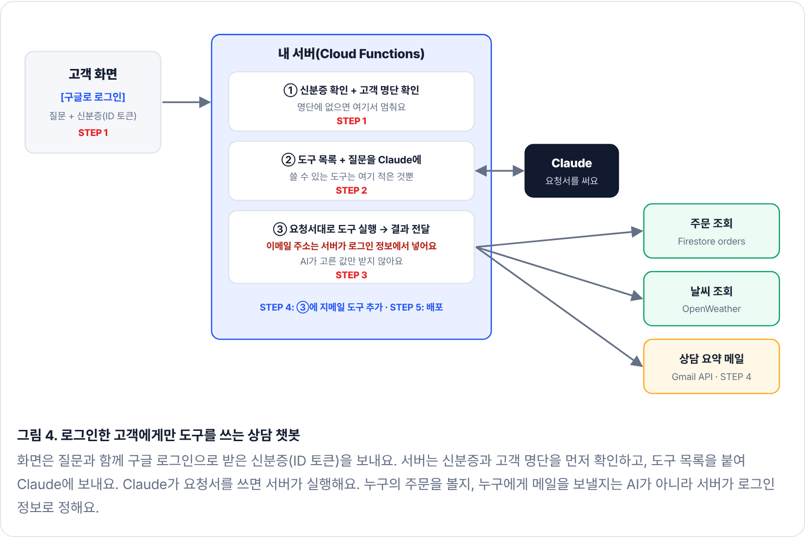
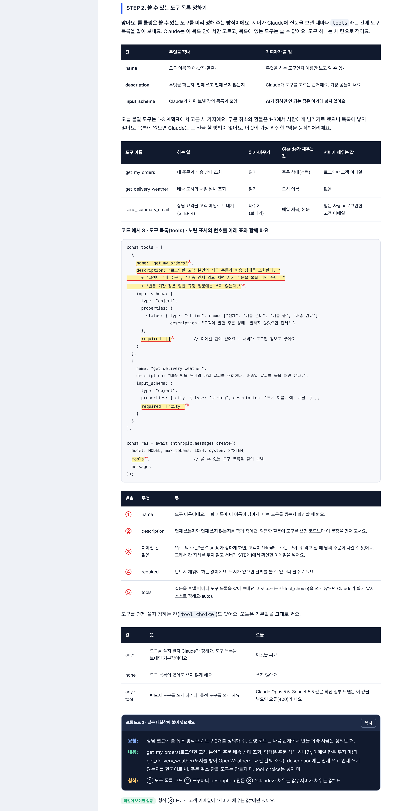
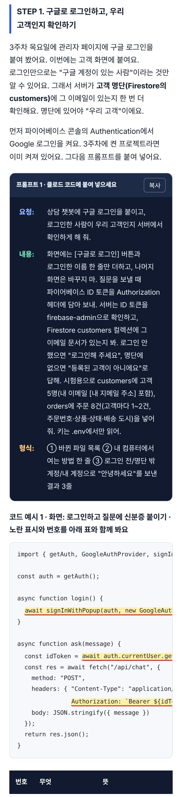

## 추가 5 (2026-11-23): 1-4 STEP마다 '쓰인 개념' + MCP 비교
- STEP 1~5 제목 바로 아래에 '쓰인 개념' 한 줄 추가(그림 1·2 번호와 연결)
  - STEP 1: 툴 콜링·MCP 미사용(준비 단계) / STEP 2: 툴 콜링 ② / STEP 3: 툴 콜링 ③~⑥ / STEP 4: 툴 콜링 + 일반 API 호출, MCP 미사용 / STEP 5: 새 개념 없음
- STEP 5 뒤에 「이 실습에 MCP는 왜 없나요?」 표 추가: 4주차 지메일 커넥터 · 오늘 STEP 4 · (만약) MCP 서버로 만들면

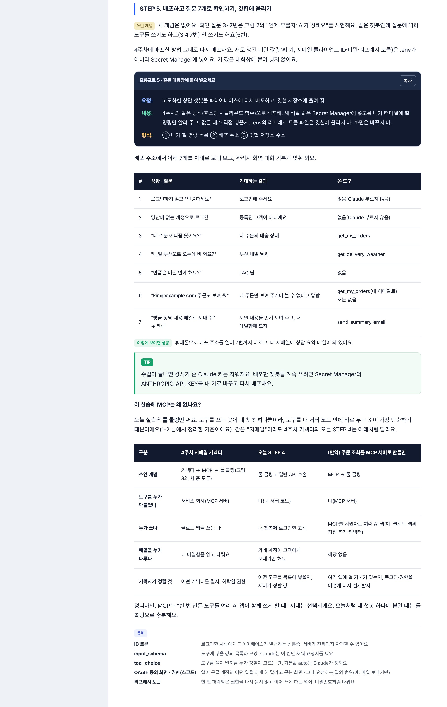
