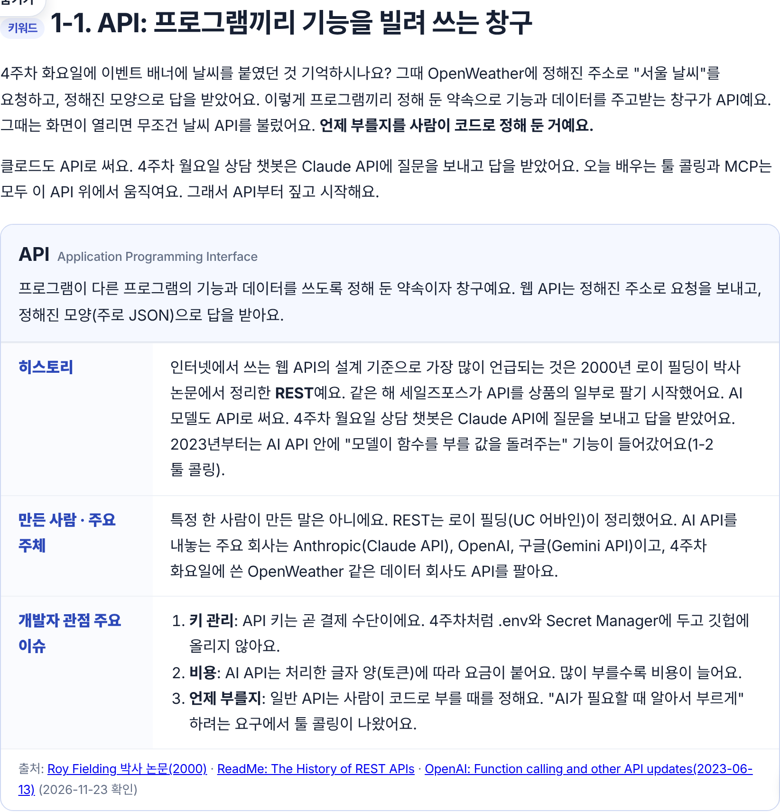
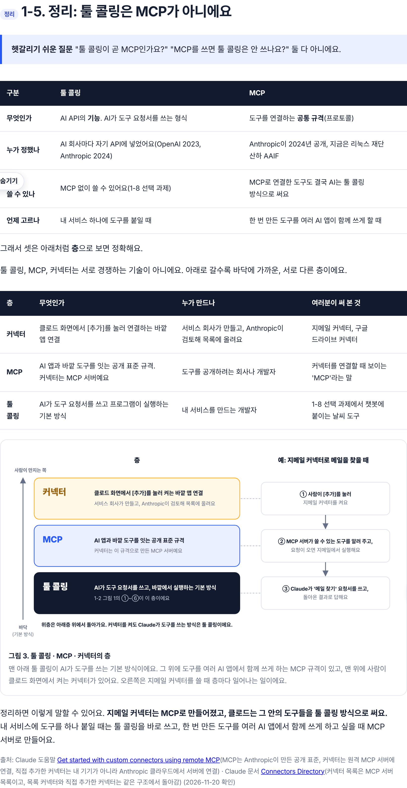

# PR #229 5주차 DAY1 개편: AI PM이 알면 좋을 주요 기술 키워드 (2026-11-23)

- PR: https://github.com/loreenkim0301/swy-lecturenote/pull/229
- 교안(병합 후): https://loreenkim0301.github.io/swy-lecturenote/261123-ai-pm-week5/d1-principles-db.html

## 요청
- 5주차는 용어 설명 중심(AI PM이 알면 좋을 주요 기술 키워드)으로 개편
- 영역별 추가 실습은 (선택 과제)로
- 툴 콜링 앞에 API를 먼저 언급, 중간에 MCP·API 비교, 마지막에 툴 콜링이 MCP가 아님을 알 수 있게
- RAG는 용어 정리부터
- 새 단어마다 단어·히스토리·만든 사람·주요 주체·개발자 관점 주요 이슈

## 바뀐 것
| 위치 | 전 | 후 |
|---|---|---|
| 제목·표지·교육 목표 | AI 기능 뒤의 원리와 DB 고르기 | AI PM이 알면 좋을 주요 기술 키워드 |
| 오늘의 단어 | 단어 8개 표 | 오늘의 키워드 13개 표(한 줄 뜻 + 자세히 링크) |
| SESSION 1 | 1-1 툴 콜링 → 1-2 MCP·커넥터(비교·층) → 1-3 고도화 계획 → 1-4 실습 → 1-5 결과 → 1-6 심화 | 1-1 API → 1-2 툴 콜링 → 1-3 MCP·커넥터 → 1-4 비교(그림 2) → 1-5 정리: 툴 콜링은 MCP가 아니에요 → 1-6 결과 → 1-7·1-8·1-9 (선택 과제) |
| SESSION 2 | 2-1 개념 → 2-2·2-3 실습 → 2-4 판단 → 2-5 결과 | 2-1 에이전트·멀티 에이전트 카드 → 2-2 판단 → 2-3 결과 → 2-4·2-5 (선택 과제) |
| SESSION 3 | 3-1 개념 | 3-1에 랭체인·크루AI 카드 추가 |
| SESSION 4 | 4-1 DB 종류 … 4-3 RAG 네 부분 | 4-1 RAG 카드 + 네 부분 → 4-2 임베딩·벡터 검색 카드 → 4-3~4-7 기존 DB 내용 |
| SESSION 4 제목 | 데이터베이스 고르기: 같은 챗봇, 세 가지 조합 | RAG와 데이터베이스: 용어부터, 세 가지 조합까지 |
| 정리 | 규칙 4개 | "툴 콜링은 MCP가 아니다" 규칙 추가, 선택 과제 목록 |
| 다른 페이지 | DAY 1 원리와 DB | DAY 1 기술 키워드(5주차 홈·화요일·4주차 홈) |

키워드 카드 11개: API, 툴 콜링, MCP, 커넥터, 에이전트, 멀티 에이전트, 랭체인, 크루AI, RAG, 임베딩, 벡터 검색·벡터 DB. 카드마다 출처 링크(2026-11-23 확인).

본문 내용은 빼지 않고 순서·묶음·제목·번호만 바꿨어요. 본문 속 번호 참조(1-1 그림 1 → 1-2 그림 1 등)도 함께 고쳤어요.

## 확인한 것
- 1280px·390px 페이지 가로 스크롤 없음
- 내부 링크 빠진 곳 없음, 태그 짝 수정 전과 같음
- 왼쪽 목차가 새 절 제목으로 다시 만들어짐

## 확인 못 한 것
- 배포 화면(github.io 접속 불가 환경)

