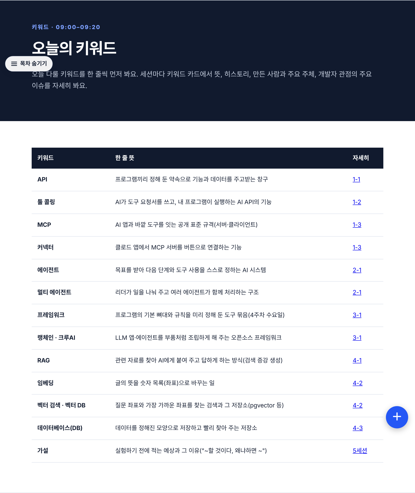
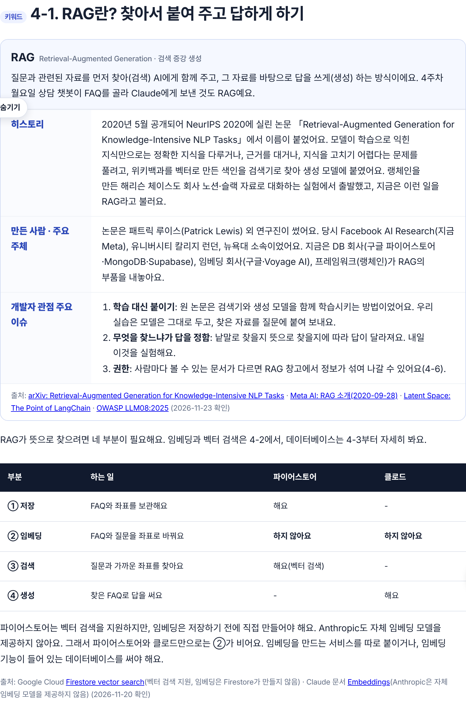
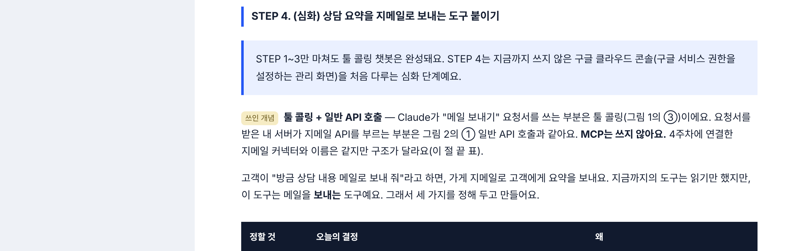
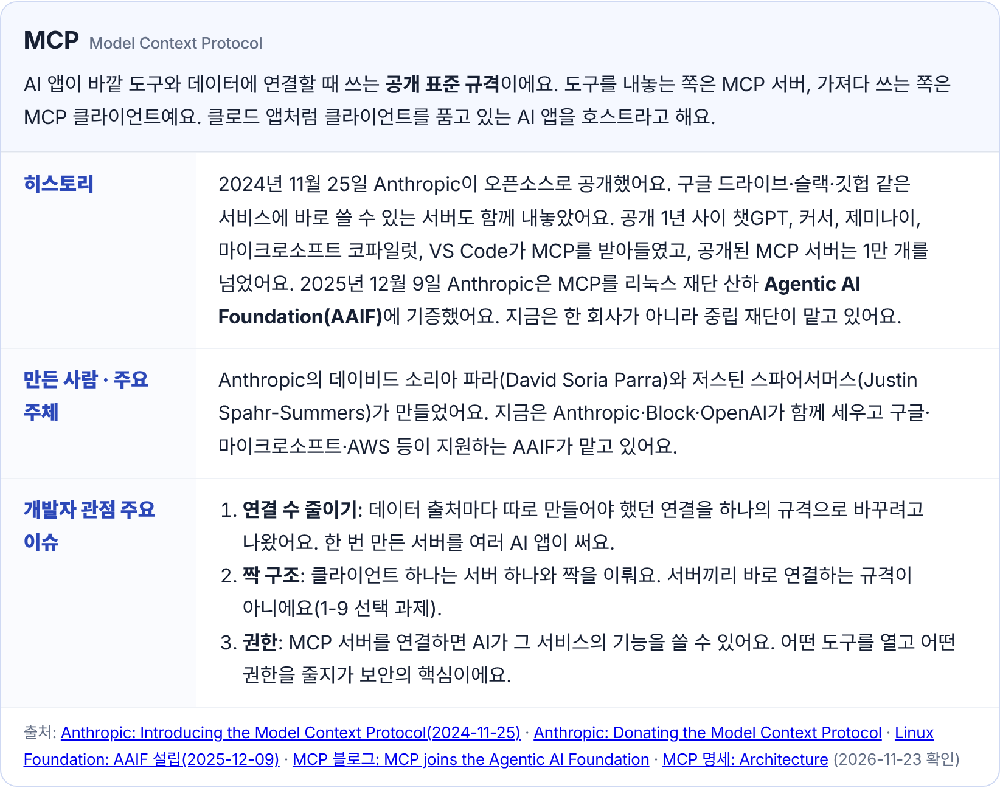
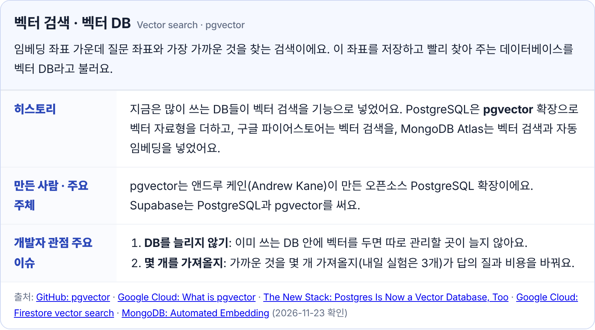
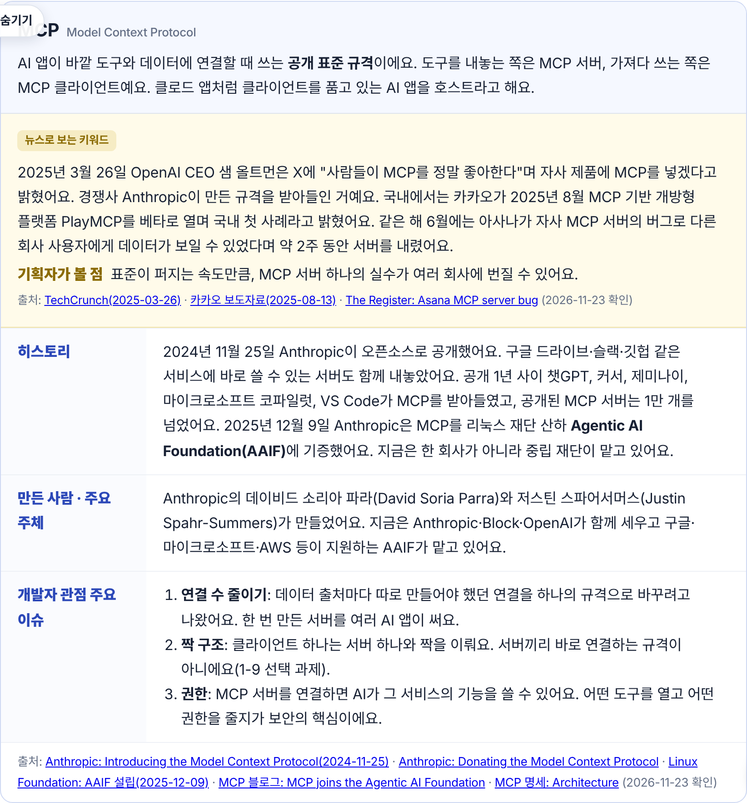
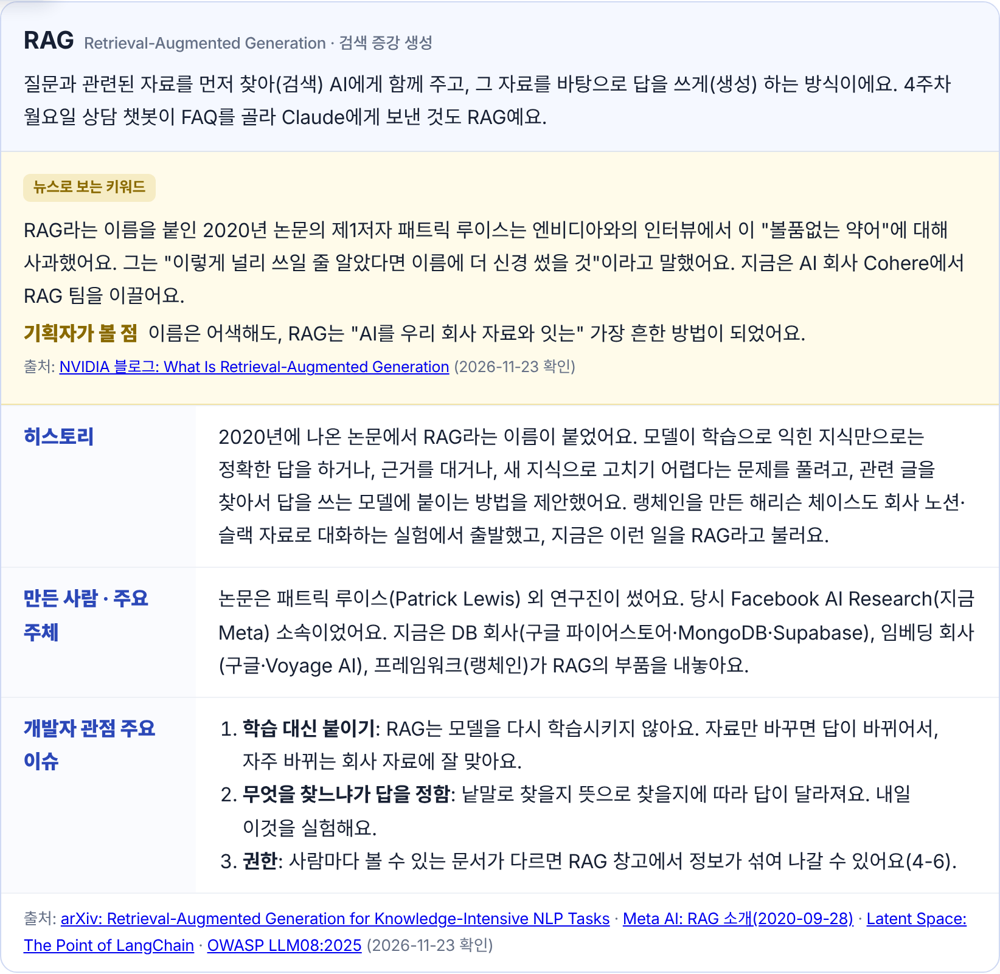
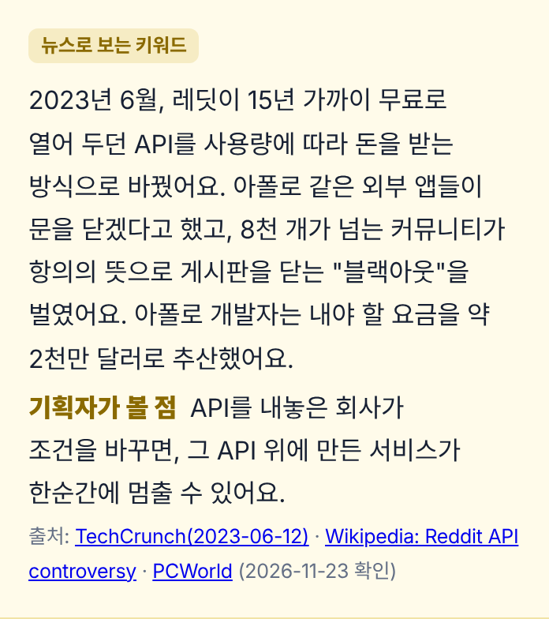

# PR #229 5주차 DAY1 개편: AI PM이 알면 좋을 주요 기술 키워드 (2026-11-23)

- PR: https://github.com/loreenkim0301/swy-lecturenote/pull/229
- 교안(병합 후): https://loreenkim0301.github.io/swy-lecturenote/261123-ai-pm-week5/d1-principles-db.html

## 요청
- 5주차는 용어 설명 중심(AI PM이 알면 좋을 주요 기술 키워드)으로 개편
- 영역별 추가 실습은 (선택 과제)로
- 툴 콜링 앞에 API를 먼저 언급, 중간에 MCP·API 비교, 마지막에 툴 콜링이 MCP가 아님을 알 수 있게
- RAG는 용어 정리부터
- 새 단어마다 단어·히스토리·만든 사람·주요 주체·개발자 관점 주요 이슈

## 바뀐 것
| 위치 | 전 | 후 |
|---|---|---|
| 제목·표지·교육 목표 | AI 기능 뒤의 원리와 DB 고르기 | AI PM이 알면 좋을 주요 기술 키워드 |
| 오늘의 단어 | 단어 8개 표 | 오늘의 키워드 13개 표(한 줄 뜻 + 자세히 링크) |
| SESSION 1 | 1-1 툴 콜링 → 1-2 MCP·커넥터(비교·층) → 1-3 고도화 계획 → 1-4 실습 → 1-5 결과 → 1-6 심화 | 1-1 API → 1-2 툴 콜링 → 1-3 MCP·커넥터 → 1-4 비교(그림 2) → 1-5 정리: 툴 콜링은 MCP가 아니에요 → 1-6 결과 → 1-7·1-8·1-9 (선택 과제) |
| SESSION 2 | 2-1 개념 → 2-2·2-3 실습 → 2-4 판단 → 2-5 결과 | 2-1 에이전트·멀티 에이전트 카드 → 2-2 판단 → 2-3 결과 → 2-4·2-5 (선택 과제) |
| SESSION 3 | 3-1 개념 | 3-1에 랭체인·크루AI 카드 추가 |
| SESSION 4 | 4-1 DB 종류 … 4-3 RAG 네 부분 | 4-1 RAG 카드 + 네 부분 → 4-2 임베딩·벡터 검색 카드 → 4-3~4-7 기존 DB 내용 |
| SESSION 4 제목 | 데이터베이스 고르기: 같은 챗봇, 세 가지 조합 | RAG와 데이터베이스: 용어부터, 세 가지 조합까지 |
| 정리 | 규칙 4개 | "툴 콜링은 MCP가 아니다" 규칙 추가, 선택 과제 목록 |
| 다른 페이지 | DAY 1 원리와 DB | DAY 1 기술 키워드(5주차 홈·화요일·4주차 홈) |

키워드 카드 11개: API, 툴 콜링, MCP, 커넥터, 에이전트, 멀티 에이전트, 랭체인, 크루AI, RAG, 임베딩, 벡터 검색·벡터 DB. 카드마다 출처 링크(2026-11-23 확인).

본문 내용은 빼지 않고 순서·묶음·제목·번호만 바꿨어요. 본문 속 번호 참조(1-1 그림 1 → 1-2 그림 1 등)도 함께 고쳤어요.

## 확인한 것
- 1280px·390px 페이지 가로 스크롤 없음
- 내부 링크 빠진 곳 없음, 태그 짝 수정 전과 같음
- 왼쪽 목차가 새 절 제목으로 다시 만들어짐

## 확인 못 한 것
- 배포 화면(github.io 접속 불가 환경)

## 추가 1 (2026-11-23): 학생 수준 점검 반영
기준: 4주차까지 배운 것(프롬프트, API 호출·키·.env, 파이어베이스 배포, 낱말 검색 RAG 챗봇, 라이브러리·프레임워크, 에이전트·스킬). 점검 기록은 내부용 문서 「AI_PM_학습자·강사이해수준_점검기록_내부용_v1_김수정_261116」에 [2026-11-23 점검]으로 남김.

| # | 문제 | 고친 것 |
|---|---|---|
| 1 | REST·SDK·리눅스 재단·NeurIPS·색인·차원·IVFFlat/HNSW·방화벽·인프라·CVE가 풀이 없이 나옴 | 카드 안에 괄호로 한 줄 풀이(인프라는 '서버'로) |
| 2 | '토큰'이 요금 단위와 인증 값 두 뜻으로 쓰임 | MCP 카드·1-8 용어 상자에 "요금 토큰과 다른 것" 명시 |
| 3 | 1-8의 '신분증' 비유(비유 설명 금지 규칙) | 'ID 토큰(로그인 증명 값)'으로 바꿈, 그림 4 포함 |
| 4 | 4-1 RAG가 카드로 바로 시작 | 4주차 월요일 FAQ 골라 보내기 경험으로 시작하는 문단 추가 |
| 5 | 2-1 에이전트 카드 앞 연결 없음 | 4주차 금요일 에이전트 수업을 다시 짚는 문장 추가 |
| 6 | 1-8 코드 예시의 JavaScript 문법 설명 없음 | 코드 예시 앞에 '처음 보는 문법' 표 추가 |
| 7 | 1-8 STEP 1이 3주차 구글 로그인을 모두 해 본 것처럼 씀(추가 실습이었음) | "해 본 적이 있다면"으로 고침 |
| 8 | 1-8 STEP 4(구글 클라우드 콘솔·OAuth)가 학생 수준을 넘음 | '(심화)' 표시 + "STEP 1~3만 마쳐도 챗봇 완성" 안내 |

## 추가 2 (2026-11-23): 너무 깊은 용어 삭제
기준: 트렌드를 이해하거나 개발자와 이야기할 때 쓰는 수준까지만 남기고, 그보다 깊은 구현 세부는 지움. (선택 과제) 1-8의 코드 예시는 앞서 요청한 '코드 예시와 설명'이라 그대로 둠.

| 카드 | 지운 것 | 남긴 것 |
|---|---|---|
| API | 로이 필딩 박사 논문·UC 어바인 | "REST API"라는 말의 출처 한 줄 |
| 툴 콜링 | 도구 정의 1만 토큰·10개 기준, tool_choice any·tool 오류 | 설명이 곧 성능, 도구가 많으면 정확도↓, AI 값 그대로 믿지 않기 |
| MCP | SDK·로컬 서버 지원, 리눅스 재단 운영 방식, 명세의 보안 경계, 인증 토큰 갱신 | 공개일·채택·AAIF 기증, 연결 수 줄이기, 짝 구조, 권한 |
| 커넥터 | 같은 기반 구조, Anthropic 클라우드 연결·방화벽 | 직접 추가 가능, 무료 1개, 데이터 처리·권한 |
| RAG | NeurIPS, 위키백과 색인·검색기 학습 방식, 공동 소속 대학 | 2020년 논문에서 이름, 학습 대신 붙이기, 찾는 방법, 권한 |
| 임베딩 | 3072·2048 차원 수 | 같은 모델, 비용 |
| 벡터 검색 | 색인, IVFFlat·HNSW, AWS 협업 | pgvector·파이어스토어·MongoDB 기능, DB 늘리지 않기, 몇 개 가져올지 |
| 3-3 사례 | CVE 번호 | LangGrinch 취약점 사례 |

## 추가 3 (2026-11-23, PR #231): 키워드마다 '뉴스로 보는 키워드'
각 키워드 카드 맨 앞(뜻 바로 아래)에 관련 인사 발언·사건 사고 뉴스, '기획자가 볼 점' 한 줄, 출처를 넣음. 인용은 짧게, 나머지는 우리말로 풀어 씀.

| 키워드 | 뉴스 |
|---|---|
| API | 2023년 레딧 API 유료화와 8천여 커뮤니티 블랙아웃 |
| 툴 콜링 | 사이먼 윌리슨의 '치명적인 3종 세트'(2025-06), 노션 AI 에이전트 지적 |
| MCP | 샘 올트먼의 MCP 지지(2025-03-26), 카카오 PlayMCP(국내 첫 MCP 개방형 플랫폼, 2025-08), 아사나 MCP 서버 버그(2025-06) |
| 커넥터 | 카카오 PlayMCP 도구함을 클로드 커스텀 커넥터로 연결(2025-11) |
| 에이전트 | Replit 코딩 에이전트의 운영 DB 삭제(2025-07) |
| 멀티 에이전트 | Anthropic vs Cognition 「멀티 에이전트를 만들지 마라」 논쟁(2025-06)과 후속 글 |
| 랭체인 | 유니콘 등극(2025-10)과 핵심 패키지 취약점(2025-12) |
| 크루AI | 앤드루 응과의 강좌·투자, 깃헙 토큰 노출(2025-09) |
| RAG | 패트릭 루이스의 '이름에 더 신경 쓸 걸' 인터뷰 |
| 임베딩 | MongoDB의 Voyage AI 인수(2025-02) |
| 벡터 검색 | The New Stack 「Postgres도 이제 벡터 데이터베이스」 |

