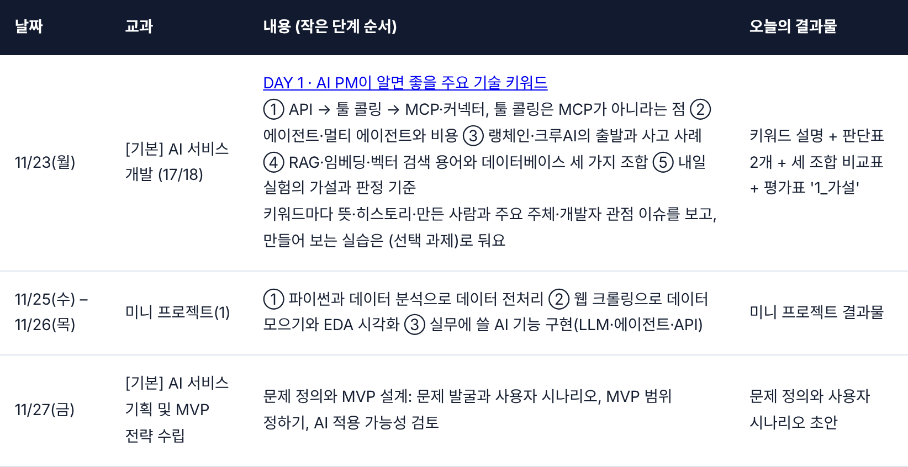

# 5주차 DAY2(RAG 비교 실험) 숨김 (2026-11-23)

- 교안(병합 후): https://loreenkim0301.github.io/swy-lecturenote/261123-ai-pm-week5/
- DAY2 파일 `261123-ai-pm-week5/d2-rag-experiment.html`은 지우지 않고 그대로 둠(주소를 직접 넣으면 열림)

## 바뀐 것 (HTML 주석 `<!-- 5주차 DAY2 숨김(2026-11-23): … -->`으로 감쌈)
| 파일 | 주석 처리한 것 |
|---|---|
| 261123-ai-pm-week5/index.html | 상단 메뉴의 'DAY 2 RAG 비교 실험' 링크, 일정표 11/24(화) 줄, 주간 흐름의 '화 RAG 실험' 칸 |
| 261123-ai-pm-week5/d1-principles-db.html | 상단 메뉴의 'DAY 2 RAG 비교 실험' 링크 |
| 261116-ai-pm-week4/index.html | 일정표 11/24(화) 줄 |

되살릴 때는 주석 표시만 지우면 돼요.

## 확인한 것
- 세 페이지에서 DAY2로 가는 링크 0개, '11/24(화)' 글자 보이지 않음

## 남은 글자(주석 처리하지 않음)
- 5주차 홈: 소개 문장의 '월·화', 목표의 실험 문장, '가설 먼저, 실험은 그다음', 준비물의 '화요일 실험에 쓸 API 키'
- 월요일 교안: SESSION 5 '내일 실험 설계'

