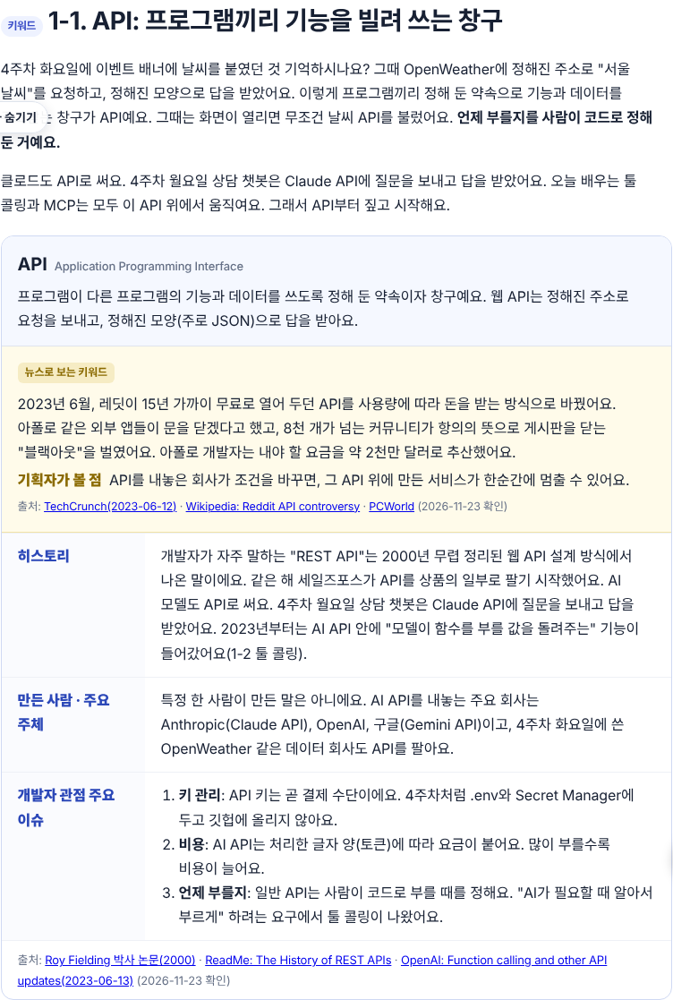
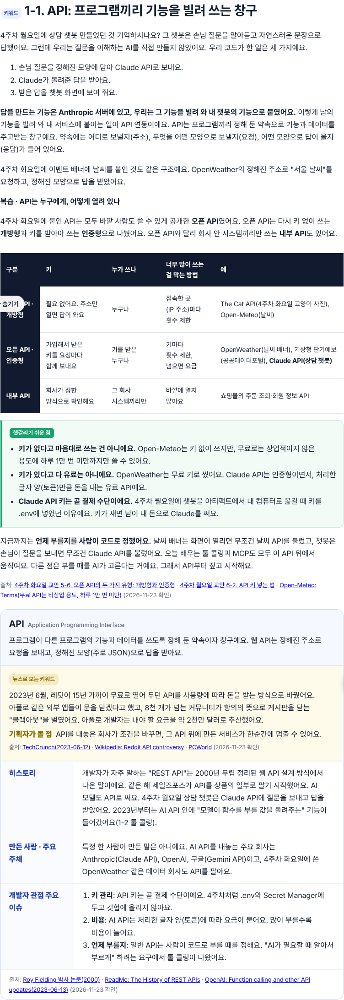
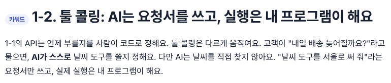
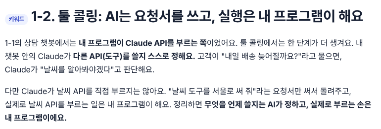

# 5주차 DAY 1 · 1-1 API 인트로 재구성 / 1-2 툴 콜링 도입 문구 변경 (2026-11-23)

대상 파일: `261123-ai-pm-week5/d1-principles-db.html`

## 무엇을 바꿨나
### 1-1. API: 프로그램끼리 기능을 빌려 쓰는 창구
- 인트로를 4주차 월요일 상담 챗봇에서 시작하도록 바꿈: 우리 코드가 한 일 3단계(보내기→받기→보여 주기) → "답을 만드는 기능을 빌려 와 내 챗봇 기능으로 붙인 것 = API 연동"
- API 약속의 3요소(주소·요청·응답) 추가, 날씨 배너 예시는 뒤로 이동
- **복습 표 추가**: 4주차 화요일 5-6 용어 그대로 사용 — 오픈 API · 개방형(키 없음) / 오픈 API · 인증형(키 필요) / 내부 API
  - Claude API를 "인증형 + 유료"로 위치시킴
- TIP "헷갈리기 쉬운 점": 키 없음 ≠ 무제한(Open-Meteo 비상업·하루 1만 번 미만), 키 있음 ≠ 유료, Claude API 키 = 결제 수단(.env 이유)
- "언제 부를지를 사람이 코드로 정했다" 문장을 1-1 끝으로 옮겨 1-2로 넘어가는 다리로 사용
- 출처 줄 추가(4주차 화요일 5-6, 4주차 월요일 6-2, Open-Meteo Terms)

### 1-2. 툴 콜링 도입 문구
- "1-1에서는 내 프로그램이 Claude API를 부르는 쪽 → 툴 콜링에서는 내 챗봇 안의 Claude가 다른 API(도구)를 쓸지 정함"으로 비교 구조화
- 핵심 문장: **무엇을 언제 쓸지는 AI가 정하고, 실제로 부르는 손은 내 프로그램**

## 캡처
| 전 | 후 |
|---|---|
|  |  |
|  |  |

참고: 캡처의 표 왼쪽 위 "숨기기" 버튼은 화면에 고정된 교안 빠른메뉴(FAB)가 캡처에 겹친 것으로, 표 레이아웃 문제가 아님.
