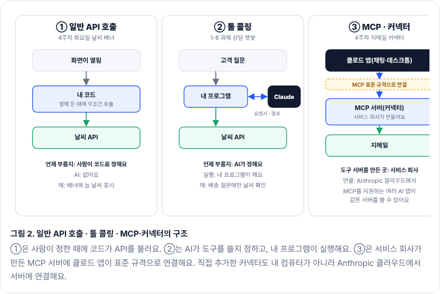
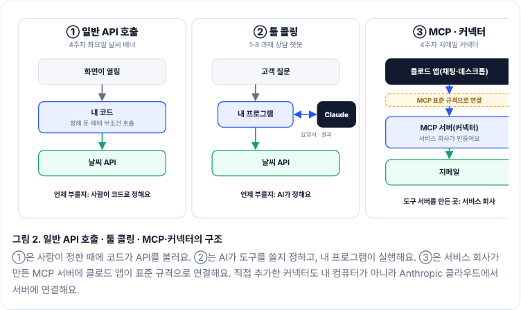

# 5주차 DAY 1 · 1-4 비교 도식(그림 2) 하단 설명 문구 삭제 (2026-11-23)

대상 파일: `261123-ai-pm-week5/d1-principles-db.html` · `#fig-structure`

## 바꾼 것
①②③ 도식 아래 굵은 제목 줄은 남기고, 그 아래 회색 설명 줄만 지움.
- ① 일반 API 호출: "AI: 없어요", "예: 배너에 늘 날씨 표시"
- ② 툴 콜링: "실행: 내 프로그램이 해요", "예: 배송 질문에만 날씨 확인"
- ③ MCP·커넥터: "연결: Anthropic 클라우드에서", "MCP를 지원하는 여러 AI 앱이 같은 서버를 쓸 수 있어요"

지운 만큼 빈 공간이 남지 않도록 카드 높이(410→345)와 SVG 높이(430→365)를 줄임. 그림 아래 캡션(그림 2 설명)은 그대로 둠.

## 캡처
| 전 | 후 |
|---|---|
|  |  |
