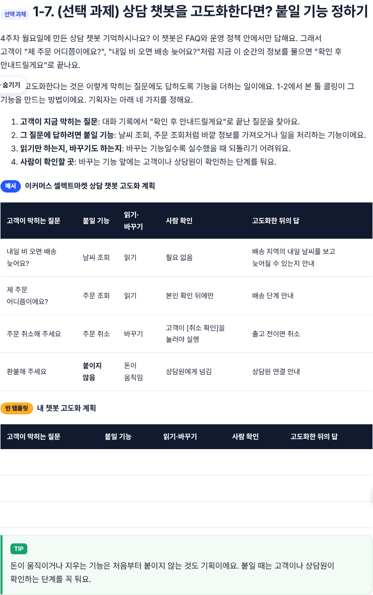
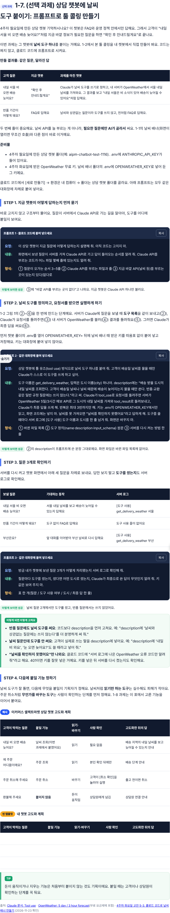

# 5주차 DAY 1 · 1-7 선택 과제를 "날씨 도구 붙이기" 실습으로 재구성 (2026-11-23)

대상 파일: `261123-ai-pm-week5/d1-principles-db.html`

## 문제
1-7이 "붙일 기능 정하기" 계획표뿐이라, 만든 챗봇에 AI + 툴 콜링을 실제로 붙이는 과정(프롬프트로 "외부 날씨 API를 가져와 답하게 해 줘")이 보이지 않았음.

## 바꾼 것
- 제목: 「1-7. (선택 과제) 상담 챗봇에 날씨 도구 붙이기: 프롬프트로 툴 콜링 만들기」 (왼쪽 목차도 같이 변경)
- **만들 결과물** 표: 같은 질문에 지금 챗봇 / 과제 후 챗봇의 답 비교, 날씨와 상관없는 질문에는 도구를 쓰지 않는다는 점 강조
- **준비물**: 4주차 월요일 챗봇 폴더(.env의 ANTHROPIC_API_KEY), 4주차 화요일 OpenWeather 무료 키(OPENWEATHER_KEY)
- **STEP 1** 프롬프트 1: 지금 구조 묻기(코드 수정 없이)
- **STEP 2** 프롬프트 2: get_delivery_weather 도구 정의 + tool_use → OpenWeather 5일/3시간 예보 → tool_result 반복(최대 3번), 서버 로그에 [도구 사용] 기록
- **STEP 3** 질문 3개 확인 표 + 프롬프트 3(서버 로그로 도구 사용 여부 확인) + 막힐 때 고치는 법
- **STEP 4** 다음에 붙일 기능 정하기: 기존 고도화 계획표·빈 템플릿·TIP을 그대로 옮김(1-8이 이 표를 참조하므로 유지)
- 1-6 결과 칸, 과제 안내 줄, 1-8 첫 문장을 새 1-7에 맞게 수정

## 캡처
| 전 | 후 |
|---|---|
|  |  |
