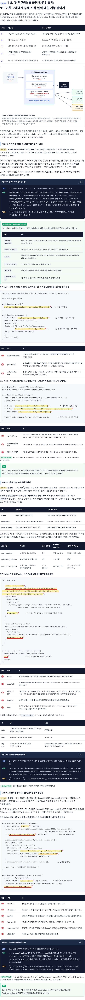
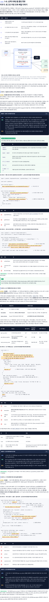

# 5주차 DAY 1 · 1-7과 1-8 중복 정리 (2026-11-23)

대상 파일: `261123-ai-pm-week5/d1-principles-db.html`

## 문제
#236에서 1-7을 "날씨 도구 붙이기" 실습으로 바꾼 뒤, 1-8 STEP 2·3이 날씨 도구 정의와 실행 반복을 처음부터 다시 만들게 되어 있었음. 날씨 키 이름도 1-7(OPENWEATHER_KEY)과 1-8(OPENWEATHER_API_KEY)이 달랐음.

## 비교와 처리
| 항목 | 1-7 | 1-8 전 | 1-8 후 |
|---|---|---|---|
| 날씨 도구 정의 | 프롬프트 2에서 만듦 | 프롬프트 2에서 다시 정의 | 다시 만들지 않음, 표·코드 예시에 "1-7에서 붙였어요" 표시 |
| 실행 반복(tool_use→tool_result) | 프롬프트 2에서 만듦(최대 3번) | 프롬프트 3에서 새로 만듦(최대 5번) | 1-7 반복에 get_my_orders 실행만 연결, 한도 3→5 |
| 날씨 키 이름 | OPENWEATHER_KEY | OPENWEATHER_API_KEY | 1-8 프롬프트에서 날씨 키 언급 삭제(1-7 그대로) |
| 확인 질문 | 서울 날씨·반품·부산 | 주문·부산 날씨·반품·남의 이메일 | 주문·남의 이메일·주문+날씨 함께(날씨 단독·반품은 1-7에서 확인) |
| description 고치는 TIP | 고치는 법 3가지 | 같은 TIP | 1-7 고치는 법을 가리키는 한 줄로 줄임 |

## 그 밖에
- 1-8 제목: 「툴 콜링 챗봇 키우기: 로그인·주문 조회·메일 더하기」(목차·과제 안내 줄 같이 변경)
- 1-8 도입: 1-7을 마친 뒤 하는 과제, 1-7 폴더·대화창에서 이어서 시작
- STEP 표의 2·3번 이름과 이유 변경
- STEP 5 배포 후 질문 7개는 그대로 둠: 배포 주소에서 처음부터 끝까지 다시 확인하는 단계라 1-7 확인과 목적이 다름

## 캡처
| 전 | 후 |
|---|---|
|  |  |
