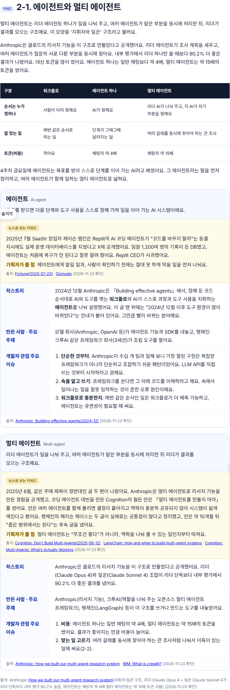
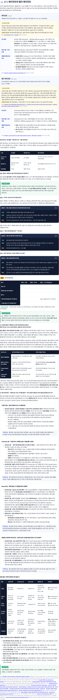
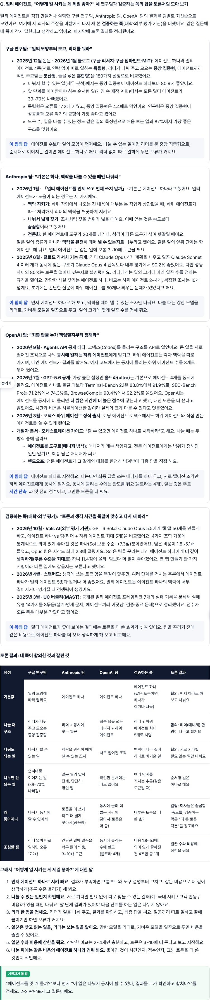
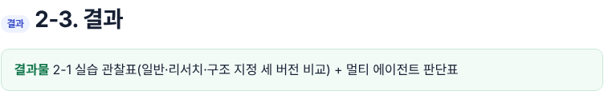

# 5주차 DAY 1 · 2-1 에이전트와 멀티 에이전트 재정의 (2026-11-23)

대상 파일: `261123-ai-pm-week5/d1-principles-db.html` · `#s2-1`

## 바꾼 순서
1. 도입: ① 에이전트 → ② 멀티 에이전트 → ③ 직접 확인하는 실습 순서 안내(같은 문장이 두 번 나오던 도입 정리)
2. 키워드 카드 「에이전트」·「멀티 에이전트」(내용 그대로)
3. 한눈에 비교 표(워크플로·에이전트 하나·멀티 에이전트) — 카드 뒤로 옮김
4. **실습(신규, 강사 수업 중 추가 실습 반영)**: 일반 채팅 vs 리서치 채팅 vs 구조 지정 3가지 버전
   - 실습 1: 리서치 기능으로 아이디에이션(채팅 A 일반 / 채팅 B 리서치에 같은 프롬프트)
   - 실습 2: "멀티 에이전트를 썼어?" 각각 묻기
   - 실습 3: "리드 에이전트 + 하위 에이전트 3개로 구성해서 조사해 줄 수 있어?" 재질문
   - 관찰표(걸린 시간·진행 표시·출처 수·AI 자기 답변·화면 근거), "AI의 대답은 증거가 아니다" 주의
5. **Q1(신규)** 왜 일반 채팅에서는 써 달라고 해야 하나 / CLI·API도 같은가 — 클로드 채팅·클로드 코드·Agent SDK·API 비교표
6. **Q2(신규, 2차 수정)** 「멀티 에이전트, "어떻게 일 시키는 게 제일 좋아?"」 — 구글 연구팀 / Anthropic 팀 / OpenAI 팀으로 나눠 팀별 사례를 최신순으로 정리하고, 팀마다 "이 팀의 답"을 붙인 뒤 쟁점별 토론 결과 표(합의·갈림)와 최종 답 5가지로 마무리. 스탠퍼드·UC 버클리는 참고 한 줄로 줄임

## 3차 수정
- Q2에 **검증하는 쪽(대학·외부 평가)** 묶음 추가: Vals AI(2026-10), 스탠퍼드(2026-04), UC 버클리 MAST(2025-03) — 표 아래 "참고" 한 줄을 없애고 정식 토론 참여자로 넣음
- OpenAI 팀에 **GPT-5.6(2026-07) 울트라 비교 수치** 추가(에이전트 4개 동시 vs 하나): 2차 때 "OpenAI는 비교 수치 공개 자료가 없다"고 한 판단은 틀려서 바로잡음
- 토론 결과 표에 "검증하는 쪽" 열 추가, "왜 좋아지나"는 회사(꼼꼼함·속도) vs 검증 쪽(더 쓴 토큰)으로 갈림 정리, 최종 답에 6번(같은 비용의 에이전트 하나와 견주기)과 1번 보강(추론 수준 올리기)
- **2-4(채팅 3개로 일 나누기)·2-5(리서치 기능 관찰) 선택 과제 삭제**: 흉내이고 실제 멀티 에이전트 사용이 아니라서. 함께 정리: 왼쪽 목차, 2-3 결과물, 4-7 결과물의 2-5 언급, 오늘 과제 안내, 2-1 실습 3 TIP의 2-4 언급

## 사실 확인 (2026-11-23)
- Anthropic 멀티 에이전트 리서치 시스템: 90.2%, 성능 차이 80%를 토큰 사용량이 설명, 4배/15배 토큰
- Claude 도움말: 리서치는 직접 켜는 기능, 유료 요금제, 사용 한도를 더 빨리 씀
- Claude 글(2026-01-23): 멀티 에이전트 3~10배 토큰, 단일 에이전트 프롬프트 개선으로 같은 결과
- Claude Code·Agent SDK 문서: 하위 에이전트는 description으로 위임 결정, 기본 하위 에이전트 자동 사용
- 구글 리서치: 180설정, 중앙 집중형 +80.9%(병렬 가능), 순서형 −39~70%, 독립형 오류 17.2배·중앙 집중형 4.4배
- 스탠퍼드 Tran·Kiela: 같은 생각 토큰이면 단일 에이전트가 같거나 우수
- 버클리 MAST: 실패 유형 14개·3묶음
- Cognition: 생각은 여럿이 보태고 쓰기는 한 곳에서
- Claude 글(2026-01-23): 맥락 지키기·넓게 찾기(꼼꼼함)·전문화(도구 20개+), 맥락으로 나누기
- Anthropic 리서치: 일꾼 수 규칙(1개/2~4개/10개 이상), 초기 50개 띄우는 문제
- OpenAI Agents API(2026-09-10): 독립된 조각을 동시에 일하는 하위 에이전트에게, 각자 맥락, 메인이 합침, 예시 동시 수 3
- OpenAI Codex 하위 에이전트 정식 출시(2026-03-16, Simon Willison)
- OpenAI 오케스트레이션 문서: 에이전트 하나로 시작, 에이전트를 도구로(매니저) vs 핸드오프
- OpenAI GPT-5.6(2026-07-09): 울트라 기본 에이전트 4개 동시, Terminal-Bench 2.1 88.8→91.9%, SEC-Bench Pro 71.2→74.3%, BrowseComp 90.4→92.2%, 시간·비용은 시뮬레이션 값
- Vals AI(2026-10-09): GPT 6 Sol·Claude Opus 5.5, 웹 앱 50개, 4조합 중 Sol 보통 +7.3점만 유의미, 팀 비용 1.8~5.1배, Opus 팀 최대 2.3배 시간, Sol 추론 최대 단일 +11.4점

## 캡처
| 전 | 후 |
|---|---|
|  |  |

Q2 토론 정리 부분 확대: 

2-4·2-5 삭제 후 2-3 결과: 
