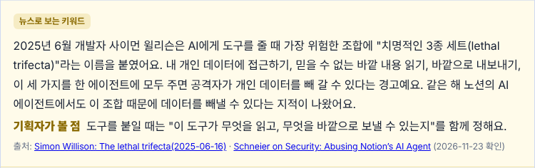
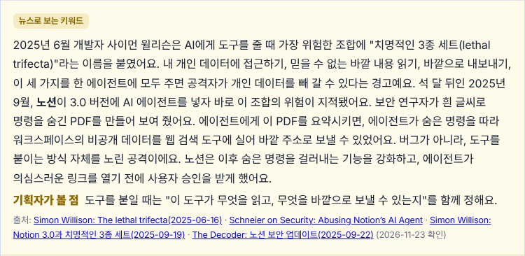
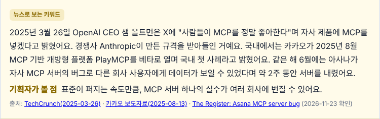
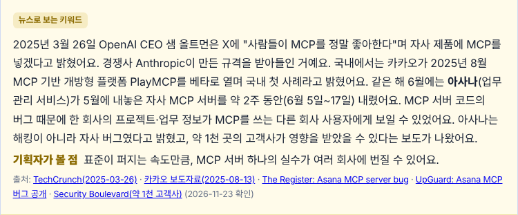

# 5주차 DAY 1 · 노션·아사나 뉴스 구분 (2026-11-23)

대상 파일: `261123-ai-pm-week5/d1-principles-db.html`

## 문제
노션과 아사나 사례가 서로 다른 카드에 한 문장씩만 있어서, 어느 회사에 무슨 일이 있었는지 구분이 안 됐음.

## 사실 확인 결과 (2026-11-23)
| | 노션 | 아사나 |
|---|---|---|
| 들어간 카드 | 1-2 툴 콜링 | 1-3 MCP |
| 시기 | 2025년 9월(노션 3.0 출시 직후) | 2025년 6월 5일~17일 서버 중단(5월 1일 출시, 6월 4일 발견) |
| 무슨 일 | 흰 글씨로 명령을 숨긴 PDF로 AI 에이전트를 속여 비공개 데이터를 웹 검색 도구로 바깥에 보낼 수 있음을 보안 연구자가 시연 | MCP 서버 버그로 한 회사의 정보가 다른 회사 MCP 사용자에게 보일 수 있었음 |
| 성격 | 외부 공격(프롬프트 인젝션), 도구 조합 문제 | 내부 버그(해킹 아님, 아사나 발표) |
| 이후 | 숨은 명령 탐지 강화, 의심 링크는 사용자 승인 | 서버 수정 후 재가동, 연결 초기화 |

## 바꾼 것
- 1-2 카드 노션 문장을 시기·방법·성격·후속 조치까지 풀어 씀, 노션에 굵게 표시
- 1-3 카드 아사나 문장에 서비스 설명·기간·원인·해킹 아님·약 1천 고객사(보도) 추가, 아사나에 굵게 표시
- 각 카드 출처에 확인한 기사 추가

## 캡처
| 전 | 후 |
|---|---|
|  |  |
|  |  |
