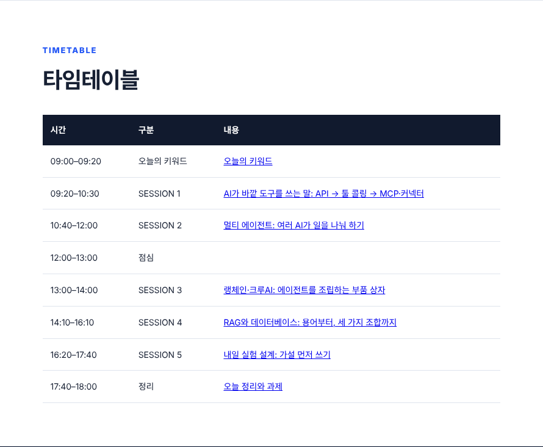
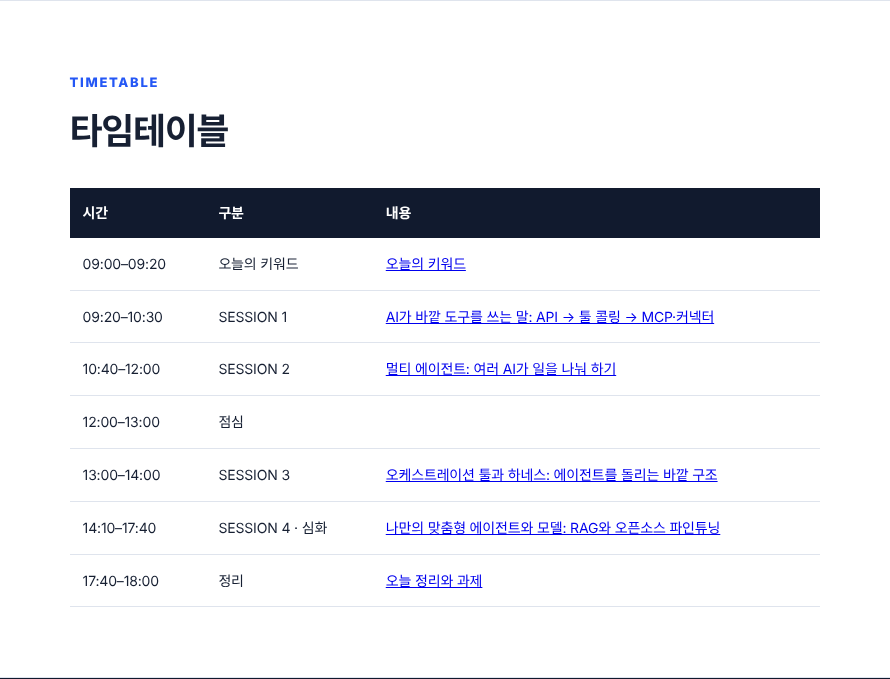
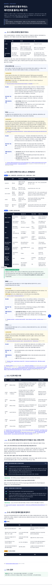
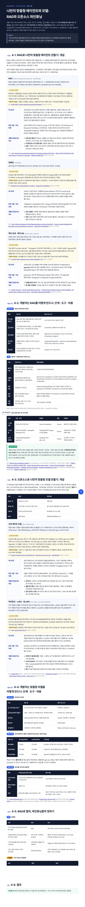
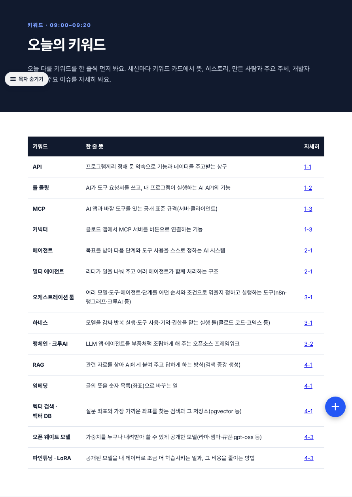
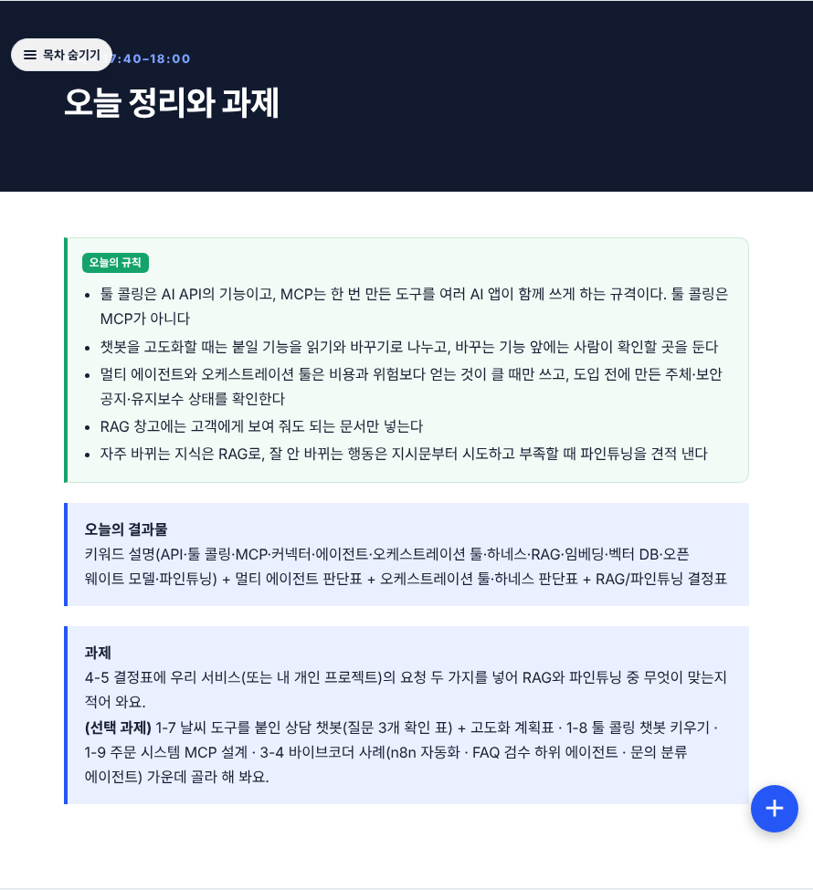

# 5주차 DAY 1 · 세션 3 재구성(오케스트레이션 툴·하네스) + 세션 4·5 통합(심화: RAG 맞춤형 에이전트·오픈소스 맞춤형 모델) (2026-11-23)

대상 파일: `261123-ai-pm-week5/d1-principles-db.html`
※ 이 브랜치는 #239(2-1 Q2 재반영·2-4/2-5 삭제) 위에 만들었어요. #239를 먼저 머지해 주세요.

## SESSION 3 · 오케스트레이션 툴과 하네스: 에이전트를 돌리는 바깥 구조 (13:00–14:00)
- 3-1 키워드: 모델(엔진) / 하네스(차체) / 오케스트레이션 툴(배차 관제실) 층 구분 표 + 키워드 카드 「오케스트레이션 툴」「하네스」 신규
- 3-2 발전 단계 표(체인 → 자율 에이전트 → 멀티 에이전트·노코드 → 모델 회사 SDK → 하네스가 상품) + 주요 도구 표(분류, 처음 만든 주체, **개인/대기업**, 안정성·이슈) + 기존 랭체인·크루AI 카드 유지
- 3-3 사고 사례 7건 시간순: Octomind·Langflow(CISA 실제 공격)·크루AI 토큰·LangGrinch·n8n Ni8mare·OpenClaw 악성 스킬·CERT 크루AI
- 3-4 (선택 과제) 바이브코더 사례 3가지: n8n 메일 요약→슬랙 / 클로드 코드 FAQ 검수 하위 에이전트 / Claude Agent SDK 문의 분류 에이전트(프롬프트 포함)
- 3-5 판단표 갱신, 3-6 결과
- 삭제: 기존 3-2 기업 사례·투자 표(키워드 중심으로 압축)

## SESSION 4 · 심화: 나만의 맞춤형 에이전트와 모델 (14:10–17:40, 기존 4·5 통합)
- 4-1 RAG로 맞춤형 에이전트: 개념 + 기존 RAG·임베딩·벡터 카드 유지
- 4-2 개발자 접근: 파이프라인 5단계(도구), 비용 표(물리: GPU 불필요 / 임베딩 1,000문서 ≈ 19원 / 저장 무료 시작 / 생성 토큰이 대부분 / 사람 비용), 세 가지 조합 압축 표, RAG 창고 원칙
- 4-3 오픈소스로 맞춤형 모델: RAG vs 파인튜닝 표 + 카드 「오픈 웨이트 모델」「파인튜닝·LoRA·QLoRA」 신규
- 4-4 개발자 접근: 파인튜닝 5단계(도구), GPU 메모리 표(Unsloth 최소값), GPU 대여비(런팟 H100 시간당 1.99~2.89달러 ≈ 2,700~3,900원)
- 4-5 RAG/파인튜닝 결정표 + 빈 템플릿, 4-6 결과
- 삭제: 기존 4-3 DB 종류, 4-4 인기 DB, 4-6 데이터 나누기 표(원칙만 4-2로), 세션 5(내일 실험 가설) 전체

## 함께 고친 곳
상단 소개·준비물·오늘의 결과물, 교육 개요(목표·수업이 끝나면), 수업 전 준비(RAG 평가표 줄 삭제), 타임테이블, 오늘의 키워드 표(오케스트레이션 툴·하네스·오픈 웨이트 모델·파인튜닝 추가, DB·가설 삭제), 왼쪽 목차, 오늘의 규칙·결과물·과제, 카드 안 "내일 실험" 언급

## 사실 확인 (2026-11-23)
- Microsoft Agent Framework(2025-10-01 공개 미리보기, AutoGen·SK 유지보수 상태)
- OpenAI Agents API(2026-09-10, 하네스 문구), Claude Code SDK → Claude Agent SDK 이름 변경(2025-09-29, 같은 하네스)
- Anthropic 하네스 글(2025-11-26, 2026-03)
- AutoGPT(2023-03-30, 토란 브루스 리처즈), LlamaIndex(2022-11 제리 리우), n8n(2019 베를린 얀 오버하우저), Langflow(Logspace → 2024-04 DataStax), OpenAI Agents SDK(2025-03-11), Google ADK(2025-04-09), Codex 하위 에이전트(2026-03-16), OpenClaw(피터 슈타인베르거, 2026-02 OpenAI 합류)
- Langflow CVE-2025-3248(9.8, CISA KEV), n8n CVE-2026-21858(10.0, 취약 서버 10만+ Cyera 추정), ClawHub 악성 스킬 341/2,857(Koi), OpenClaw 노출 서버 24,478(Cyera)
- OpenAI text-embedding-3-small 100만 토큰당 0.02달러, gpt-oss(2025-08-05, 아파치 2.0, 20b는 16GB), QLoRA(65B를 48GB GPU 1장, 780GB→48GB), Unsloth VRAM 표, Unsloth 창업(2023 한 형제), 런팟 H100 시간당 1.99/2.89달러, 원/달러 1,330원대 후반(2026-11-17 연합뉴스) → 1달러≈1,340원으로 계산

## 캡처
| 전 | 후 |
|---|---|
|  |  |

- 세션 3 후: 
- 세션 4 후: 
- 오늘의 키워드 후: 
- 정리 후: 
