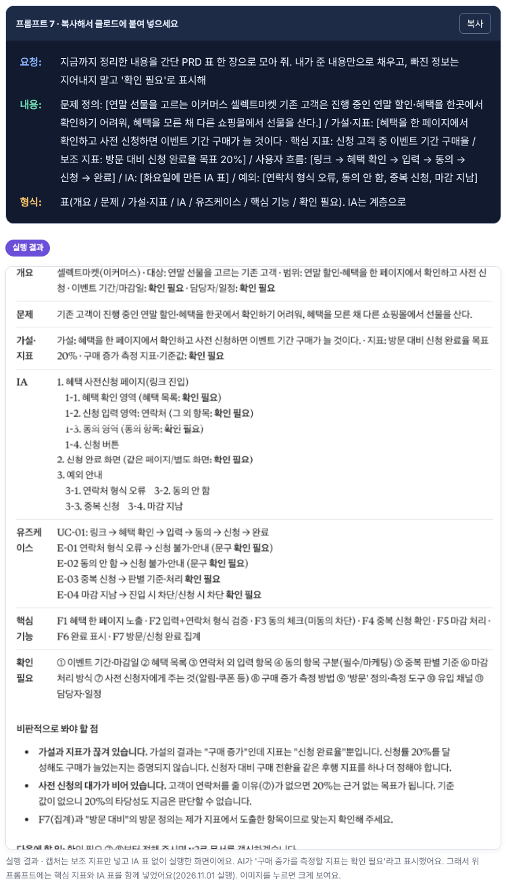
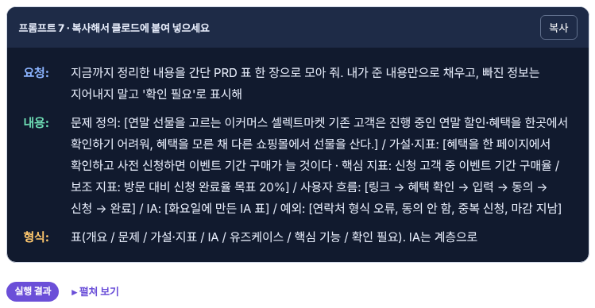
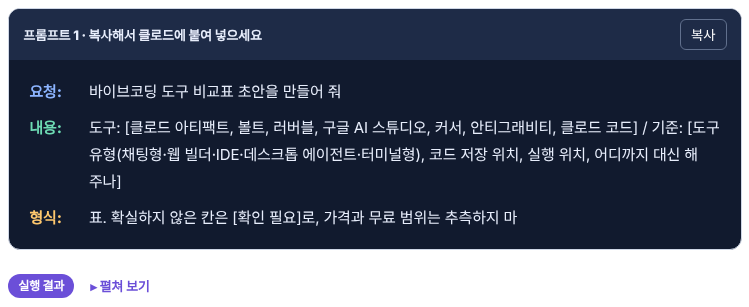
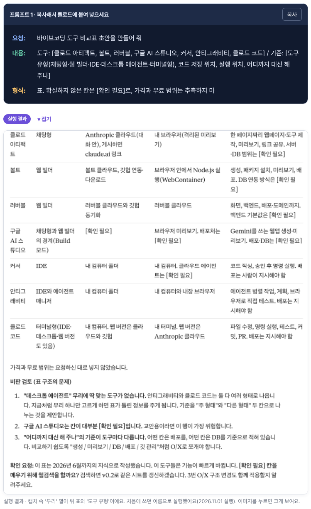
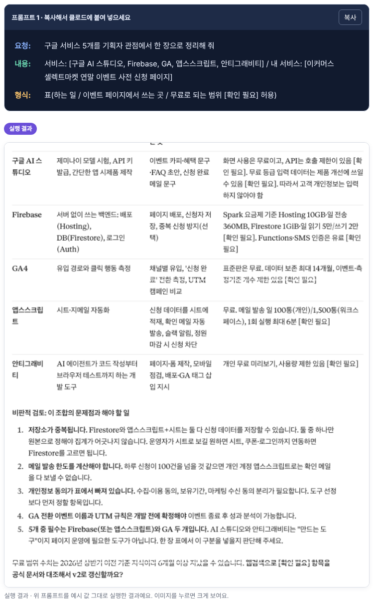
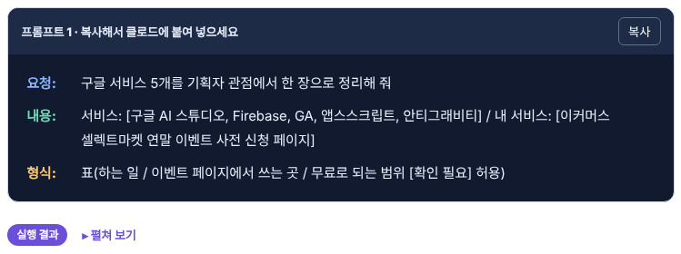
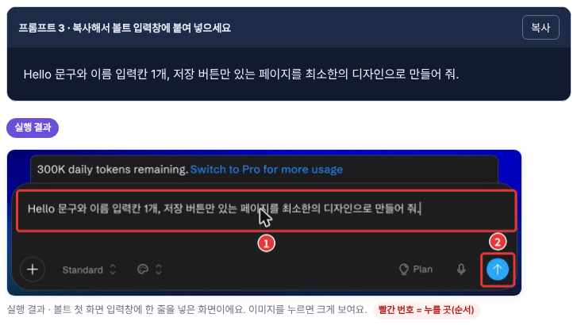
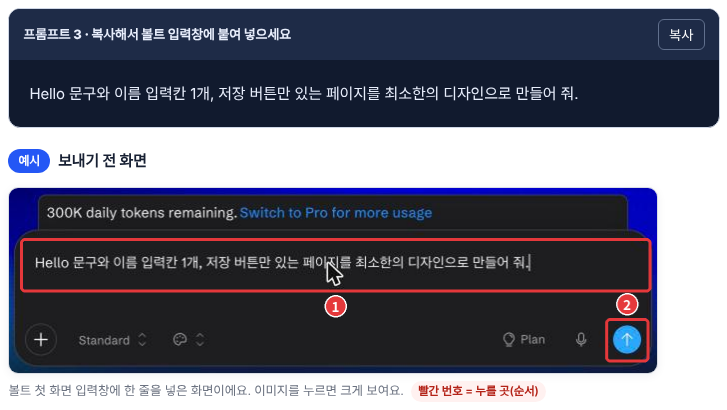

# PR #139 · 실행 결과 캡처 토글 (2026-11-05)

## 한 줄 요약
수·목·금 교안의 **프롬프트 실행 결과 캡처 13장**을 `[실행 결과 ▸ 펼쳐 보기]` 토글로 닫았어요. 학생이 먼저 직접 해 보고, 필요할 때만 펼쳐 비교하게 하려는 변경이에요.

## 무엇을 바꿨나
| 파일 | 요일 | 절 | 바뀐 내용 |
| --- | --- | --- | --- |
| `d3-deploy-localdb.html` | 수요일 | 3-3, 5-3(2개), 6-4, 7-2, 8-3, 9-2, 10-2, 11-2, 12-2 | 10장 토글로 닫음 |
| `d4-vibe-tools-bolt.html` | 목요일 | 1-3 | 1장 토글로 닫음 |
| `d4-vibe-tools-bolt.html` | 목요일 | 2-2 | 「실행 결과」→「예시 · 보내기 전 화면」, 펼친 채 유지 |
| `d5-google-firebase.html` | 금요일 | 1-3, 3-2 | 2장 토글로 닫음 |
| `d5-google-firebase.html` | 금요일 | 2-2 | 「실행 결과」→「예시 · 보내기 전 화면」, 펼친 채 유지 |
| `common/lecture-rules.md` | 규칙서 | 11장 | 실행 결과 캡처는 토글로 닫는다(누를 곳 캡처는 예외) 1줄 추가 |

**코드로 보면**
- 전: `
실행 결과
<figure>…</figure>`
- 후: `

실행 결과 ▸ 펼쳐 보기
<figure>…</figure>
` (처음엔 닫힘, 누르면 열림)
- 각 파일 `<style>`에 토글 모양 CSS 7줄 추가(`/* 실행 결과 캡처 토글 */`)

## 화면으로 보면 (전 → 후)

### 수요일 3-3 · 프롬프트 7 아래
| 전 (캡처가 바로 펼쳐져 있음) | 후 (닫힘) | 후 (펼쳤을 때) |
| --- | --- | --- |
|  |  |  |

### 목요일 1-3 · 프롬프트 1 아래
| 전 (캡처가 바로 펼쳐져 있음) | 후 (닫힘) | 후 (펼쳤을 때) |
| --- | --- | --- |
|  |  |  |

### 금요일 1-3 · 프롬프트 1 아래
| 전 (캡처가 바로 펼쳐져 있음) | 후 (닫힘) | 후 (펼쳤을 때) |
| --- | --- | --- |
|  |  |  |

### 목요일 2-2 · 닫지 않은 예외
입력창(①)과 보내기 화살표(②)를 표시한 **누를 곳 캡처**라서 규칙서 12장에 따라 닫지 않았어요. 실제로는 결과가 아니라 보내기 전 화면이라 표시만 바로잡았어요. 금요일 2-2(AI 스튜디오)도 같아요.

| 전 | 후 |
| --- | --- |
|  |  |

## 확인한 것
- 로컬에서 세 파일을 열어 토글 13개가 모두 닫힌 상태로 시작하는지 확인(수 10 · 목 1 · 금 2)
- 토글을 누르면 캡처가 열리고 「▾ 접기」로 바뀌는지 확인
- 페이지 오류 0건, 깨진 이미지 0장

## 확인 못 한 것
- GitHub Pages 배포 화면은 병합 후에만 볼 수 있어요: [수](https://loreenkim0301.github.io/swy-lecturenote/261102-ai-pm-week2/d3-deploy-localdb.html#s3-3) · [목](https://loreenkim0301.github.io/swy-lecturenote/261102-ai-pm-week2/d4-vibe-tools-bolt.html#s1-3) · [금](https://loreenkim0301.github.io/swy-lecturenote/261102-ai-pm-week2/d5-google-firebase.html#s1-3)
- 슬라이드 보기에서 토글이 어떻게 보이는지는 보지 않았어요

## 리뷰 포인트
- 목·금 2-2의 「보내기 전 화면」 2장도 닫아야 하는지
