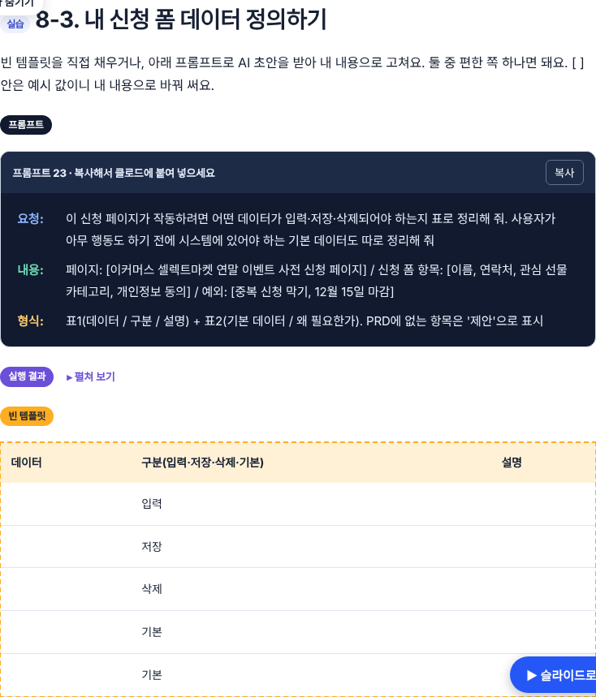
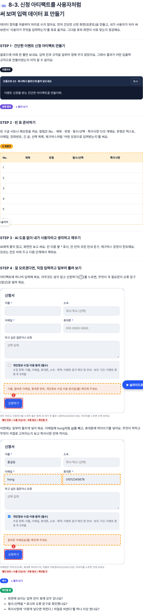
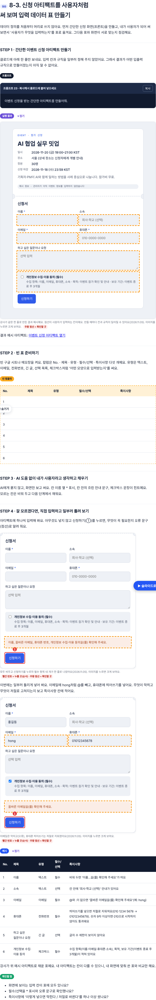
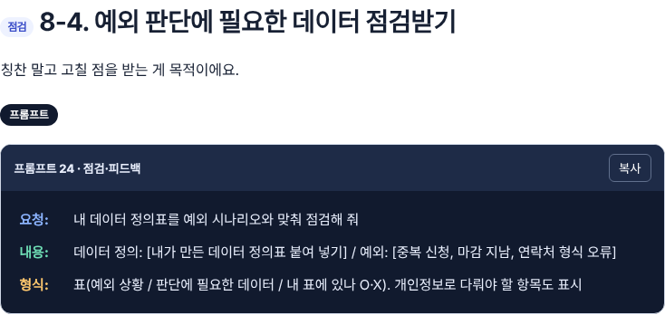
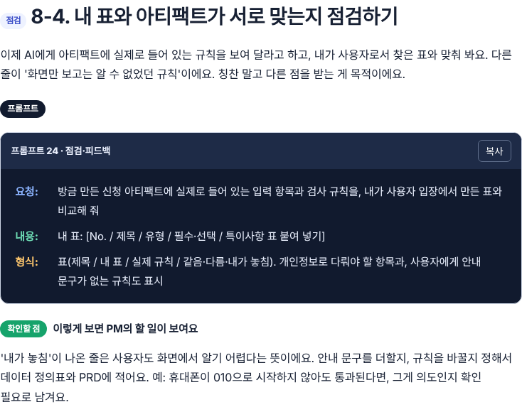

# PR #140 · 수요일 8-3 사용자 입력 데이터 표 실습 (2026-11-05)

## 한 줄 요약
수요일 8-3 실습을 '데이터 정의를 처음부터 쓰기'에서 **'간단한 신청 아티팩트를 만들고, 사용자처럼 써 보며 입력 데이터 표를 직접 만든 뒤, 아티팩트와 맞는지 점검하기'**로 바꿨어요.

## 무엇을 바꿨나
| 파일 | 절 | 전 | 후 |
| --- | --- | --- | --- |
| `261102-ai-pm-week2/d3-deploy-localdb.html` | 8-3 | 「내 신청 폼 데이터 정의하기」 · 빈 템플릿(데이터/구분/설명) 또는 AI 초안 프롬프트 | 「신청 아티팩트를 사용자처럼 써 보며 입력 데이터 표 만들기」 · STEP 1~4 |
| 같은 파일 | 8-3 STEP 1 | – | 프롬프트 "이벤트 신청을 받는 간단한 아티팩트를 만들어줘." + 결과 예시 캡처(토글) + 예시 아티팩트 링크 |
| 같은 파일 | 8-3 STEP 2 | 빈 템플릿 칼럼: 데이터 · 구분 · 설명 | 빈 템플릿 칼럼: **No. · 제목 · 유형 · 필수/선택 · 특이사항** (6줄) |
| 같은 파일 | 8-3 STEP 3 | – | AI 도움 없이 화면만 보고 채우기(힌트: * 표시, 안내 문구, 체크박스 문장) |
| 같은 파일 | 8-3 STEP 4 | – | 직접 입력·일부러 틀려 보기 캡처 2장(빈 칸 제출 오류 / 이메일 오류·휴대폰 띄어쓰기 자동 삭제) + 완성 예시 표(토글) + 확인할 점 |
| 같은 파일 | 8-4 | 「예외 판단에 필요한 데이터 점검받기」 | 「내 표와 아티팩트가 서로 맞는지 점검하기」 · 비교 프롬프트(같음·다름·내가 놓침) |
| 같은 파일 | 8-5 | 결과물: 데이터 정의표 v1 | 결과물: 사용자 입력 데이터 표 + 비교 점검표 |
| `images/` | – | `d3-s1-start.png`(이전 AI 초안 결과) | 삭제. 새 캡처 `d3-s8-artifact-form` · `-error-all` · `-error-email`(+ 누를 곳 표시 `-hl`) |

- 이전 프롬프트 23(AI로 데이터 정의 초안 받기)을 빼서, 뒤 프롬프트 번호가 하나씩 당겨졌어요(새 점검 프롬프트 1개를 더해 수요일 프롬프트는 33개 그대로).
- 캡처는 예시 아티팩트를 로컬에서 띄워 가상의 값(홍길동, hong, 010 1234 5678)으로 찍었어요. 실제 신청 데이터는 건드리지 않았어요.

## 화면으로 보면 (전 → 후)
전·후를 나란히 보려면 **이 문서** 를 눌러요.
- 8-3: [전](01_%EC%88%98%EC%9A%94%EC%9D%BC_8-3_%EC%A0%84.png) · [후(토글 닫힘)](01_%EC%88%98%EC%9A%94%EC%9D%BC_8-3_%ED%9B%84.png) · [후(토글 펼침)](01_%EC%88%98%EC%9A%94%EC%9D%BC_8-3_%ED%9B%84_%ED%8E%BC%EC%B9%A8.png)
- 8-4: [전](02_%EC%88%98%EC%9A%94%EC%9D%BC_8-4_%EC%A0%84.png) · [후](02_%EC%88%98%EC%9A%94%EC%9D%BC_8-4_%ED%9B%84.png)

## 확인한 것
- 페이지 오류 0건, 깨진 이미지 0장, 왼쪽 목차에 새 8-3·8-4 제목 반영
- 캡처 속 오류 문구는 예시 아티팩트 코드의 검사 규칙과 같음(이름 빈칸, 이메일 @·., 휴대폰 숫자·-·+ 9자 이상, 동의 체크)

## 확인 못 한 것
- 배포 화면은 병합 후 확인: [수요일 8-3](https://loreenkim0301.github.io/swy-lecturenote/261102-ai-pm-week2/d3-deploy-localdb.html#s8-3)
- 학생마다 STEP 1 결과 아티팩트의 칸이 달라질 수 있어요. 완성 예시 표는 강사 예시 아티팩트 기준이에요

## 리뷰 포인트
- 8-2(입력·저장·삭제·기본 예시 표)는 그대로 두었어요. 새 8-3과 순서가 맞는지 봐 주세요
- 예시 아티팩트 링크(claude.ai 아티팩트)를 학생에게 그대로 공개해도 되는지

## 캡처 (전 · 후)
<table><tr><th>8-3 전</th><th>8-3 후(닫힘)</th><th>8-3 후(펼침)</th></tr><tr><td></td><td></td><td></td></tr></table>

<table><tr><th>8-4 전</th><th>8-4 후</th></tr><tr><td></td><td></td></tr></table>
