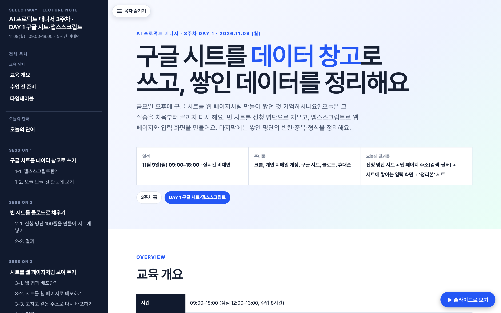
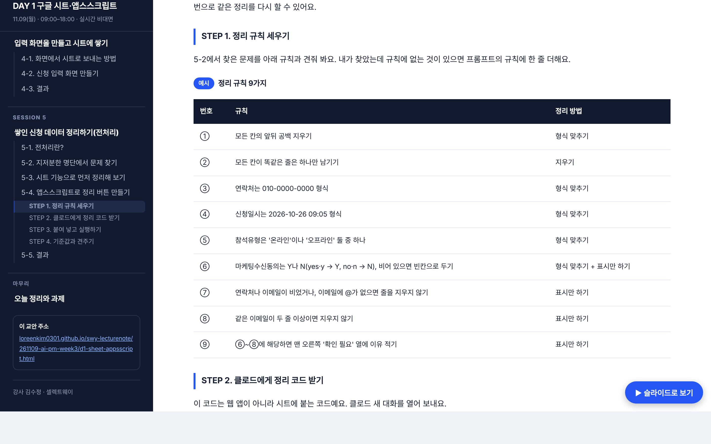
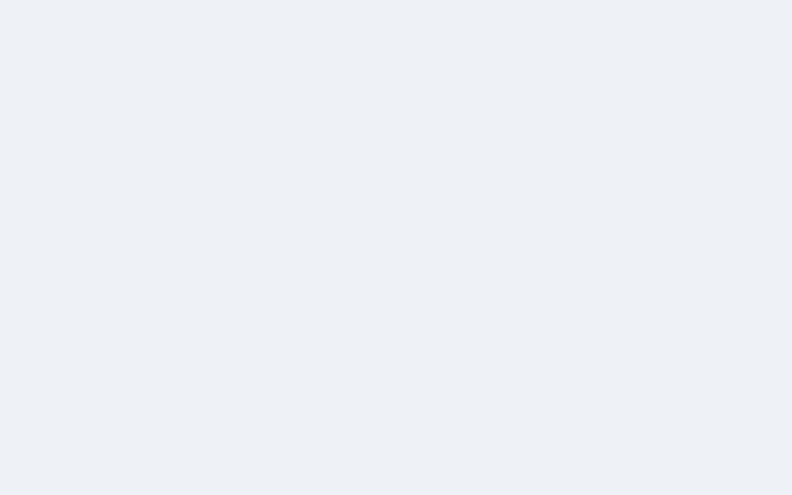
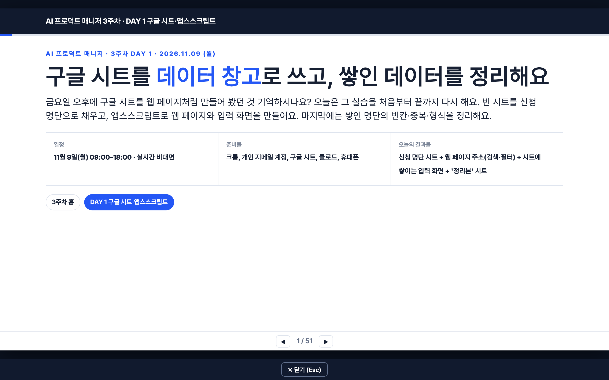
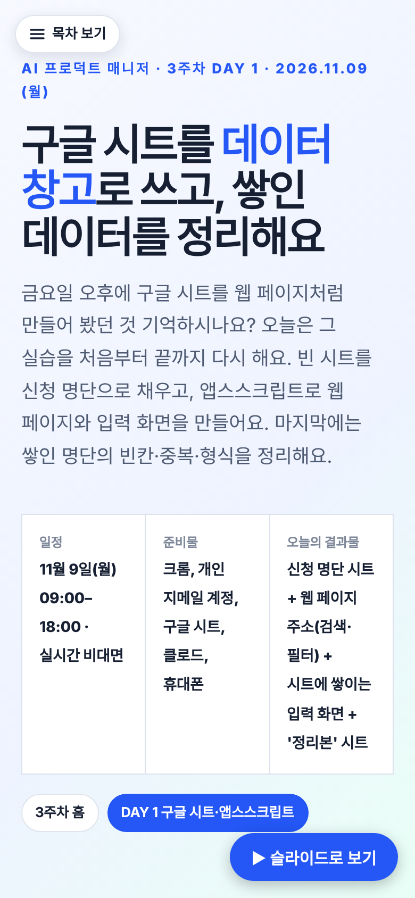
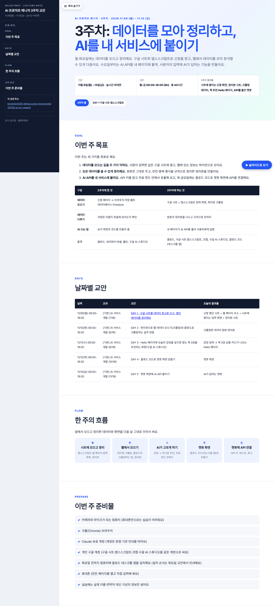
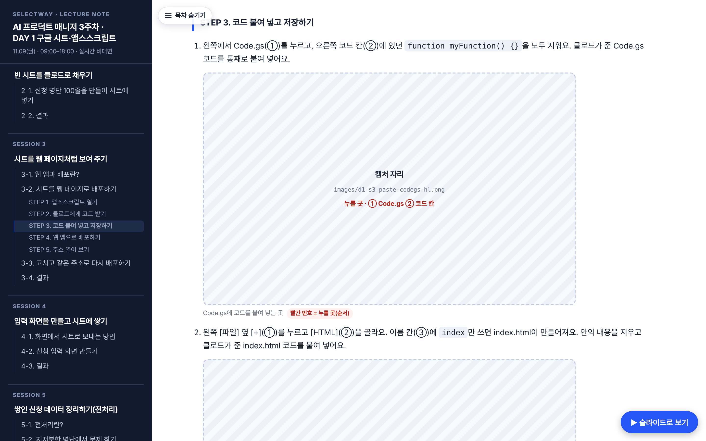
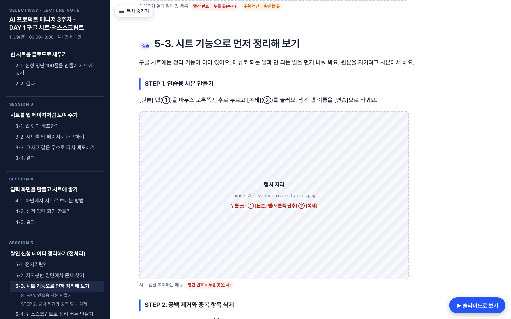
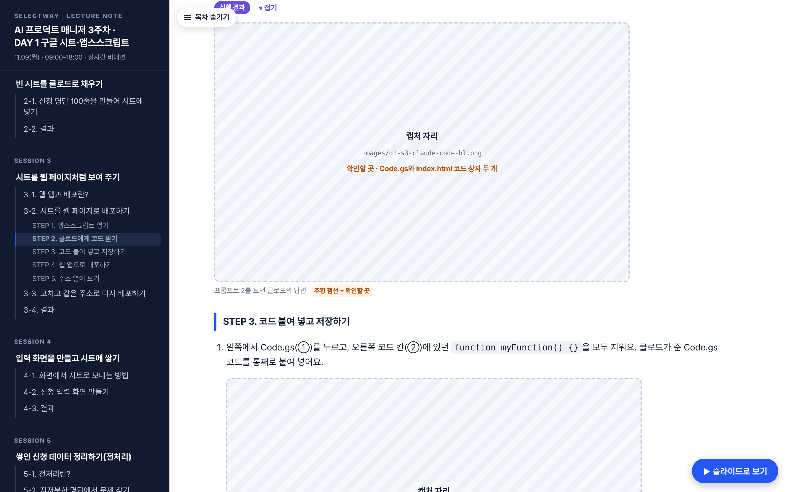
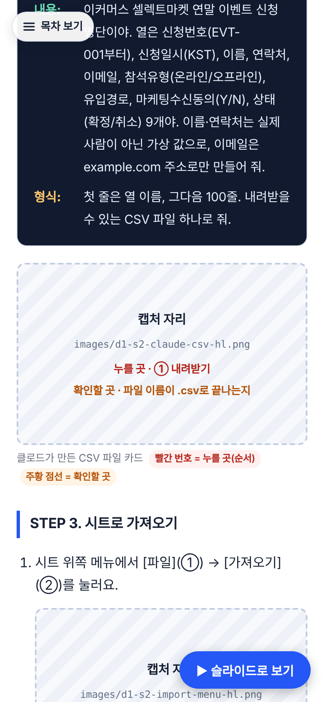

# PR #141 · AI PM 3주차 폴더 신설 + 월요일 교안

신규 페이지라 '전' 캡처는 없고 '후'만 있어요. 2026-11-08 KST, 로컬 서버 + Playwright(2배 해상도)로 찍었어요.

| 장면 | 후 |
|---|---|
| 월요일 교안 첫 화면 |  |
| 5-4 정리 규칙 9가지·STEP 목차 |  |
| 3-2 웹 앱 배포 실습 |  |
| 슬라이드 보기(1/51) |  |
| 휴대폰 390px |  |
| 3주차 홈(전체) |  |

## 2차 커밋 · 실습 캡처 자리 42곳 (2026-11-08)

모든 실습 단계에 캡처 자리를 넣었어요. 자리마다 파일 이름, 누를 곳(빨간 번호), 확인할 곳(주황 점선)을 적었고, 본문 단계 문장에도 같은 번호(①②③)를 달았어요. 프롬프트 실행 결과 캡처 10곳은 [실행 결과] 토글로 닫아 두었어요. 전체 목록은 [캡처목록.md](캡처목록.md)에 있어요.

| 장면 | 후 |
|---|---|
| 3-2 STEP 3 캡처 자리 |  |
| 5-3 캡처 자리 |  |
| 실행 결과 토글 펼침 |  |
| 휴대폰 390px |  |
