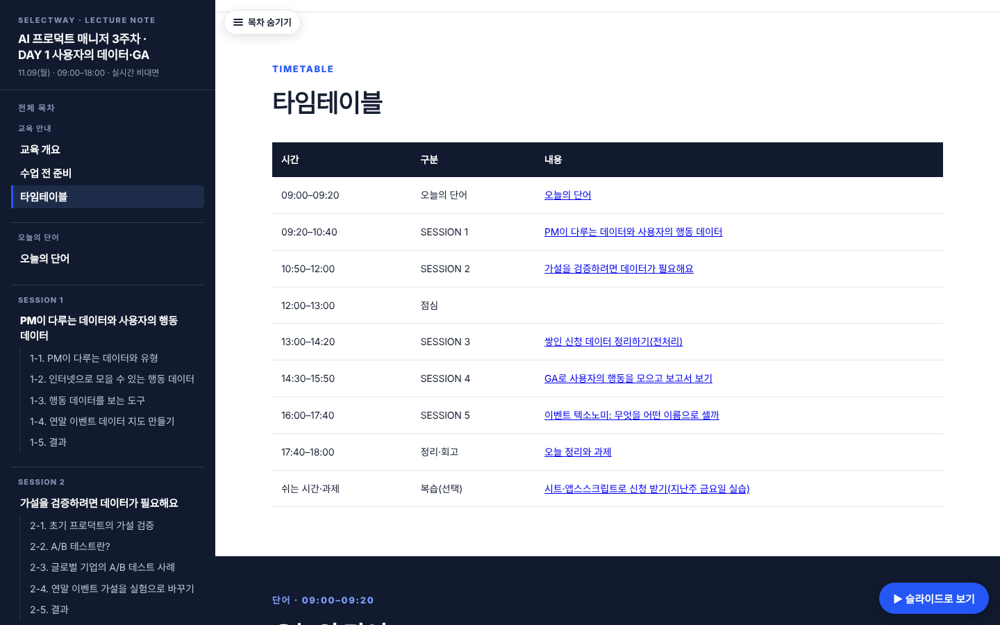
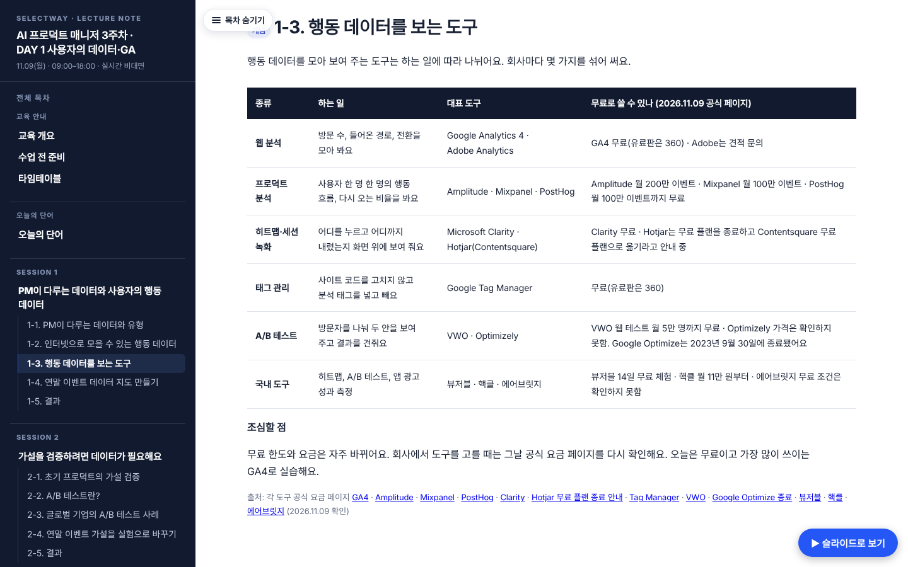
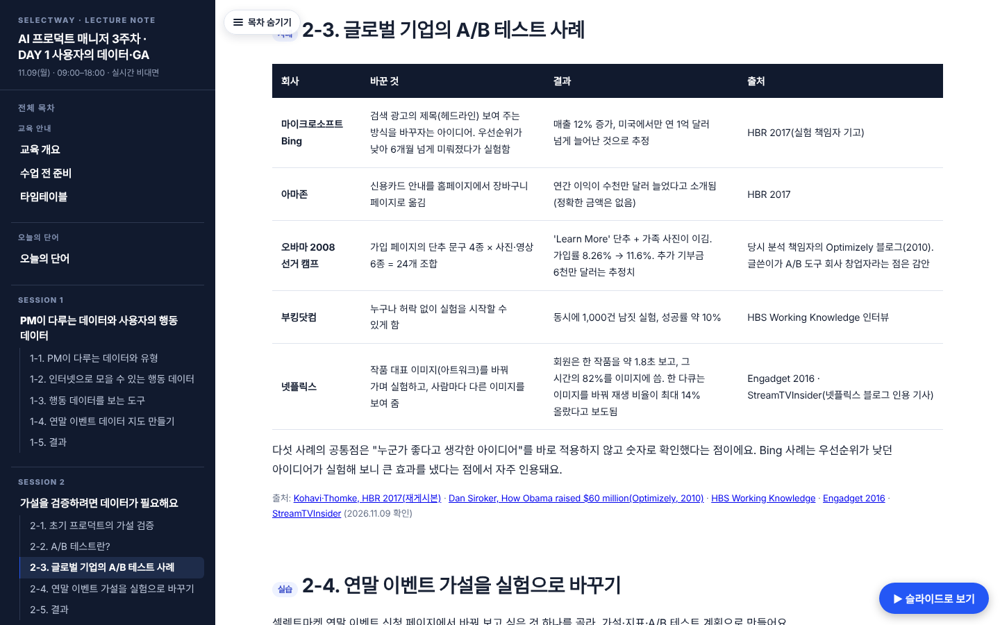
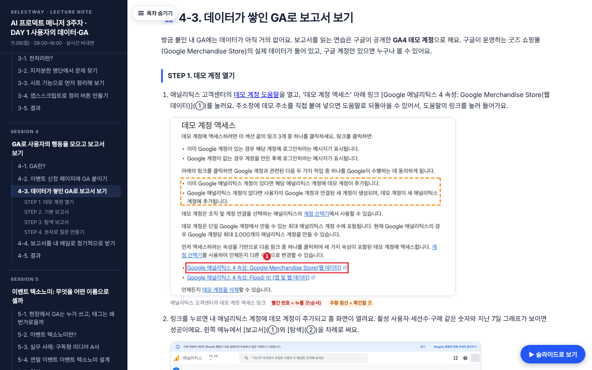
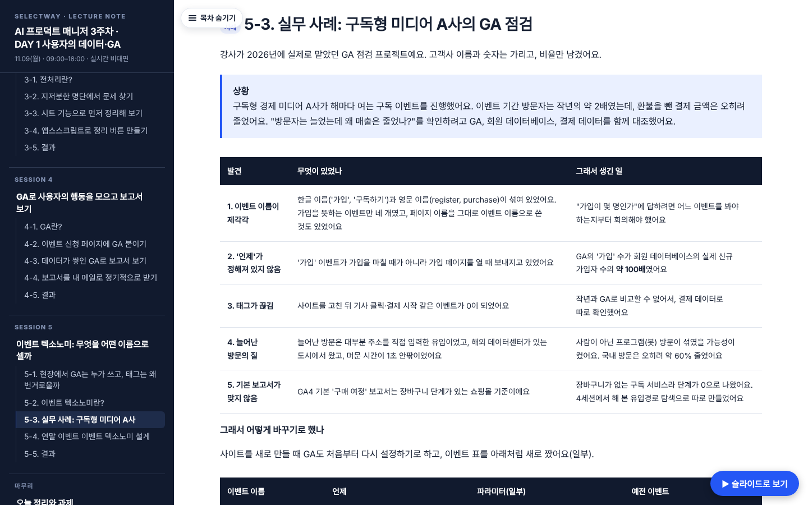
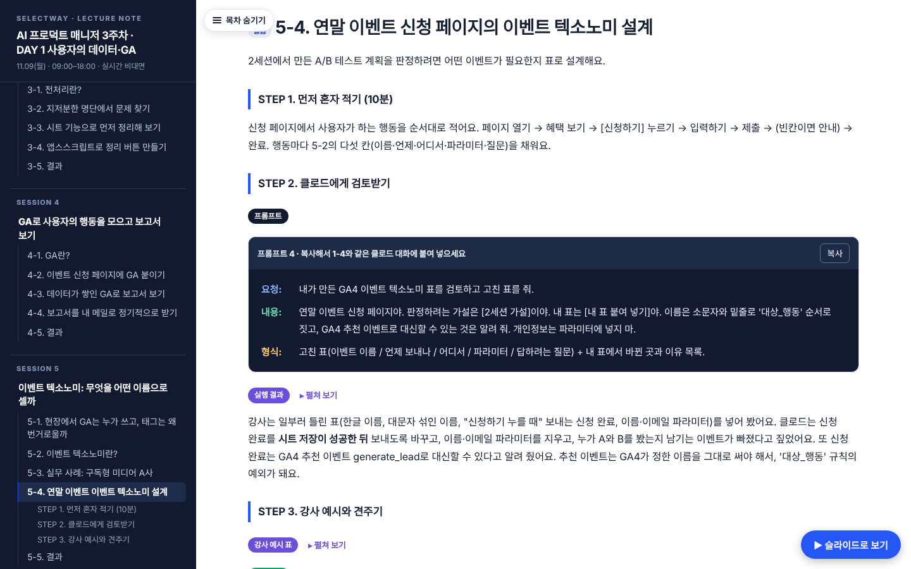
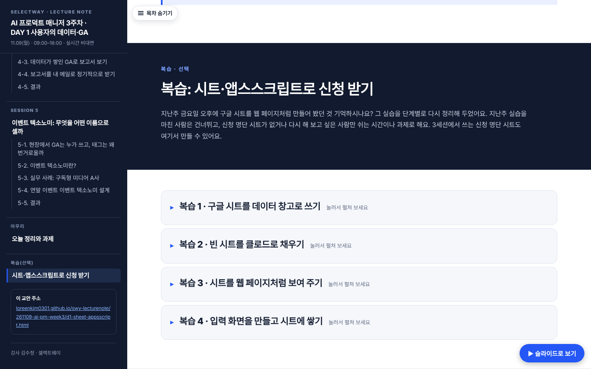

## 산출물 링크
- 월요일 교안(브랜치): https://github.com/loreenkim0301/swy-lecturenote/blob/claude/ai-pm-week3-d1-data-intro/261109-ai-pm-week3/d1-sheet-appsscript.html
- 병합 후 공개 주소: https://loreenkim0301.github.io/swy-lecturenote/261109-ai-pm-week3/d1-sheet-appsscript.html
- 자료 수집 정리 문서: 프로젝트 문서 claude/AI_PM_3주차_DAY1_데이터개론_자료수집_v1_로린_261109.md

## ① 무엇을 바꿨나
지난주 금요일에 한 시트·앱스스크립트 실습과 겹치는 부분은 맨 아래 **복습(선택)**으로 접었어요. 그리고 앞부분에 데이터 개론을 넣고, GA 부분을 늘렸어요.

| 시간 | 세션 | 내용 |
|---|---|---|
| 09:20–10:40 | S1 (새로 씀) | PM이 다루는 데이터 유형, 인터넷으로 모을 수 있는 행동 데이터(GA4 향상된 측정 이벤트), 분석 도구 종류·무료 여부, 실습: 데이터 지도 |
| 10:50–12:00 | S2 (새로 씀) | 가설 검증(Build–Measure–Learn·MVP·AARRR), A/B 테스트, 글로벌 사례 5개(Bing·아마존·오바마 2008·부킹닷컴·넷플릭스), 에어비앤비의 함정 사례, 실습: A/B 테스트 계획 |
| 13:00–14:20 | S3 (예전 S5) | 전처리. 번호와 상호 참조만 바꿈 |
| 14:30–15:50 | S4 (예전 S6 + 새 4-3·4-4) | GA 붙이기, GA4 데모 계정으로 보고서 보기(트래픽 획득, 유입경로 탐색에 장바구니 단계 넣기), 보고서를 내 메일로 정기적으로 받기 |
| 16:00–17:40 | S5 (새로 씀) | 현장에서 GA를 쓰는 사람과 태그 작업 흐름, 이벤트 텍소노미 개념·이름 규칙, 고객사 익명 사례(구독형 미디어 A사), 실습: 텍소노미 설계 |
| 쉬는 시간·과제 | 복습(선택) | 예전 S1~S4를 접어서 유지. 번호는 '복습 2-1'처럼 바꿈 |

- 오늘의 단어 7개를 추가했어요. 타임테이블, 목차, 정리·과제, 주간 홈 결과물 문구도 바꿨어요.
- DAY 1 이름은 '구글 시트·앱스스크립트'에서 '사용자의 데이터·GA'로 바꿨어요. 3주차 6개 파일의 이동 메뉴에 반영했어요.

## ② 실제로 해 보고 넣은 캡처 (2026-11-09)
- GA4 데모 계정 8장: 도움말 링크, 홈, 트래픽 획득, 탐색 첫 화면, 유입경로 기본, 단계 수정, 장바구니 단계로 바꾸기, 결과
- 클로드 답변 5장: 프롬프트 1(데이터 지도) 2장, 프롬프트 2(A/B 계획) 2장, 프롬프트 4(텍소노미 검토) 1장
- GA 새 속성 만들기 6장: 계정, 속성, 플랫폼, 스트림, 태그 안내, 태그 복사
- GA 보고서 메일 6장: 데모 계정 공유 메뉴, 관리자 속성 공유 메뉴, 이메일 보내기, 받은 메일(주소 가림), 예약, 예약 목록
- 구글 권한 승인 1장(d1-s3-allow, 주소 가림)
- 3세션 데이터 정리 3장: 메뉴, 알림 창(원본 124줄 → 정리본 118줄, 확인 필요 18줄로 기준값과 같음), 정리본 시트
- 해 보고 알게 된 것
  - 데모 계정은 보기 권한만 있어서 예약 이메일을 만들 수 없어요. 관리자 권한이 있는 속성에서 해야 해요(공식 도움말 answer/13722168).
  - 데모 계정 주소를 주소창에 바로 넣으면 도움말로 돌아와요. 도움말의 링크를 눌러야 열려요.
  - 유입경로에서 세션 시작 → 장바구니 단계를 넘어간 비율은 3.6%였어요. 휴대폰은 1.15%, PC는 10.22%였어요(지난 28일 기준).
  - 클로드는 '선착순 100명' 문구가 실험에 필요한 인원 수와 맞지 않는다는 문제를 먼저 짚었어요.
  - 클로드는 신청 완료 이벤트를 GA4 추천 이벤트 generate_lead로 바꾸고, 신청이 저장된 뒤에 보내라고 고쳤어요. 공식 추천 이벤트 목록에서 다시 확인한 뒤 강사 예시 표에 반영했어요.

## ③ 출처
- 공식·1차 출처로 확인한 것만 넣었어요. 출처 줄마다 확인 날짜(2026.11.09)를 적었어요.
- 2차 출처만 있는 것은 교안에 그렇다고 밝혔어요. 넷플릭스 수치는 기사 인용이고, 오바마 캠프의 6천만 달러는 추정치예요.
- 무료 플랜
  - Hotjar는 무료 플랜 종료 안내가 있어서 '무료'라고 쓰지 않았어요.
  - Optimizely 가격과 에어브릿지 무료 조건은 '확인하지 못함'으로 적었어요.

## ④ 고객사 자료 익명화
- 더밀크 두 자료(6주년 GA 분석 md, GA 현재 분석·TOBE 보고서)를 썼어요.
- 교안에는 '구독형 경제 미디어 A사'로만 적었어요. 회사 이름, URL, 금액, 실제 수치는 넣지 않았어요.
- 숫자는 비율만 남겼어요: 약 2배, 약 100배, 약 60% 감소.
- TOBE 이벤트 표는 이름 규칙을 보여 주는 6줄만 넣었어요.

## ⑤ 점검
- id 중복 0, 깨진 앵커 0, 깨진 이미지 0, 페이지 오류 0이에요.
- 390px 화면에서 가로 스크롤이 생기지 않아요.
- 슬라이드는 131장이에요.

## ⑥ 남은 일·주의
- 이 브랜치는 PR #146(문구 정리) 위에서 만들었어요. 그래서 이 PR에 #146의 커밋도 함께 보여요. 이 PR만 병합해도 두 변경이 모두 들어가요.
- 캡처 자리 16개가 남아 있어요.
  - 복습 3·4의 웹 앱 화면 10개: 웹 앱 '모든 사용자' 배포 뒤에 찍을 수 있어요.
  - 4-2의 GA 연결 화면 5개: 2주차 페이지에 GA 태그를 넣고 다시 배포해야 찍을 수 있어요.
  - d1-s3-unverified 1개: 회사(Workspace) 계정에서는 '확인되지 않은 앱' 경고가 나오지 않아요. 개인 Gmail 계정으로 찍어야 해요.
- 데모 계정의 숫자는 날짜마다 달라져요. 교안에는 '강사가 11/9에 본 숫자'라고 밝혀 두었어요.

## ⑦ 병합
- 로린 님이 "병합해"라고 하시면 병합할게요.

🤖 Generated with [Claude Code](https://claude.com/claude-code)

https://claude.ai/code/session_01C4uqyAL9psqyp3PzBZ6jMH
