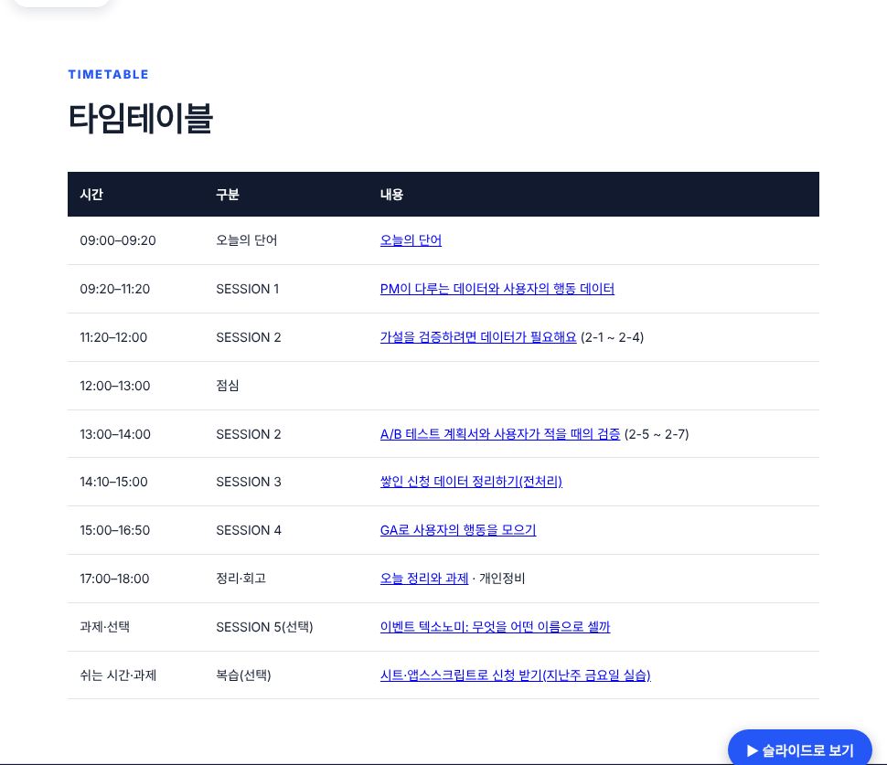
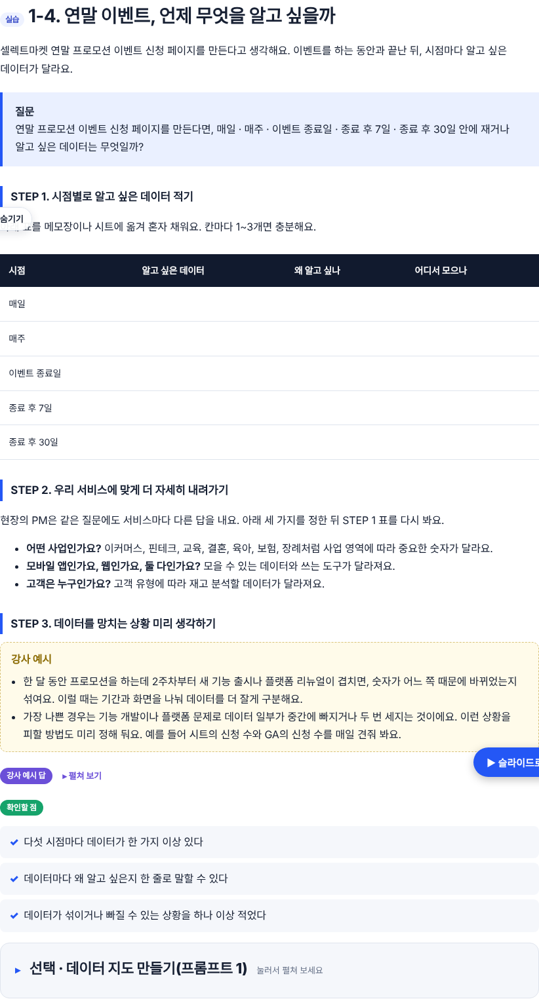
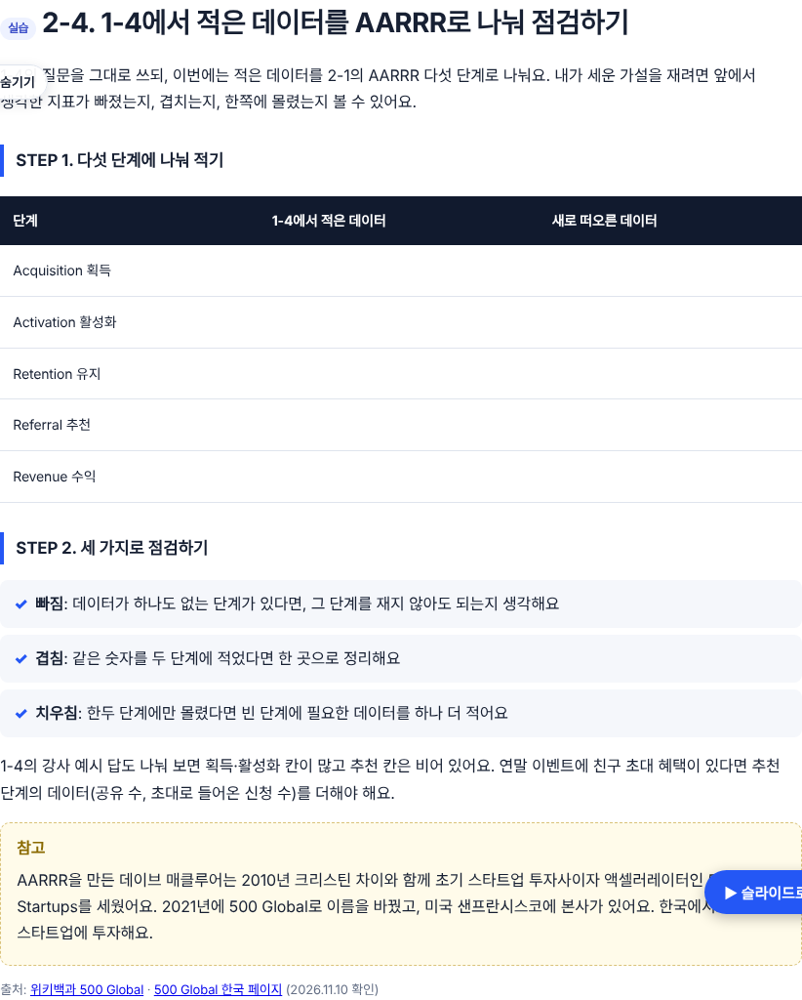
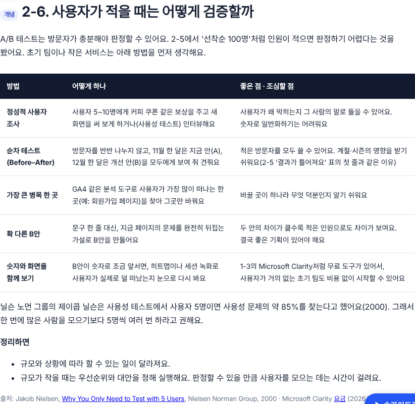
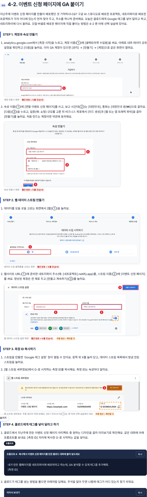

## 산출물 링크
- 월요일 교안(브랜치): https://github.com/loreenkim0301/swy-lecturenote/blob/claude/ai-pm-week3-d1-slack-sync/261109-ai-pm-week3/d1-sheet-appsscript.html
- 병합 후 공개 주소: https://loreenkim0301.github.io/swy-lecturenote/261109-ai-pm-week3/d1-sheet-appsscript.html

## 근거
- 슬랙 #프로덕트-매니저, 11/9(월) 09:00~18:00 강사 메시지
- 수강생 결과물과 이름(베스트케이스 등)은 넣지 않았어요.

## ① 실제 수업에 맞춰 추가·변경한 것
| 위치 | 수업에서 한 것(슬랙 시각) | 교안 반영 |
|---|---|---|
| 1-4 | 10:22 "연말 프로모션 이벤트 신청 페이지를 만든다면, 매일·매주·종료일·종료 후 7일·30일 안에 알고 싶은 데이터는?" / 10:39 현장 PM의 고민(사업 영역·앱/웹·고객 유형) / 10:47 예시2(기능 출시·리뉴얼이 겹칠 때, 데이터 유실·중복) | 1-4를 '연말 이벤트, 언제 무엇을 알고 싶을까'로 바꿈. 빈 표, STEP 2·3, 강사 예시 답 추가 |
| 2-4 (새로 씀) | 11:27 같은 질문의 답을 AARRR 5단계로 나눠 빠짐·겹침·치우침 점검 / 11:32 500 Global 참고 | 실습 2-4 추가. 500 Global은 창업 연도·창업자·이름 변경만 넣음 |
| 2-5 | 13:16 STEP 2 목표 'A/B 테스트 계획서 1장' / 13:32 피드백: 실험 시작·종료일, 보고 일정이 빠짐 | 프롬프트 2 형식에 일정 추가, 강사 피드백과 확인할 점 추가 |
| 2-6 (새로 씀) | 13:53~13:58 작은 규모의 대안(정성 조사, 순차 테스트, 병목 한 곳, 확 다른 B안, 숫자와 녹화 함께 보기), NN/g 5명 원칙, 규모와 상황에 따라 할 수 있는 일이 다름 | 개념 2-6 추가 |
| 4-1 | 15:15 "의도와 설계 없이 나중에 GA를 붙이면 그 전 기록은 되살릴 수 없다" | 조심할 점에 추가 |
| 4-2 | 15:07 AI 스튜디오·네트리파이 배포 프로젝트 찾기 / 15:48 Google 태그 설정 창 X로 닫고 스트림 클릭 / 16:04 측정 ID 복사, 클로드 아티팩트 미리보기 / 16:12·16:17 프롬프트 / 16:21 HTML 변환 시간 / 16:26 zip 파일 / 16:32~16:41 배포 사이트에서 Ctrl+F로 측정 ID 검수 → GA 실시간 | 깃헙·버셀 흐름을 '클로드에게 태그 넣기 → 네트리파이 다시 올리기 → 페이지 소스에서 측정 ID 찾기 → 실시간'으로 바꿈. 프롬프트 4는 수업에서 쓴 문장 그대로 |
| 정리 | 17:19 회고 swy.kr/retrospective | 오늘의 규칙 3줄, 결과물, 회고 링크 추가 |
| 타임테이블 | 실제 진행 시각 | S1 09:20–11:20, S2 11:20–14:00(점심 포함), S3 14:10–15:00, S4 15:00–16:50, 정리 17:00–18:00 |

## ② 선택으로 바꾼 것(수업에서 하지 않음)
- 1-4 데이터 지도(프롬프트 1) → 1-4 안의 '선택' 접기
- 4-2 깃헙·버셀로 직접 붙이기 → 4-2 맨 아래 '선택' 접기(기존 캡처 그대로)
- 4-3 GA4 데모 계정 보고서, 4-4 보고서 메일 예약 → 단계 표시를 '선택'으로 바꾸고 안내 추가
- 5세션 이벤트 텍소노미 → 'SESSION 5 · 선택'. 프롬프트 번호는 4 → 5로 바꿈
- 지운 것은 없어요.

## ③ 출처 확인
- NN/g: Jakob Nielsen, Why You Only Need to Test with 5 Users(2000). "5명이 사용성 문제의 85%"로 적었어요. 슬랙의 "가장 치명적인 UX 문제의 85%"는 원문과 표현이 달라 원문대로 고쳤어요.
- 500 Global: 2010년 데이브 매클루어·크리스틴 차이 창업, 2021년 500 Startups에서 이름 변경(위키백과). 슬랙에 있던 국내 포트폴리오 목록은 확인하지 못해 넣지 않았어요.
- 슬랙의 Hotjar 언급은 무료 플랜 종료 안내(1-3에 적힌 내용)가 있어 'GA4 같은 분석 도구'와 Microsoft Clarity로 적었어요.
- 네트리파이 업로드 칸이 zip 파일을 받는다는 것은 기존 교안(260929) 캡처의 화면 문구로 확인했어요.
- 슬랙의 GA 도움말 링크(answer/6132368)는 열어서 확인하지 못해 넣지 않았어요.

## ④ 주의
- 2-5의 클로드 답변 캡처 2장은 일정 항목을 넣기 전 프롬프트로 받은 답이에요. 계획서 일정 부분은 캡처에 없어요.
- 4-2 STEP 4~5(클로드에 태그 넣기, 네트리파이 다시 올리기)는 캡처가 없어요.

## ⑤ 점검
- id 중복 0, 깨진 앵커 0, 페이지 오류 0, 390px 가로 스크롤 없음

## ⑥ 병합
- 로린 님이 "병합해"라고 하시면 병합할게요.

🤖 Generated with [Claude Code](https://claude.com/claude-code)

https://claude.ai/code/session_01C4uqyAL9psqyp3PzBZ6jMH
