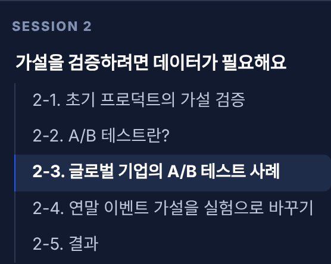
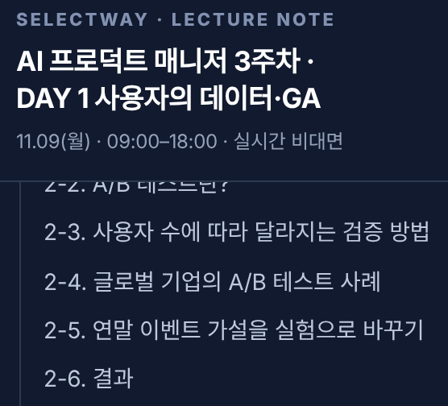
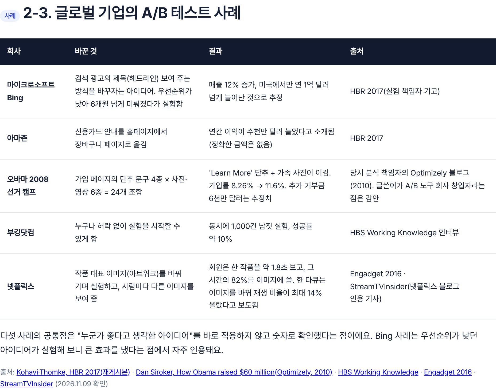
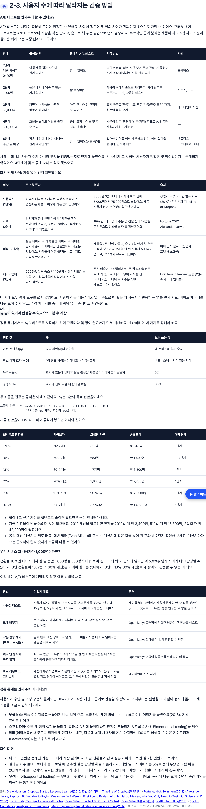

# PR #149 · 3주차 월요일 2-3 사용자 수별 가설 검증과 표본 수 계산 추가 (초안)

- PR: https://github.com/loreenkim0301/swy-lecturenote/pull/149
- 브랜치 파일: https://github.com/loreenkim0301/swy-lecturenote/blob/claude/ai-pm-week3-d1-user-scale-stats/261109-ai-pm-week3/d1-sheet-appsscript.html#s2-3

## ① 한 줄 요약
세션 2에 "사용자 수에 따라 검증 방법이 달라지고, 정통 통계는 사용자가 충분히 모인 뒤의 후순위 도구"라는 절(2-3)을 넣었어요. AI 검색 결과의 사례·숫자는 공식 자료로 다시 확인한 것만 남겼어요.

## ② 바뀐 것
| 파일 | 요일 | 절 | 바뀐 내용 |
|---|---|---|---|
| d1-sheet-appsscript.html | 월 | 2-3 (신규) | 5단계 로드맵 표, 초기 사례 4개(드롭박스·자포스·버퍼·에어비앤비), 표본 수 공식·계산표, MAU 1,000명 계산과 대안 5개, 정통 통계 단계 사례(넷플릭스·스포티파이·메타), 조심할 점, 출처 |
| 같은 파일 | 월 | 2-3~2-5 → 2-4~2-6 | 번호만 이동(본문 그대로), 왼쪽 목차 반영 |
| 같은 파일 | 월 | 2-5 STEP 3 | "그룹마다 몇 명이 필요한지는 2-3의 표본 수 표로 가늠해 봐요" 한 문장 추가 |

## ③ 코드로 보면
- 전: `
<h3>…2-3. 글로벌 기업의 A/B 테스트 사례`
- 후: `
<h3>…2-3. 사용자 수에 따라 달라지는 검증 방법` + 기존 사례 절은 `id="s2-4"`

## ④ 화면으로 보면
| 장면 | 전 | 후 |
|---|---|---|
| 왼쪽 목차 세션 2 |  |  |
| 2-3 절 |  |  |
| 2-3 모바일(390px) | — |  |

## ⑤ 확인한 것
- 원문(AI 검색 결과) 수정: MAU 1,000명 MDE 7.6%p → 5.9%p(공식 재계산), "1,000명에서 20~30% 차이면 유의" → 30% 개선은 약 3,500명 필요, Hotjar=코호트 분석 → 히트맵·녹화, 'Sequential Testing' = 기간 분할 비교 → 통계의 순차 검정(스포티파이 문서), NN/g "5명 인터뷰로 치명적 문제 85%" → 사용성 테스트 5명·문제 85%(닐슨 2000), 정량은 20명
- 사례 재배치: 에어비앤비 사진은 4단계 A/B가 아니라 데이터 없이 시작한 1주 전·후 비교(조 게비아 인터뷰) → 3단계. 버퍼는 A/B가 아니라 가격 페이지를 끼워 넣은 순차 확인(버퍼 공식 블로그) → 2단계
- 출처 두 곳 확인: 드롭박스(휴스턴 발표 자료 + 위키백과), 자포스(Fortune + Alexander Jarvis), 에어비앤비(First Round + Jarvis)
- 2026.11.10 확인. 로컬 파일로 열어 PC·모바일(390px) 가로 넘침 0px

## ⑥ 확인 못 한 것
- GitHub Pages 배포 화면(병합 전이라 미확인)
- 드롭박스 영상 길이(원문 4분, 위키백과 3분으로 달라 본문에서 뺌)
- 배민·토스 마이크로 전환 사례: 공식 출처를 찾지 못해 넣지 않음
- 4단계(~1만 명)에 맞는 공개 기업 사례 없음
- 메타 '1% 카나리'는 공식 글에서 2%로 확인되어 2%로 씀

## ⑦ 리뷰 포인트(로린님이 정할 것)
1. 세션 2(10:50–12:00, 70분)에 절이 하나 늘었어요. 2-3을 15분 안에 끝낼지, 표본 수 계산 부분을 [참고]로 접을지
2. 4단계 사례 칸을 비워 둘지, 강사 현업 사례로 채울지
3. 2-4 표의 넷플릭스(Engadget 인용)와 2-3의 넷플릭스(Netflix Tech Blog)를 한 곳으로 합칠지
