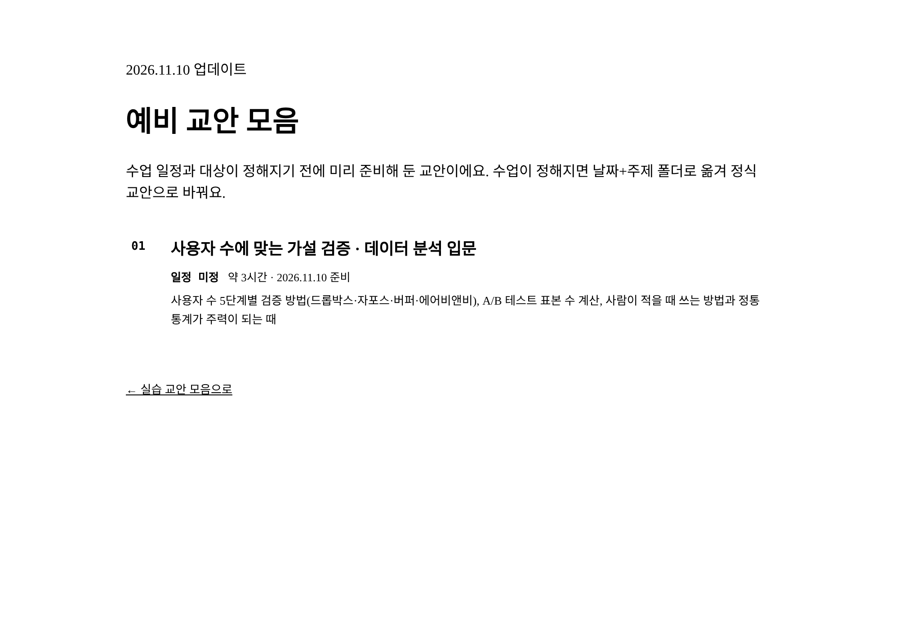
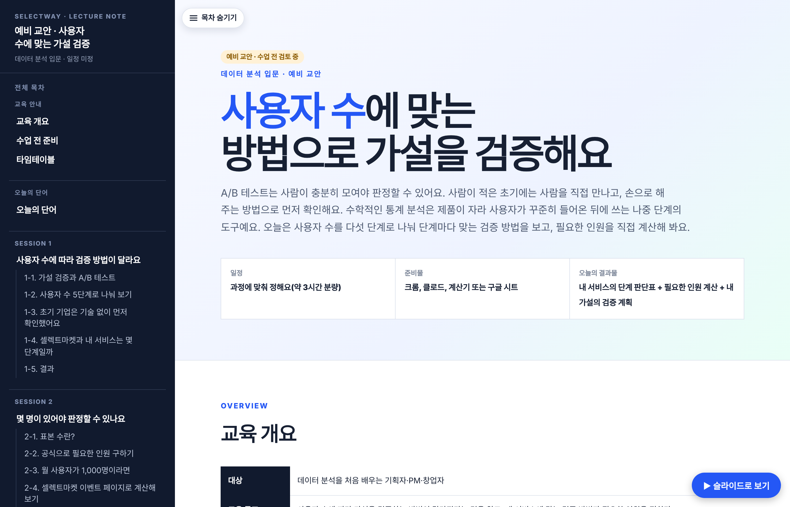
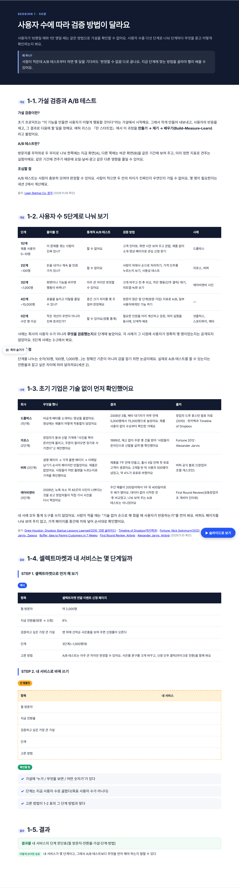
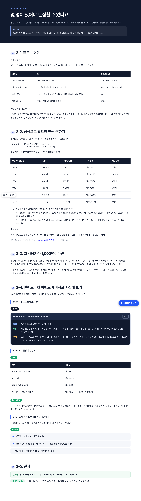
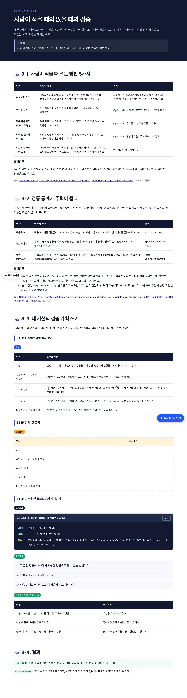
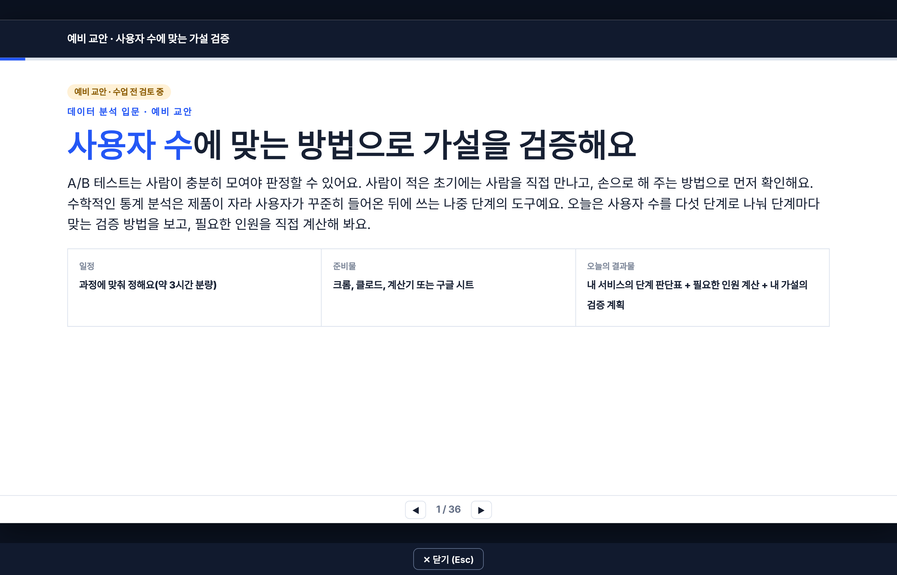

# PR #149 · 예비 교안 폴더 만들기 + 「사용자 수에 맞는 가설 검증」 예비 교안 (초안)

- PR: https://github.com/loreenkim0301/swy-lecturenote/pull/149
- 교안 파일: https://github.com/loreenkim0301/swy-lecturenote/blob/claude/ai-pm-week3-d1-user-scale-stats/drafts/data-hypothesis-by-user-scale/index.html
- 병합 후 주소: https://loreenkim0301.github.io/swy-lecturenote/drafts/data-hypothesis-by-user-scale/

## ① 한 줄 요약
3주차 월요일 교안에 넣었던 2-3절을 빼고, 같은 내용을 새 예비 교안(약 3시간, 세션 3개)으로 다시 짰어요. 예비 교안은 새 폴더 `drafts/`에 모았어요.

## ② 바뀐 것
| 파일 | 바뀐 내용 |
|---|---|
| `261109-ai-pm-week3/d1-sheet-appsscript.html` | 이 PR의 첫 커밋에서 넣은 2-3절과 번호 이동을 되돌림 → 기본 브랜치와 같음(변경 없음) |
| `drafts/README.md` (신규) | 예비 교안 폴더 규칙: 날짜 없는 주제 폴더, noindex, 첫 페이지 목록에 올리지 않음, 수업이 정해지면 날짜-주제 폴더로 옮김 |
| `drafts/index.html` (신규) | 예비 교안 목록 페이지(첫 페이지와 같은 스타일) |
| `drafts/data-hypothesis-by-user-scale/index.html` (신규) | 예비 교안 본문. 3주차 교안과 같은 틀(사이드 목차·슬라이드 보기·복사 상자) |

### 교안 구성
| 세션 | 절 |
|---|---|
| 오늘의 단어 | 가설·MVP, A/B 테스트, 전환율, 표본 수, MDE, 유의수준·검정력, %p, 마이크로 전환, 사용성 테스트 |
| 1. 사용자 수에 따라 검증 방법이 달라요 | 1-1 가설 검증과 A/B 테스트 · 1-2 사용자 수 5단계 · 1-3 초기 사례 4개 · 1-4 실습: 셀렉트마켓과 내 서비스는 몇 단계일까 · 1-5 결과 |
| 2. 몇 명이 있어야 판정할 수 있나요 | 2-1 표본 수란? · 2-2 공식과 계산표 · 2-3 월 사용자 1,000명이라면 · 2-4 실습: 셀렉트마켓 이벤트 페이지로 계산(기준값 표 포함) · 2-5 결과 |
| 3. 사람이 적을 때와 많을 때의 검증 | 3-1 사람이 적을 때 방법 5가지 · 3-2 정통 통계가 주력이 될 때(넷플릭스·스포티파이·메타) · 3-3 실습: 내 가설의 검증 계획 쓰기 · 3-4 결과 |

## ③ 코드로 보면
- 전: 2-3절이 `261109-ai-pm-week3/d1-sheet-appsscript.html` 안의 `
`
- 후: `drafts/data-hypothesis-by-user-scale/index.html`의 `<section class="section session" id="s1">`~`id="s3"`

## ④ 화면으로 보면 (새 파일이라 '후'만 있음)
| 장면 | 후 |
|---|---|
| 예비 교안 목록 |  |
| 첫 화면 |  |
| 세션 1 |  |
| 세션 2 |  |
| 세션 3 |  |
| 세션 1 모바일(390px) |  |
| 슬라이드 보기 |  |

## ⑤ 확인한 것
- 사례·숫자 출처: 앞 커밋에서 다시 확인한 것 그대로(2026.11.10). 드롭박스·자포스·에어비앤비는 출처 두 곳
- 셀렉트마켓 실습 기준값(8%→10%: 그룹당 약 3,210명, 1,000명씩일 때 최소 차이 약 3.7%p)은 공식으로 계산
- 로컬 파일로 열어 PC·모바일 가로 넘침 0px, 목차 내부 링크 깨짐 0개, 스크립트 오류 없음(글꼴 CDN 연결 실패만 있음), 슬라이드 보기 36장
- 3주차 월요일 교안은 기본 브랜치와 차이 없음

## ⑥ 확인 못 한 것
- 프롬프트 1·2를 실제 클로드 계정에서 돌려 보지 않음 → 실행 결과 캡처 없음(교안 규칙 2장 2번 미충족)
- GitHub Pages 배포 화면(병합 전)
- 4단계(~1만 명) 공개 사례 없음

## ⑦ 리뷰 포인트(로린님이 정할 것)
1. 폴더 이름 `drafts/`와 교안 폴더 `data-hypothesis-by-user-scale` 이대로 둘지
2. 예비 교안을 첫 페이지 목록에 올리지 않고 `noindex`로 둔 방식이 맞는지
3. 분량(세션 3개·약 3시간)과 대상(입문 기획자·PM·창업자)을 어떤 과정에 맞출지
4. 프롬프트 실행 캡처는 수업이 정해진 뒤에 찍을지
