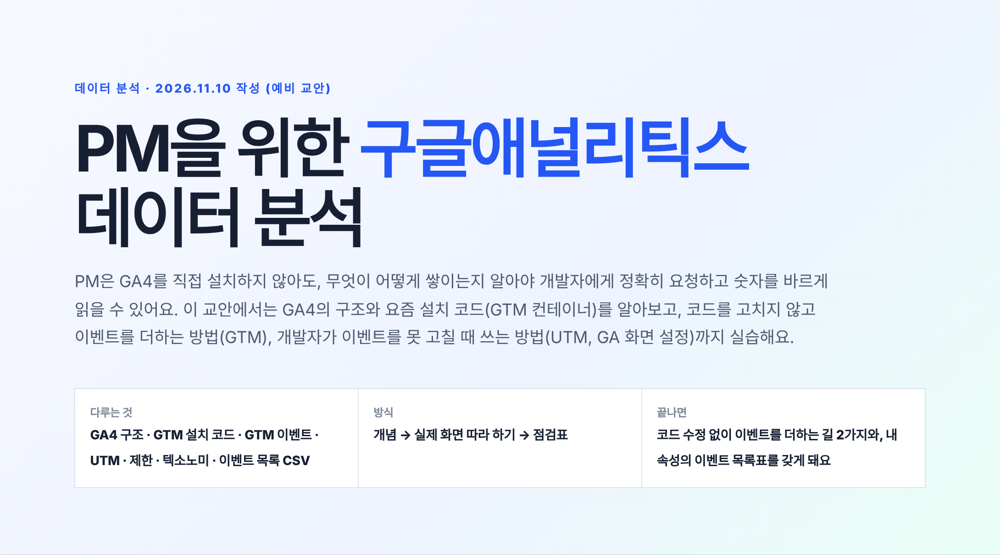
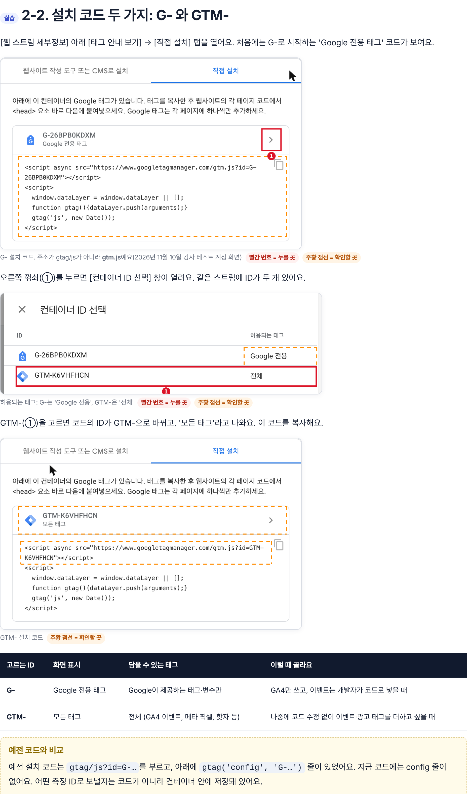
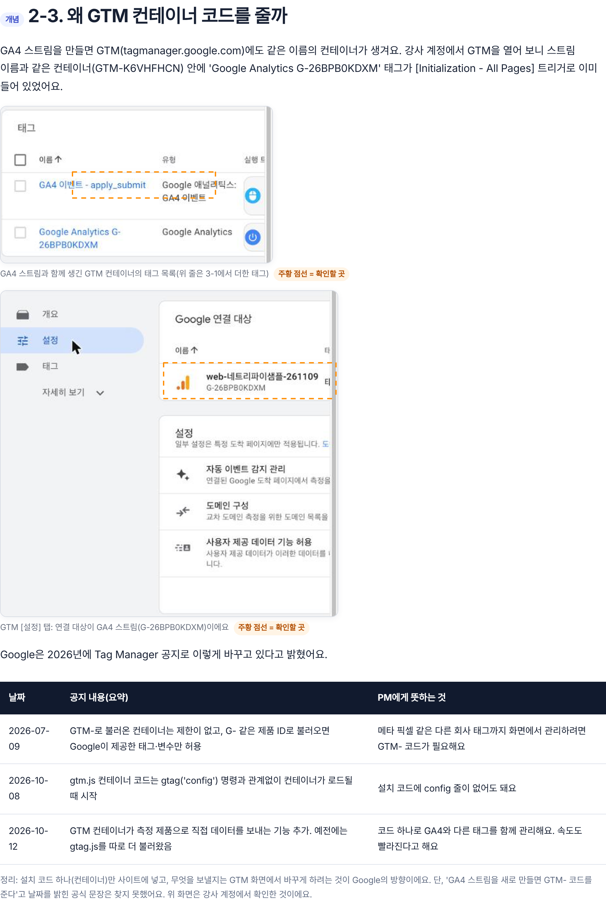
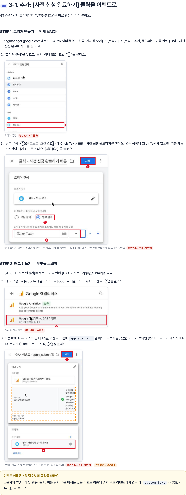
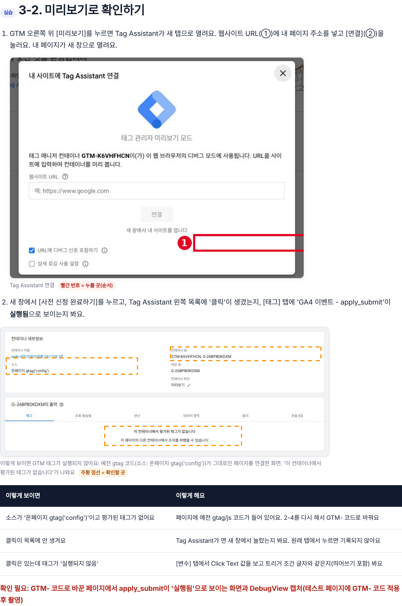
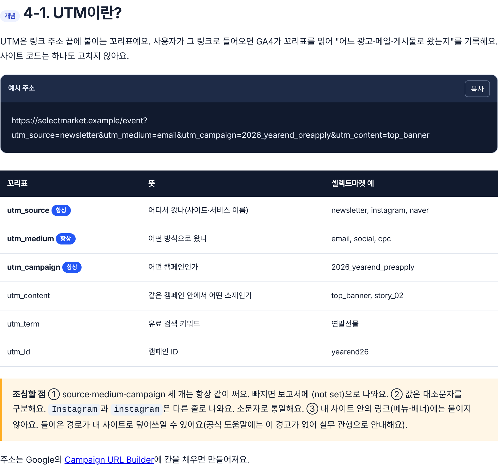
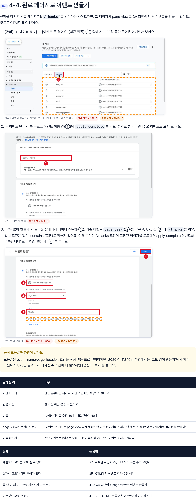
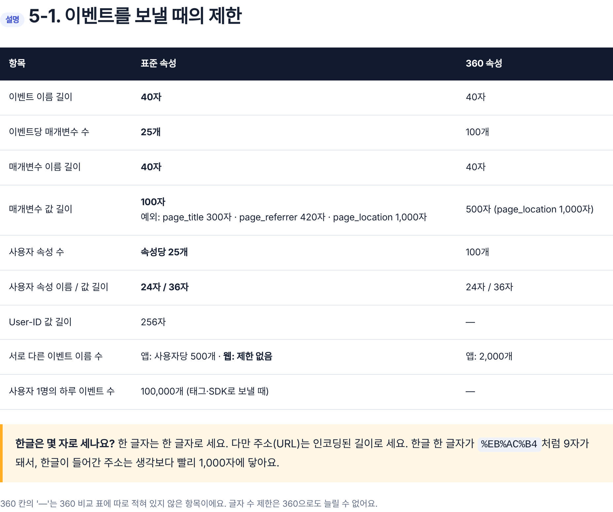
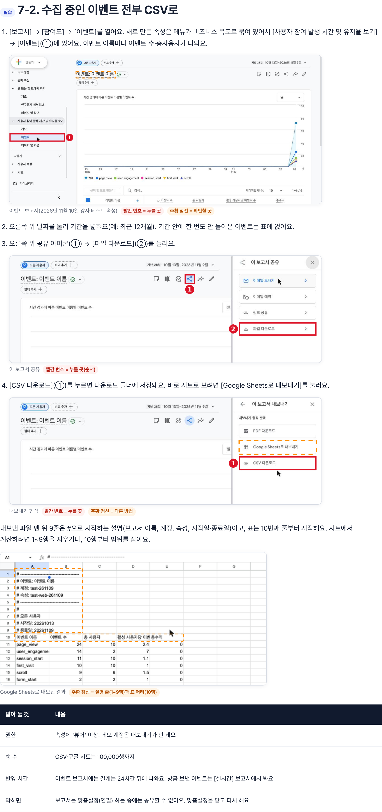
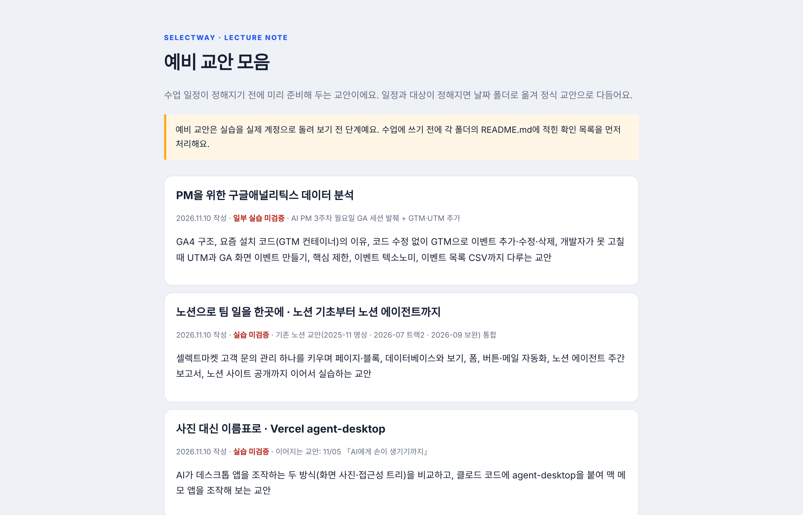

# PR #161 · 예비 교안 「PM을 위한 구글애널리틱스 데이터 분석」 신규

2026-11-10 KST · 새 교안이라 '전' 캡처는 없고, 장면별 '후' 캡처만 남겨요.

- PR: https://github.com/loreenkim0301/swy-lecturenote/pull/161
- 교안 페이지(머지 후): https://loreenkim0301.github.io/swy-lecturenote/drafts/261110-ga4-pm-data-analysis/

| # | 장면 | 무엇이 새로 들어갔나 | 후 |
| --- | --- | --- | --- |
| 01 | 표지 | 제목 「PM을 위한 구글애널리틱스 데이터 분석」, 다루는 것 |  |
| 02 | 2-2 | 설치 코드 G-(Google 전용) / GTM-(전체) 비교, 실제 화면 3장 |  |
| 03 | 2-3 | GA4 스트림과 함께 생긴 GTM 컨테이너, Tag Manager 출시 노트 3건 |  |
| 04 | 3-1 | GTM 트리거·GA4 이벤트 태그 apply_submit 만들기 |  |
| 05 | 3-2 | Tag Assistant 미리보기, gtag 코드 페이지에서 '평가된 태그 없음' |  |
| 06 | 4-1 | UTM 개념과 꼬리표 표 |  |
| 07 | 4-4 | GA 화면 '코드 없이 만들기'로 apply_complete |  |
| 08 | 5-1 | 표준 속성 이벤트 제한(360 비교) |  |
| 09 | 7-2 | 이벤트 보고서 → 공유 → 파일 다운로드, 시트로 내보낸 결과(1~9행 설명 줄) |  |
| 10 | 예비 교안 목록 | drafts/index.html 맨 위에 추가 |  |

## 확인한 것
- 로컬 Playwright(1400px·390px): 이미지 28개 모두 열림, 목차 링크 깨짐 없음, 모바일 가로 스크롤 없음
- 캡처는 강사 테스트 계정(GA4 test-web-261109, GTM-K6VHFHCN)에서 2026-11-10에 찍음

## 확인 못 한 것
- 3-2에서 GTM- 코드 페이지의 apply_submit '실행됨' 화면(테스트 페이지 공개 배포 승인 대기)
