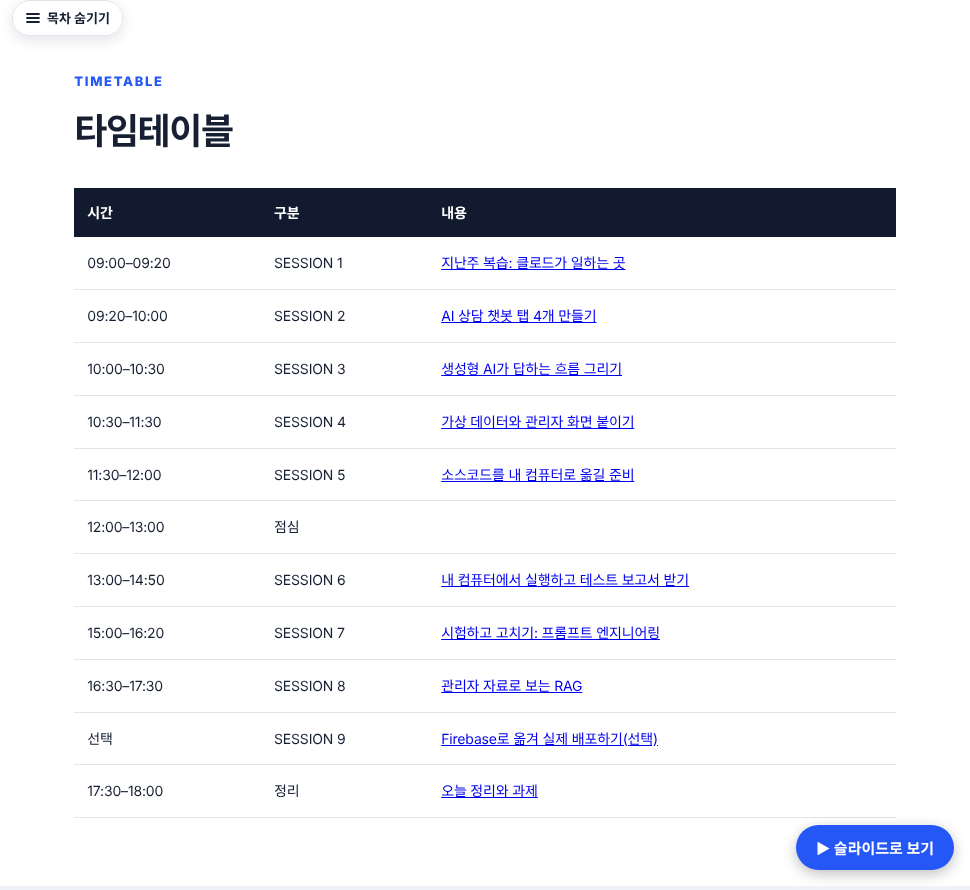
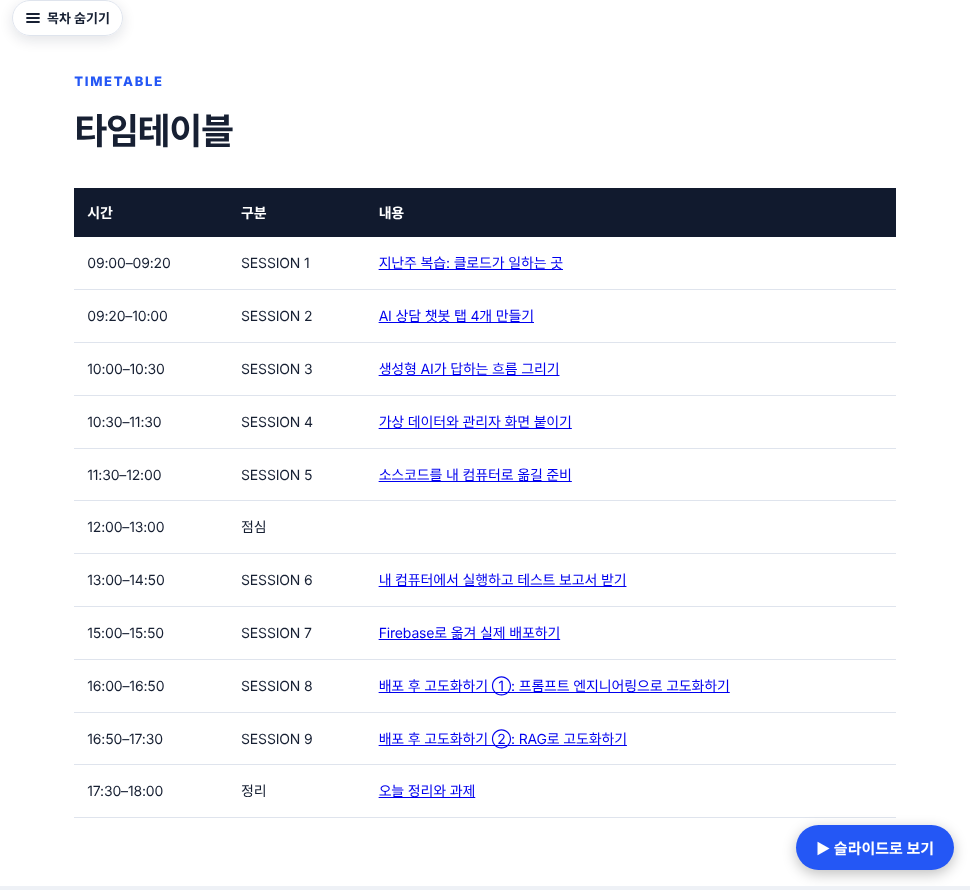
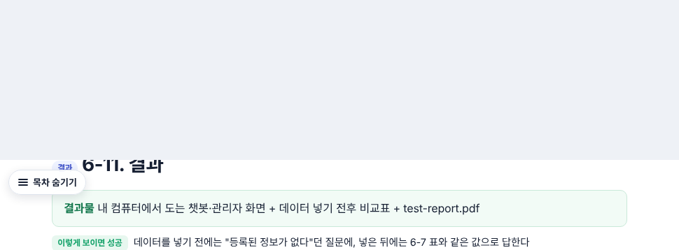
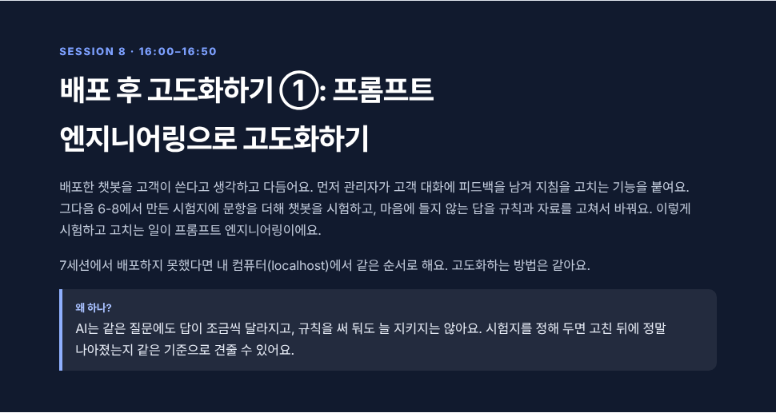
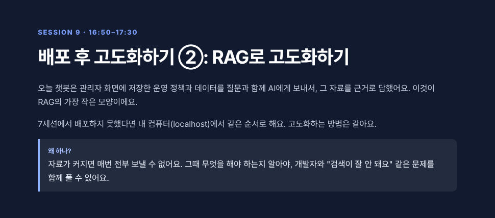

# 4주차 DAY 1(11/16 월) — 7·8세션을 '배포 후 고도화하기'로 바꾸고 순서 조정

## 무엇을 왜
로린님 요청: 7·8세션 제목을 '배포 후 고도화하기' 방향으로 바꾸고, 프롬프트 엔지니어링과 RAG로 나눈 뒤 목차 순서를 조정.
고도화가 '배포 후'에 오도록, 선택이던 Firebase 배포를 7세션으로 올리고 고도화 두 세션을 8·9세션으로 옮겼어요.

## 바뀐 것
| 전 | 후 |
| --- | --- |
| 7세션 15:00–16:20 시험하고 고치기: 프롬프트 엔지니어링 | 8세션 16:00–16:50 배포 후 고도화하기 ①: 프롬프트 엔지니어링으로 고도화하기 |
| 8세션 16:30–17:30 관리자 자료로 보는 RAG | 9세션 16:50–17:30 배포 후 고도화하기 ②: RAG로 고도화하기 |
| 9세션 선택 Firebase로 옮겨 실제 배포하기(선택) | 7세션 15:00–15:50 Firebase로 옮겨 실제 배포하기 |

- 절 번호(7-x↔8-x↔9-x)와 본문 속 번호·세션 참조를 함께 고침 (6세션 안의 '7세션에서 고칠 때', '8세션에서 볼 RAG', '8-2에서' 등)
- 8-1의 "이 한계는 9세션(선택)에서 다시 나와요" → 배포에서 Firestore에 저장했다면 관리자가 다른 기기의 대화도 볼 수 있다는 문장으로
- 8·9세션 머리에 "7세션에서 배포하지 못했다면 내 컴퓨터(localhost)에서 같은 순서로" 안내 추가
- 사이드 목차·타임테이블·4주차 홈 월요일 행 수정

## 화면
| 장면 | 전 | 후 |
| --- | --- | --- |
| 타임테이블 |  |  |
| 7세션 머리 | — |  |
| 8세션 머리 | — |  |
| 9세션 머리 | — |  |

## 확인한 것
- 내부 앵커 깨짐 없음, 세션 순서 s1~s9
## 확인 못 한 것
- 시간 배분(배포 50분·고도화 50분·40분)은 추정
- 배포가 필수가 되면서 Blaze(결제 수단 등록) 요금제가 수업 흐름에 들어옴 — 수강생 전원이 가능한지 미확인
## 리뷰 포인트(로린님)
1. 배포를 필수로 둘지, 선택으로 두고 고도화는 localhost로 할지
2. 시간 배분
