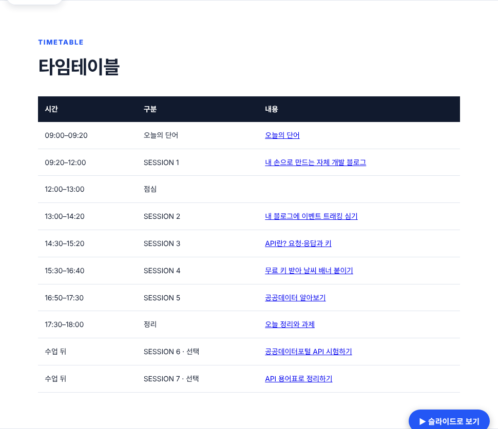
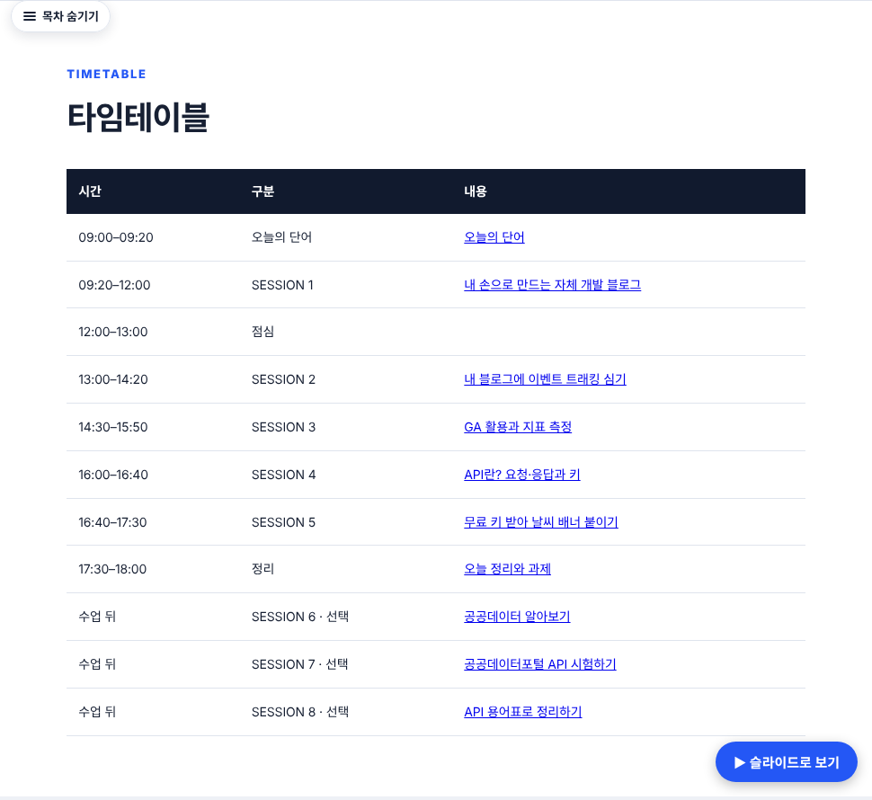
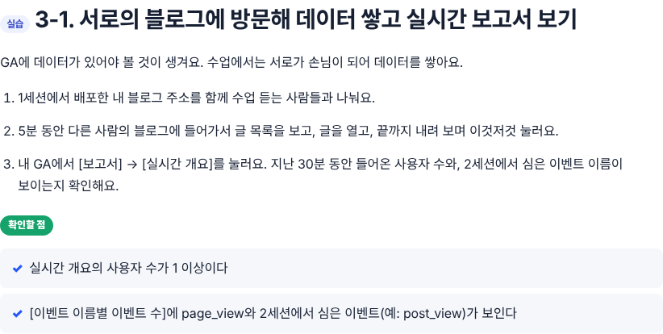
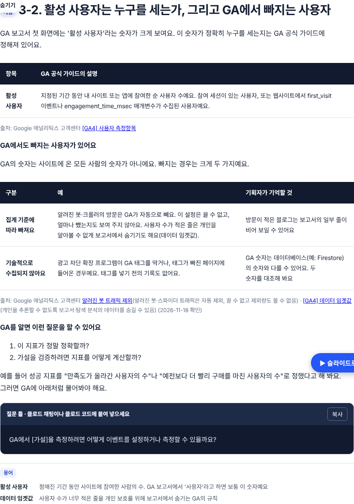
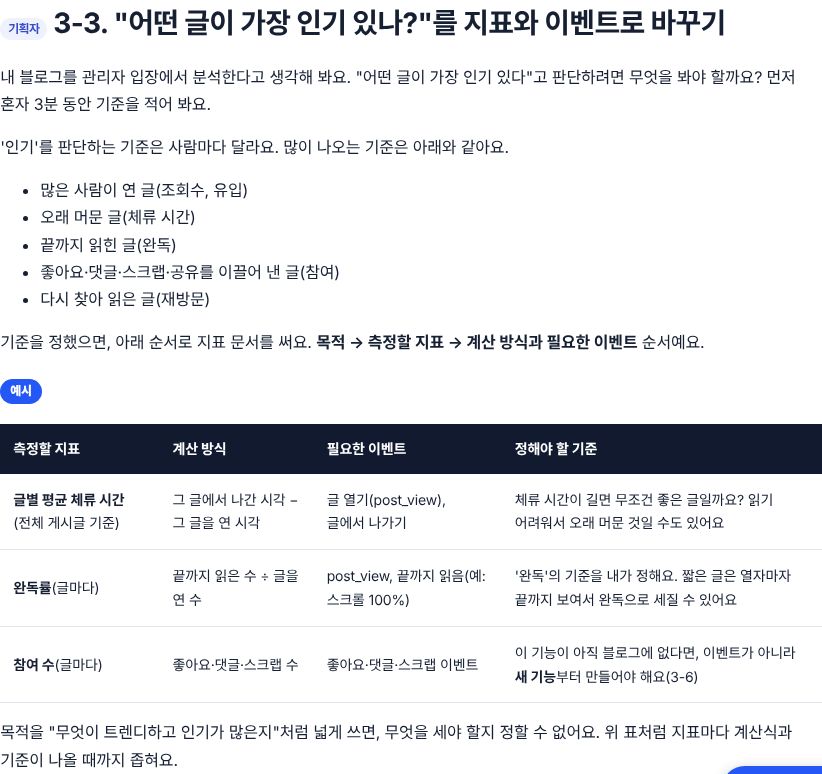
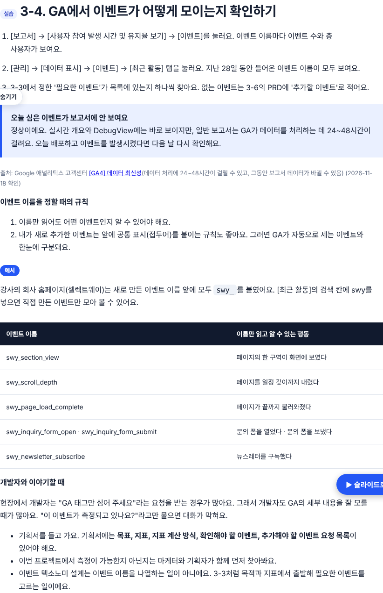
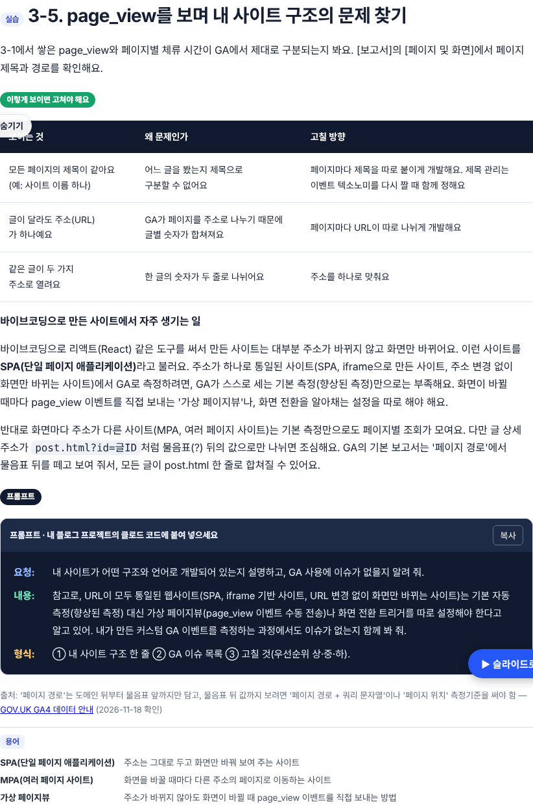
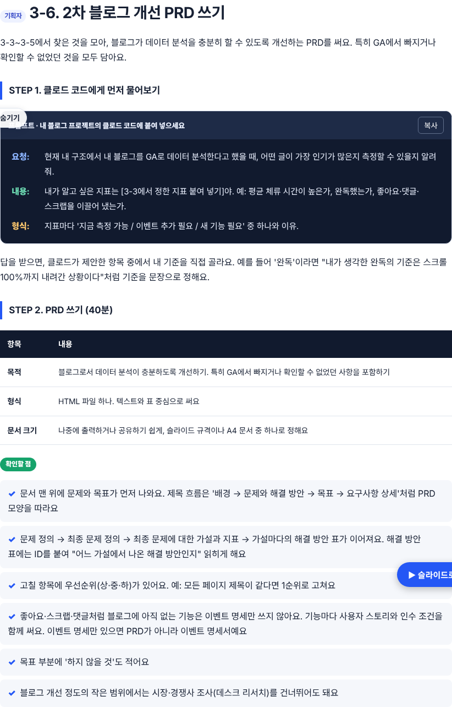
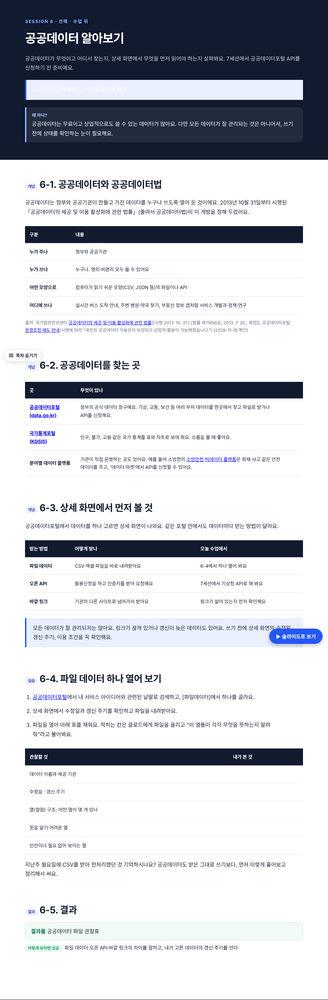
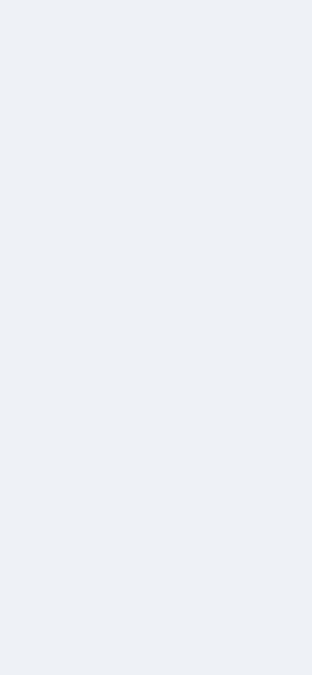

# 4주차 DAY 2 — 3세션 「GA 활용과 지표 측정」 추가 (2026-11-18)

## 무엇을 왜
2세션(블로그 이벤트 트래킹) 다음에, 2026-11-18 오전(09:03~13:05 KST) 실제 수업에서 진행한 GA 수업 내용을 새 3세션으로 넣었어요. 다음 기수 재수업용으로 강사의 설명·질문·실습·피드백만 옮겼고, 수강생 답변·결과물과 슬랙 캡처는 넣지 않았어요.

## 수업 기록 → 교안 대응
| 수업 진행(KST) | 교안 위치 |
| --- | --- |
| 09:05 서로의 배포 주소 5분 방문·데이터 쌓기, 09:16 보고서 > 실시간 개요 | 3-1 |
| 09:21~09:27 활성 사용자 정의(GA 가이드), "GA에서 빠지는 사용자: 집계 기준 제외·기술적 누락" 질문 | 3-2 (빠지는 사용자 답은 공식 문서로 보충: 봇 자동 제외, 데이터 임곗값, 광고 차단·태그 누락) |
| 09:28 GA로 할 수 있는 질문 2개, 예시 가설 2개, 질문 틀 | 3-2 |
| 09:39 "어떤 글이 가장 인기 있나?", 10:04 지표의 목적·측정할 지표·계산 방식 | 3-3 (완독·체류시간 기준 피드백 11:15·11:27·11:28 반영) |
| 10:12~10:26 보고서 > 이벤트, 관리 > 이벤트 > 최근 활동, 오늘 배포분은 다음 날 확인, 이벤트 이름 규칙 2개, 개발자와 소통할 때 | 3-4 (강사 사이트 swy_ 이벤트 이름은 표로) |
| 10:30~10:46 page_view·체류시간 확인, 제목 관리·URL 분리, SPA·가상 페이지뷰, 클로드 코드 질문 | 3-5 (11:03·11:04 피드백: 커스텀 이벤트 이슈, post.html?id= 쿼리 문제) |
| 11:06 인기 글 측정 추가 질문, 11:19~13:05 2차 블로그 개선 PRD(HTML·텍스트와 표·40분)와 공통 피드백 | 3-6 |

## 바뀐 것
- d2-api.html: 3세션 신설, 구 3~7세션 → 4~8세션(번호·참조 갱신), 시간 재배치(3세션 14:30–15:50, 4세션 16:00–16:40, 5세션 16:40–17:30), 6~8세션(공공데이터 알아보기·공공데이터포털 API·비교표)은 수업 뒤 선택
- 교육 개요·히어로·오늘의 규칙·오늘의 결과물·수업 전 준비·사이드 목차·타임테이블 갱신
- index.html 화요일 행 갱신

## 확인 못 한 것
- 활성 사용자 정의는 강사가 슬랙에 옮긴 GA 가이드(12253918) 문구를 따름(이번 세션에서 해당 페이지 직접 열람은 승인 대기로 못 함)
- GA 화면 캡처 없음(슬랙 캡처는 넣지 않는 규칙) → 강사 계정에서 [최근 활동]·[이벤트] 화면 재촬영 필요
- 시간 배분과, 공공데이터 알아보기를 선택으로 돌린 것은 추정

## 화면
         
