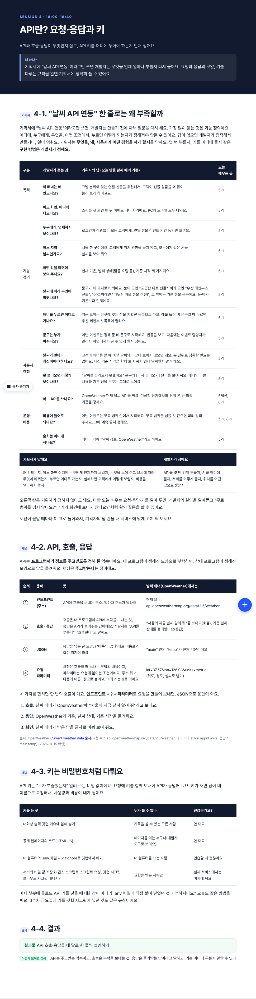
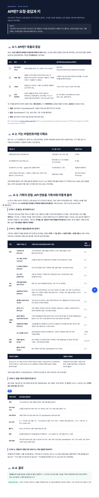
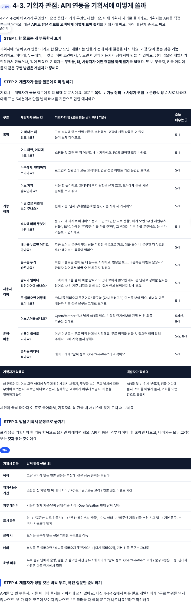

# 4주차 DAY 2 — 4세션 순서 변경: API란? → 키 → 기획자 관점의 기획서 쓰기 (2026-11-18)

## 바뀐 것
| 전 | 후 |
| --- | --- |
| 4-1 (기획자) "날씨 API 연동" 한 줄로는 왜 부족할까 | 4-1 (개념) API란? 호출과 응답 (구 4-2) |
| 4-2 (개념) API, 호출, 응답 | 4-2 (개념) 키는 비밀번호처럼 다뤄요 (구 4-3) |
| 4-3 (개념) 키는 비밀번호처럼 다뤄요 | 4-3 (기획자) 기획자 관점: API 연동을 기획서에 어떻게 쓸까 (구 4-1을 STEP 흐름으로 재구성) |
| 4-4 결과 | 4-4 결과 (결과물·성공 기준에 기획서 항목 쓰기 추가) |

4-3 흐름: STEP 1 한 줄로는 왜 부족한지 → STEP 2 개발자가 물을 질문에 미리 답하기(기존 질문·답 표, 기획자/개발자 역할 표 유지) → STEP 3 답을 기획서 항목으로 옮기기(신규 예시: 목적·위치·대상·기간·외부 데이터·표시 규칙·클릭 시·예외·운영·비용) → STEP 4 개발자가 정할 것은 비워 두고 확인 질문 준비

- 세션 머리말 갱신, 5-1의 "4-1에서 개발자가 물었던 질문" → "4-3에서", 사이드 목차 갱신
- 기존 "오른쪽 칸은 기획자가 정하지 않아도 돼요…" 문단은 STEP 4와 같은 내용이라 삭제

## 확인한 것
- 내부 앵커 깨짐 없음, 화면 캡처 확인

## 화면
  
