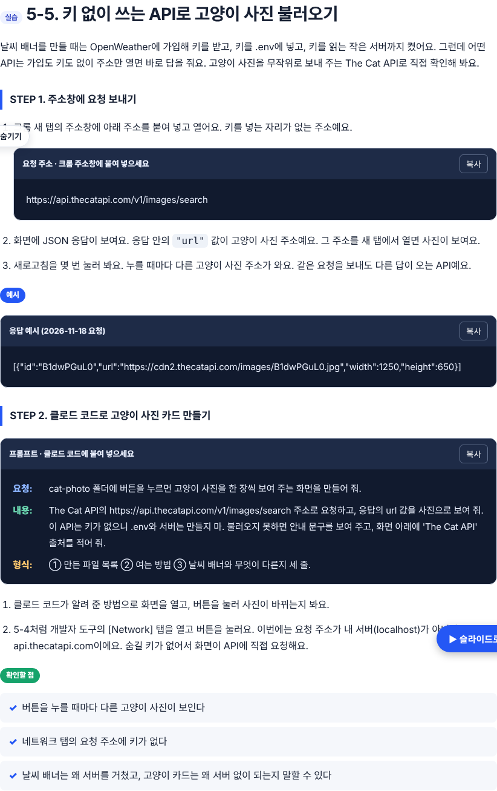
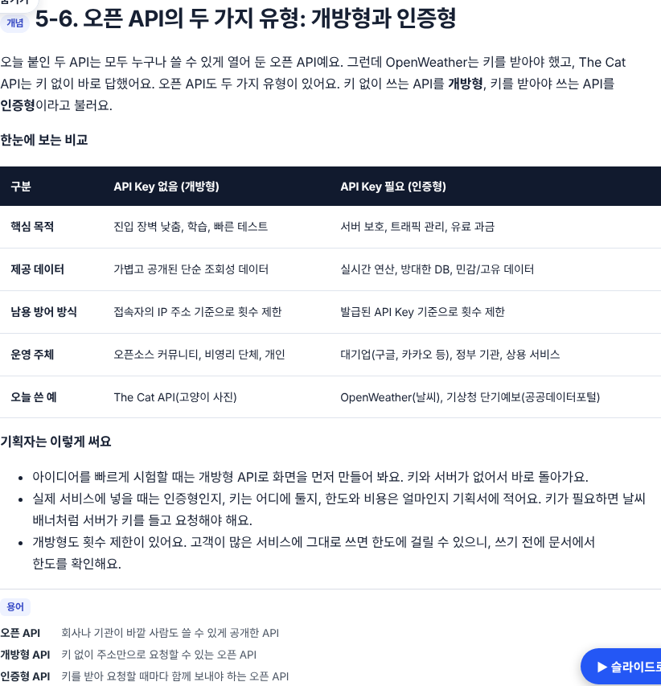
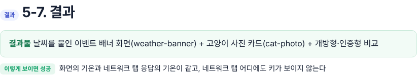
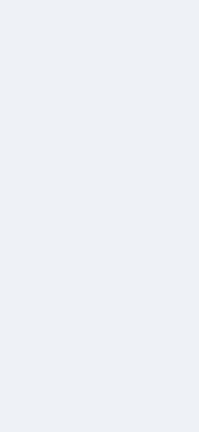

# 4주차 DAY 2 — 5세션에 개방형 API(고양이 사진) 실습과 오픈 API 두 유형 추가 (2026-11-18)

## 바뀐 것
| 절 | 내용 |
| --- | --- |
| 5-5 (신규) 키 없이 쓰는 API로 고양이 사진 불러오기 | STEP 1 주소창에 The Cat API 요청(https://api.thecatapi.com/v1/images/search) → JSON의 url 확인 → 새로고침마다 다른 사진 / STEP 2 클로드 코드로 cat-photo 화면(키·.env·서버 없음) → 네트워크 탭에서 요청 주소가 api.thecatapi.com인지 확인 |
| 5-6 (신규) 오픈 API의 두 가지 유형 | 로린님이 준 '한눈에 보는 비교' 표(핵심 목적·제공 데이터·남용 방어 방식·운영 주체) 그대로 + '오늘 쓴 예' 줄 + 기획자 활용 3줄 + 용어 상자 |
| 5-7 결과 | 기존 5-5 결과 → 5-7, 결과물에 고양이 사진 카드·유형 비교 추가 |
| 5세션 머리말, 사이드 목차 | 갱신 |

## 확인한 것
- 2026-11-18 키 없이 https://api.thecatapi.com/v1/images/search 요청 → `[{"id":"B1dwPGuL0","url":"https://cdn2.thecatapi.com/images/B1dwPGuL0.jpg","width":1250,"height":650}]` 응답 (교안 응답 예시로 사용)
- 내부 앵커, 390px 가로 스크롤 없음

## 확인 못 한 것
- STEP 2 프롬프트를 클로드 코드로 실제 실행하지 않음 → 실행 화면 캡처 없음
- The Cat API의 키 없는 요청 횟수 한도(공식 수치) 미확인 → 교안에는 숫자를 쓰지 않음
- 5세션(16:40–17:30)에 두 절이 늘어 시간이 빠듯할 수 있음

## 화면
   
