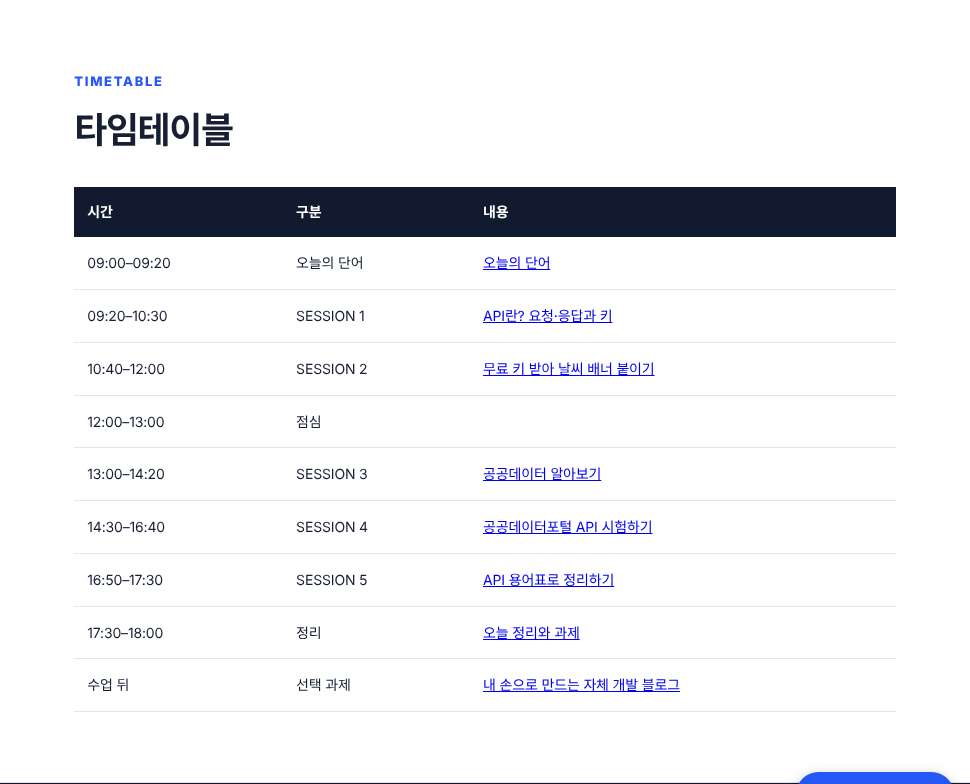
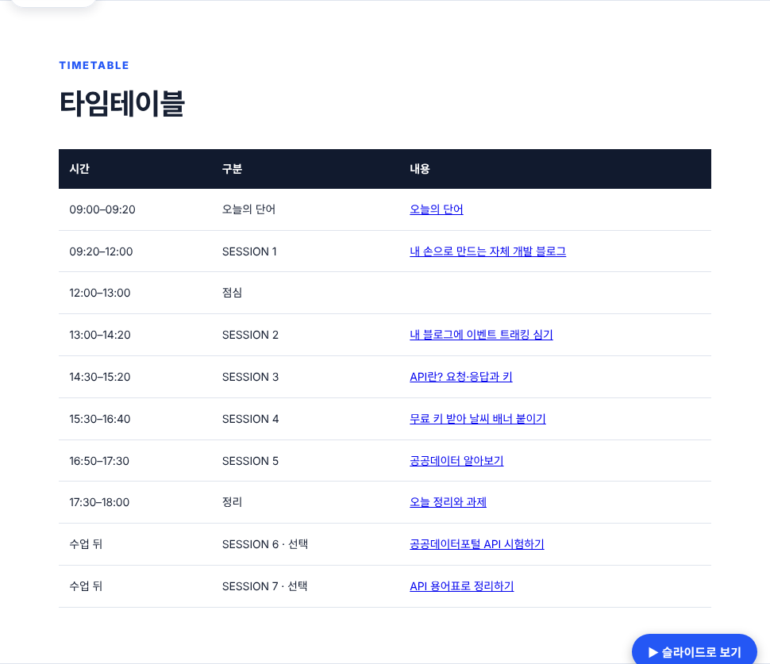
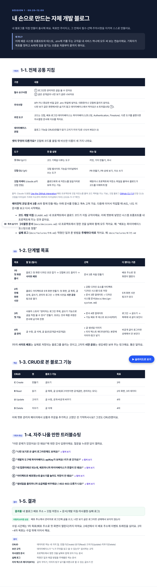
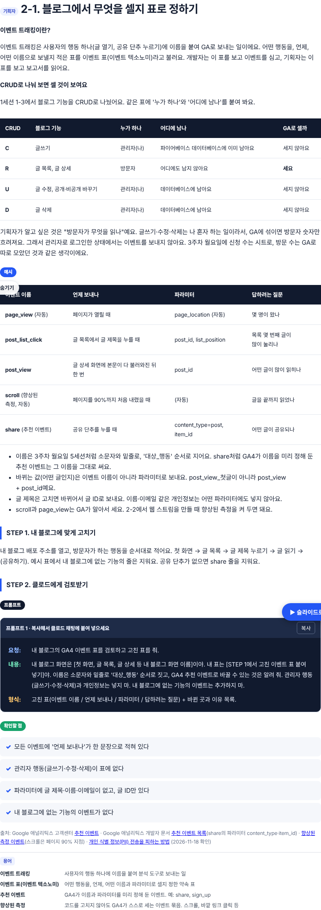
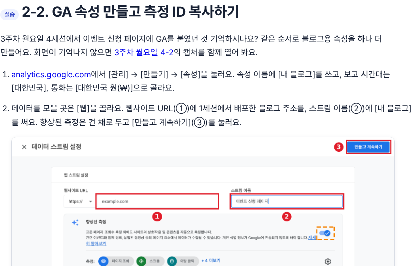
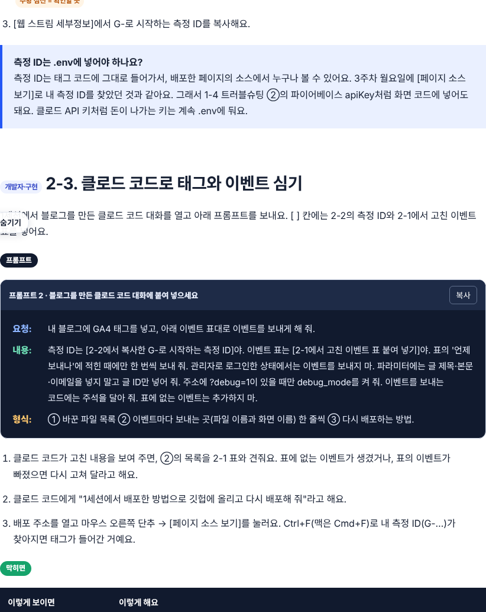
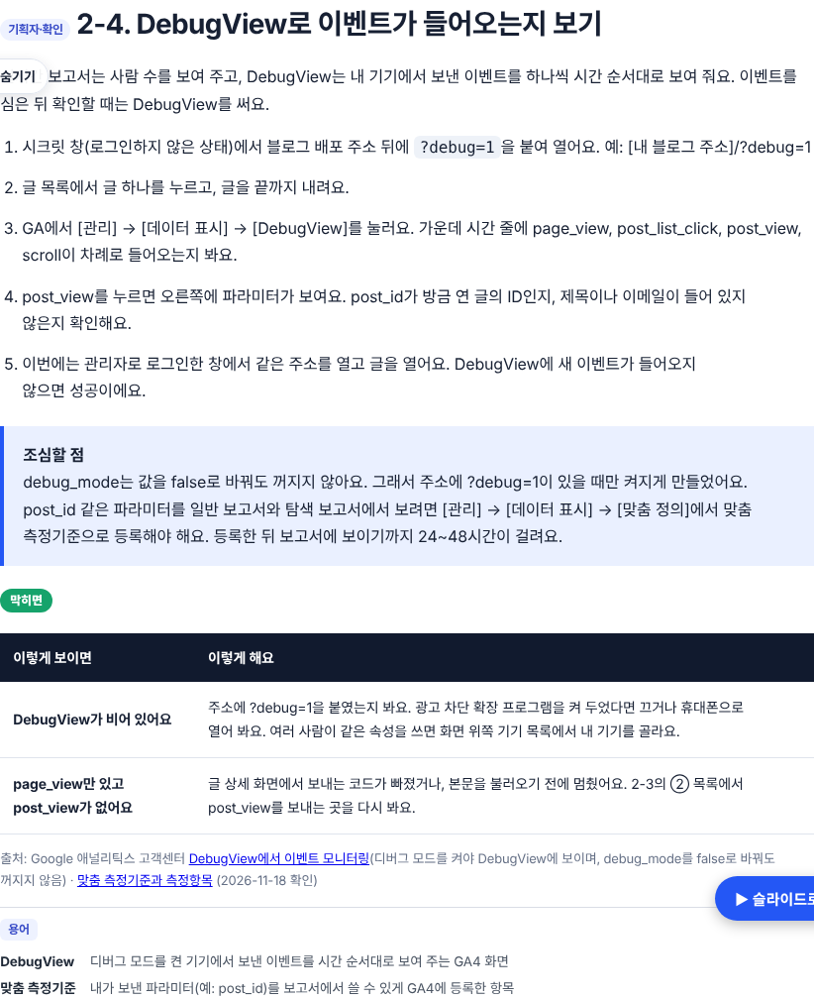
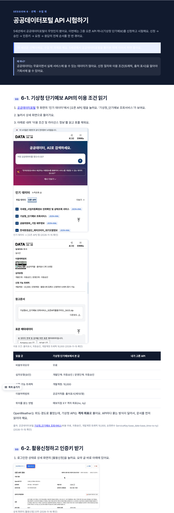
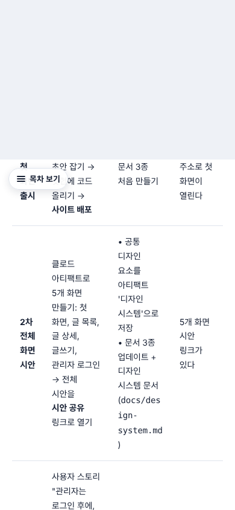

# 4주차 DAY 2(11/17 화) — 블로그 1순위 배치 + 블로그 이벤트 트래킹 세션 추가

## 무엇을 왜
실제 수업에서 블로그 만들기를 먼저 했기 때문에, 선택 과제(수업 뒤)였던 블로그를 SESSION 1로 올리고 API 세션을 뒤로 옮겼어요.
기존 강의자료의 데이터·GA 내용(3주차 월요일 4·5세션 GA 붙이기·이벤트 텍소노미, 예비교안 백엔드 플랫폼의 맞춤 측정기준·debug)을 모아 블로그 바로 다음에 SESSION 2 「내 블로그에 이벤트 트래킹 심기」를 새로 넣었어요.

## 바뀐 것
| 파일 | 절 | 바뀐 내용 |
| --- | --- | --- |
| d2-api.html | SESSION 1 | 기존 SESSION 6(선택 과제) 블로그 → 1세션 09:20–12:00, 절 번호 6-x → 1-x |
| d2-api.html | SESSION 2 (신규) | 2-1 CRUD로 셀 것 정하기·이벤트 표 / 2-2 GA 속성·측정 ID / 2-3 클로드 코드로 태그·이벤트 심기 / 2-4 DebugView 확인 / 2-5 결과 |
| d2-api.html | SESSION 3~5 | 기존 1~3(API란·날씨 배너·공공데이터 알아보기), 시간 재배치 |
| d2-api.html | SESSION 6~7 | 기존 4~5(공공데이터포털 API·비교표) → 수업 뒤 선택 |
| d2-api.html | 히어로·개요·준비·타임테이블·목차·정리 | 새 순서에 맞게 수정, 본문 속 절·세션 번호 참조 일괄 갱신 |
| index.html | 화요일 행 | 내용·결과물 갱신 |
| d1~d5 | 상단 day-nav | "DAY 2 API 붙이기" → "DAY 2 블로그·API" |

## 화면 (전·후)
| 장면 | 전 | 후 |
| --- | --- | --- |
| 타임테이블 |  |  |
| 블로그 세션 | _전.png) |  |
| 신규 2-1 | — |  |
| 신규 2-2 | — |  |
| 신규 2-3 | — |  |
| 신규 2-4 | — |  |
| 6세션(선택) | — |  |
| 390px | — |  |

## 확인한 것
- 내부 앵커 깨짐 없음, 세션 순서 words→s1~s7→wrap, 390px 가로 스크롤 없음
- GA 공식 문서 확인(2026-11-18): 추천 이벤트(share: content_type·item_id), 향상된 측정 스크롤 90%, DebugView·debug_mode(false로 꺼지지 않음), PII 금지
- 「어제 6-2에서 .env」(DAY 1 참조)는 번호를 바꾸지 않음

## 확인 못 한 것
- 2-3 프롬프트를 실제 학생 블로그(파이어베이스)에 돌려 보지 않았음 → DebugView 실행 캡처 없음
- 오후 시간 배치(3~5세션)와 6·7세션 선택 전환은 실제 수업 기록이 아니라 추정
- GA 한국어 화면의 [DebugView]·[맞춤 정의] 메뉴명은 3주차 교안·예비교안 표기를 따름(이번에 화면 재확인 안 함)

## 리뷰 포인트(로린님)
1. 어제 오후 실제 진행 순서·시간 — 6·7세션(공공데이터포털 API·비교표)을 했다면 선택 표시를 풀어야 함
2. 이벤트 트래킹 2세션을 어제 실제로 했는지, 다음 기수용 보강인지
3. 예시 이벤트 표(post_list_click·post_view·scroll·share) 범위
