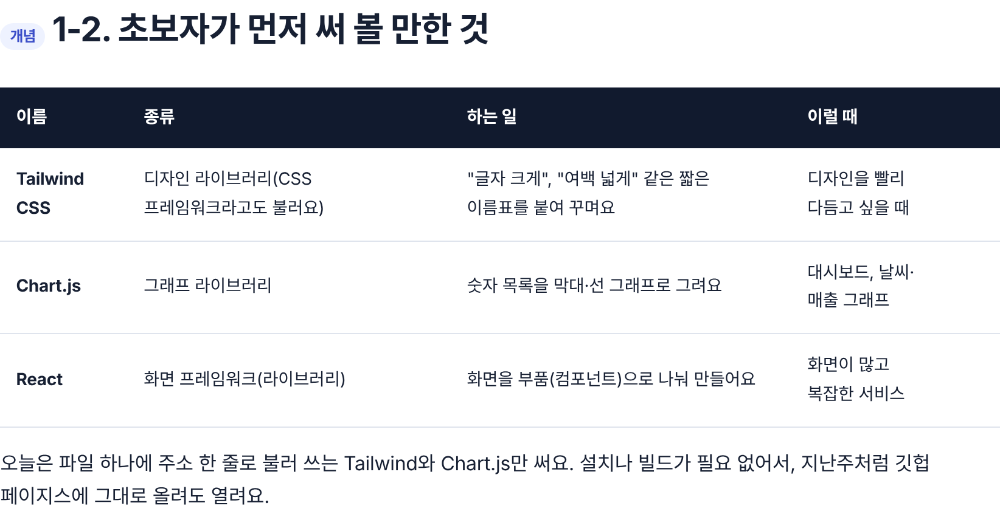
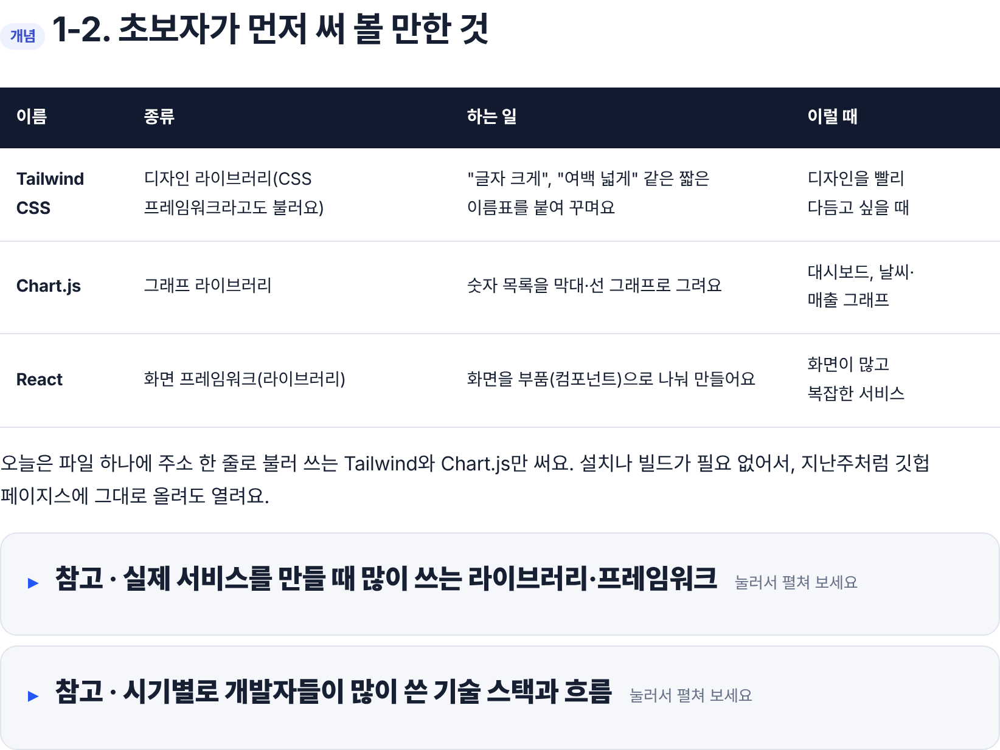
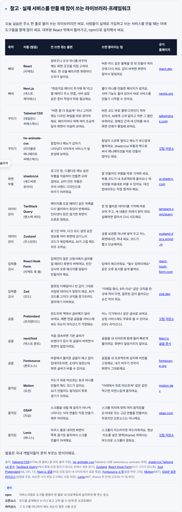
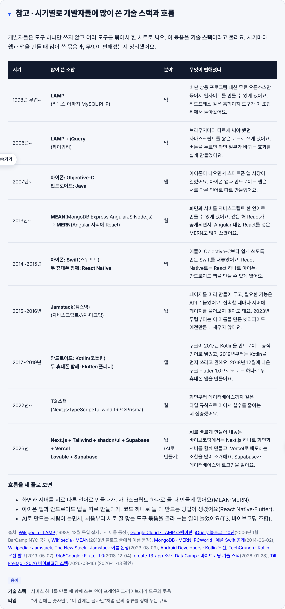

# 4주차 DAY 3 — 1-2절에 참고 토글 2개 추가: 실제 서비스용 라이브러리·프레임워크 표, 시기별 기술 스택 흐름 표 (2026-11-18)

## 한 줄 요약
1-2 "초보자가 먼저 써 볼 만한 것" 아래에, 실제 서비스를 만들 때 많이 쓰는 도구 15개를 "안 쓰면 겪는 불편 → 쓰면 좋아지는 점"으로 정리한 토글과, 1998년부터 2026년까지 많이 쓰인 웹·앱 기술 스택을 정리한 토글을 넣었어요.

## 바뀐 것
| 파일 | 요일 | 절 | 바뀐 내용 |
| --- | --- | --- | --- |
| 261116-ai-pm-week4/d3-dev-env.html | 수 | 1-2 | 토글 ① `#s1-2-libs` 참고 · 실제 서비스를 만들 때 많이 쓰는 라이브러리·프레임워크 (목적·이름(발음)·안 쓰면 겪는 불편·쓰면 좋아지는 점·공식 홈페이지, 출처, 용어 상자) |
| 같은 파일 | 수 | 1-2 | 토글 ② `#s1-2-stacks` 참고 · 시기별로 개발자들이 많이 쓴 기술 스택과 흐름 (시기·조합·분야·무엇이 편해졌나 9줄, 흐름 3줄, 출처, 용어 상자) |

## 코드로 보면
- 전: 1-2절 = 표 1개 + 안내 문단 1개
- 후: 같은 내용 + `
` + `
` (기존 스타일 재사용, 새 CSS 없음)

## 화면으로 보면
| 장면 | 전 | 후 |
| --- | --- | --- |
| 1-2절(닫힘) |  |  |
| 토글 ① 펼침 | – |  |
| 토글 ② 펼침 | – |  |
| 390px 펼침 | – |  |

## 확인한 것
- 표의 사실(버전·연도·라이선스·공식 주소)은 2026-11-18 웹 검색으로 확인하고 출처 줄에 확인일을 남김
- `keep_phrase_linebreak.py` 적용(새로 넣은 부분만 바뀜), 1280px·390px 가로 스크롤 없음

## 확인 못 한 것
- 발음은 공식 발음이 아니라 국내에서 흔히 읽는 방식
- 토글 ①의 "안 쓰면 겪는 불편" 칸은 공식 문서 문장이 아니라 수업용 풀이
- Jamstack 이름이 나온 해는 자료마다 2015/2016으로 갈려서 "2015~2016년"으로 적음
- React Native 공개 달은 자료마다 3월/5월로 달라 연도(2015)만 적음
- 2026년 줄(바이브코딩 조합)은 업계 블로그 2곳 기준이며, 공식 통계가 아님
- GitHub Pages 배포 뒤 실제 페이지는 머지 후 확인 필요

## 리뷰 포인트 (로린님이 정할 것)
- "모던 프로그래밍"은 쓰이는 용어가 아니라서 제목을 "기술 스택"으로 바꿈. 괜찮은지
- 2026-11-18 PR 노트에 적힌 "학생용 개념 설명은 비유를 쓰지 않는다"에 맞춰, 앞서 대화에서 쓴 "애플 제품 소개 페이지처럼" 비유는 뺌
- 토글 ① 표가 15줄이라 깁니다. 수업에서는 뼈대·꾸미기만 보여 주고 나머지는 참고로 둘지
