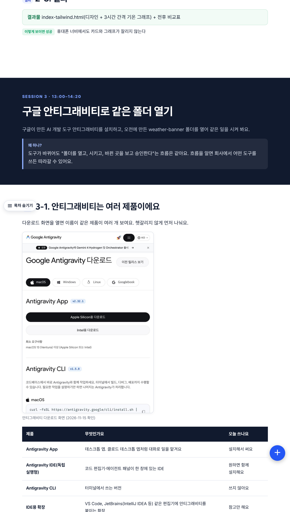
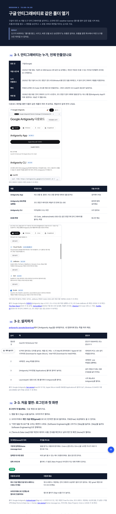
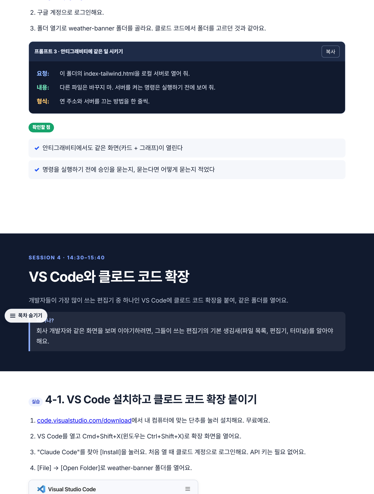
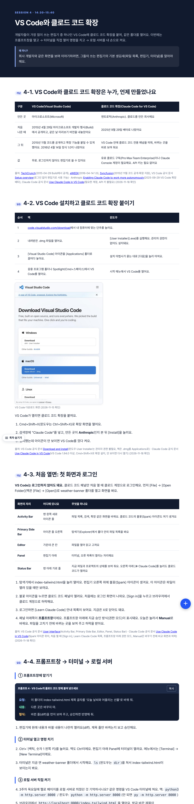
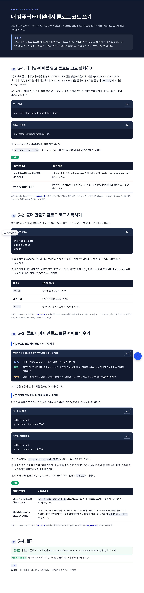
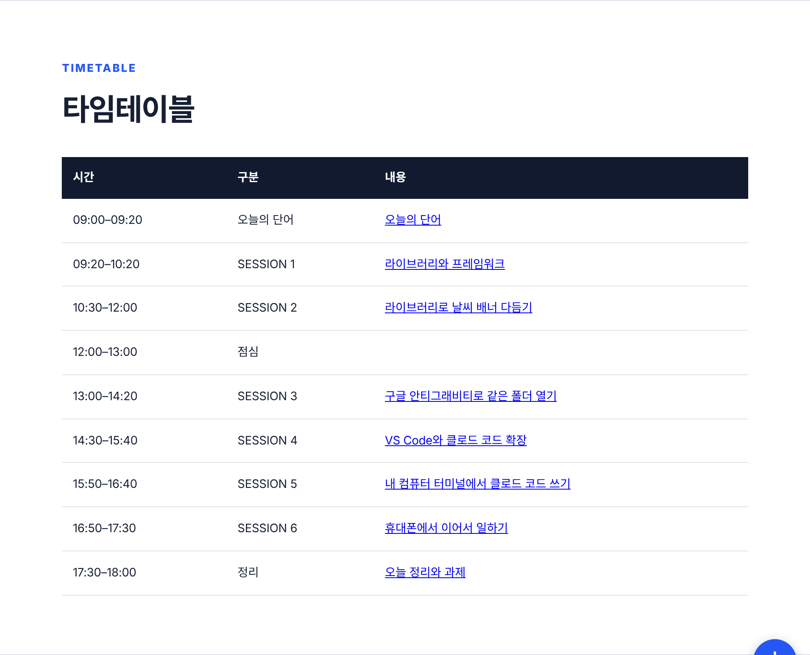

# 4주차 DAY 3 — 세션 3·4 도구 안내 보강 + 새 세션 5(터미널에서 클로드 코드) 추가 (2026-11-18)

## 한 줄 요약
세션 3(안티그래비티)과 세션 4(VS Code+클로드 코드 확장)에 역사(만든 곳·처음 나온 때), OS별 설치, 로그인 필요 여부, 첫 화면 설명을 넣었어요. 실습은 '프롬프트창 → 명령(터미널) → 로컬 서버' 흐름으로 다시 짰어요. 비어 있던 세션 5 자리에는 '내 컴퓨터 터미널(파워셸)에서 클로드 코드로 헬로 페이지 만들고 로컬 서버 띄우기'를 새로 넣었어요.

> 이 브랜치는 PR #209(세션 5 비교표 삭제) 위에서 만들었어요. #209를 먼저 머지하거나, 이 PR만 머지해도 #209 내용이 함께 들어가요.

## 바뀐 것
| 파일 | 위치 | 바뀐 내용 |
| --- | --- | --- |
| d3-dev-env.html | 세션 3 | 3-1 역사 표(구글, 2025-11-18 공개, 윈드서프 팀, VS Code 기반, 2026-05-19 2.0 앱) + 기존 제품 표 / 3-2 맥·윈도우 설치 표 / 3-3 로그인(개인 gmail 필수, 워크스페이스 계정 불가)·첫 화면(Home 입력창·추천 문장·사이드바) / 3-4 New Project→Add Folder→Request Review→프롬프트→명령 승인→localhost:8000 |
| d3-dev-env.html | 세션 4 | 4-1 VS Code(마이크로소프트, 2015-04-29 공개, 2016-04-14 1.0)·확장(앤트로픽, 2025-09-29 베타) 표 / 4-2 맥·윈도우 설치 표 + 확장 설치 / 4-3 VS Code는 로그인 불필요, 화면 5구역, Spark 아이콘, 패널 첫 로그인, Manual 모드 / 4-4 프롬프트 → Ctrl+` 터미널 → python http.server → 브라우저 → Ctrl+C |
| d3-dev-env.html | 세션 5(새로) | 5-1 터미널·파워셸 열고 설치 명령(맥 curl / 윈도우 irm), claude --version / 5-2 mkdir·cd·claude, 첫 로그인, /help·Shift+Tab·/exit / 5-3 헬로 페이지 프롬프트, 두 번째 창에서 로컬 서버, 고친 뒤 새로고침 / 5-4 결과 |
| d3-dev-env.html | 세션 6 | 휴대폰 세션을 다시 세션 6(16:50–17:30)으로 |
| d3-dev-env.html | 머리말·목표·준비·타임테이블·오늘의 단어·정리 | 세션 5 추가 반영, 오늘의 단어에 CLI 추가, 결과물에 '터미널에서 만든 헬로 페이지' |
| index.html | 11/18 행 | ④ 터미널 클로드 코드 항목 추가, 결과물 추가 |

## 화면으로 보면
| 장면 | 전 | 후 |
| --- | --- | --- |
| 세션 3 |  |  |
| 세션 4 |  |  |
| 새 세션 5 | – |  |
| 타임테이블 | – |  |
| 세션 5 390px | – |  |

## 확인한 것
- 사실은 2026-11-18 공식 문서(antigravity.google/docs, code.claude.com/docs, code.visualstudio.com/docs, docs.python.org)와 기사로 확인하고 절마다 출처·확인일을 남김
- 내부 앵커 누락·중복 id 없음, 1280px·390px 가로 스크롤 없음

## 확인 못 한 것
- 실제 계정으로 안티그래비티 앱·VS Code 확장·터미널 설치를 돌려 보지 않아 **실행 화면 캡처가 없음**(교안 규칙 2·5장). 수업 화면으로 캡처를 넣어야 함
- 안티그래비티 앱 안의 '명령 승인' 화면 모양과 문구는 공식 문서에 없어 일반 설명으로만 씀
- 윈도우 안티그래비티의 승인 설정 이름은 문서상 'Terminal execution policy'이며, 그 안의 선택지 이름은 미확인
- 안티그래비티 앱에서 로컬 서버를 켰을 때 브라우저로 바로 열리는지 미확인
- VS Code 맥 메뉴가 [Open Folder]인지 [Open]인지 버전마다 다를 수 있음
- 윈도우에 파이썬이 없으면 http.server가 안 됨 → '클로드 코드에게 서버를 대신 켜 달라'로 안내만 해 둠

## 리뷰 포인트
- 안티그래비티 2.0 앱은 코드 편집기·터미널 창이 없어요. 3세션에서 터미널을 직접 보여 주려면 Antigravity IDE를 쓰는 쪽으로 바꿀지 정해 주세요.
- 세션 5는 50분이라 설치(5-1)에서 시간이 길어질 수 있어요.
