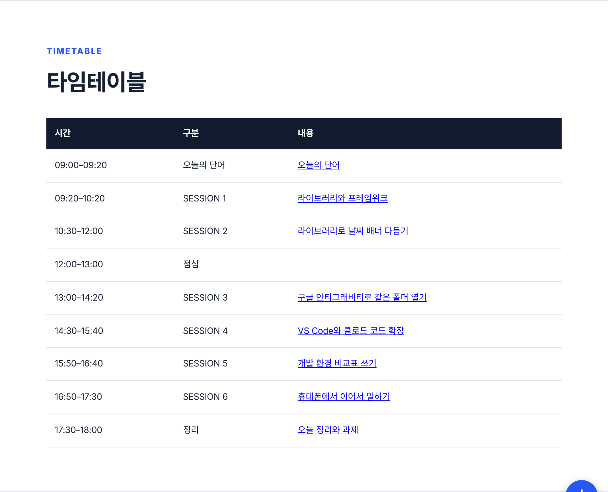
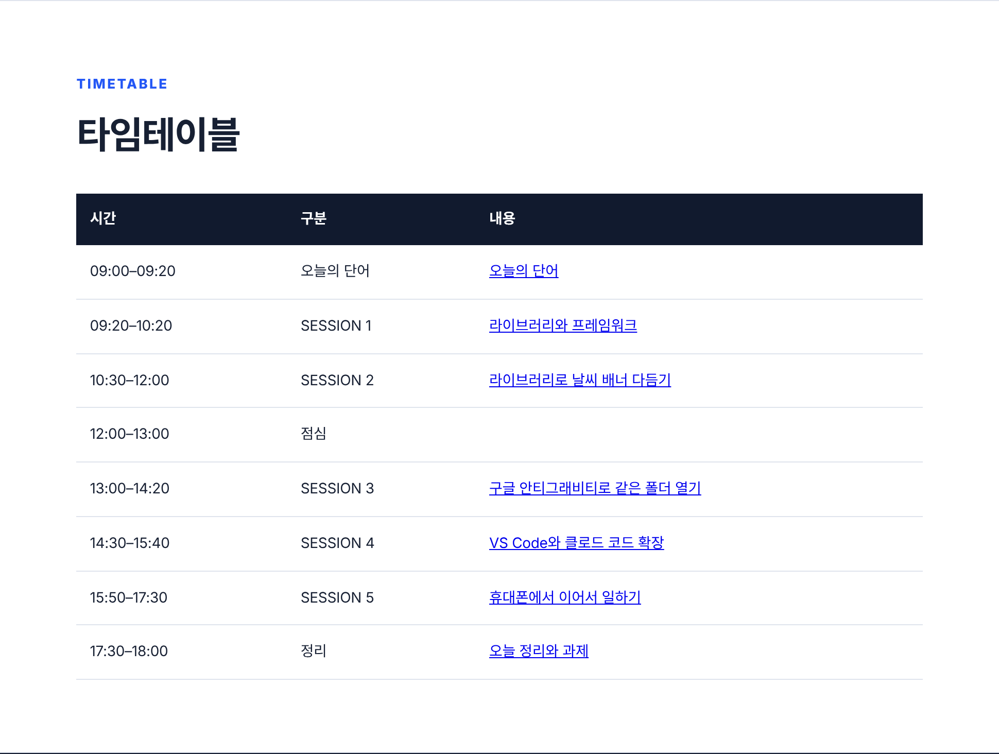
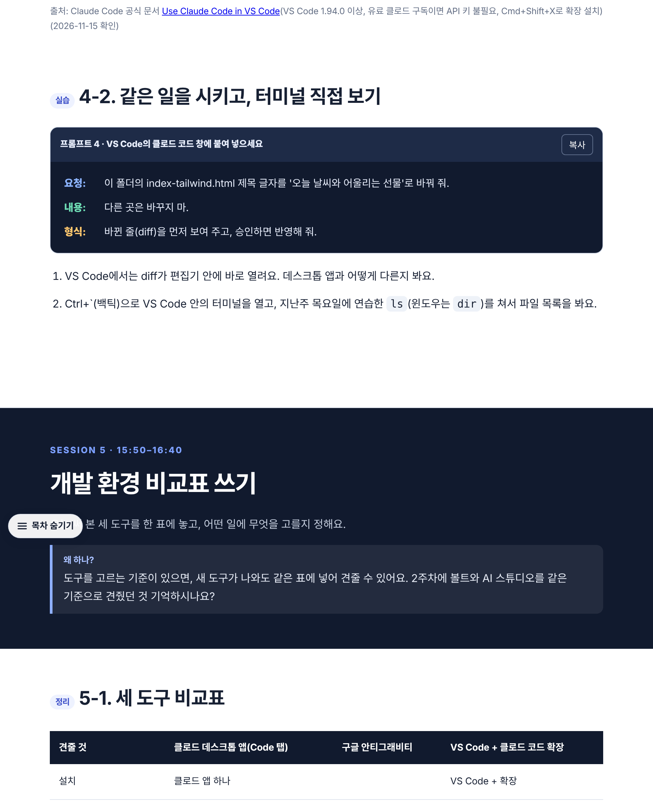
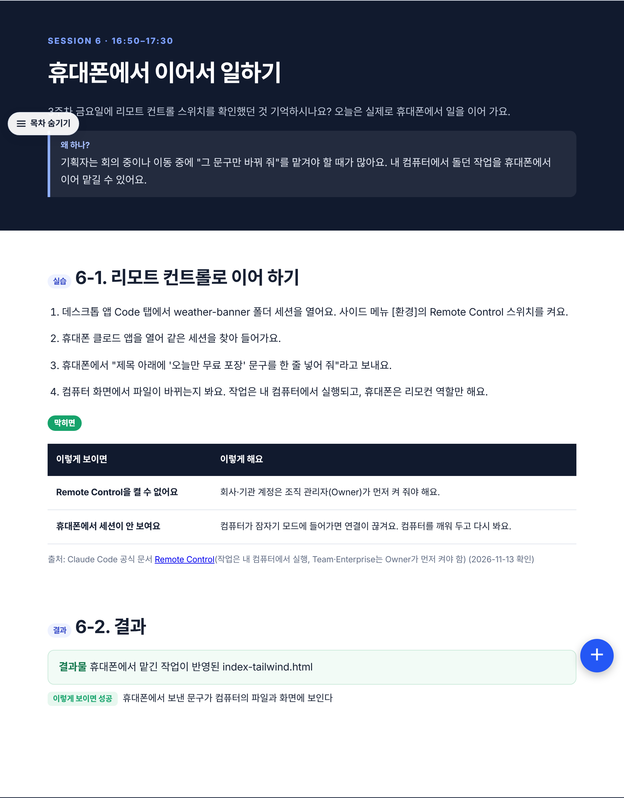
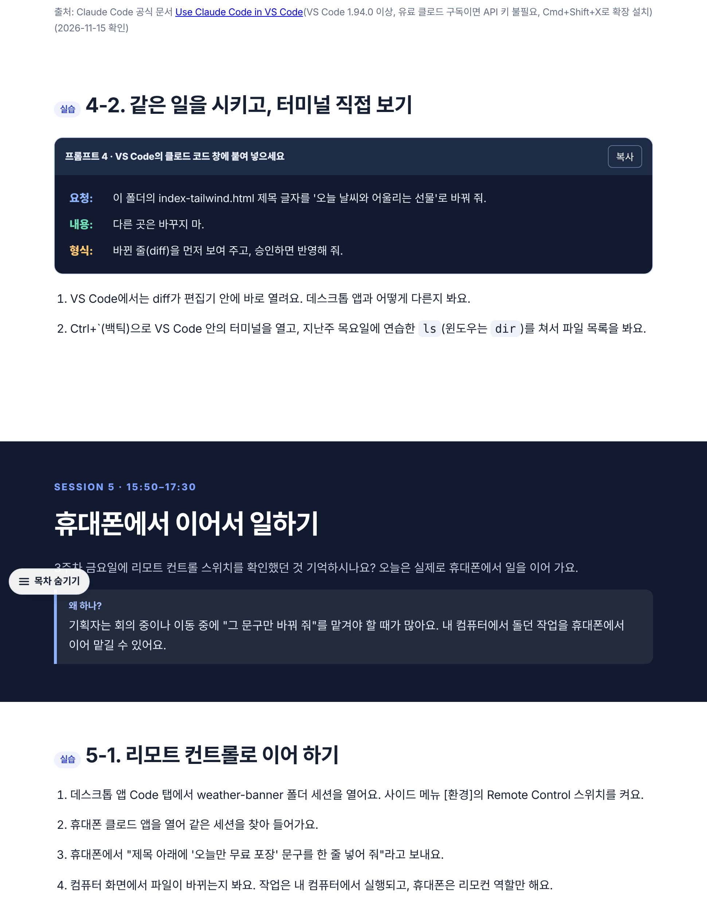
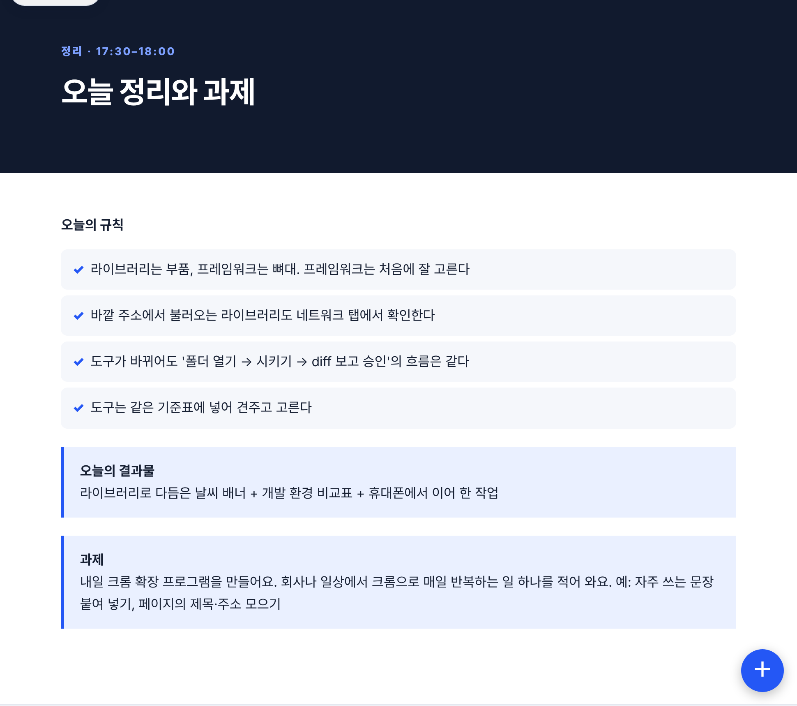
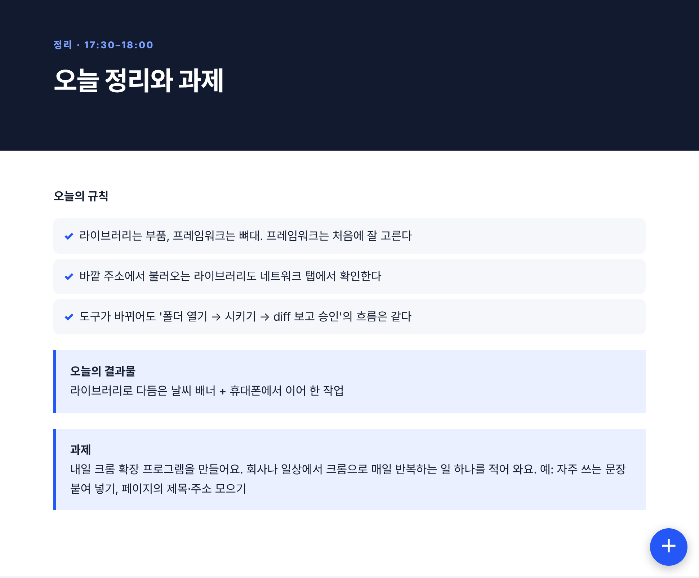
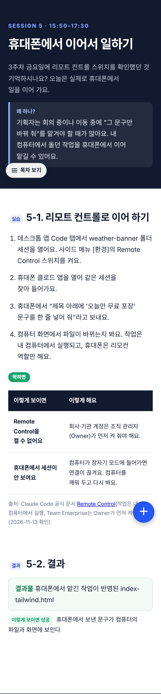

# 4주차 DAY 3 — 세션 5 "개발 환경 비교표 쓰기" 삭제 (2026-11-18)

## 한 줄 요약
로린님 지시로 DAY 3의 세션 5(세 도구 비교표)를 통째로 지우고, 세션 6(휴대폰에서 이어서 일하기)을 세션 5로 당겼어요. 비교표를 결과물로 적어 둔 4주차 홈·DAY 5 문구도 함께 고쳤어요.

## 바뀐 것
| 파일 | 요일 | 위치 | 바뀐 내용 |
| --- | --- | --- | --- |
| d3-dev-env.html | 수 | 세션 5 | 섹션 전체 삭제(5-1 세 도구 비교표, 5-2 결과) |
| d3-dev-env.html | 수 | 세션 6 → 5 | id·번호 변경(s6→s5, 6-1→5-1, 6-2→5-2), 시간 16:50–17:30 → 15:50–17:30 |
| d3-dev-env.html | 수 | 사이드 목차·타임테이블 | 세션 5 줄 삭제, 세션 6을 세션 5로 |
| d3-dev-env.html | 수 | 머리말·교육 개요·정리 | '개발 환경 비교표' 결과물 삭제, 교육 목표 "고르는 기준을 설명한다" → "해 본다", 오늘의 규칙 "도구는 같은 기준표에 넣어 견주고 고른다" 삭제 |
| index.html | 홈 | 4주차 결과물, 11/18 행 | '개발 환경 비교표' 삭제, ④ 비교 항목 삭제(⑤→④) |
| d5-agent.html | 금 | 수업 전 준비, 6-1 결과물 표 | '개발 환경 비교표' 삭제 |

## 화면으로 보면
| 장면 | 전 | 후 |
| --- | --- | --- |
| 타임테이블 |  |  |
| 세션 5 |  | (삭제) |
| 휴대폰 세션 |  |  |
| 정리 |  |  |
| 390px | – |  |

## 확인한 것
- d3 안에 s6·SESSION 6·'개발 환경 비교표' 남은 곳 없음(세션 2의 '전후 비교표'는 다른 내용이라 유지)
- 다른 교안에서 d3-dev-env.html#s5·#s6로 거는 링크 없음
- 1280px·390px 가로 스크롤 없음

## 확인 못 한 것 / 리뷰 포인트
- 새 세션 5 시간을 15:50–17:30(100분)으로 늘렸어요. 실제 진행 시간이 다르면 알려 주세요.
- 4주차 홈의 "구글 안티그래비티·VS Code에서 같은 페이지를 띄워 클로드 코드와 비교해요" 문장은 세션 3·4에서 직접 써 보며 견주는 내용이라 남겼어요.
