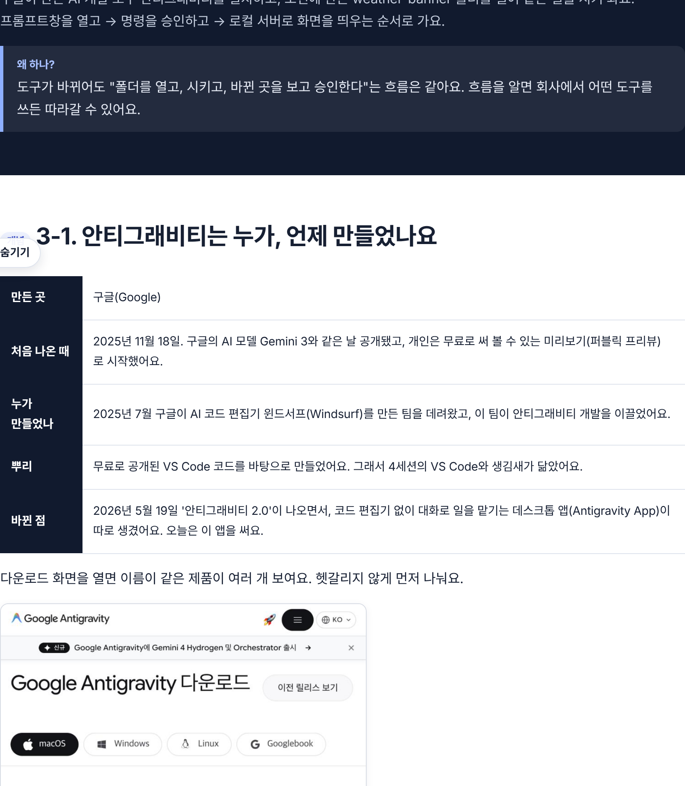
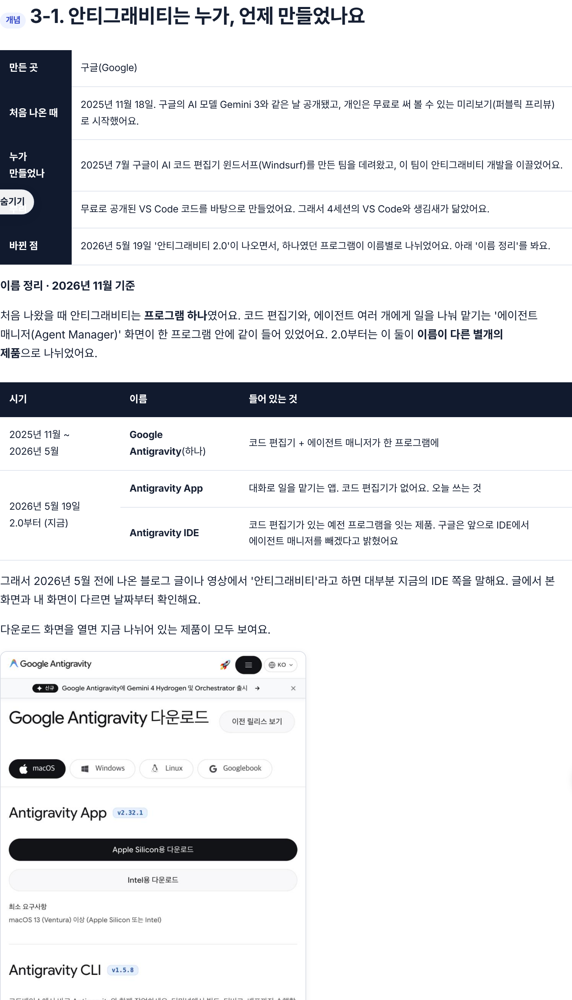
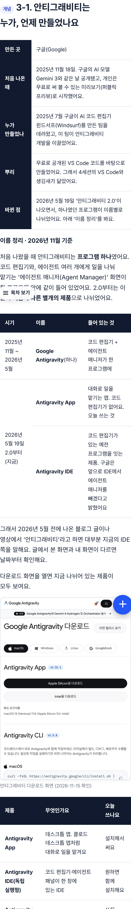

# 4주차 DAY 3 — 3-1에 안티그래비티 '이름 정리 · 2026년 11월 기준' 추가 (2026-11-18)

## 한 줄 요약
처음(2025-11)에는 'Google Antigravity' 하나에 코드 편집기와 에이전트 매니저가 함께 있었고, 2.0(2026-05-19)부터 Antigravity App과 Antigravity IDE로 나뉘었다는 사실을 3-1에 표로 분명히 적었어요.

## 바뀐 것
| 파일 | 절 | 바뀐 내용 |
| --- | --- | --- |
| d3-dev-env.html | 3-1 | '바뀐 점' 줄을 '이름별로 나뉘었다'로 바꿈 + '이름 정리 · 2026년 11월 기준' 소제목·설명·시기별 표(이전 하나 / 지금 App·IDE) + "2026년 5월 전 글의 '안티그래비티'는 대부분 지금의 IDE" 안내 + 출처 문구 보강 |

## 화면으로 보면
| 전 | 후 | 390px |
| --- | --- | --- |
|  |  |  |

## 확인한 것
- TestMu AI 리뷰(2025년 11월 IDE = 편집기 + 별도 Agent Manager, 2026-05-19 2.0 = 편집기 없는 App·CLI·SDK, 이후 IDE에서 Agent Manager 제거 예정) (2026-11-18 확인)
- 1280px·390px 가로 스크롤 없음

## 확인 못 한 것
- 'IDE에서 에이전트 매니저 제거'는 예고이며, 실제로 빠졌는지 여부와 날짜는 미확인
- 근거가 구글 공식 발표문이 아니라 리뷰 기사예요. 구글 2.0 발표 글 원문은 아직 열어 보지 않았어요
