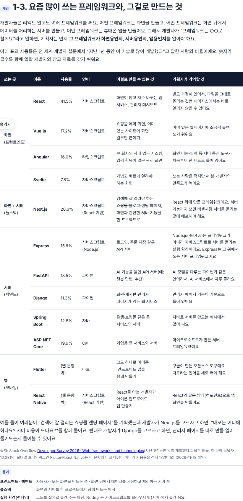
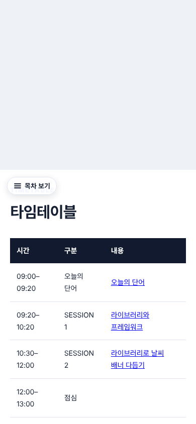

# 4주차 DAY 3 — 1-3 「요즘 많이 쓰는 프레임워크와, 그걸로 만드는 것」 추가 (2026-11-18)

## 바뀐 것
- d3-dev-env.html 1세션에 1-3 신설: 쓰는 곳(화면/화면+서버/서버/앱)별 프레임워크 표 — 이름, 사용률, 언어, 만들 수 있는 것, 기획자가 기억할 것
  - 화면: React 41.5%, Vue.js 17.2%, Angular 16.0%, Svelte 7.8%
  - 화면+서버: Next.js 20.6%
  - 서버: Express 15.6%(Node.js 46.4%는 실행 환경으로 설명), FastAPI 18.5%, Django 11.3%, Spring Boot 12.8%, ASP.NET Core 19.9%
  - 앱: Flutter, React Native(웹 문항 밖이라 사용률 없음)
- 기획자 질문 예시 2개, 출처(Stack Overflow Developer Survey 2026, 응답자 10,281명), 용어 상자
- 사이드 목차 갱신

## 확인한 것
- 사용률: https://survey.stackoverflow.co/2026/technology/data/web-framework (2026-11-18)
- Svelte 만족도 높음: 같은 조사 Admired 59%
- 390px 가로 스크롤 없음

## 확인 못 한 것·상충
- 1세션 머리말("두 말의 차이를 비유로 잡아요")과 1-1(부품 상자와 집의 뼈대)은 2026-11-18 정한 '비유 대신 이런 것이 있다 → ○○라고 부른다' 규칙과 어긋남 → 이번 PR에서는 바꾸지 않음
- jQuery·WordPress·ASP.NET(구버전) 등은 프레임워크 예시에서 뺌

## 화면
 
