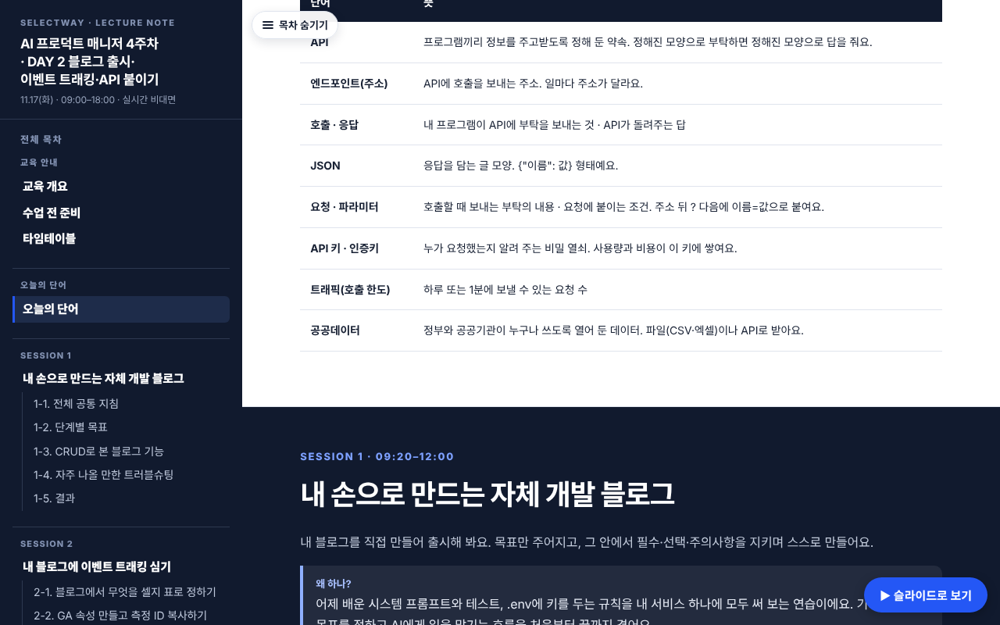
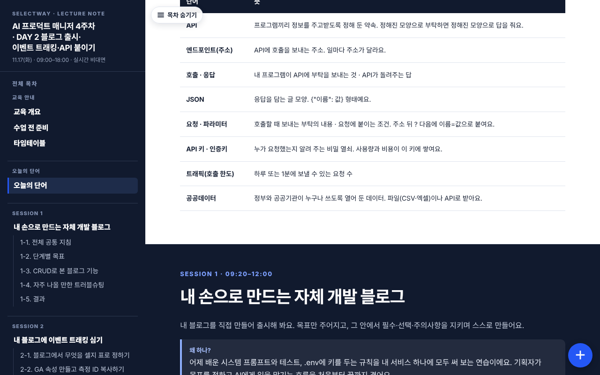
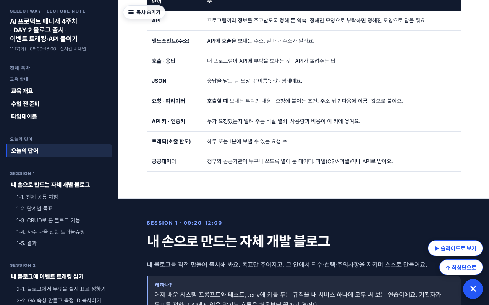
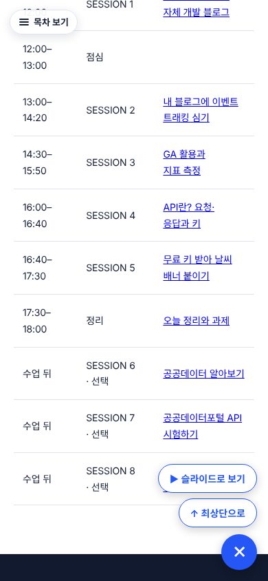
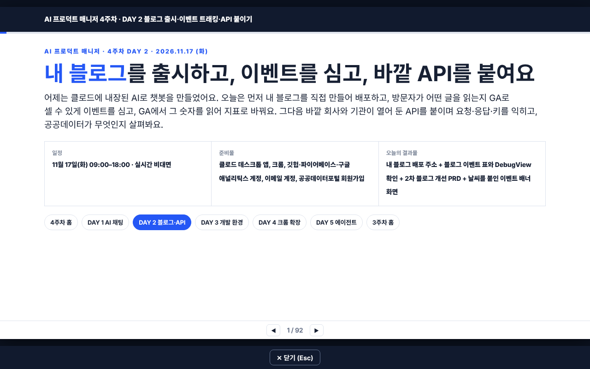

# 교안 오른쪽 아래 FAB → 빠른 메뉴(슬라이드로 보기 / 최상단으로) (2026-11-18)

## 바뀐 것
- `common/tools/apply_fab_menu.py` 신규: 기존 `#slideBtn` 단추를 빠른 메뉴 안으로 옮기고(슬라이드 스크립트는 그대로), ↑ 최상단으로 단추·CSS·JS를 넣는 도구
- 적용한 교안 36개:
261014-ai-data-sheet/index.html
261019-ai-report-chatgpt/index.html
261019-ai-report-plan/index.html
261026-ai-pm-week1/d1-ot.html
261026-ai-pm-week1/d2-ai-governance.html
261026-ai-pm-week1/d3-github-agile.html
261026-ai-pm-week1/d4-python-1.html
261026-ai-pm-week1/d4-web-basics.html
261026-ai-pm-week1/d5-first-deploy.html
261026-ai-pm-week1/d5-python-2.html
261026-ai-pm-week1/index.html
261102-ai-pm-week2/d1-problem-artifact.html
261102-ai-pm-week2/d2-claude-flow.html
261102-ai-pm-week2/d3-deploy-localdb.html
261102-ai-pm-week2/d4-vibe-tools-bolt.html
261102-ai-pm-week2/d5-google-firebase.html
261102-ai-pm-week2/index.html
261109-ai-pm-week3/d1-sheet-appsscript.html
261109-ai-pm-week3/d2-web-crawling.html
261109-ai-pm-week3/d3-ai-studio-books.html
261109-ai-pm-week3/d4-claude-code-chatbot.html
261109-ai-pm-week3/d5-chatbot-api.html
261109-ai-pm-week3/index.html
261116-ai-pm-week4/d1-claude-code-chatbot.html
261116-ai-pm-week4/d2-api.html
261116-ai-pm-week4/d3-dev-env.html
261116-ai-pm-week4/d4-chrome-extension.html
261116-ai-pm-week4/d5-agent.html
261116-ai-pm-week4/index.html
drafts/2610-aiclass-python/index.html
drafts/2610-aiclass-python/python-2.html
drafts/261026-github-basics/index.html
drafts/261102-backend-platform/index.html
drafts/261105-ai-agent-three-hands/index.html
drafts/261110-agent-desktop/index.html
drafts/261110-notion-workspace/index.html
- `common/lecture-rules.md` 17장 추가

## 확인한 것 (크롬, 1280px·390px)
- ＋ 누르면 하위 단추 2개 펼침, aria-expanded 전환 / ↑ 최상단으로 → 맨 위로 이동 후 메뉴 닫힘 / ▶ 슬라이드로 보기 → 슬라이드 열림 / 스크립트 오류 0
- 다른 폴더 표본 3개(10/14 교안, 1주차 홈, 노션 예비교안)에서도 동작

## 화면

