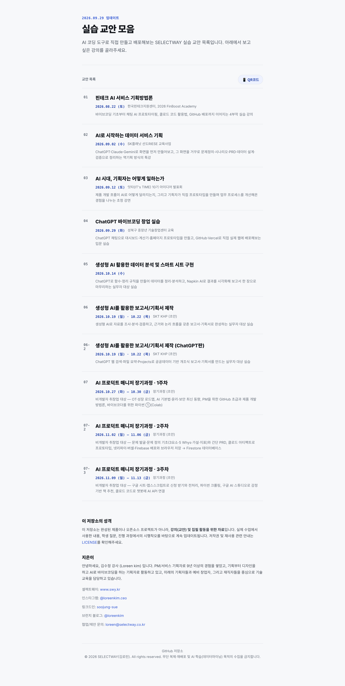
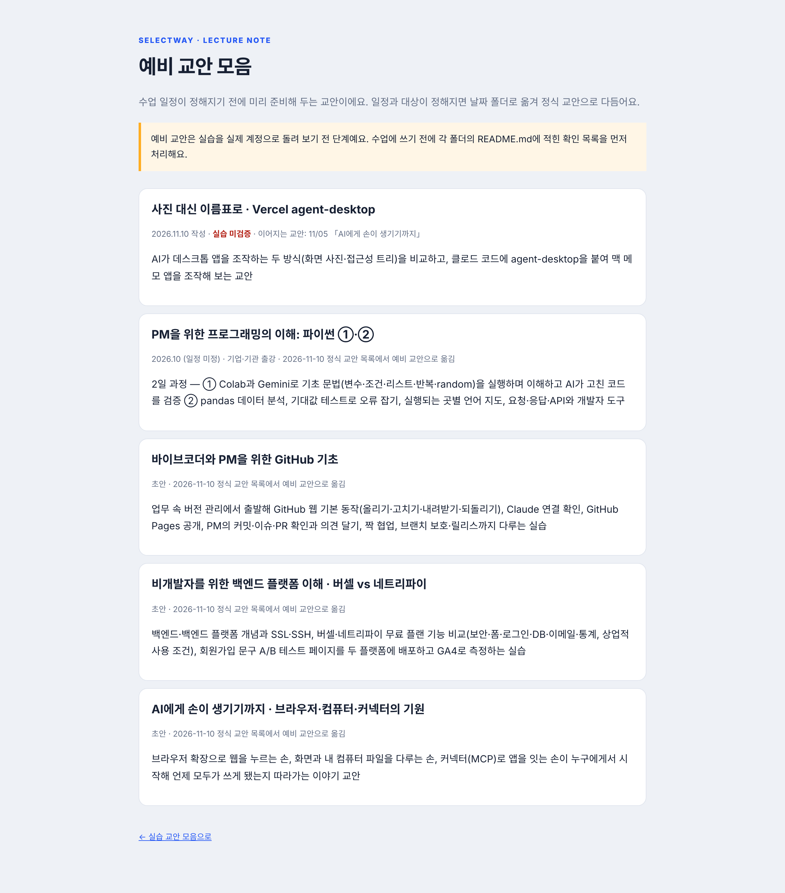

# 교안 4종을 예비 교안(draft/)으로 이동 (2026-11-10)

옮긴 교안: 파이썬 ①·②(2610-aiclass-python), GitHub 기초(261026-github-basics), 백엔드 플랫폼(261102-backend-platform), AI에게 손이 생기기까지(261105-ai-agent-three-hands)

| 장면 | 캡처 |
| --- | --- |
| 홈 정식 교안 목록 — 4종 빠지고 번호 다시 매김(01~07-3) |  |
| 예비 교안 목록(draft/) — 기존 agent-desktop + 옮긴 4종 |  |
| draft/2610-aiclass-python/ 첫 화면 |  |
| draft/261026-github-basics/ 첫 화면 |  |
| draft/261102-backend-platform/ 첫 화면 |  |
| draft/261105-ai-agent-three-hands/ 첫 화면 |  |
