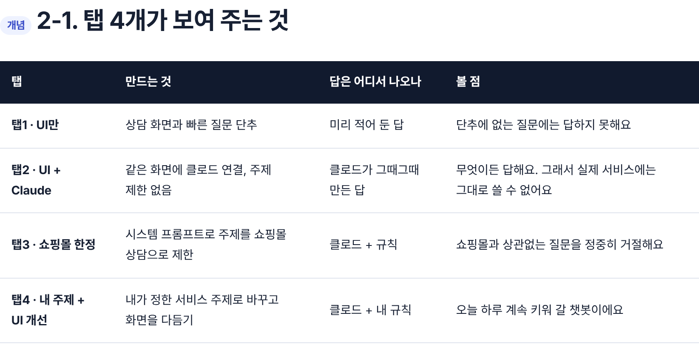
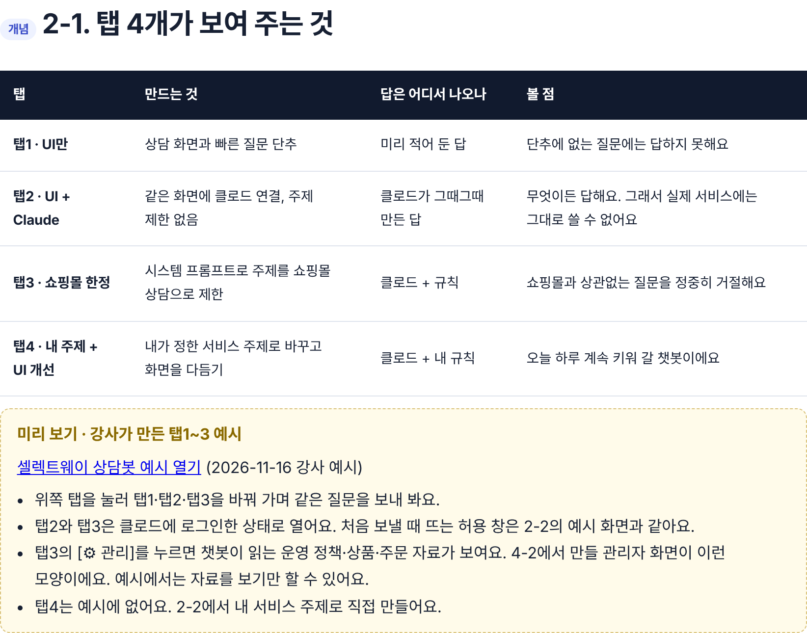
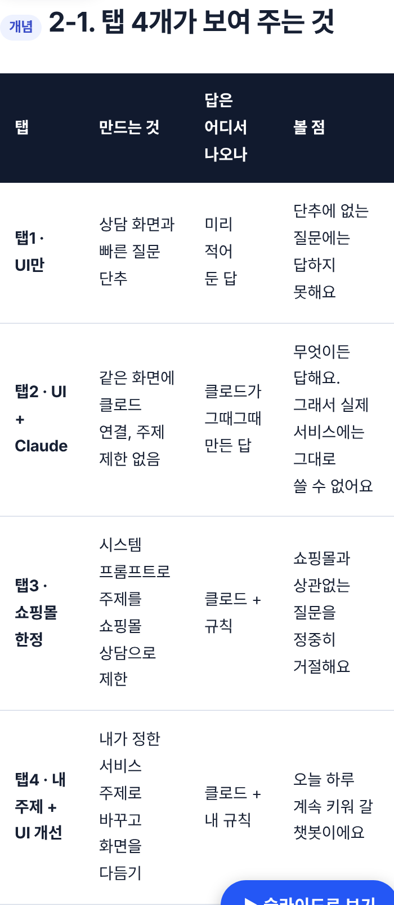
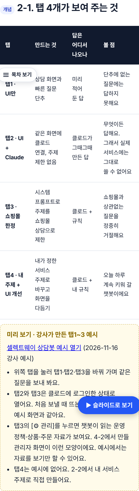

# 4주차 DAY1 · 2-1에 강사 예시(탭1~3) 링크 추가 (2026-11-16)

## 한 줄 요약
학생이 탭 4개를 만들기 전에 완성된 모양을 먼저 볼 수 있게, SESSION 2-1 표 아래에 강사가 만든 탭1~3 상담봇 예시 링크를 넣었어요.

## 산출물 링크
- 교안 (병합 후): https://loreenkim0301.github.io/swy-lecturenote/261116-ai-pm-week4/d1-claude-code-chatbot.html#s2-1-demo
- 예시 아티팩트: https://claude.ai/artifact/UUaW544kAxoGhaR8Xvyv16 (탭1 UI만 · 탭2 UI+Claude · 탭3 쇼핑몰 한정 + ⚙ 관리)

## 바뀐 것
| 파일 | 요일 | 절 | 바뀐 내용 |
|---|---|---|---|
| 261116-ai-pm-week4/d1-claude-code-chatbot.html | 월(DAY1) | 2-1. 탭 4개가 보여 주는 것 | 표 아래에 참고 상자 `미리 보기 · 강사가 만든 탭1~3 예시` 추가 (`id="s2-1-demo"`) |

## 코드로 보면
- 전: 2-1 표(`</table>
`) 다음에 바로 절 끝(`
`)
- 후: 표 다음에 `
` — 예시 링크 1개 + 안내 4줄(탭 바꿔 보기 / 로그인 상태로 열기 / ⚙ 관리는 4-2 관리자 화면 미리 보기·보기 전용 / 탭4는 직접 만들기)
- `common/tools/keep_phrase_linebreak.py` 실행: 새로 넣은 문장의 '할 수 있어요' 1곳만 묶임

## 화면으로 보면
| 장면 | 전 | 후 |
|---|---|---|
| 2-1 PC(1280px) |  |  |
| 2-1 모바일(390px) |  |  |

## 확인한 것
- Playwright(로컬 파일): JS 오류 0, 1280px·390px 가로 스크롤 없음
- 앵커: 새 id `s2-1-demo` 중복 없음, 기존 내부 링크 깨짐 없음(스크립트 안의 템플릿 문자열 1건은 원래 있던 것)
- 규칙 15 금지 문구(강사 설명·강사 조정·확인 필요·TBD·(예정)) 0건
- 예시 아티팩트 저장소 권한: 보기 권한(view)으로 운영 정책 읽기 가능, 편집 권한이 없는 사람(Contributor)의 쓰기는 거절됨 → 학생은 ⚙ 관리 자료를 바꿀 수 없음

## 확인 못 한 것
- **아티팩트가 아직 비공개예요.** 지금은 로린님만 열 수 있어요. claude.ai에서 공개 링크로 공유해야 학생이 열 수 있어요.
- 공개 링크로 연 다른 계정에서 탭2·탭3이 실제로 답하는지(아티팩트 Claude 호출이 방문자 계정으로 동작하는지), 탭3 자료가 보이는지는 시험하지 못했어요.
- 로그인하지 않은 방문자는 탭1만 쓸 수 있을 것으로 보지만 확인하지 못했어요.
- 공개 공유 후 주소가 지금 링크와 달라지면 교안 링크를 바꿔야 해요.

## 리뷰 포인트 (로린님이 정할 것)
1. 아티팩트 공개 공유 후 시크릿 창(다른 계정)에서 탭2·탭3 동작 확인 → 병합
2. 위치: 2-1 표 아래(만들기 전에 미리 보기)로 넣었어요. 2-2 결과 비교 뒤가 낫다면 옮길게요.
3. 링크 문구 '셀렉트웨이 상담봇 예시 열기'와 예시 화면 제목(셀렉트웨이 상담봇 · 무드마켓 고객센터)이 맞는지
