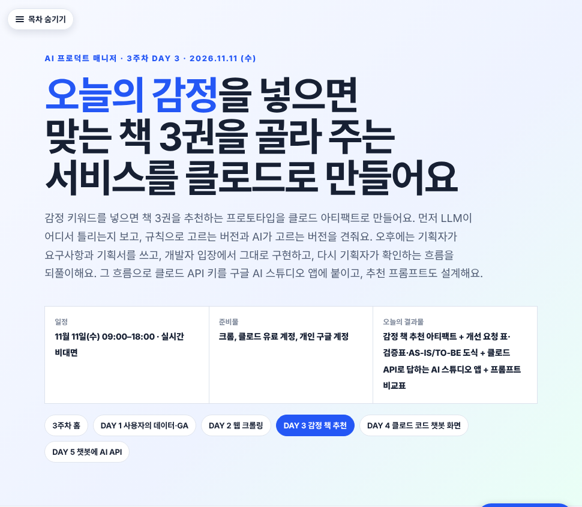
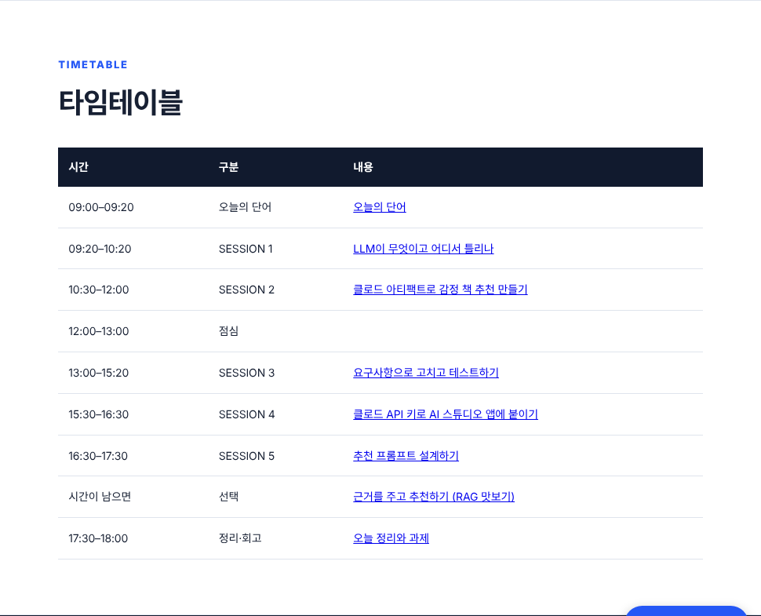
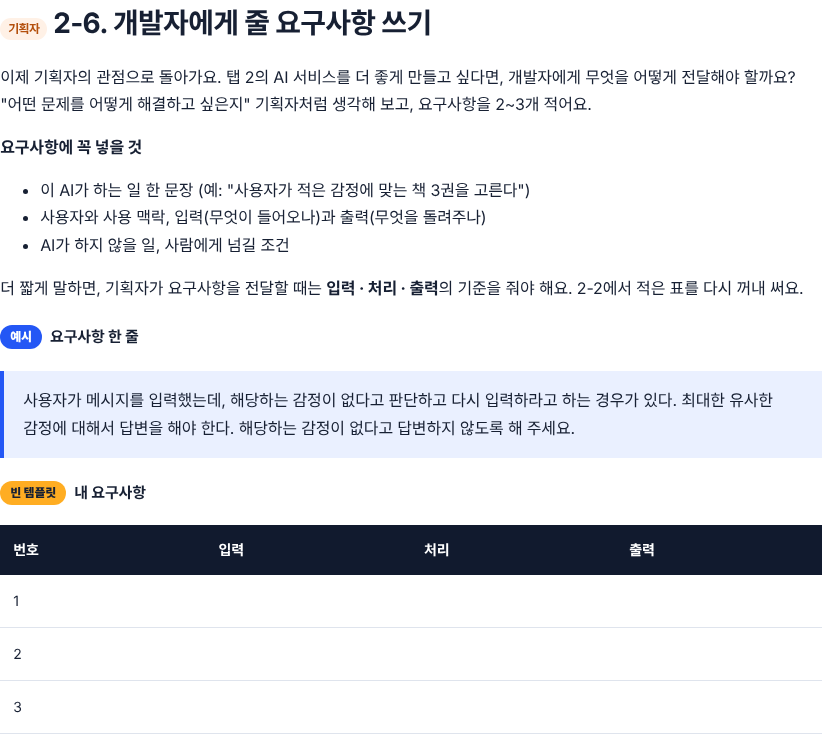
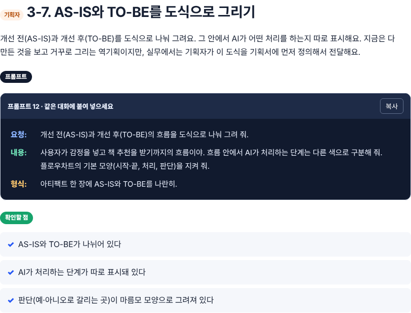
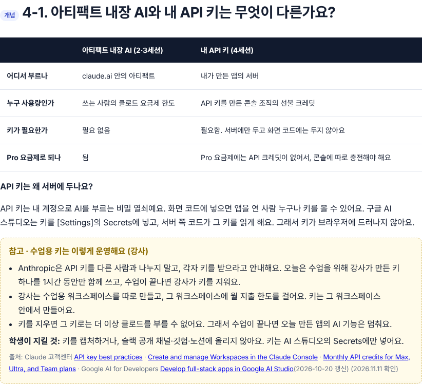
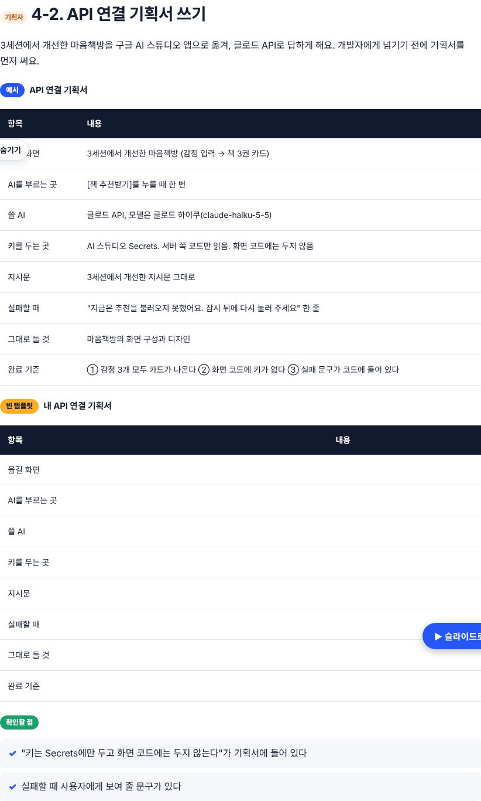
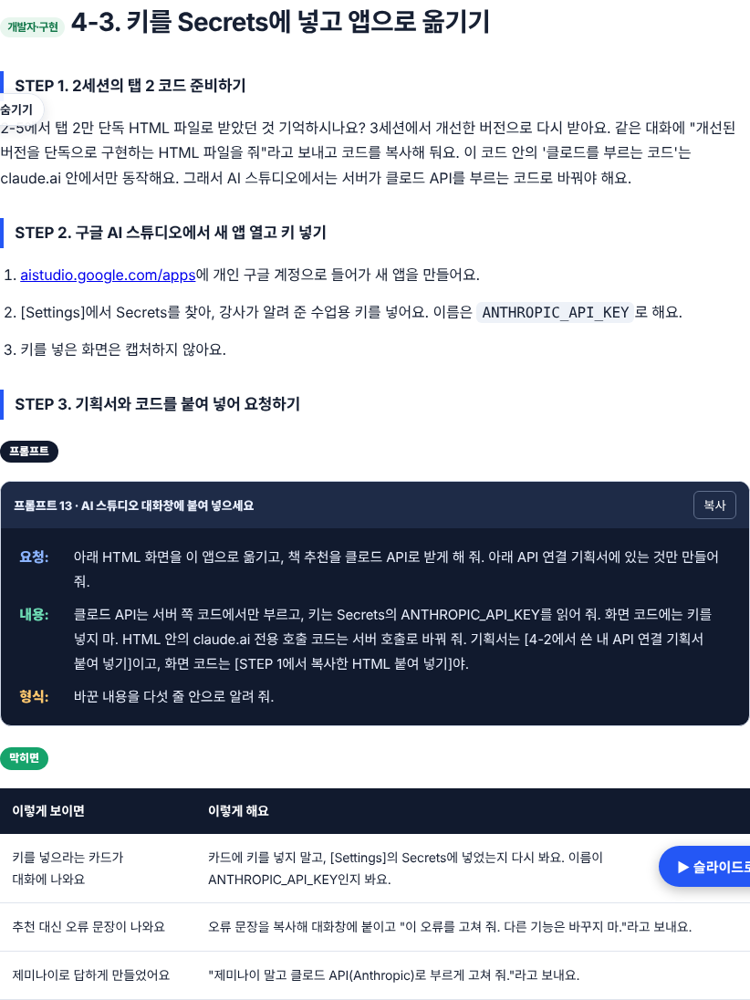
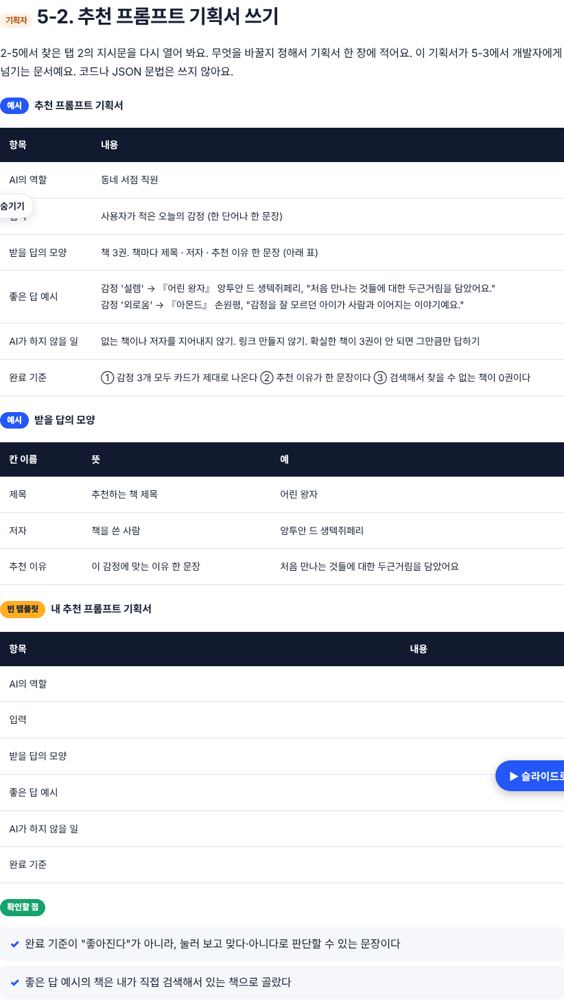
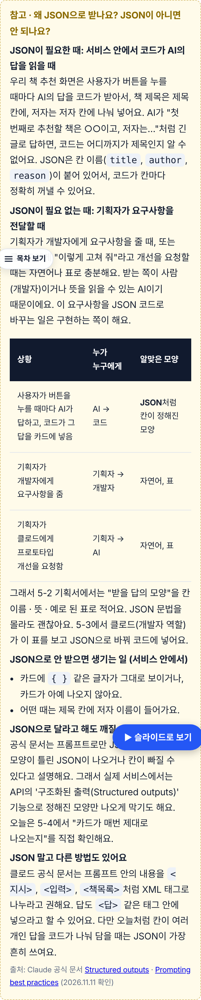

# DAY 3 세션 2~6 교체 (구글 AI 스튜디오·제미나이 → 클로드 아티팩트 + 클로드 API) · 2026-11-11

## 2차 수정 (같은 날 오후, 로린 님 결정 반영)
- **세션 3을 13:00–15:20 실제 진행 순서로**: 3-1 [기획자] 개선 요청 표 → 3-2 [구현] 고치기 → 3-3 [구현] AI 테스트 보고서 → 3-4 [기획자·확인] 검증표·유저플로우 → 3-5 [구현] 개선된 버전 → 3-6 [기획자·확인] 개선 질문 3가지 → 3-7 [기획자] AS-IS·TO-BE 도식. 강사 예시 아티팩트 링크 2개(테스트 보고서, 개선된 마음책방) 추가
- **세션 4 신설 (15:30–16:30)**: 클로드 API 키로 구글 AI 스튜디오 앱에 붙이기. 4-1 아티팩트 내장 AI vs API 키 + 참고 박스(수업용 키 운영: 키 공유 비권장 안내, 워크스페이스 지출 한도, 수업 후 키 삭제, 학생이 지킬 것) → 4-2 [기획자] API 연결 기획서 → 4-3 [구현] Secrets에 키 넣고 옮기기 → 4-4 [기획자·확인] 화면 코드에 키 없는지 확인
- **세션 5 (16:30–17:30)**: 1차의 '추천 프롬프트 설계'를 옮김 (아티팩트 내장 AI, 수업용 키 안 씀)
- **선택 세션 (시간이 남으면)**: 1차의 'RAG 맛보기'를 옮김
- 프롬프트 번호를 1~16으로 다시 매김 (1차에서 세션 1과 2의 '프롬프트 1'이 겹쳤음)
- 타임테이블·사이드 목차·교육 목표·준비물·단어표(API 키, Secrets, AS-IS·TO-BE)·정리 규칙 갱신

## 1차 수정
- 세션 1 유지(제미나이 → 챗지피티), 세션 2를 11/11 오전 실제 진행으로, 기획자/구현/확인 이름표 색 구분, 참고 박스 2개(JSON / Few-shot 외 방법), 3주차 홈·저장소 첫 페이지 문구

## 확인한 것
- 내부 링크(#절) 깨진 곳 없음, '제미나이'는 4-3 '막히면' 표의 "제미나이로 답하게 만들었어요" 한 줄만, 390px·1280px 가로 스크롤 없음

## 확인하지 못한 것
- 프롬프트 7~16을 실제 계정에서 돌려 보지 않음, 실행 캡처 없음 (규칙서 2장 미충족)
- 구글 AI 스튜디오 앱에서 클로드 API(Anthropic) 호출은 공식 문서에 '외부 REST API 호출 가능'만 확인, 클로드로 직접 해 본 예는 없음
- 모델 이름 claude-haiku-5-5는 Anthropic 공개 모델 목록 기준, AI 스튜디오에서 실제 호출로 확인하지 않음

## 캡처
| 화면 | 파일 |
|---|---|
| 머리말 |  |
| 타임테이블 |  |
| 2-6 기획자 요구사항 |  |
| 3-7 AS-IS·TO-BE 도식 |  |
| 4-1 API 키 개념·수업용 키 운영 |  |
| 4-2 API 연결 기획서 |  |
| 4-3 Secrets에 키 넣고 옮기기 |  |
| 5-2 추천 프롬프트 기획서 |  |
| 6-2 근거 추천 기획서(선택) |  |
| 5-1 참고 박스(휴대폰 390px) |  |
