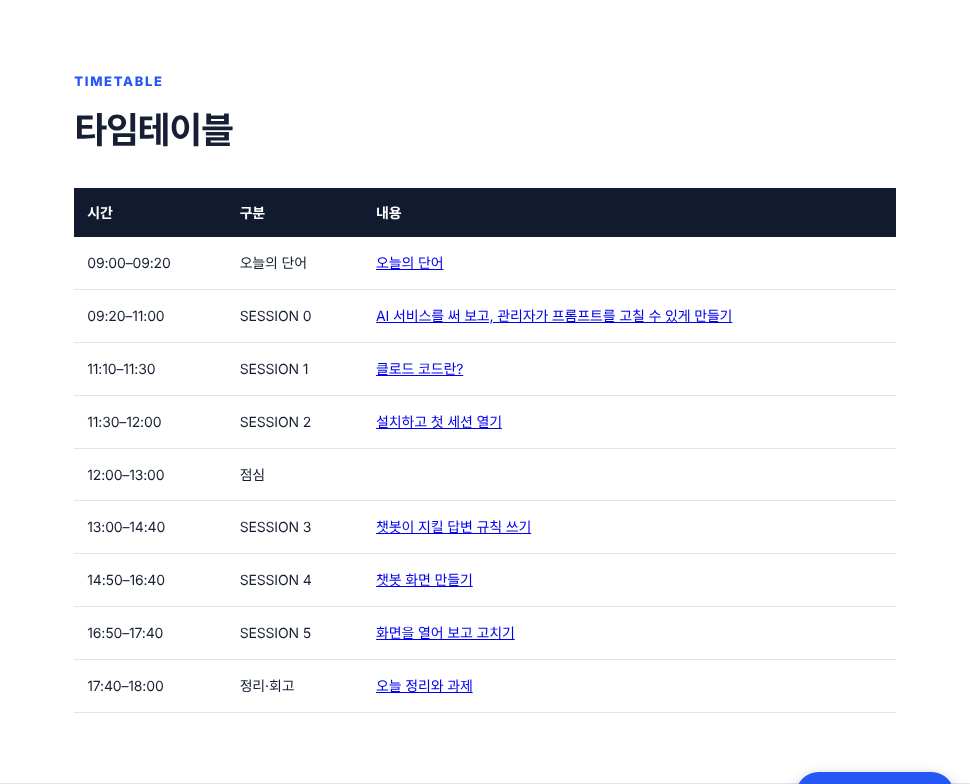
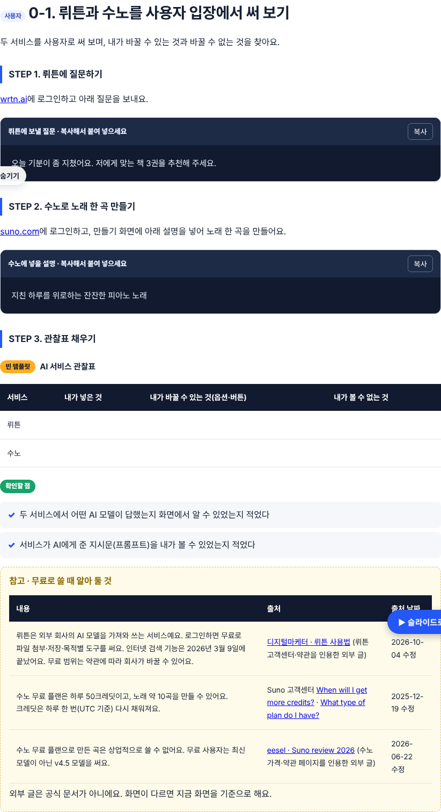
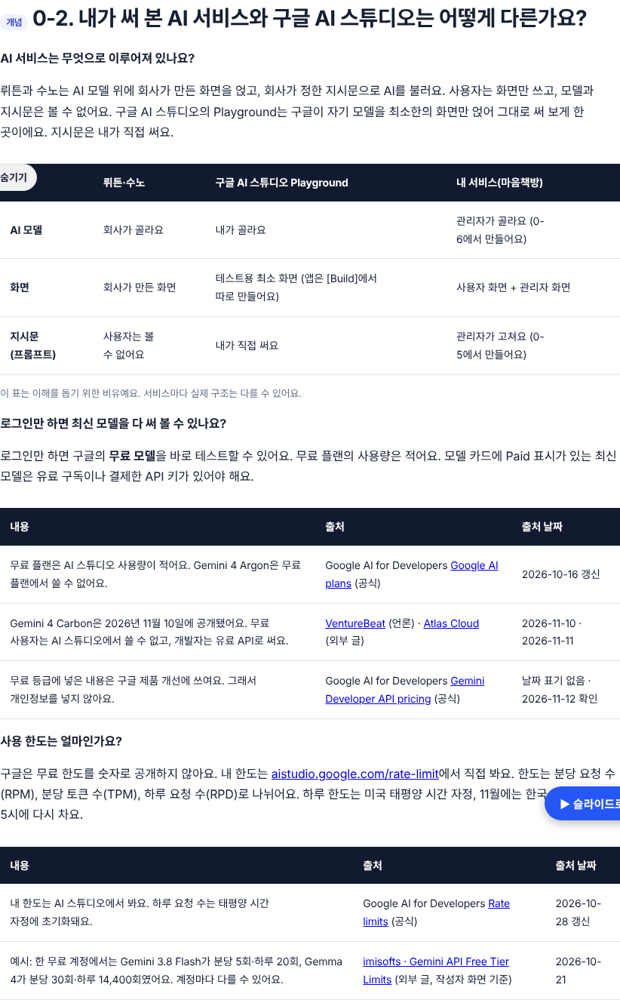
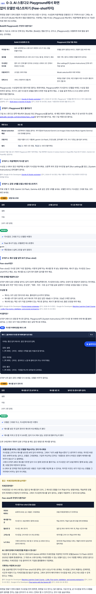
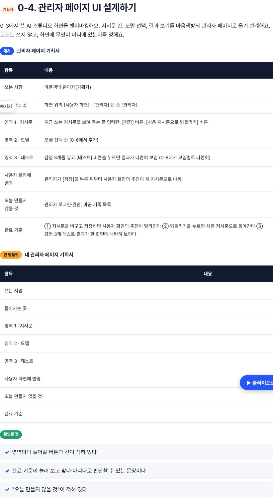
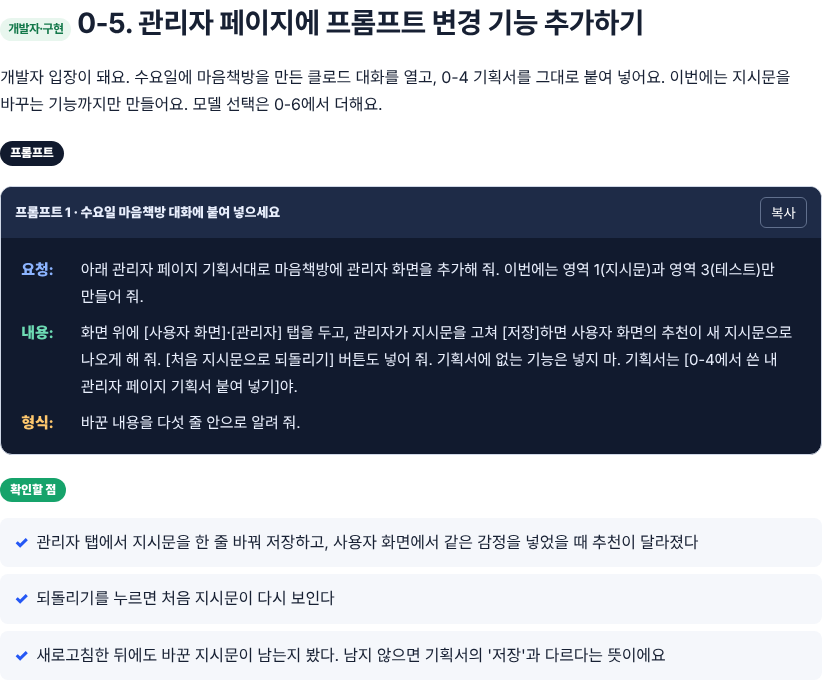
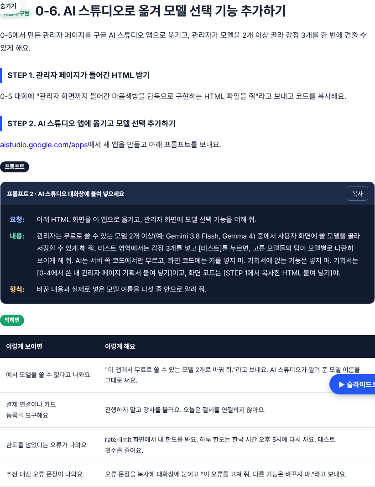
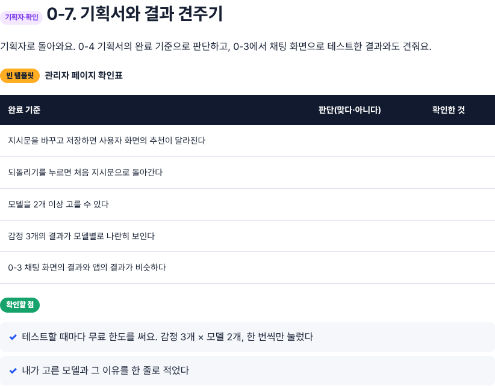
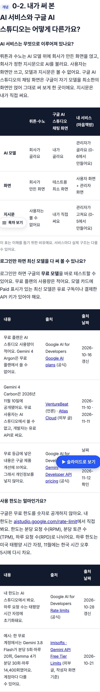

# DAY 4 SESSION 0 추가 · AI 서비스를 써 보고, 관리자가 프롬프트를 고칠 수 있게 만들기 (2026-11-12)

## 3차 수정 (로린 님 지적: 학생은 Playground를 처음 씀)
- 0-3 맨 앞에 "Build와 Playground는 무엇이 다른가요?" 비교표(무엇을 하나·결과물·지시문 위치·모델 바꾸기·언제 쓰나) 추가
- "Playground에서 바꿔도 수요일 앱은 안 바뀜 → 그래서 관리자 페이지" 연결
- STEP 1을 "왼쪽 메뉴에서 [Build] 대신 [Playground]"로, 0-2·0-7의 '채팅 화면' 표현을 Playground로 통일

## 2차 수정 (로린 님 요청)
- 0-3 STEP 4 "예시 답을 넣어 보기(Few-shot)" 추가: Few-shot이란? → 해결하는 문제 → 조심할 점(형식 통일, 너무 많으면 예시만 따라 함, 실제 책으로) → 예시 3개 붙여 넣기 → 넣기 전·후 비교표 → 예시를 지우면 돌아가는지 확인
- 강조 상자 "프롬프트를 바꾸는 것은 모델을 학습시키는 것이 아니에요" (구글 ML 강의: 프롬프트 엔지니어링은 매개변수를 바꾸지 않음, 무료 등급 데이터 활용과도 구분)
- 참고 박스 "미세조정이란?" 다시 씀: 정의, Few-shot과 비교표(무엇이 바뀌나·예시 두는 곳·필요한 것·고치는 법·누가 하나), AI 스튜디오에서는 현재 불가, 기획자의 사용 순서
- Gemma 미세조정 안내 삭제. 빈 이미지 상자 없음(텍스트만)

## 추가한 것
| 절 | 누구 | 내용 |
|---|---|---|
| 0-1 | 사용자 | 뤼튼·수노 써 보기, 관찰표, 무료로 쓸 때 알아 둘 것(출처·날짜 표) |
| 0-2 | 개념 | 뤼튼·수노 / AI 스튜디오 채팅 / 내 서비스 비교(비유 표시), 무료·유료 모델, 사용 한도 (출처·날짜 표) |
| 0-3 | 사용자 | AI 스튜디오 채팅 화면 둘러보기(강사 화면 2026-11-12), 마음책방 지시문을 System Instructions에 넣고 감정 3개 × 무료 모델 2개 테스트, **참고 박스: 미세조정이란? (AI 스튜디오에서는 현재 불가)** |
| 0-4 | 기획자 | 관리자 페이지 UI 설계 (예시 기획서 + 빈 템플릿) |
| 0-5 | 구현 | 클로드 마음책방에 관리자 탭 + 프롬프트 변경·저장·되돌리기 |
| 0-6 | 구현 | AI 스튜디오 앱으로 옮기고 모델 2개 이상 선택, 감정 3개 모델별 나란히 테스트 |
| 0-7 | 확인 | 관리자 페이지 확인표 |

- 시간표: SESSION 0 09:20–11:00, SESSION 1 11:10–11:30, SESSION 2 11:30–12:00 (설치는 수업 전 준비로)
- 교육 목표 ⓪, 수업 전 준비(뤼튼·수노 계정, 구글 계정, 앱 미리 설치), 단어(관리자 페이지·벤치마킹·미세조정), 정리 규칙 1줄, 3주차 홈 DAY 4 카드
- 프롬프트 번호 1~6으로 다시 매김

## 출처 (본문 표에 날짜와 함께 표기)
- 공식: Google AI plans(2026-10-16), Rate limits(2026-10-28), Gemini API pricing(날짜 없음, 11-12 확인), AI Studio quickstart(2026-07-30), Fine-tuning with the Gemini API(2026-04-28), Prompt design strategies(2026-10-13), ML Crash Course LLM tuning(2025-12-03), Suno 고객센터(2025-12-19)
- 언론·외부: VentureBeat(2026-11-10), Atlas Cloud(2026-11-11), imisofts(2026-10-21), 디지털마케터 뤼튼(2026-10-04), eesel Suno(2026-06-22)

## 확인하지 못한 것
- 뤼튼·수노 공식 사이트/약관 원문은 작업 공간에서 열리지 않아 외부 글로 보완
- System Instructions 위치는 2026-07-30 공식 문서 기준, 지금 화면 캡처 없음
- 프롬프트 1·2(0-5, 0-6) 실제 실행 안 함. Gemma 4가 AI 스튜디오 앱에서 쓰이는지 미확인(막히면 표로 대응)

## 캡처
| 화면 | 파일 |
|---|---|
| 타임테이블 |  |
| 0-1 |  |
| 0-2 |  |
| 0-3 (미세조정 참고 박스 포함) |  |
| 0-4 |  |
| 0-5 |  |
| 0-6 |  |
| 0-7 |  |
| 0-2 휴대폰 390px |  |
