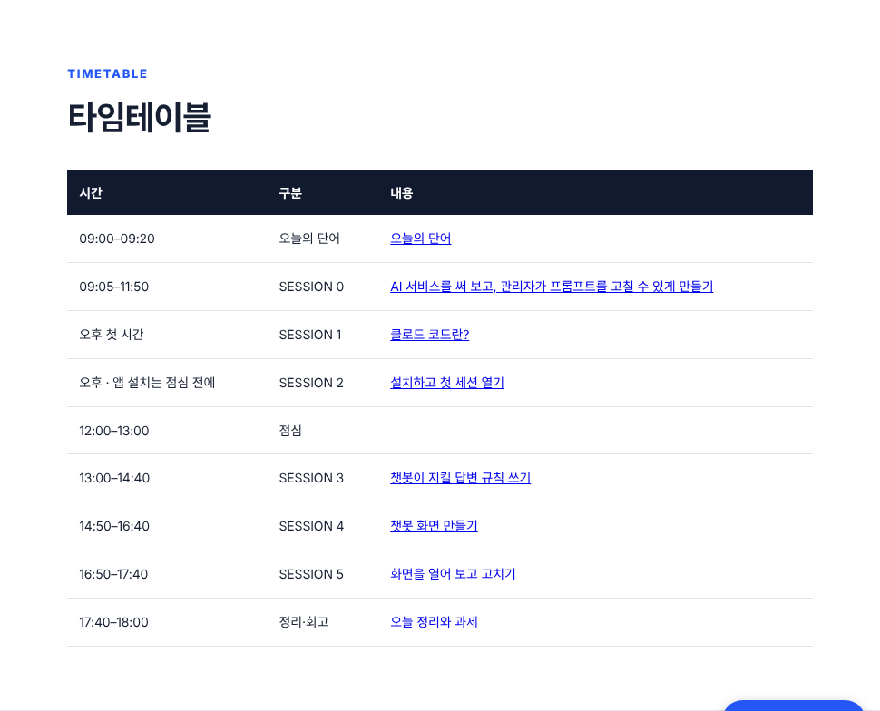
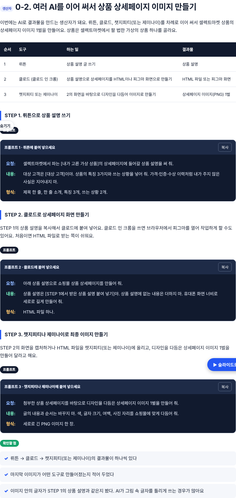
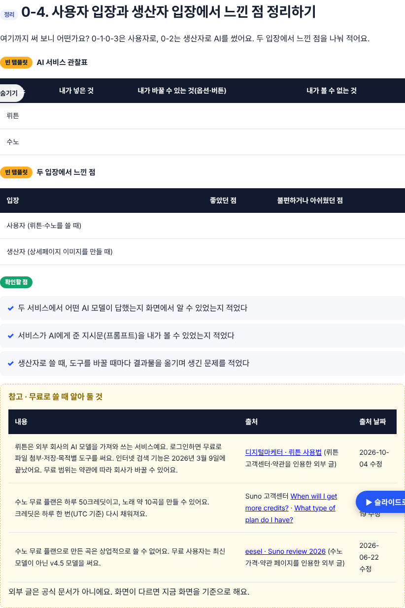
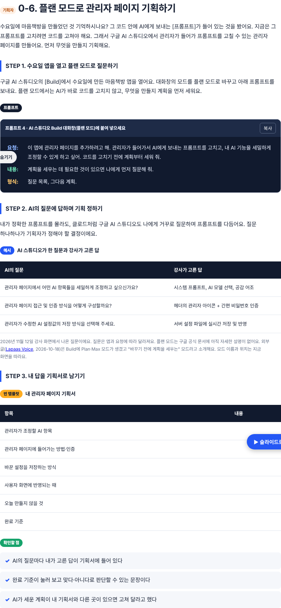
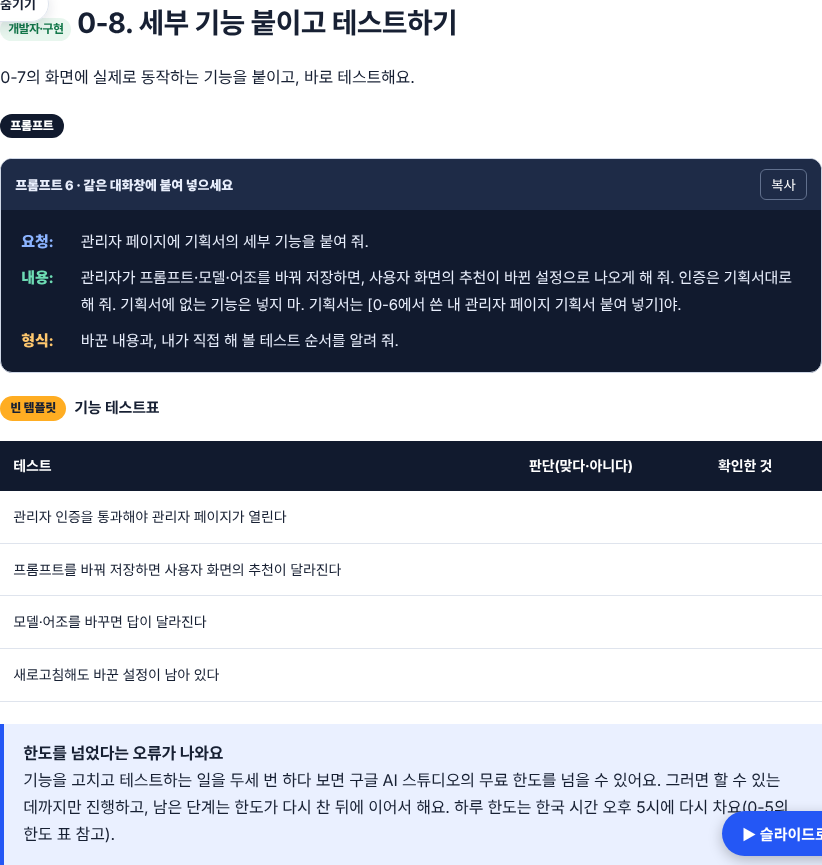
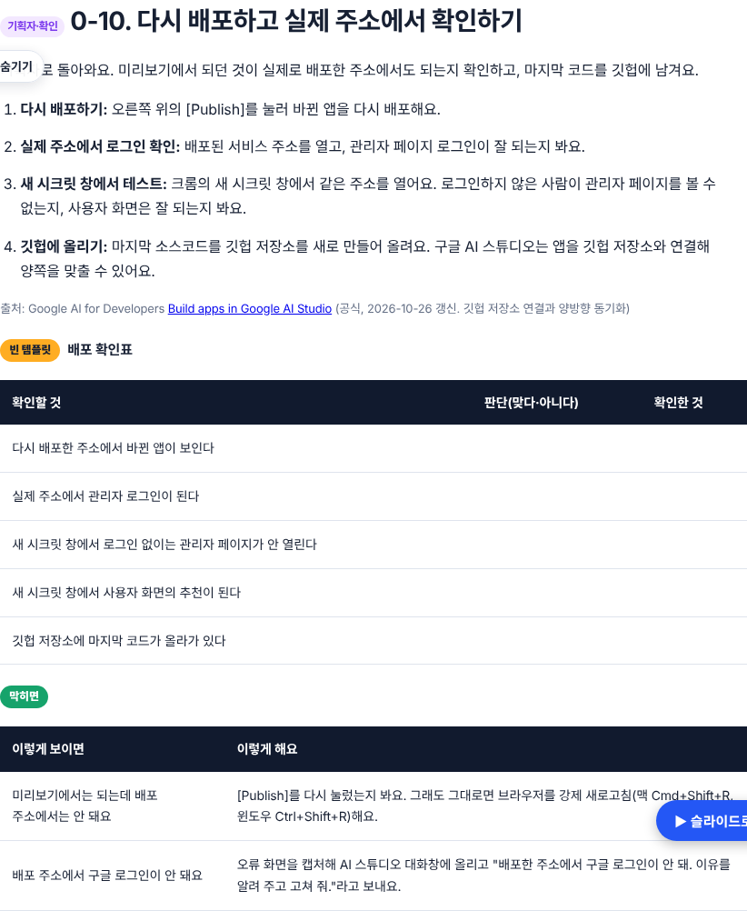
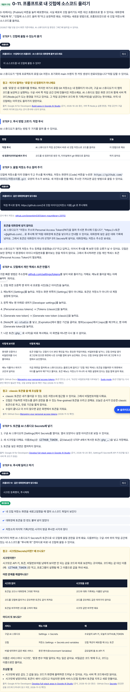
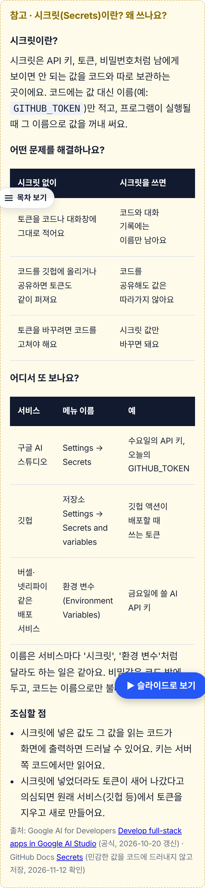

# DAY 4 오전 수업(11/12 09:05–11:51) 슬랙 기록 반영

## 2차 수정 (로린 님 요청)
- 0-10: [Publish] 대신 "배포해 줘" 프롬프트도 가능하다고 추가
- 0-11 신설 "프롬프트로 내 깃헙에 소스코드 올리기": 깃헙에 올릴 수 있는지 묻기 → '로컬 Git 저장소'는 내 컴퓨터가 아니라 AI 스튜디오의 구글 서버 쪽 작업 공간(참고 박스) → 직접 푸시 vs 내 컴퓨터 푸시 → 저장소 주소만 보내기(토큰은 대화창에 넣지 않기) → 깃헙 PAT(classic) 만들기 7단계 + 다시 본인 확인(깃헙 모바일 앱) + 화면이 다를 때 캡처해서 묻기 → Secrets에 GITHUB_TOKEN → "시크릿 등록했어, 푸시해줘"
- 참고 박스: classic 토큰 주의(모든 저장소 접근, 깃헙은 fine-grained 권장, 만료 짧게, 다 쓰면 삭제), 시크릿이란·왜 쓰나·어디서 또 보나(AI 스튜디오/깃헙/버셀·넷리파이)
- 단어표: 시크릿, 개인 액세스 토큰(PAT). 결과 0-11 → 0-12
- 출처: GitHub Docs Managing your personal access tokens · Sudo mode · Secrets (2026-11-12 확인), AI Studio full-stack(2026-10-20)

## 근거
#프로덕트-매니저 채널 강사 메시지 09:06~11:51 (수강생 결과물·이름은 넣지 않음, 슬랙 운영 안내·다음 주 예고·DM 안내는 넣지 않음)

## 바뀐 SESSION 0 (09:05–11:50)
| 절 | 실제 진행 (슬랙 시각) |
|---|---|
| 0-1 사용자 | 뤼튼 써 보기 (09:19 질문, 09:31 실습1) |
| 0-2 생산자 | 뤼튼 → 클로드(클로드 인 크롬, 피그마/HTML) → 챗지피티·제미나이로 상품 상세페이지 이미지 1벌 (09:32 실습2) |
| 0-3 사용자 | 수노 써 보기 (09:33 실습3) |
| 0-4 정리 | 사용자 입장·생산자 입장 느낀 점 (10:13) + 관찰표 + 무료 이용 참고(출처·날짜) |
| 0-5 개념 | AI 서비스와 AI 스튜디오, 무료·유료 모델, 사용 한도 (기존 0-2 유지) |
| 0-6 기획자 | 플랜 모드로 질문 → AI가 역으로 질문 → 기획서 (10:37, 10:40 실습1, 10:47 강사 화면 질문 3개) |
| 0-7 구현 | 관리자 페이지 UI 구축 (10:40 실습2) |
| 0-8 구현 | 세부 기능 구축 → 테스트, 한도 초과 안내 (10:40 실습3, 11:22) |
| 0-9 구현(추가) | 관리자 페이지 진입 시 구글 로그인 (10:42 실습4) |
| 0-10 확인 | 다시 배포 → 실제 주소 로그인 → 새 시크릿 창 → 깃헙 저장소 (11:29) |
| 0-11 결과 | + 오후 전 클로드 데스크톱 앱 설치 (11:51) |
| 선택 | 진행하지 않은 Playground·Few-shot·미세조정 실습을 선택으로 옮김 |

- 진행하지 않은 기존 0-4~0-7(클로드 아티팩트 관리자 탭, 모델 2개 비교)은 실제 흐름(AI 스튜디오 Build 플랜 모드)으로 대체
- PR #164 병합 뒤 올라간 Build/Playground 설명 커밋(ba8a0da)이 배포 브랜치에 빠져 있어 이 브랜치에 합쳤음
- 시간표: SESSION 0 09:05–11:50, SESSION 1·2는 "오후 첫 시간"으로 표기 (오후 시간 확정 필요)

## 출처
- 플랜 모드: 강사 화면(2026-11-12), 외부 글 Lapaas Voice(2026-10-18, 구글 공식 문서 없음)
- 구글 로그인(Firebase "Sign in with Google")·깃헙 연결: Build apps in Google AI Studio (공식, 2026-10-26)

## 확인하지 못한 것
- 프롬프트 1~7을 실제로 돌려 보지 않음 (수업 원문 프롬프트가 슬랙에 없어 강사 지시를 요청·내용·형식으로 다시 씀)
- 오후 SESSION 1~5 시간

## 캡처
| 화면 | 파일 |
|---|---|
| 타임테이블 |  |
| 0-2 상세페이지 이미지 |  |
| 0-4 느낀 점 |  |
| 0-6 플랜 모드 기획 |  |
| 0-8 세부 기능·테스트 |  |
| 0-10 배포 확인 |  |
| 0-11 프롬프트로 깃헙 푸시 |  |
| 0-11 시크릿 참고 박스(휴대폰) |  |
