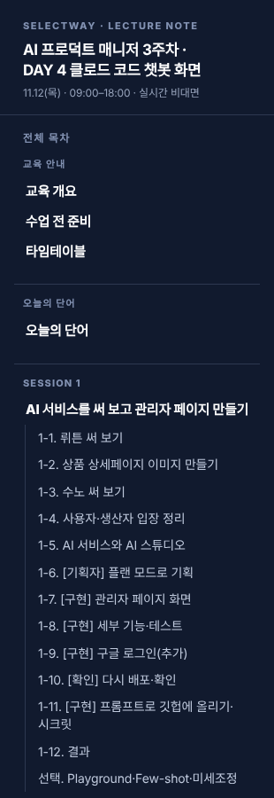
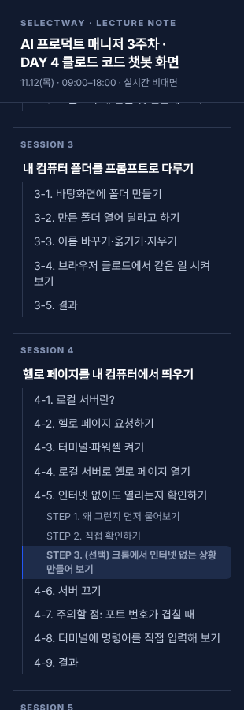
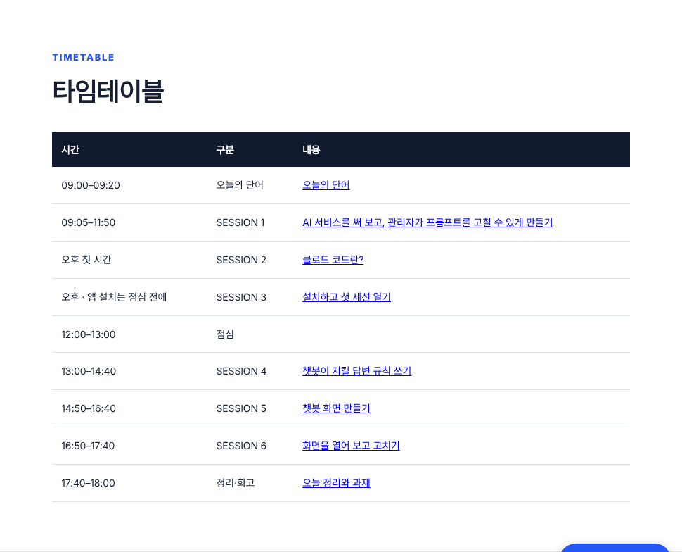
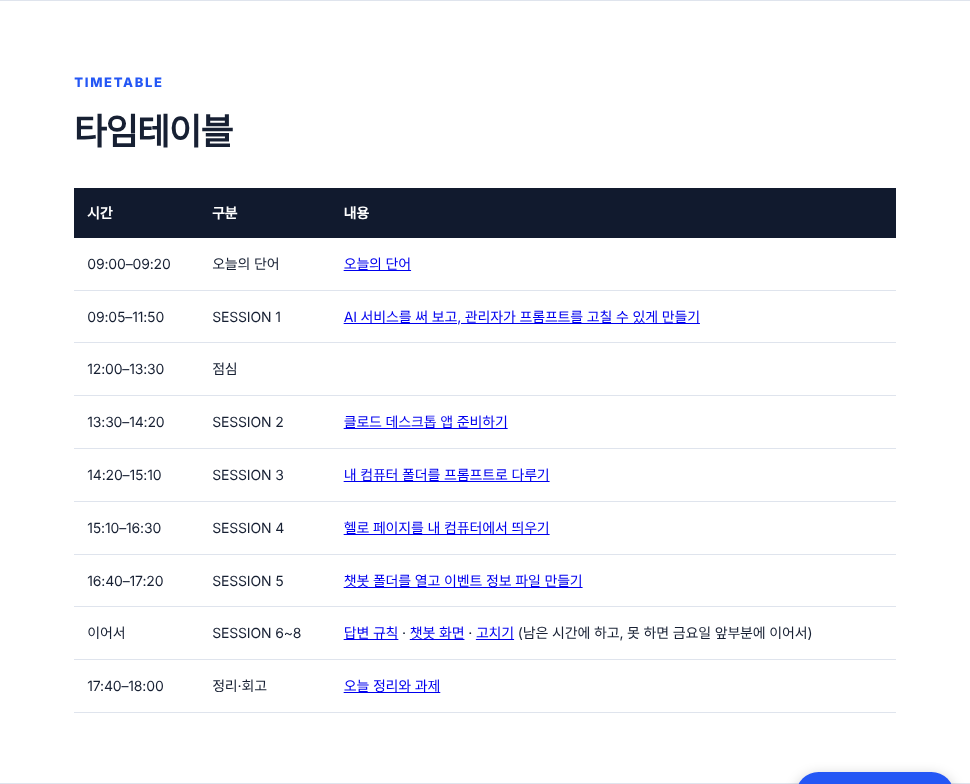
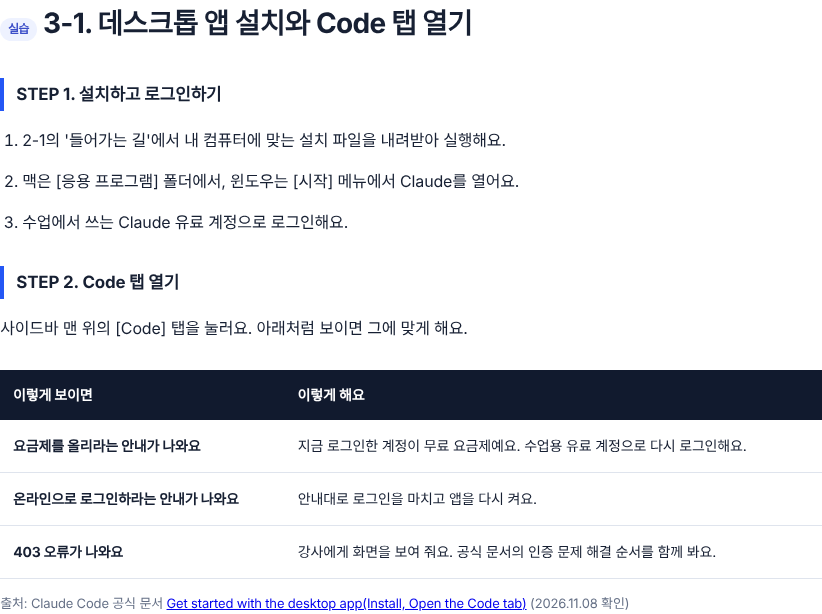
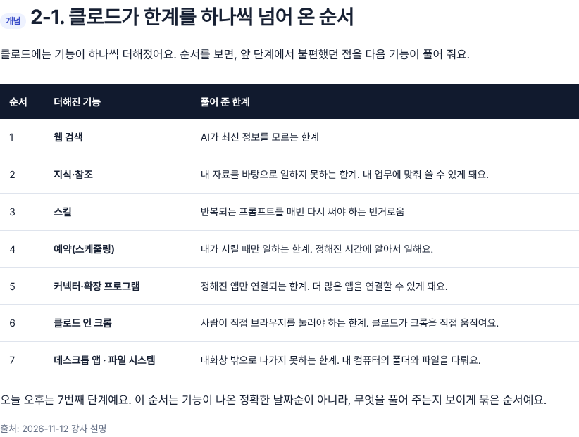

# DAY 4 오후 세션 세분화 + 로컬 서버 실습 (2026-11-12)

## 결과물 링크
- DAY 4 교안(병합 후): https://loreenkim0301.github.io/swy-lecturenote/261109-ai-pm-week3/d4-claude-code-chatbot.html#s2
- 근거 캡처: `06_근거_컴퓨터사용_플랜안내.png` (수강생 이름 없음)

## 한 줄 요약
오늘 오후 실제 수업(데스크톱 앱·파일 시스템·로컬 서버)이 교안에 없었어요. 그래서 SESSION 2~4로 나눠 넣었어요. 챗봇 세션은 SESSION 5~8로 밀었어요.

## 바뀐 것
| 세션 | 전 | 후 |
| --- | --- | --- |
| 2 | 클로드 코드란? (2절) | 클로드 데스크톱 앱 준비하기: 2-1 기능 확장 7단계 · 2-2 채팅·코워크·코드 · 2-3 설치·계정·버전 · 2-4 파일 시스템 연결 · 2-5 흐름 |
| 3 | 설치하고 첫 세션 열기 | 내 컴퓨터 폴더를 프롬프트로 다루기: 3-1 폴더 만들기 · 3-2 폴더 열기(컴퓨터 사용, 플랜 제한) · 3-3 선택 CRUD · 3-4 선택 브라우저 비교 · 3-5 결과 |
| 4 | 답변 규칙 | 헬로 페이지를 내 컴퓨터에서 띄우기: 4-1 로컬 서버란 · 4-2 기획자 요청 · 4-3 터미널·파워셸 켜기 · 4-4 로컬 서버로 열기 · 4-5 인터넷 없이 확인 · 4-6 서버 끄기 · 4-7 포트 번호 주의 · 4-8 선택 명령어 직접 입력 · 4-9 결과 |
| 5~8 | 3~6 | 챗봇 세션. 번호만 +2, 설치 절은 2-3으로 옮김 |

- 타임테이블 · 사이드 목차 · 수업 전 준비(계정 종류 확인) · 오늘의 규칙 · 결과물을 새 구성에 맞췄어요.
- 프롬프트 번호를 1~21로 다시 매겼어요.
- 3주차 홈의 설치 순서 링크를 #s2-3으로 고쳤어요. 'DAY 4 0세션'은 '1세션'으로 고쳤어요.

## 근거
- 컴퓨터 사용 플랜 제한: https://support.claude.com/en/articles/14128542 ("Team and Enterprise plans don't have access to computer use at this time.") 2026-11-12 확인
- 수업 화면 안내 문구: "컴퓨터 사용 기능은 아직 Team 및 Enterprise 플랜에서 제공되지 않습니다." (06 캡처)
- 터미널 열기: Apple 지원 Open or quit Terminal on Mac
- 로컬 서버 기본 포트 8000: Python 공식 문서 http.server
- 크롬 Offline: Chrome DevTools Network features reference

## 확인한 것
- 크롬 개발자 도구 '오프라인'에서는 localhost도 열리지 않음(크로미움 직접 테스트: net::ERR_INTERNET_DISCONNECTED). 그래서 4-5는 네트워크 탭을 '제한 없음'으로 두고 요청이 모두 localhost인지 보는 것을 기본 실습으로 했어요. '왜 정확한가'와 '마음책방을 로컬에서 열면 바깥 인터넷 부분(AI 추천·구글 로그인·바깥 이미지·글꼴)이 깨질 수 있음'은 설명 박스로 넣었어요. 오프라인 메뉴는 '쓰지 않는다' 참고 박스로 옮겼고, 와이파이 끄기는 수업 뒤 선택으로 남겼어요. 
- 사이드 목차 SESSION 1~8, 깨진 앵커 0개, 중복 id 0개
- 390px·1280px 가로 스크롤 없음
- 줄바꿈 묶기 도구 적용(두 번 돌려 변화 0)

## 확인 못 한 것
- 윈도우에서 로컬 서버 켜기(py 명령, 실행 파일)는 실제 PC에서 테스트하지 않았어요.
- 데스크톱 앱 메뉴 이름(설정 > 시스템, 확장 프로그램)은 2026-11-12 수업 화면 기준이에요.

## 화면
| 장면 | 전 | 후 |
| --- | --- | --- |
| 목차 |  |  |
| 타임테이블 |  |  |
| 설치 절 |  |  |

후: [3-2](04_s3-2_후.png) · [4-1](04_s4-1_후.png) · [4-3](04_s4-3_후.png) · [4-3 휴대폰](05_s4-3_휴대폰_후.png) · [4-4](04_s4-4_후.png) · [4-5](04_s4-5_후.png) · [4-6](04_s4-6_후.png) · [4-7](04_s4-7_후.png)

- 네트워크 탭 화면 캡처는 아직 없어요. 개발자 도구는 자동 캡처가 안 돼서, 강사 화면 캡처가 필요해요.

## 추가 (마지막 실습)
- 4-9 마지막 실습: 마음책방 소스코드 전체 내려받기(깃헙 Download ZIP, 없으면 자료실 HTML) → 클로드 코드에 README 읽고 로컬 실행 요청 → 네트워크 탭 '제한 없음'에서 localhost가 아닌 바깥 연결 찾기 → 표·프롬프트로 정리. 결과는 4-10으로 밀었어요.
- 4-1에 127.0.0.1 = localhost 추가(수업에서 127~ 주소로 접속).
- 캡처: [4-9](07_s4-9_마음책방로컬_후.png)
- 확인 못 한 것: AI 스튜디오 앱을 로컬에서 실행할 때 필요한 설정(키, 설치 명령)은 앱마다 달라 직접 실행해 보지 않았어요. 교안에서는 클로드가 README를 읽고 정하게 했어요.

## 추가 (포트·이미지)
- 4-4 첫 프롬프트에서 포트 번호 요청을 뺐어요. 기본 포트는 도구·기기마다 달라서, 클로드가 알려 준 주소를 쓰게 했어요.
- 새 4-5 '포트 번호를 정해서 하나 더 켜 보기'(8080). 두 주소·두 창 비교표. 이후 절 번호 +1(4-6 인터넷 확인 ~ 4-11 결과). 서버 끄기는 두 창 모두 끄도록.
- 오프라인 참고 박스 이미지를 '제한 없음'에 체크된 그림으로 교체(강사 화면에서 체크 위치만 바꿔 표시, 캡션에 명시).
- 캡처: [4-4](08_s4-4_포트_후.png) · [4-5](08_s4-5_포트_후.png) · [4-6](04_s4-5_후.png)

## 추가 (선택 4-9 명령어 연습)
- STEP 1 cd·ls·pwd(맥/윈도우 표) → STEP 2 파이썬·깃·노드제이에스·npm 설치 확인(--version, 설치 안 됐을 때 문구 표, 깃헙≠깃 참고) → STEP 3 직접 로컬 서버 켜기(포트 없이 → 포트 붙여서) + 결과를 클로드에게 정리받는 프롬프트
- 표 안 명령어가 '--'에서 끊기지 않게 td code.inline 줄바꿈 금지
- 캡처: [4-9](09_s4-9_명령어연습_후.png) · [휴대폰](09_s4-9_명령어연습_휴대폰_후.png)
- 확인 못 한 것: 윈도우 명령·안내 문구 실PC 테스트
