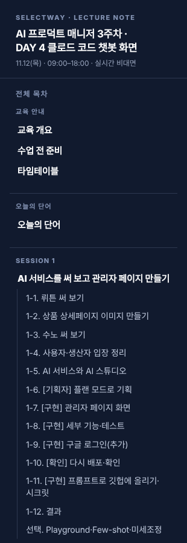
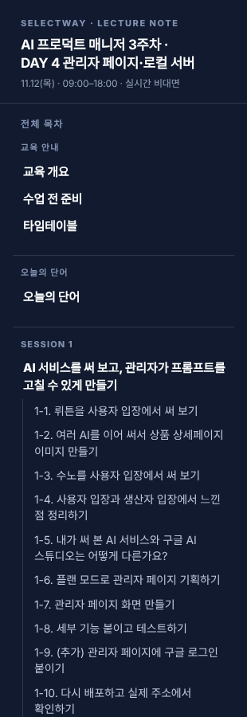
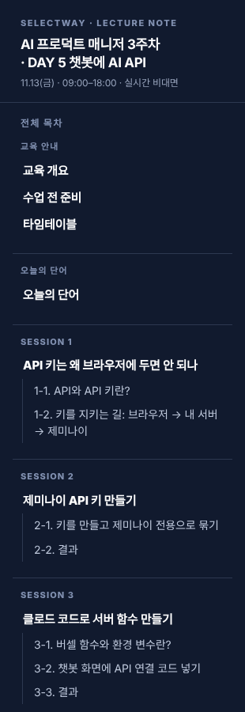
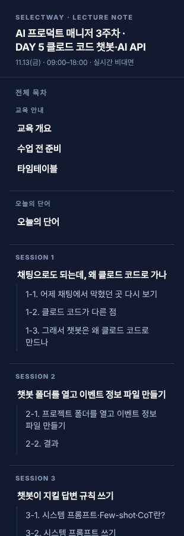

# DAY 4 챗봇 세션을 DAY 5로 이동 + 클로드 코드 개념 세션 (2026-11-12)

## 결과물 링크
- DAY 5(병합 후): https://loreenkim0301.github.io/swy-lecturenote/261109-ai-pm-week3/d5-chatbot-api.html#s1
- DAY 4(병합 후): https://loreenkim0301.github.io/swy-lecturenote/261109-ai-pm-week3/d4-claude-code-chatbot.html#tt

## 바뀐 것
| 파일 | 전 | 후 |
| --- | --- | --- |
| DAY 4 | SESSION 1~8 (5~8 챗봇) | SESSION 1~4. 챗봇 4세션 삭제, 타임테이블에 '금요일(DAY 5)로 옮겼어요' 링크. 제목·소개·교육 목표·결과물·오늘의 규칙을 오늘 실제 수업(관리자 페이지·데스크톱 앱·로컬 서버)으로 고침 |
| DAY 5 | SESSION 1~6 (API 키 ~ 회고) | SESSION 1 새 개념 '채팅으로도 되는데, 왜 클로드 코드로 가나' + 2~5 DAY 4 챗봇 세션 + 6~11 원래 DAY 5 |
| 3주차 전 페이지 | DAY 4 클로드 코드 챗봇 화면 / DAY 5 챗봇에 AI API | DAY 4 관리자 페이지·로컬 서버 / DAY 5 클로드 코드 챗봇·AI API (상단 탭, 홈 표) |

- DAY 5 타임테이블 시간은 '강사 조정'으로 비워 둠(로린님이 직접 조정).
- 옮긴 챗봇 세션의 '금요일에' 표현을 같은 날 세션 번호(8세션·10세션)로 바꿈. 원래 DAY 5의 '목요일에 만든 폴더'는 '2~5세션에서 만든 폴더'로.
- 세션 1 개념(로린님 지적 반영): 학생은 둘 다 데스크톱 앱에서 일반 채팅·클로드 코드를 씀. 채팅에서도 파일 시스템·컴퓨터 사용을 썼음. 그래서 '어제 채팅에서 막혔던 곳'(이름 바꾸기·옮기기·지우기, 폴더 열기, 서버 켜기) → '클로드 코드가 다른 점'(프로젝트 단위, 터미널 명령 직접 실행, diff 승인, 이어서 고치기) → '그래서 챗봇은 왜 클로드 코드로'.

## 확인한 것
- 두 페이지 깨진 앵커 0, 중복 id 0, 390·1280px 가로 스크롤 없음, 프롬프트 번호 재정렬
- 다른 요일을 가리키는 번호(수요일 5세션) 보존

## 화면
| 장면 | 전 | 후 |
| --- | --- | --- |
| DAY 4 목차 |  |  |
| DAY 5 목차 |  |  |

후: [DAY 5 타임테이블](03_DAY5_타임테이블_후.png) · [DAY 5 세션 1](04_DAY5_S1_클로드코드개념_후.png) · [DAY 4 타임테이블](05_DAY4_타임테이블_후.png)
