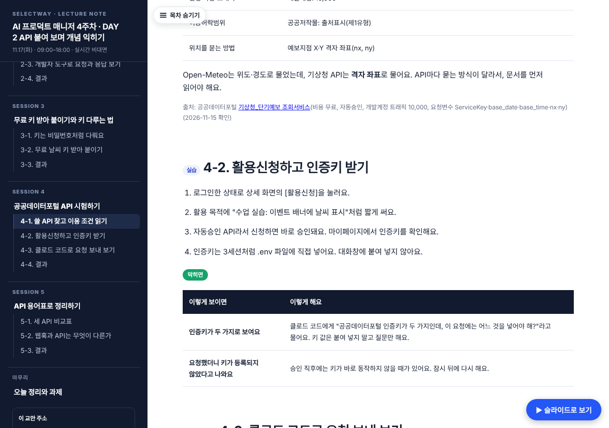
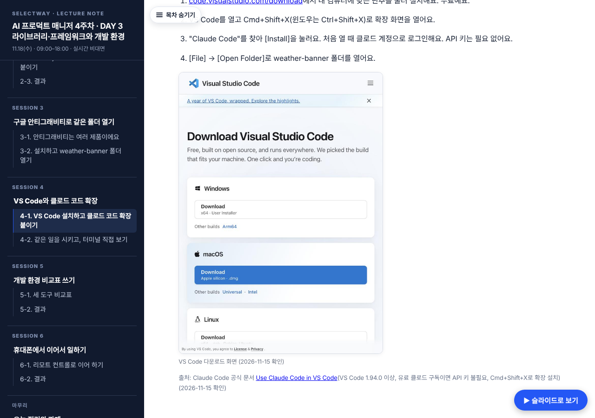
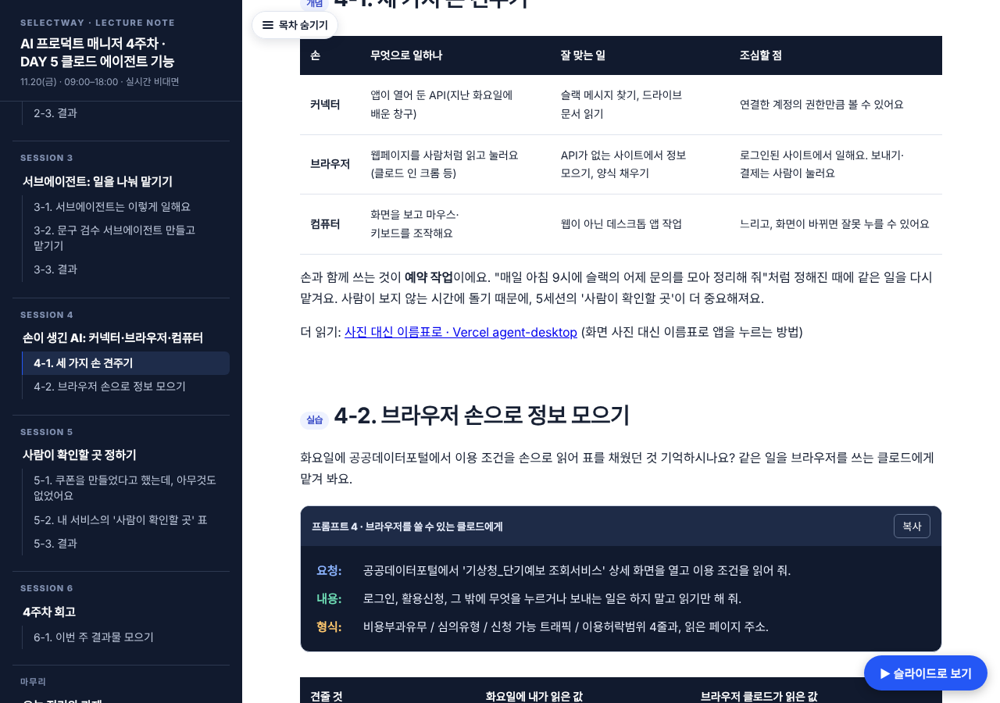

# 4주차 DAY1–DAY5 HTML 교안 (2026-11-15)

## 산출물 링크 (병합 후 GitHub Pages)
- 4주차 홈: https://loreenkim0301.github.io/swy-lecturenote/261116-ai-pm-week4/
- DAY1 클로드 코드로 AI 채팅 만들기: .../261116-ai-pm-week4/d1-claude-code-chatbot.html
- DAY2 API 붙여 보며 개념 익히기: .../261116-ai-pm-week4/d2-api.html
- DAY3 라이브러리·프레임워크와 개발 환경: .../261116-ai-pm-week4/d3-dev-env.html
- DAY4 크롬 확장 프로그램: .../261116-ai-pm-week4/d4-chrome-extension.html
- DAY5 클로드 에이전트 기능: .../261116-ai-pm-week4/d5-agent.html
- DAY1 데모 아티팩트(내장 AI 이벤트 도우미): https://claude.ai/artifact/GWz9EQL3bfHbWw21414N1F

## 바꾼 것
| 파일 | 내용 |
|---|---|
| d1 | 내장 AI 채팅(API 키 없음) → 답변 규칙 → 시험 질문 5가지 → RAG 5단계. 캡처: 첫 화면, 동의 창 |
| d2 (신규) | API 개념 → Open-Meteo(키 없음) → OpenWeather(무료 키, .env) → 공공데이터포털 기상청 단기예보(자동승인, 개발계정 10,000) → 세 API 비교표·웹훅 비교 |
| d3 (신규) | 라이브러리 vs 프레임워크 → Tailwind·Chart.js → 안티그래비티(App/IDE/CLI/확장 구분) → VS Code+클로드 코드 확장 → 비교표 → 리모트 컨트롤 |
| d4 (신규) | 확장 프로그램 파일 4개 → '내 문장 모음' 만들기·설치 → 권한 → 내 반복 업무 확장 프로그램 → 짝 점검. 예시 코드 samples/snippet-ext/ |
| d5 (신규) | 에이전트 개념 → 스킬(SKILL.md) → 서브에이전트(copy-reviewer) → 커넥터·브라우저·컴퓨터·예약 작업 → 사람이 확인할 곳(쿠폰 실패 사례) → 4주 회고 |
| index | DAY2–5 제목에 링크 |

## 확인
- Playwright: 6개 파일 JS 오류 0, 깨진 앵커 0, 이미지 파일 13개 모두 존재·디코드 확인, 모바일(390px) 확인
- 학생 페이지 금지 문구(규칙 15) grep 0건
- keep_phrase_linebreak 실행

## 캡처

## 남은 확인 (로린님)
- DAY1 동의 창 [계속]은 누르지 않음 → AI 답변 화면 캡처 없음
- "idea"는 IntelliJ IDEA(안티그래비티 JetBrains 확장)로 해석해 참고로만 넣음
- d2_weather_page.png, d4_popup_demo.png는 강사 예시로 직접 렌더한 화면
