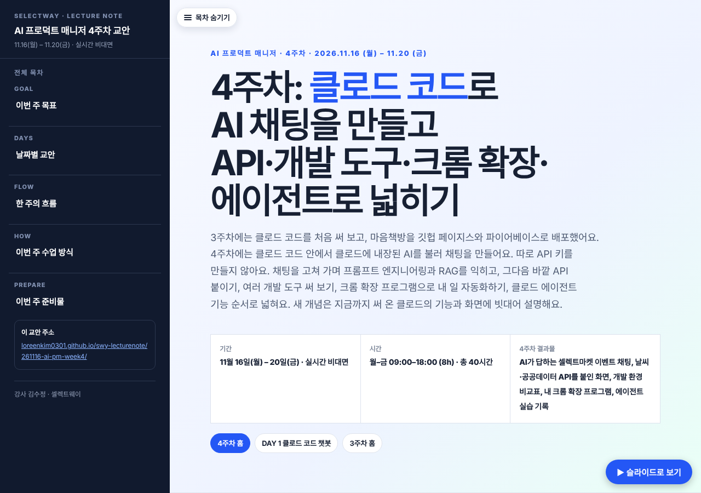
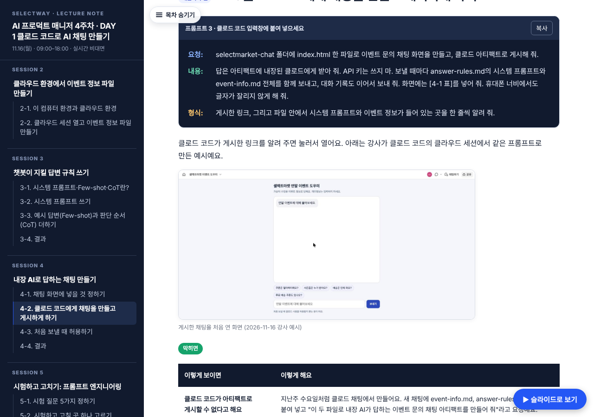
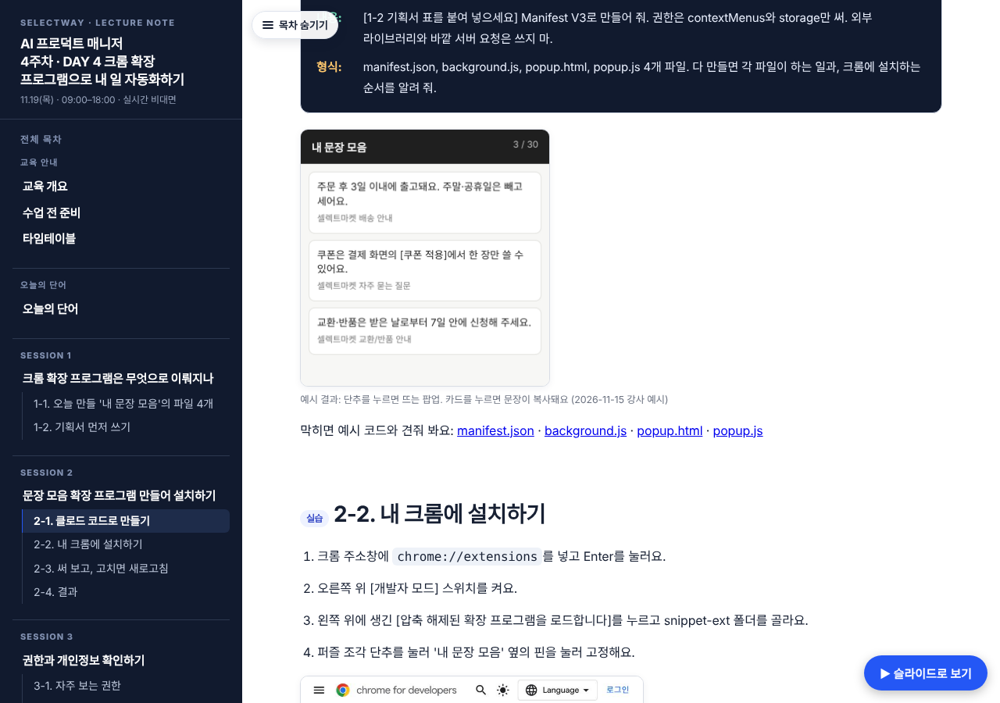
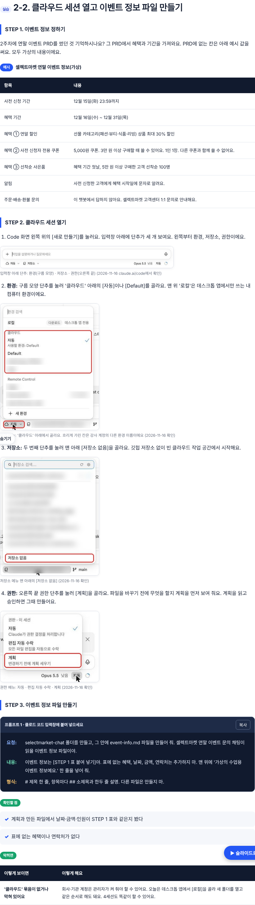
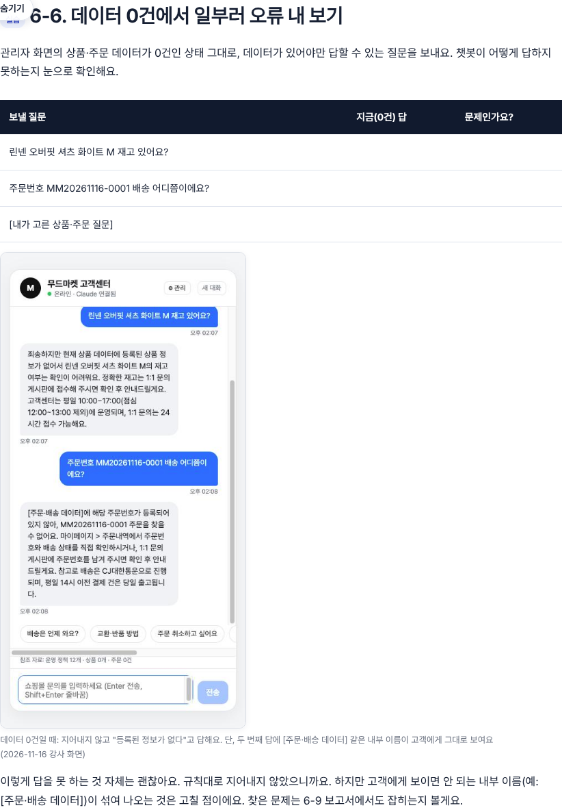

# 4주차 DAY1–DAY5 HTML 교안 (2026-11-15)

## 산출물 링크 (병합 후 GitHub Pages)
- 4주차 홈: https://loreenkim0301.github.io/swy-lecturenote/261116-ai-pm-week4/
- DAY1 클로드 코드로 AI 채팅 만들기: .../261116-ai-pm-week4/d1-claude-code-chatbot.html
- DAY2 API 붙여 보며 개념 익히기: .../261116-ai-pm-week4/d2-api.html
- DAY3 라이브러리·프레임워크와 개발 환경: .../261116-ai-pm-week4/d3-dev-env.html
- DAY4 크롬 확장 프로그램: .../261116-ai-pm-week4/d4-chrome-extension.html
- DAY5 클로드 에이전트 기능: .../261116-ai-pm-week4/d5-agent.html
- DAY1 데모 아티팩트(내장 AI 이벤트 도우미): https://claude.ai/artifact/GWz9EQL3bfHbWw21414N1F

## 바꾼 것
| 파일 | 내용 |
|---|---|
| d1 | 내장 AI 채팅(API 키 없음) → 답변 규칙 → 시험 질문 5가지 → RAG 5단계. 캡처: 첫 화면, 동의 창 |
| d2 (신규) | API 개념 → Open-Meteo(키 없음) → OpenWeather(무료 키, .env) → 공공데이터포털 기상청 단기예보(자동승인, 개발계정 10,000) → 세 API 비교표·웹훅 비교 |
| d3 (신규) | 라이브러리 vs 프레임워크 → Tailwind·Chart.js → 안티그래비티(App/IDE/CLI/확장 구분) → VS Code+클로드 코드 확장 → 비교표 → 리모트 컨트롤 |
| d4 (신규) | 확장 프로그램 파일 4개 → '내 문장 모음' 만들기·설치 → 권한 → 내 반복 업무 확장 프로그램 → 짝 점검. 예시 코드 samples/snippet-ext/ |
| d5 (신규) | 에이전트 개념 → 스킬(SKILL.md) → 서브에이전트(copy-reviewer) → 커넥터·브라우저·컴퓨터·예약 작업 → 사람이 확인할 곳(쿠폰 실패 사례) → 4주 회고 |
| index | DAY2–5 제목에 링크 |

## 확인
- Playwright: 6개 파일 JS 오류 0, 깨진 앵커 0, 이미지 파일 13개 모두 존재·디코드 확인, 모바일(390px) 확인
- 학생 페이지 금지 문구(규칙 15) grep 0건
- keep_phrase_linebreak 실행

## 캡처

## 남은 확인 (로린님)
- DAY1 동의 창 [계속]은 누르지 않음 → AI 답변 화면 캡처 없음
- "idea"는 IntelliJ IDEA(안티그래비티 JetBrains 확장)로 해석해 참고로만 넣음
- d2_weather_page.png, d4_popup_demo.png는 강사 예시로 직접 렌더한 화면

## 추가 (2026-11-16): 실제 화면 확인 후 캡처 보강
claude.ai/code 새 세션 화면에서 직접 확인했어요(세션은 시작하지 않음, 저장소 선택은 원래대로 되돌림).

| 위치 | 바꾼 것 |
|---|---|
| DAY1 2-2 | 실제 화면과 달랐던 안내 수정: `Cloud 묶음` → '클라우드' 아래 [자동]/[Default], 권한 `[Manual]`(없음) → [계획], `[이 컴퓨터]` → [로컬]. [저장소 없음] 단계 추가. 캡처 4장(입력창 단추, 환경 메뉴, 저장소 메뉴, 권한 메뉴). 강사 계정의 다른 환경·저장소 이름은 흐리게 가림 |
| DAY2 3-2 | OpenWeather 무료 범위 캡처(1분 60회, 한 달 1,000,000회) |
| DAY2 4-2 | 공공데이터포털 [활용신청] 단추 캡처, 오류 문구를 실제 문구("등록되지 않은 API 인증키입니다")로 |
| DAY3 2-1·2-2 | Tailwind Play CDN·Chart.js 공식 문서 캡처, "Play CDN은 연습용" 안내 추가 |
| DAY5 2-1·3-1 | 스킬·서브에이전트 공식 문서 캡처, '폴더 이름이 명령 이름', '서브에이전트 요청도 사용량에 포함' 반영 |

캡처하지 못한 것: 개발자 도구 네트워크 탭, chrome://extensions 세부정보, 크롬 우클릭 메뉴(확장 프로그램 도구로 찍을 수 없는 화면), 안티그래비티·VS Code 설치 후 화면, 데스크톱 앱 Remote Control 스위치(데스크톱 앱은 컴퓨터 사용 도구로 열 수 없음).

## 추가 (2026-11-16 오후): DAY1을 실제 오전 수업 흐름으로 재구성 + 4교시 정리
- 근거: 오늘 #프로덕트-매니저 슬랙의 강사 공지(수강생 결과물·이름은 넣지 않음)
- 세션: S1 클로드가 일하는 곳·커넥터 → S2 상담 챗봇 탭 4개 → S3 답변 흐름 플로우차트 → S4 배송 조회(2차)·가상 데이터+관리자(3차) → S5 내 컴퓨터로 옮길 준비(4차) → **S6(4교시) 실행·API 키·테스트 보고서** → S7 프롬프트 엔지니어링 → S8 RAG
- S6 캡처: 프롬프트 입력 화면(강사 슬랙 화면), 결과 화면(강사 컴퓨터 localhost:3000 챗봇·/admin, 질문 1회 보냄)
- 확인한 사실: localhost와 127.0.0.1은 같은 서버가 열리지만 브라우저 저장 대화가 따로 보임(직접 확인), AI 스튜디오 키는 서버 쪽 Secrets·ZIP이면 환경 변수 직접 설정(공식 문서)
- 이전 DAY1의 클라우드 세션 캡처(d1_cloud_*)는 이번 흐름에서 쓰지 않아 페이지에서 빠짐(파일은 남겨 둠)
- DAY5 스킬 실습의 월요일 참조를 상담 챗봇 기준으로 수정, 4주차 홈 DAY1 행 수정

## 추가 (2026-11-16 4교시): 데이터 0건 → 오류 확인 → 가상 데이터 추가 → 비교
- 6-5: localhost vs 127.0.0.1 개념(둘 다 내 컴퓨터 루프백, 이름 vs 숫자 주소, ::1 해석 문제, 브라우저 저장 분리), 개발자가 쓰는 상황, 127.0.0.1 vs 0.0.0.0
- 6-6: 데이터 0건에서 재고·주문 질문 → 실제 답 캡처(내부 이름 '[주문·배송 데이터]'가 고객 답에 노출되는 문제 발견)
- 6-7: 내가 먼저 적는 가상 상품·주문 1건 표
- 6-8: 관리자 화면 상품 추가·주문 추가(캡처) → 같은 질문 다시 → 넣기 전/후 비교표
- 6-9·6-10: 보고서 프롬프트와 확인표에 전후 비교·내부 이름 노출 항목 추가
- 타임테이블: S6 13:00–14:50, S7 15:00–16:20
- 강사 컴퓨터 localhost:3000에 테스트 질문 2개 보냄(API 사용량 발생). 관리자 데이터는 바꾸지 않음(0건 유지)

## 교안 수정 이력 (DAY1, 2026-11-16)

| PR | 내용 | 로린님 결정 |
|---|---|---|
| #181 | 4주차 DAY1~5 HTML 교안 첫 작성 | 승인(병합) |
| #182 | DAY1 2-2 클라우드 세션 안내를 실제 화면대로 고침 + 캡처 보강 | 승인(병합). 이후 #183에서 클라우드 세션 절이 빠짐(실제 수업에서 쓰지 않음) |
| #183 | DAY1을 실제 오전 수업 흐름으로 재구성, 4교시 정리 | 승인(병합) |
| #184 | 4교시: 데이터 0건 오류 → 가상 데이터 추가 → 비교, localhost·127.0.0.1 개념 | 승인(병합) |
| #185 | 2-1 강사 예시(탭1~3 상담봇) 링크 | 승인(병합) |
| 이번 PR | **4-1 '2차 업데이트: 배송 조회 테스트하기' 삭제** | **미승인 → 삭제** |

### 4-1을 승인하지 않은 이유
- 로린님 판단: 실습으로서 의미가 없음.
- 교안 구조로 본 근거(Claude 정리, 로린님 확인 필요):
  1. 4-1 시점에는 주문·배송 데이터가 아직 없어서, "배송 조회"를 해도 AI가 만든 가상 답만 나와요. 맞는지 틀린지 견줄 기준이 없어 확인할 것이 없어요.
  2. 배송 조회가 제대로 되는지는 4교시 6-6~6-8에서 확인해요. 데이터 0건일 때 답하지 못하는 것을 먼저 보고, 내가 정한 주문을 관리자 화면에 넣은 뒤 같은 질문으로 견줘요. 4-1은 이 실습과 겹치면서 근거가 더 약해요.
  3. 참고 화면(펫프렌즈)은 화면 생김새를 보는 데 그쳐요. 오늘 배울 것은 화면이 아니라 '챗봇이 데이터를 참조해 답하는가'예요.

### 이번 PR에서 함께 바뀐 것
- SESSION 4 제목: '배송 조회와 상품 데이터 붙이기' → '가상 데이터와 관리자 화면 붙이기'. 4-2 → 4-1, 4-3 → 4-2로 번호를 당김
- 프롬프트 번호 3~9 → 3~8로 당김
- 정리의 '화면보다 사용자의 기대치(예: 바로 배송 조회)를 먼저 정한다' 줄 삭제(4-1에서만 나온 내용)
- 2-1 예시 상자의 '4-2에서 만들 관리자 화면' → '4-1'
- 4주차 홈 DAY1 행 ④ 문구 수정
- #185의 예시 상자를 교안 원본(빌드 소스)에도 반영해, 다시 빌드해도 지워지지 않게 함

## v4 · DAY 1 6-5 localhost 확인·모두 닫기 추가 (2026-11-16)

- 위치: 6-5 '개발자는 둘 중 무엇을 쓰나요?' 표 아래
- STEP 1 프롬프트 7(열린 localhost 확인) → 맥 `lsof -nP -iTCP -sTCP:LISTEN` / 윈도우 `Get-NetTCPConnection -State Listen`
- STEP 2 프롬프트 8(실습 서버 모두 닫기, node·python만) → 맥 lsof+awk+kill / 윈도우 Stop-Process, 포트 3000 하나만 끄기 명령 포함
- 기존 프롬프트 7 → 9(테스트 보고서), 8 → 10(고칠 곳 한 군데만)으로 번호 변경
- 테스트: 리눅스 환경에서 맥용 lsof 끄기 명령 확인(python·node 서버만 꺼지고 claude 프로세스는 남음). **맥·윈도우 실PC 테스트는 아직 안 함** → 수업 전 강사 PC에서 확인 필요
- 캡처: d1_v4_s6-5_1280.png, d1_v4_s6-5_390.png (390px 가로 스크롤 없음)

## v5 · 6-5 명령어 블록 삭제, 프롬프트 중심으로 (2026-11-16, 로린님 지시)

- 학생은 프롬프트만 입력하고 명령어는 클로드 데스크톱 앱(클로드 코드)이 실행함 → 맥·윈도우 명령어 복사 박스, 목록 읽는 법 표, 포트 하나만 끄기 표, 명령어 출처 2개 삭제
- 대신 "클로드 코드가 실행해도 되는지 물으면 (끌 목록 확인 후) 실행 단추를 눌러요" 안내로 바꿈
- 확인할 점 1번: "클로드 코드가 알려 준 '남은 것'에 node, python이 없다"로 변경
- 남은 확인: 강사 PC(맥)에서 프롬프트 7·8을 한 번 돌려 보기
- 캡처: d1_v5_s6-5_1280.png, d1_v5_s6-5_390.png

## v6 · DAY 1 7세션·8세션 개념 보강 (2026-11-16, 로린님 지시)

- 7-1 신설 「프롬프트 엔지니어링이란?」: 정의(모델은 그대로, 보내는 글을 설계·시험·수정), 기술 표(분명한 지시·역할·제로샷·퓨샷·자료 넣기·형식), 퓨샷 원리(인컨텍스트 러닝, 파라미터 안 바뀜), 퓨샷 예시 복사 박스, 원문 자료 3개(Claude 공식 문서 Prompting best practices, Anthropic Interactive Tutorial, Brown 외 2020)
- 8-1 신설 「RAG란? 기획자가 보는 원리」: 찾기·붙이기·만들기, 오픈북 시험 비유, 머릿속 지식 vs 펼쳐 주는 책 표, 기획자가 정할 것 6가지, 자료가 작으면 전부 넣기(Anthropic 20만 토큰 기준)
- 8-2 신설 「RAG는 모델을 학습시키지 않아요」: 사전 학습·파인튜닝·프롬프트/퓨샷/RAG 비교, 정책 지우면 바로 사라지는 확인법, API 입력·출력 기본 학습 미사용(Anthropic 개인정보 센터), 2020년 원 논문과 실무 RAG 차이 참고
- 번호 변경: 7-1~7-3 → 7-2~7-4, 8-1~8-3 → 8-3~8-5
- 이 PR은 #188 브랜치 위에 쌓음(#188 먼저 병합)
- 웹 원문 직접 열람(WebFetch)은 승인 대기로 못 했고, 검색 결과의 원문 발췌로 확인함
- 캡처: d1_v6_s7-1_*.png, d1_v6_s8-1_*.png, d1_v6_s8-2_*.png

## v7 · 7-1 학생 눈높이로 재구성 (2026-11-16, 로린님 지적)

- 점검 기록: AI_PM_학습자·강사이해수준_점검기록_내부용_v1_김수정_261116 (https://docs.google.com/document/d/11FHUNMBbZdQqEpIGJDVzf1EWaAb7fO7hIpZ-Iny7IeM/edit) — 학생 질문 "뭐야/왜 필요해/지금 왜 해" 불합격
- 순서 변경: 문제(답 길이·말투 들쭉날쭉) → 퓨샷 한 줄 정의 → 제로샷·원샷·퓨샷(=멀티샷) 표('샷'=예시 개수) → 쓸 때/안 쓸 때 → 예시 3개(정상·모를 때·거절) → 기획자가 할 일
- 기술 6개 표 삭제, 인컨텍스트 러닝·논문은 '더 알아보기'로 내림
- 제목: 7-1. 프롬프트 엔지니어링과 퓨샷
- 캡처: d1_v7_s7-1_*.png

## v8 · SESSION 7 전체 재구성 (2026-11-16, 로린님 지시)

- 7-1 프롬프트 엔지니어링과 퓨샷: 예시 박스는 7-4로 옮겨 중복 제거
- 7-2 신설 「지금 시스템 프롬프트 읽어 보기」: 프롬프트 10, 다섯 부분(역할·지킬 규칙·모를 때 할 말·말투와 길이·예시 답변) 표
- 7-3 「시험 질문 5가지 보내고 기록하기」: 실제 답·통과 칸, 시험할 때 지킬 점(새 대화, 같은 질문 두 번, 내부 이름·길이 함께 보기)
- 7-4 「고칠 곳 하나만 골라 고치기」: 모두 함께 퓨샷 고치기 STEP 1~4(예시 답변 3개 쓰기 → 프롬프트 11 → 넣기 전후 비교(예시에 없는 질문 포함) → 5가지 다시 보내기), prompt-backup.txt 저장·되돌리기, 다른 곳은 프롬프트 12로 하나씩
- 7-5 결과물: 다섯 부분 표 + 시험 결과표 + 예시 답변 3개 + 전후 비교표
- 프롬프트 번호: 10(시스템 프롬프트 보기), 11(예시 답변 넣기), 12(고칠 곳 한 군데만)
- 캡처: d1_v8_s7-1~4_*.png
