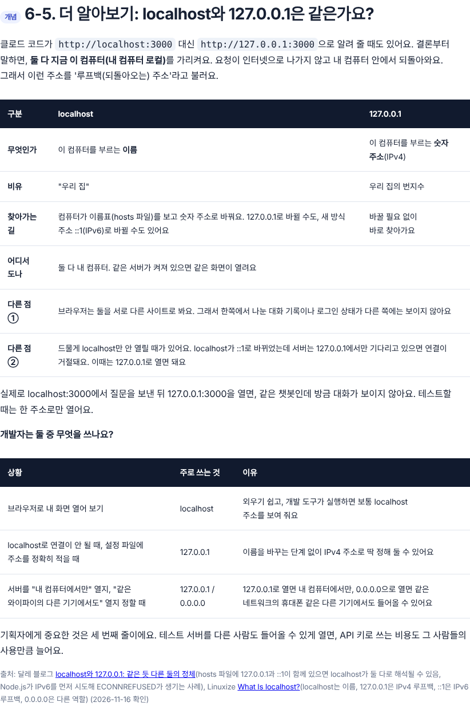

# 4주차 DAY1–DAY5 HTML 교안 (2026-11-15)

## 산출물 링크 (병합 후 GitHub Pages)
- 4주차 홈: https://loreenkim0301.github.io/swy-lecturenote/261116-ai-pm-week4/
- DAY1 클로드 코드로 AI 채팅 만들기: .../261116-ai-pm-week4/d1-claude-code-chatbot.html
- DAY2 API 붙여 보며 개념 익히기: .../261116-ai-pm-week4/d2-api.html
- DAY3 라이브러리·프레임워크와 개발 환경: .../261116-ai-pm-week4/d3-dev-env.html
- DAY4 크롬 확장 프로그램: .../261116-ai-pm-week4/d4-chrome-extension.html
- DAY5 클로드 에이전트 기능: .../261116-ai-pm-week4/d5-agent.html
- DAY1 데모 아티팩트(내장 AI 이벤트 도우미): https://claude.ai/artifact/GWz9EQL3bfHbWw21414N1F

## 바꾼 것
| 파일 | 내용 |
|---|---|
| d1 | 내장 AI 채팅(API 키 없음) → 답변 규칙 → 시험 질문 5가지 → RAG 5단계. 캡처: 첫 화면, 동의 창 |
| d2 (신규) | API 개념 → Open-Meteo(키 없음) → OpenWeather(무료 키, .env) → 공공데이터포털 기상청 단기예보(자동승인, 개발계정 10,000) → 세 API 비교표·웹훅 비교 |
| d3 (신규) | 라이브러리 vs 프레임워크 → Tailwind·Chart.js → 안티그래비티(App/IDE/CLI/확장 구분) → VS Code+클로드 코드 확장 → 비교표 → 리모트 컨트롤 |
| d4 (신규) | 확장 프로그램 파일 4개 → '내 문장 모음' 만들기·설치 → 권한 → 내 반복 업무 확장 프로그램 → 짝 점검. 예시 코드 samples/snippet-ext/ |
| d5 (신규) | 에이전트 개념 → 스킬(SKILL.md) → 서브에이전트(copy-reviewer) → 커넥터·브라우저·컴퓨터·예약 작업 → 사람이 확인할 곳(쿠폰 실패 사례) → 4주 회고 |
| index | DAY2–5 제목에 링크 |

## 확인
- Playwright: 6개 파일 JS 오류 0, 깨진 앵커 0, 이미지 파일 13개 모두 존재·디코드 확인, 모바일(390px) 확인
- 학생 페이지 금지 문구(규칙 15) grep 0건
- keep_phrase_linebreak 실행

## 캡처

## 남은 확인 (로린님)
- DAY1 동의 창 [계속]은 누르지 않음 → AI 답변 화면 캡처 없음
- "idea"는 IntelliJ IDEA(안티그래비티 JetBrains 확장)로 해석해 참고로만 넣음
- d2_weather_page.png, d4_popup_demo.png는 강사 예시로 직접 렌더한 화면

## 추가 (2026-11-16): 실제 화면 확인 후 캡처 보강
claude.ai/code 새 세션 화면에서 직접 확인했어요(세션은 시작하지 않음, 저장소 선택은 원래대로 되돌림).

| 위치 | 바꾼 것 |
|---|---|
| DAY1 2-2 | 실제 화면과 달랐던 안내 수정: `Cloud 묶음` → '클라우드' 아래 [자동]/[Default], 권한 `[Manual]`(없음) → [계획], `[이 컴퓨터]` → [로컬]. [저장소 없음] 단계 추가. 캡처 4장(입력창 단추, 환경 메뉴, 저장소 메뉴, 권한 메뉴). 강사 계정의 다른 환경·저장소 이름은 흐리게 가림 |
| DAY2 3-2 | OpenWeather 무료 범위 캡처(1분 60회, 한 달 1,000,000회) |
| DAY2 4-2 | 공공데이터포털 [활용신청] 단추 캡처, 오류 문구를 실제 문구("등록되지 않은 API 인증키입니다")로 |
| DAY3 2-1·2-2 | Tailwind Play CDN·Chart.js 공식 문서 캡처, "Play CDN은 연습용" 안내 추가 |
| DAY5 2-1·3-1 | 스킬·서브에이전트 공식 문서 캡처, '폴더 이름이 명령 이름', '서브에이전트 요청도 사용량에 포함' 반영 |

캡처하지 못한 것: 개발자 도구 네트워크 탭, chrome://extensions 세부정보, 크롬 우클릭 메뉴(확장 프로그램 도구로 찍을 수 없는 화면), 안티그래비티·VS Code 설치 후 화면, 데스크톱 앱 Remote Control 스위치(데스크톱 앱은 컴퓨터 사용 도구로 열 수 없음).

## 추가 (2026-11-16 오후): DAY1을 실제 오전 수업 흐름으로 재구성 + 4교시 정리
- 근거: 오늘 #프로덕트-매니저 슬랙의 강사 공지(수강생 결과물·이름은 넣지 않음)
- 세션: S1 클로드가 일하는 곳·커넥터 → S2 상담 챗봇 탭 4개 → S3 답변 흐름 플로우차트 → S4 배송 조회(2차)·가상 데이터+관리자(3차) → S5 내 컴퓨터로 옮길 준비(4차) → **S6(4교시) 실행·API 키·테스트 보고서** → S7 프롬프트 엔지니어링 → S8 RAG
- S6 캡처: 프롬프트 입력 화면(강사 슬랙 화면), 결과 화면(강사 컴퓨터 localhost:3000 챗봇·/admin, 질문 1회 보냄)
- 확인한 사실: localhost와 127.0.0.1은 같은 서버가 열리지만 브라우저 저장 대화가 따로 보임(직접 확인), AI 스튜디오 키는 서버 쪽 Secrets·ZIP이면 환경 변수 직접 설정(공식 문서)
- 이전 DAY1의 클라우드 세션 캡처(d1_cloud_*)는 이번 흐름에서 쓰지 않아 페이지에서 빠짐(파일은 남겨 둠)
- DAY5 스킬 실습의 월요일 참조를 상담 챗봇 기준으로 수정, 4주차 홈 DAY1 행 수정

## 추가 (2026-11-16 4교시): 데이터 0건 → 오류 확인 → 가상 데이터 추가 → 비교
- 6-5: localhost vs 127.0.0.1 개념(둘 다 내 컴퓨터 루프백, 이름 vs 숫자 주소, ::1 해석 문제, 브라우저 저장 분리), 개발자가 쓰는 상황, 127.0.0.1 vs 0.0.0.0
- 6-6: 데이터 0건에서 재고·주문 질문 → 실제 답 캡처(내부 이름 '[주문·배송 데이터]'가 고객 답에 노출되는 문제 발견)
- 6-7: 내가 먼저 적는 가상 상품·주문 1건 표
- 6-8: 관리자 화면 상품 추가·주문 추가(캡처) → 같은 질문 다시 → 넣기 전/후 비교표
- 6-9·6-10: 보고서 프롬프트와 확인표에 전후 비교·내부 이름 노출 항목 추가
- 타임테이블: S6 13:00–14:50, S7 15:00–16:20
- 강사 컴퓨터 localhost:3000에 테스트 질문 2개 보냄(API 사용량 발생). 관리자 데이터는 바꾸지 않음(0건 유지)

