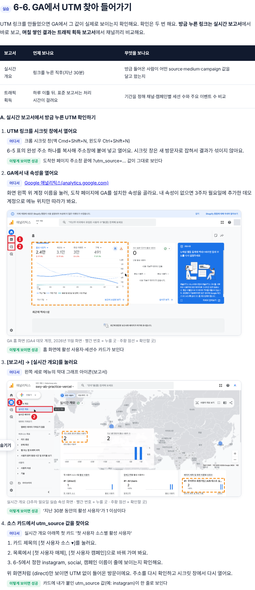
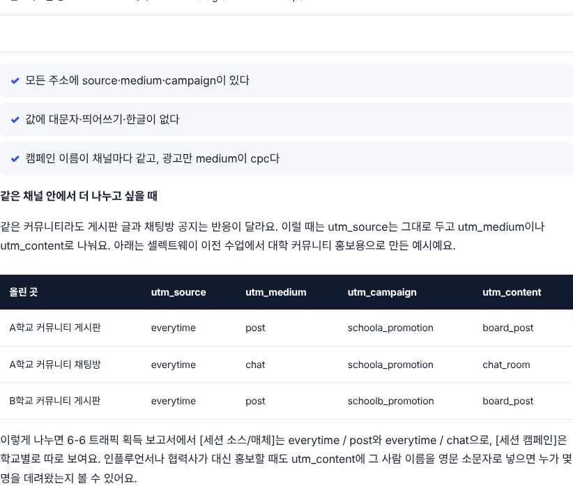
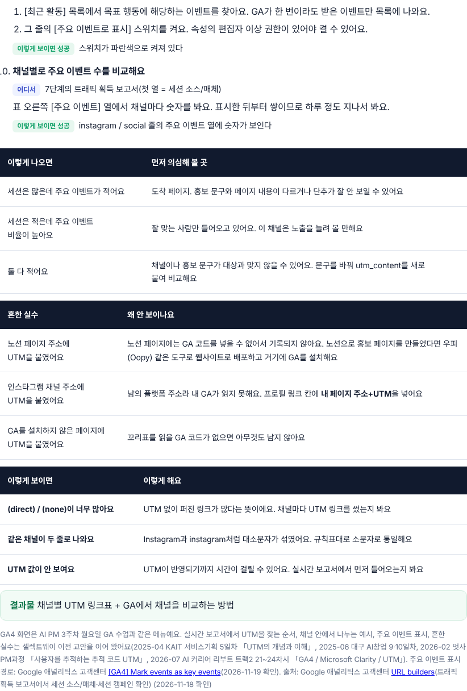

# 4주차 DAY4 · 6-6 "GA에서 UTM 찾아 들어가기" 보완 (261119)

대상: `261116-ai-pm-week4/d4-chrome-extension.html` 6-6

## 문제

6-6에는 트래픽 획득 보고서 화면 1장과 3줄 설명만 있었습니다. 방금 누른 UTM 링크를 GA에서 어디로 들어가 확인하는지가 빠져 있었습니다. 이 내용은 이전 교안 「[AI_커리어_리부트_트랙2] 교안 21~24차시 GA4 / Microsoft Clarity / UTM」(2026-07, 구글 드라이브)에 있던 부분입니다.

## 바꾼 것

- **제목:** "GA에서 채널별 성과 보기"에서 **"GA에서 UTM 찾아 들어가기"**로 바꿨습니다(사이드바 포함).
- **비교표 추가:** 실시간 개요(링크를 누른 직후)와 트래픽 획득(하루 이틀 뒤)을 언제 보는지 나란히 정리했습니다.
- **A. 실시간 보고서(1~5단계):**
  - 시크릿 창에서 UTM 링크 열기
  - GA에서 속성 고르기
  - [보고서] → [실시간 개요]
  - '첫 사용자 소스별 활성 사용자' 카드에서 소스, 매체, 캠페인으로 바꿔 보기
  - '이벤트 수(이벤트 이름별)' 카드에서 page_view를 누르고 source, medium, campaign, content, page_location 확인
- **B. 트래픽 획득(6~8단계):**
  - [보고서] → Life cycle → [획득] → [트래픽 획득]. 데모 계정에서는 영어 메뉴 이름으로 보인다는 점도 적었습니다.
  - 표 첫 열의 드롭다운을 [세션 소스/매체] 또는 [세션 캠페인]으로 바꾸기
  - 늘릴 채널과 줄일 채널 판단하기
- **단계 형식:** 모든 단계에 `어디서`, 하위 순서, `이렇게 보이면 성공`을 넣었습니다.
- **흔한 실수 표 추가:** 이전 교안에 있던 세 가지입니다. 노션 주소에 UTM을 붙인 경우, 인스타그램 채널 주소에 붙인 경우, GA를 설치하지 않은 페이지에 붙인 경우.
- **이미지:**
  - `d4_ga_home-hl.png`, `d4_ga_realtime-hl.png`: 3주차 월요일 교안의 GA 캡처를 복사했습니다.
  - `d4_ga_traffic_dim-hl.png`: 기존 트래픽 획득 캡처에 표 첫 열 드롭다운 표시(3번)를 추가했습니다.

## 캡처

전

후: A. 실시간 보고서

후: B. 트래픽 획득과 흔한 실수

## 확인 못 한 것

- **실시간 카드의 하위 화면 캡처가 없습니다.** 5단계(page_view를 누른 뒤 매개변수 목록)와 4단계(카드 드롭다운에서 [첫 사용자 매체]·[첫 사용자 캠페인]을 고른 화면)입니다.
  - 이전 교안 슬라이드 46에 해당 화면이 있지만, 이 작업 환경에서 슬라이드 이미지를 내려받을 수 없었습니다.
  - 지금은 글로만 설명했고, 빈 자리 그림은 넣지 않았습니다.
- **메뉴 이름의 근거:** 카드 이름과 매개변수 이름은 이전 교안과 3주차 캡처에 나온 화면을 기준으로 적었습니다.

## 2차 보완: 예전 교안까지 찾아 반영 (261119)

드라이브에서 예전 교안까지 거슬러 찾았어요. 같은 UTM·GA 내용이 2025년 4월부터 이어져 온 흐름이에요.

| 날짜 | 교안 | 이번에 가져온 것 |
|---|---|---|
| 2025-04 | KAIT 디지털신기술 서비스기획 5일차 「UTM의 개념과 이해」 | 클릭률과 전환율로 결과를 해석하는 방법(→ C의 해석 표) |
| 2025-06 | 대구 AI창업 9·10일차 「사용자의 행동을 부분적 추적하는 UTM」 | 도메인이 GA와 연결되어 있어야 한다는 점, 표준 보고서는 하루 이상 걸린다는 점 |
| 2025-12 | 멋사 PM부트캠프 1208 | 노션에는 GA를 직접 넣을 수 없어 우피로 배포한다는 점(→ 흔한 실수 표 보강) |
| 2026-02 | 멋사 PM과정 0205 「사용자를 추적하는 추적 코드 UTM」 | 실시간 보고서 → page_view → source·medium 순서(원본), 학교 커뮤니티 게시판과 채팅방을 나눈 UTM 예시, 주요(핵심) 이벤트 표시, 유입·행동·성과 3단계 |
| 2026-07 | AI 커리어 리부트 트랙2 21~24차시 | 1차 반영분 |

### 추가된 것
- **6-5:** "같은 채널 안에서 더 나누고 싶을 때"를 추가했어요. source는 그대로 두고 medium과 content로 나누는 예시 표이고, 인플루언서별로 구분하는 방법도 넣었어요.
- **6-6 C(9~10단계):**
  - 유입·행동·성과 3단계 표
  - [관리] → [데이터 표시] → [이벤트] → [주요 이벤트로 표시] 스위치 켜기
  - 트래픽 획득 보고서의 [주요 이벤트] 열에서 채널 비교하기
  - 결과 해석 표
- **흔한 실수:** 노션 줄에 우피로 배포하는 대안을 넣었어요.
- **출처:** 예전 교안 4개와 구글 공식 도움말 [GA4] Mark events as key events를 적었어요.

### 확인 못 한 것
- 주요 이벤트 스위치는 영어판 공식 도움말 기준이에요(Admin → Data display → Events → Mark as key event). 한국어 화면의 실제 이름 '주요 이벤트로 표시'는 캡처로 확인하지 못했어요.
- 2025-04 교안에 있던 실제 기업 인스타그램 UTM 예시는 지금도 같은 주소인지 확인할 수 없어서 넣지 않았어요.
