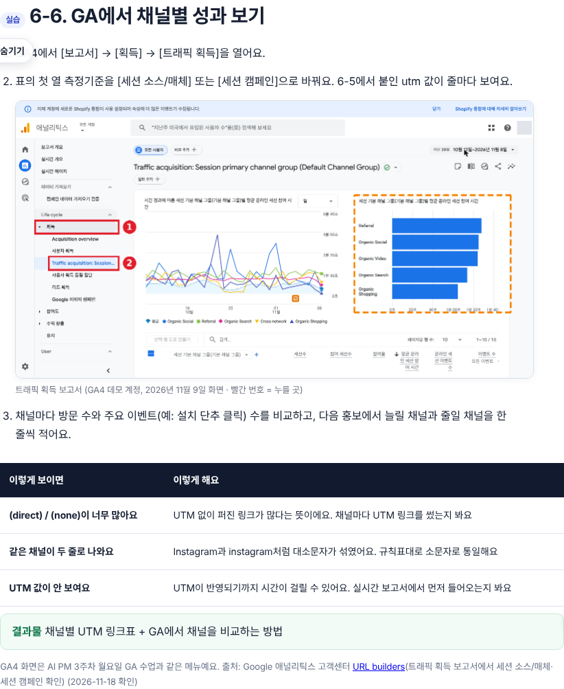
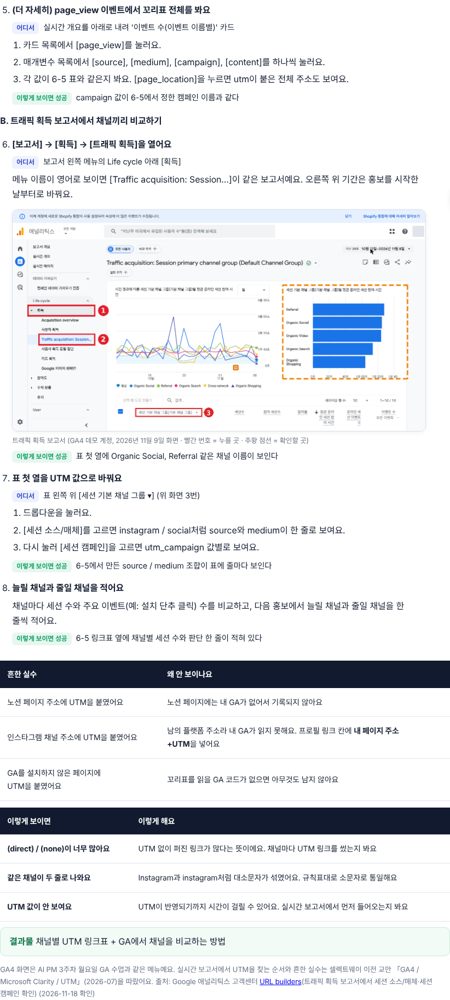

# 4주차 DAY4 · 6-6 "GA에서 UTM 찾아 들어가기" 보완 (261119)

대상: `261116-ai-pm-week4/d4-chrome-extension.html` 6-6

## 문제

6-6에는 트래픽 획득 보고서 화면 1장과 3줄 설명만 있었습니다. 방금 누른 UTM 링크를 GA에서 어디로 들어가 확인하는지가 빠져 있었습니다. 이 내용은 이전 교안 「[AI_커리어_리부트_트랙2] 교안 21~24차시 GA4 / Microsoft Clarity / UTM」(2026-07, 구글 드라이브)에 있던 부분입니다.

## 바꾼 것

- **제목:** "GA에서 채널별 성과 보기"에서 **"GA에서 UTM 찾아 들어가기"**로 바꿨습니다(사이드바 포함).
- **비교표 추가:** 실시간 개요(링크를 누른 직후)와 트래픽 획득(하루 이틀 뒤)을 언제 보는지 나란히 정리했습니다.
- **A. 실시간 보고서(1~5단계):**
  - 시크릿 창에서 UTM 링크 열기
  - GA에서 속성 고르기
  - [보고서] → [실시간 개요]
  - '첫 사용자 소스별 활성 사용자' 카드에서 소스, 매체, 캠페인으로 바꿔 보기
  - '이벤트 수(이벤트 이름별)' 카드에서 page_view를 누르고 source, medium, campaign, content, page_location 확인
- **B. 트래픽 획득(6~8단계):**
  - [보고서] → Life cycle → [획득] → [트래픽 획득]. 데모 계정에서는 영어 메뉴 이름으로 보인다는 점도 적었습니다.
  - 표 첫 열의 드롭다운을 [세션 소스/매체] 또는 [세션 캠페인]으로 바꾸기
  - 늘릴 채널과 줄일 채널 판단하기
- **단계 형식:** 모든 단계에 `어디서`, 하위 순서, `이렇게 보이면 성공`을 넣었습니다.
- **흔한 실수 표 추가:** 이전 교안에 있던 세 가지입니다. 노션 주소에 UTM을 붙인 경우, 인스타그램 채널 주소에 붙인 경우, GA를 설치하지 않은 페이지에 붙인 경우.
- **이미지:**
  - `d4_ga_home-hl.png`, `d4_ga_realtime-hl.png`: 3주차 월요일 교안의 GA 캡처를 복사했습니다.
  - `d4_ga_traffic_dim-hl.png`: 기존 트래픽 획득 캡처에 표 첫 열 드롭다운 표시(3번)를 추가했습니다.

## 캡처

전

후: A. 실시간 보고서

후: B. 트래픽 획득과 흔한 실수

## 확인 못 한 것

- **실시간 카드의 하위 화면 캡처가 없습니다.** 5단계(page_view를 누른 뒤 매개변수 목록)와 4단계(카드 드롭다운에서 [첫 사용자 매체]·[첫 사용자 캠페인]을 고른 화면)입니다.
  - 이전 교안 슬라이드 46에 해당 화면이 있지만, 이 작업 환경에서 슬라이드 이미지를 내려받을 수 없었습니다.
  - 지금은 글로만 설명했고, 빈 자리 그림은 넣지 않았습니다.
- **메뉴 이름의 근거:** 카드 이름과 매개변수 이름은 이전 교안과 3주차 캡처에 나온 화면을 기준으로 적었습니다.
