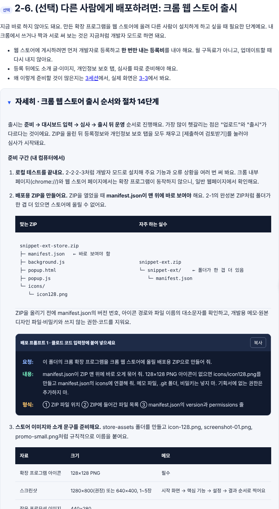
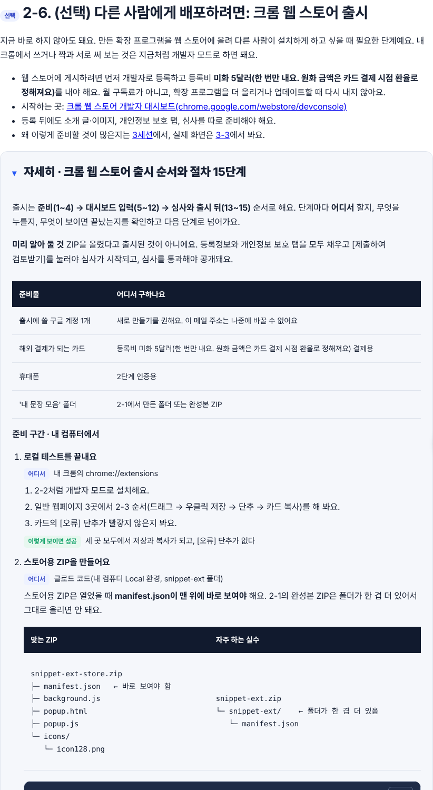
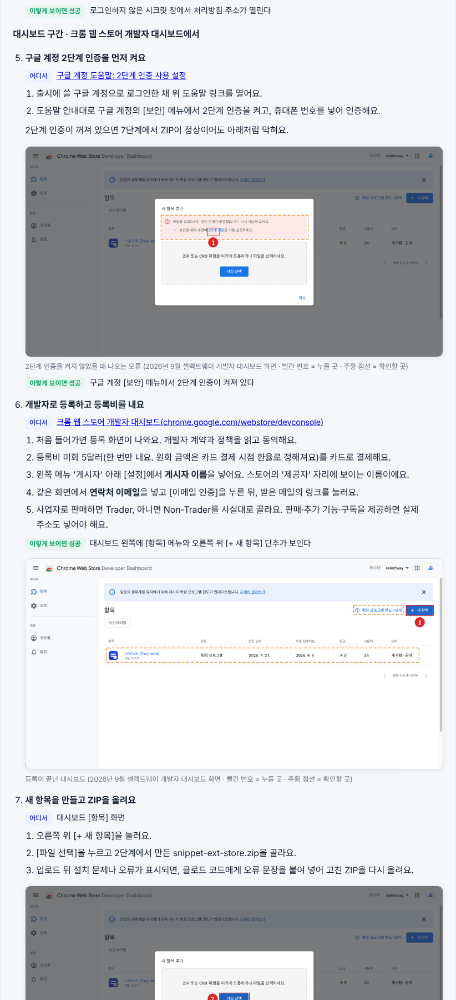
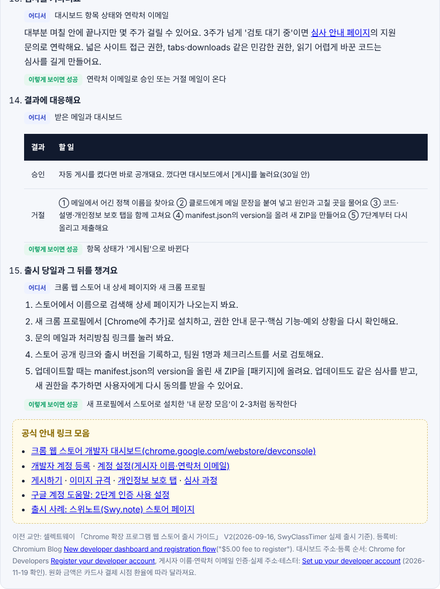
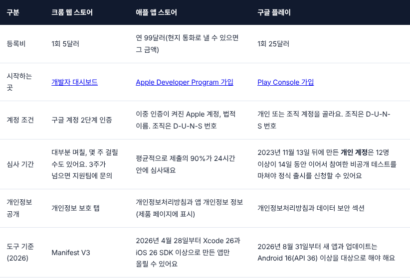

# 4주차 DAY4 · 크롬 웹 스토어 등록비·링크·단계별 절차 보완 (261119)

대상: `261116-ai-pm-week4/d4-chrome-extension.html`

## 바꾼 것

| 위치 | 전 | 후 |
|---|---|---|
| 2-6 본문 | "한 번만 내는 등록비"라고만 적혀 있고 금액과 링크 없음 | 등록비 **미화 5달러(1회)**, 개발자 대시보드 링크 추가 |
| 2-6 토글 | 14단계를 한 줄씩 설명. 어디서 할지, 성공 기준, 링크 없음 | **15단계**. 각 단계에 `어디서`(링크 포함) → 하위 순서 → `이렇게 보이면 성공`을 넣고, 준비물 표, 맞는 ZIP과 틀린 ZIP 비교, 스토어 이미지 파일 표, 개인정보 보호 탭 입력값 표, 공개 범위 표, 3-3 실제 화면 9장을 해당 단계에 배치, 공식 안내 링크 모음 추가 |
| 2-2 용어 표 | 등록비 금액 없음 | "한 번만 내는 미화 5달러" |
| 3-1 비교 표 | "1회 등록비" | 금액 표기 |
| 3-2 계정 행 | "금액은 결제 화면 기준" | 금액, 대시보드 링크, 2-6 자세히로 가는 링크 |
| 4-1 3개 스토어 표 | 크롬 칸이 "1회 등록비" | "1회 5달러"로 고치고, 세 스토어 모두 가입 링크가 있는 `시작하는 곳` 행 추가 |

## 출처와 확인 상태 (2026-11-19 KST 확인)

- **등록비 5달러:** 공식 등록 안내 페이지에는 금액이 없습니다. Chromium 공식 블로그(2020-03, "charges a $5.00 fee to register")를 근거로 적었고, 실제 결제 화면은 확인하지 못했습니다.
- **대시보드 주소와 등록 순서(동의 → 결제):** developer.chrome.com/docs/webstore/register
- **게시자 이름, 연락처 이메일 인증, 실제 주소 조건, 테스터:** developer.chrome.com/docs/webstore/set-up-account
- **심사 기간(대부분 며칠, 3주가 넘으면 지원 문의):** developer.chrome.com/docs/webstore/review-process
- **대시보드 메뉴 이름:** 2026년 9월에 캡처한 셀렉트웨이 대시보드 화면 기준입니다. 왼쪽 메뉴는 '게시자' 아래 [항목], [설정], '계정' 아래 [프로필], [알림]입니다.
- **2단계 인증:** 구글 계정 도움말(support.google.com/accounts/answer/185839)로 연결합니다. 보안 메뉴 안의 정확한 단추 이름은 확인하지 못해서 '도움말 안내대로'라고 적었습니다.
- **원화 금액:** 카드 결제 시점 환율로 정해진다고만 적었습니다. 고정 원화 금액은 적지 않았습니다.

## 캡처

전: 2-6 토글

후: 2-6 토글 위쪽(등록비, 대시보드 링크, 준비물 표)

후: 5~6단계(어디서 → 순서 → 성공 기준과 실제 화면)

후: 공식 링크 모음과 출처

후: 4-1 스토어 비교표의 등록비 행과 시작하는 곳 행

## 남은 것

- 실제 결제 화면에서 등록비 금액을 다시 확인하기(새 구글 계정으로 대시보드에 처음 들어가면 보입니다)
- 크롬 내부 화면 캡처 6장과 스위노트 스토어 상세 페이지 캡처(사용자 제공 대기)
