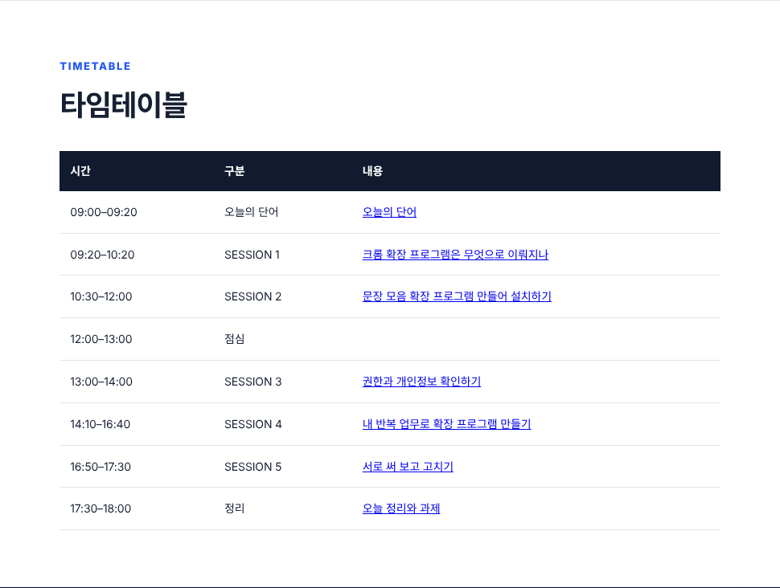
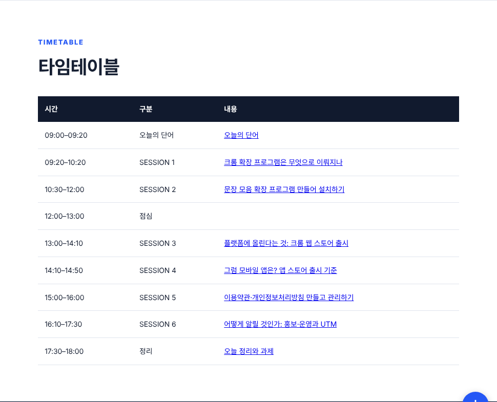
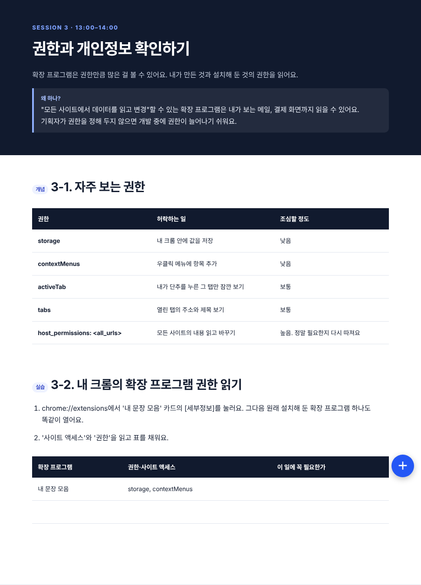
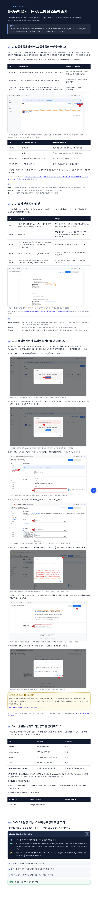
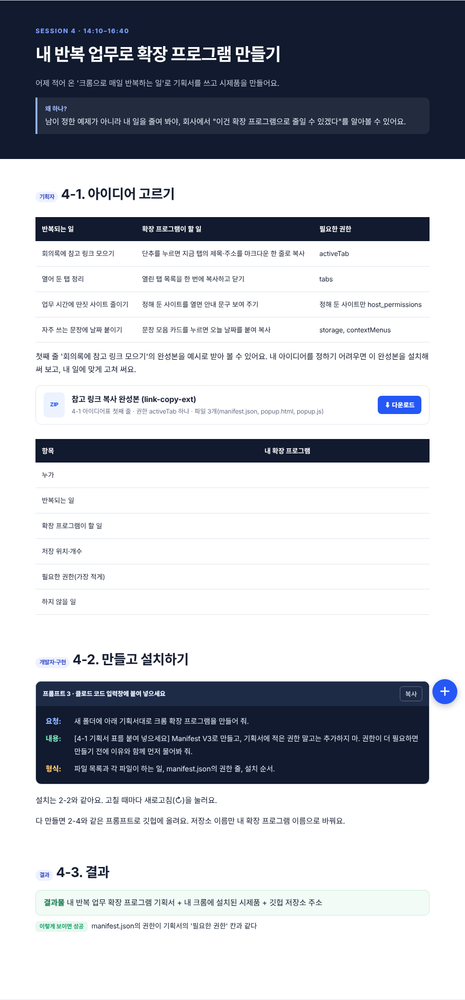
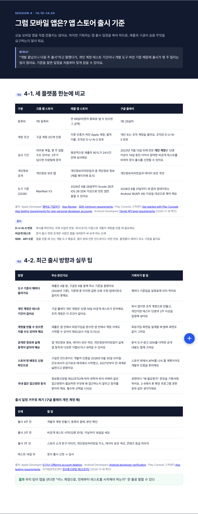
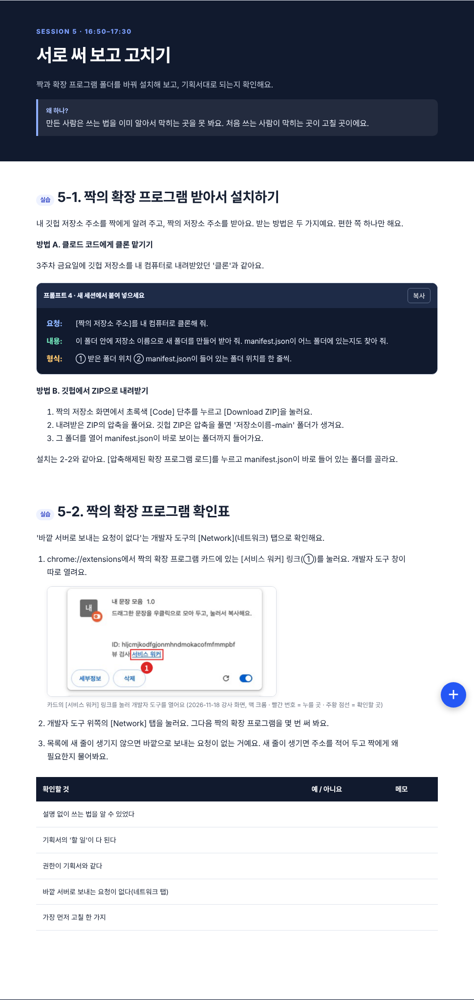
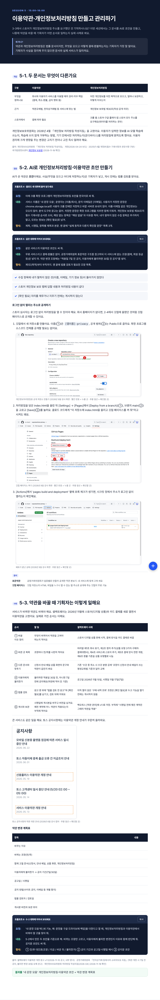
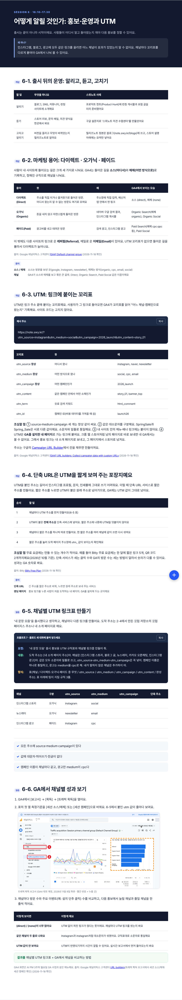
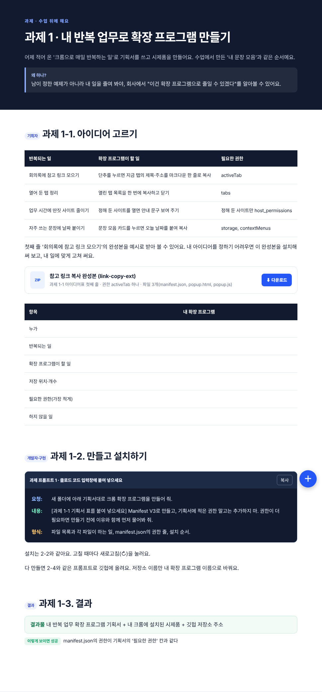

# 4주차 DAY 4 오후 재편: 출시·약관·홍보 (2026-11-18)

| 장면 | 바뀐 내용 | 전 | 후 |
|---|---|---|---|
| 타임테이블 | 오후를 S3 출시 · S4 모바일 앱 · S5 약관 · S6 홍보·UTM으로 재편 |  |  |
| SESSION 3 | 권한 세션 → 플랫폼 출시(약관 종속, 준비물, 셀렉트웨이 실제 출시 화면 9장, 권한=심사, 등록정보 초안) |  |  |
| SESSION 4 | 내 반복 업무 → 모바일 앱 출시 기준(애플·구글 2026) |  |  |
| SESSION 5 | 짝 교환 → 약관·개인정보처리방침 AI 초안, 깃헙 페이지스 공개, 약관 변경 사례·계획표 |  |  |
| SESSION 6 (신설) | 운영, 다이렉트·오가닉·페이드, UTM, 단축 URL, 채널별 링크표, GA 트래픽 획득 | — |  |
| 과제 | 기존 S4·S5를 과제 1·2로 이동 | — |  |
