# 4주차 DAY 4 크롬 확장 프로그램: 실제 크롬 테스트 반영 (2026-11-18)

| 장면 | 절 | 바뀐 내용 | 전 | 후 |
|---|---|---|---|---|
| 01_d4_오늘의단어 | 오늘의 단어 | manifest.json 비유 삭제, Manifest V3·개발자 모드·개발자 등록 추가, 버튼 이름을 실제 화면대로 | 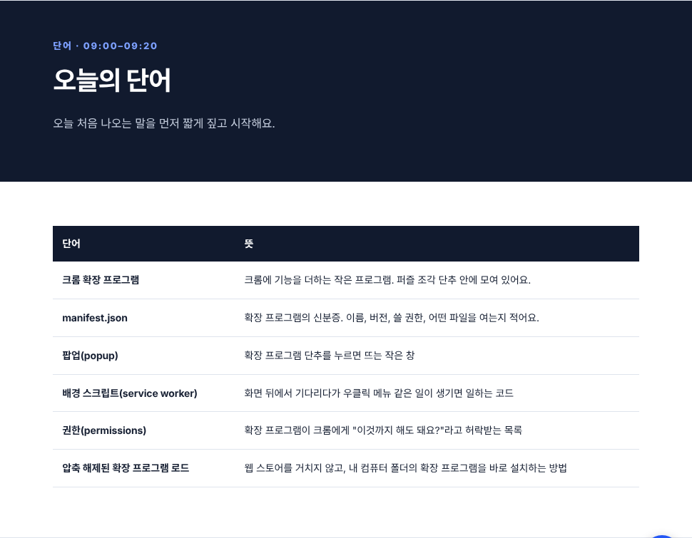 | 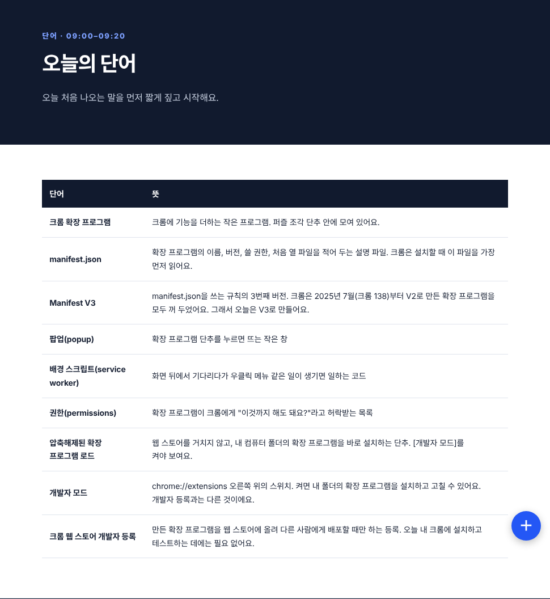 |
| 02_d4_1-1 | 1-1 | 비유 칸 삭제 | 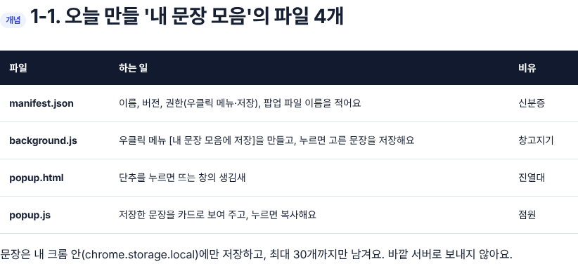 | 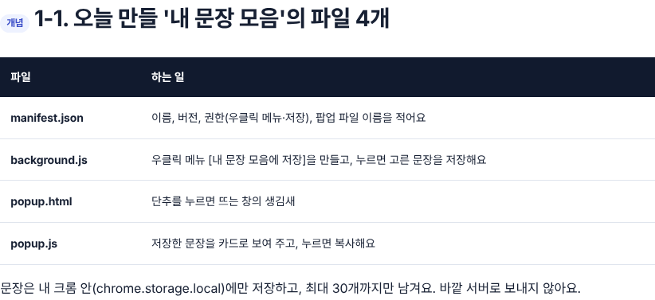 |
| 03_d4_2-1 | 2-1 | 완성본 ZIP 다운로드 카드 + 맥·윈도우 압축 풀기 + Finder 캡처 | 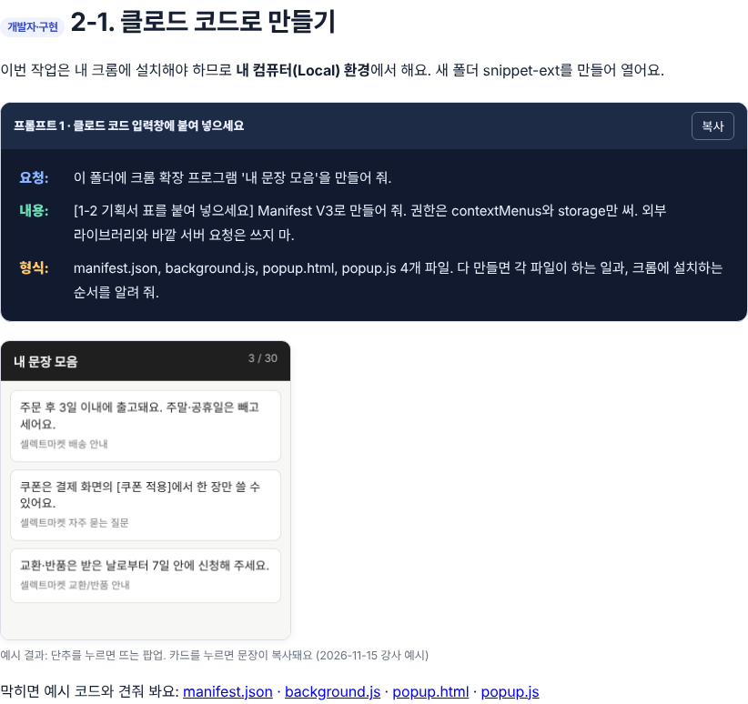 | 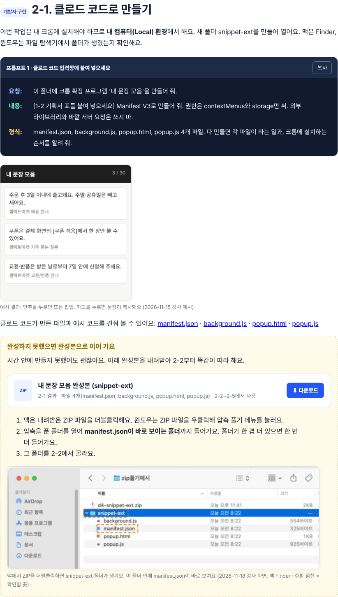 |
| 04_d4_2-2 | 2-2 | 실제 한국어 크롬 캡처 3장(누를 곳 표시), 개발자 등록 불필요 안내, 막히면 표(회색 스위치·폴더 오류) | 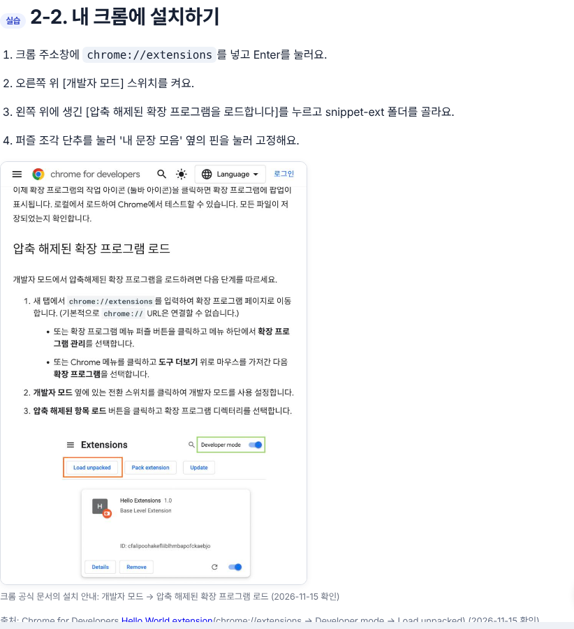 | 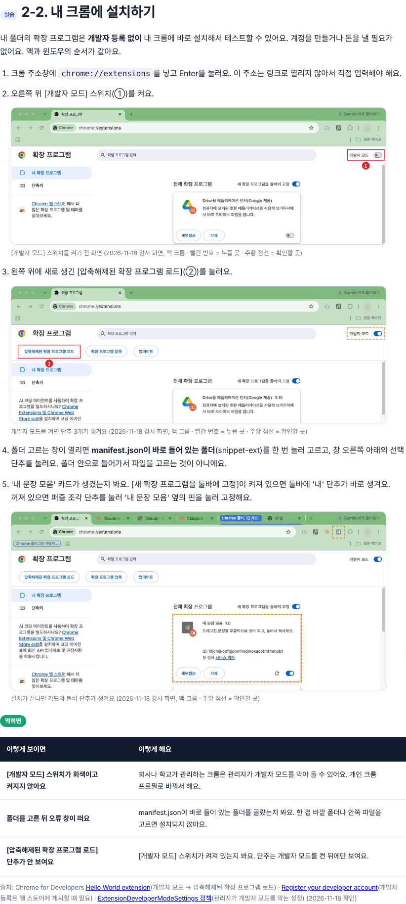 |
| 05_d4_2-3 | 2-3 | 팝업·새로고침 캡처, 맥·윈도우 붙여 넣기 단축키 | 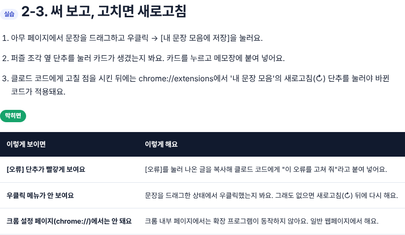 | 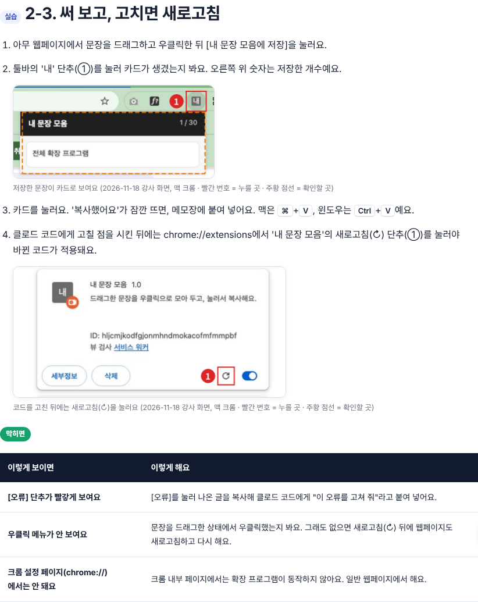 |
| 06_d4_2-4 | 2-4~2-6 | 깃헙 보관(필수) 신설, 결과 2-5, (선택) 웹 스토어 개발자 등록 2-6 | 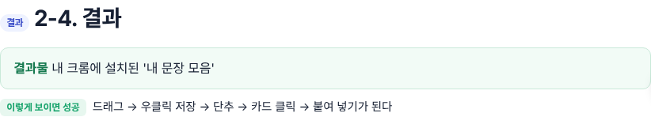 | 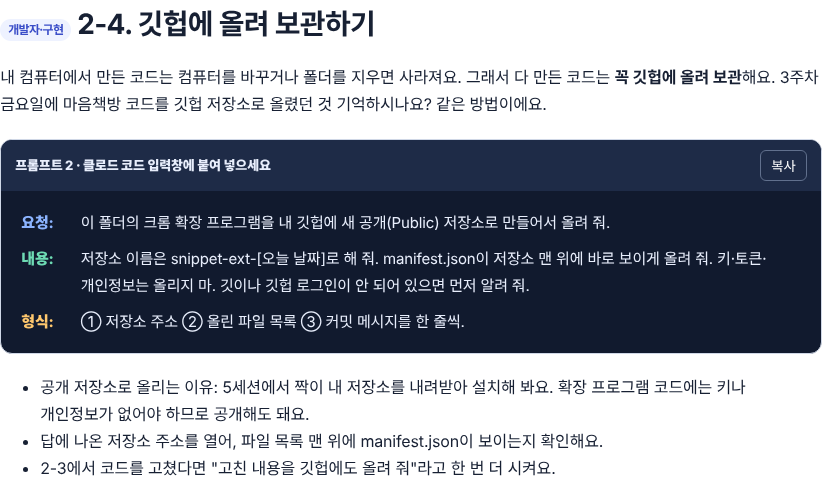 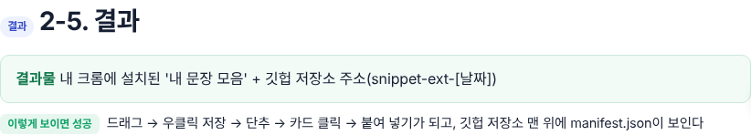 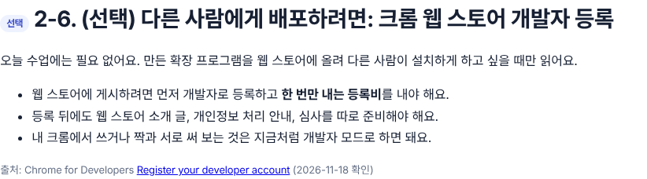 |
| 07_d4_3-2 | 3-2 | 개발자 등록 안내 상자를 2-6으로 옮김 | 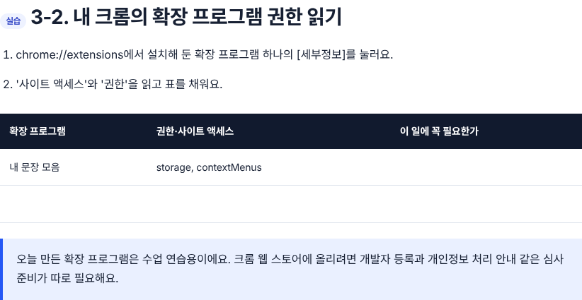 | 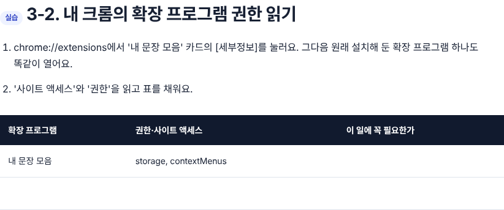 |
| 08_d4_4-1 | 4-1 | 참고 링크 복사 완성본 ZIP | 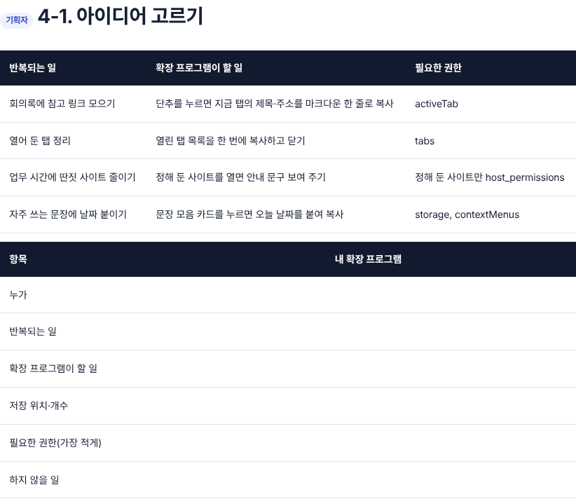 | 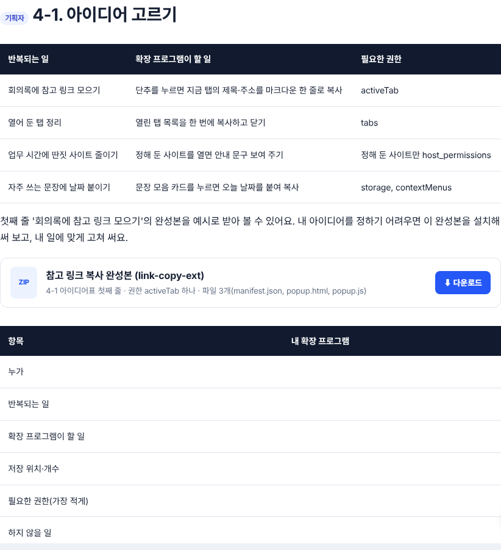 |
| 09_d4_5-1 | 5-1~5-2 | 짝 저장소 받기(클론/ZIP) 절차, 네트워크 탭 여는 법(서비스 워커) | 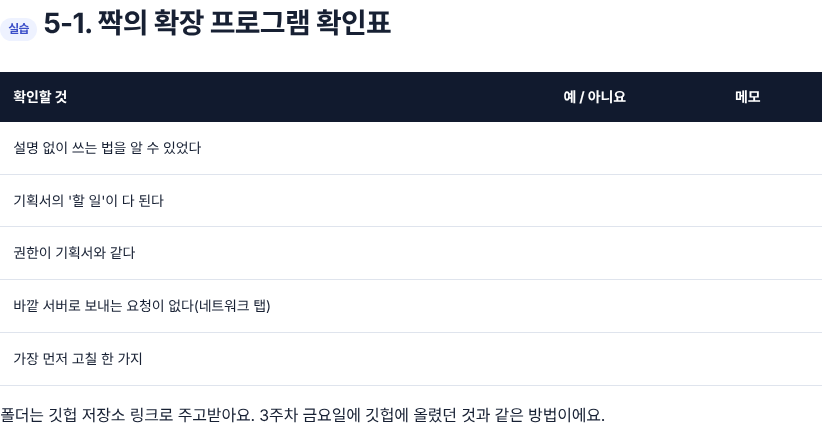 | 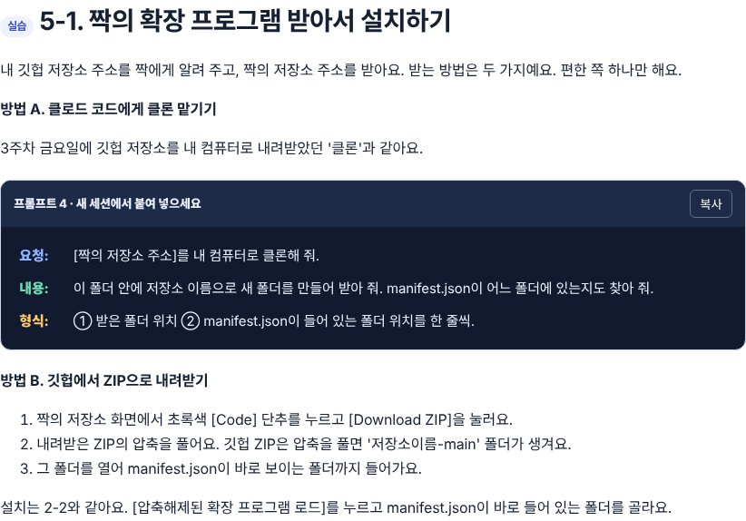 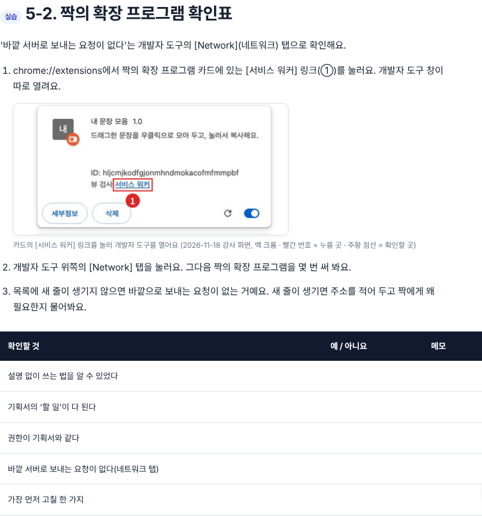 |
