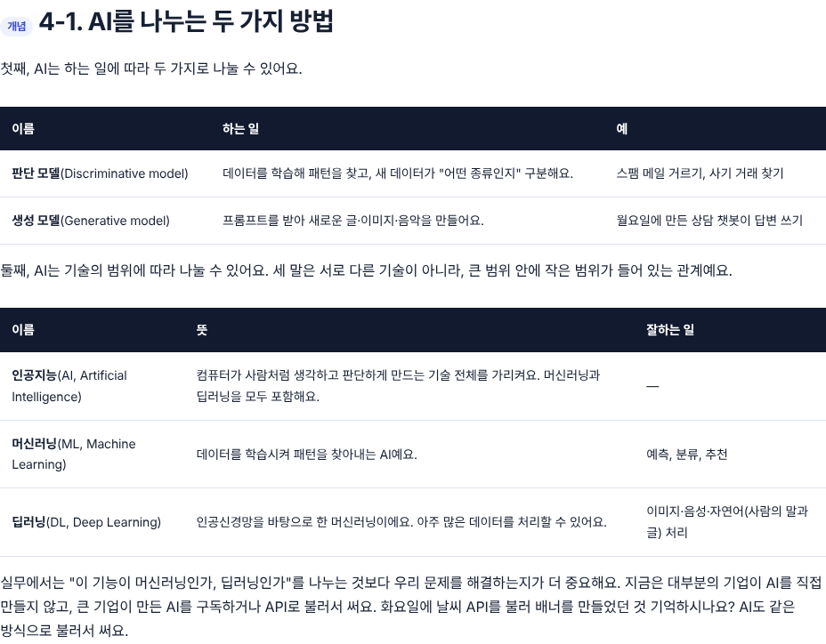
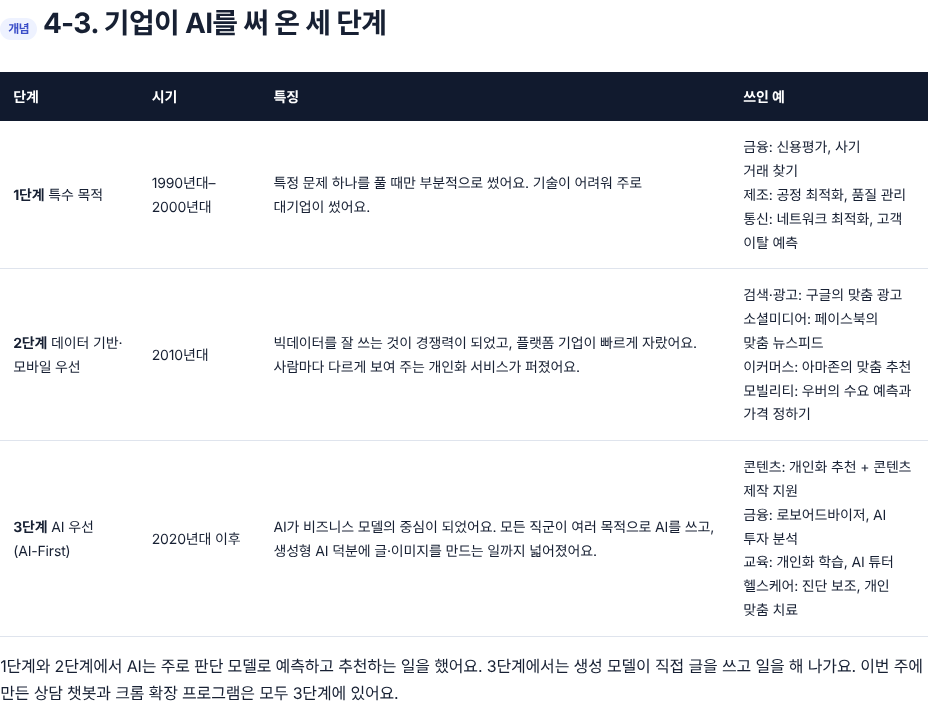
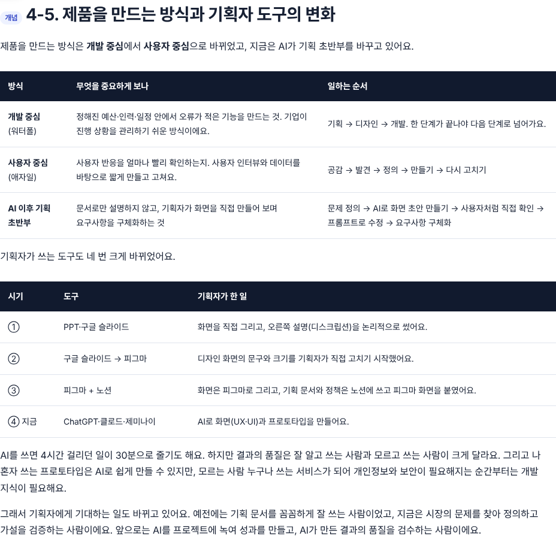
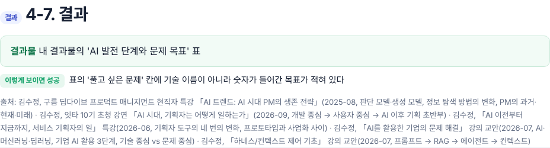

# 4주차 DAY5 SESSION 4 교체: 사람이 확인할 곳 → AI 발전 흐름 (2026-11-20 KST)

- 바꾼 파일: `261116-ai-pm-week4/d5-agent.html`
- 결과 페이지: https://loreenkim0301.github.io/swy-lecturenote/261116-ai-pm-week4/d5-agent.html#s4

## 바꾼 내용
1. SESSION 4(15:40–16:40) '사람이 확인할 곳 정하기'(쿠폰 사례, 확인 표)를 지웠어요.
2. 같은 시간에 'AI 발전 흐름: 기업과 기획자는 AI를 어떻게 써 왔나'를 넣었어요.
3. 2차(같은 날): 처음에 빠졌던 외부 특강 자료 3개를 더해 4-1·4-2·4-5를 새로 넣거나 보강했어요.

| 절 | 가져온 자료 |
|---|---|
| 4-1 AI를 나누는 두 가지 방법 | 구름 현직자 특강(2025-08-13) 판단 모델·생성 모델 + 트랙2 15차시 AI·ML·DL |
| 4-2 ChatGPT의 등장 | 구름 현직자 특강(2025-08-13) 책 → 검색엔진 → 생성형 AI, ChatGPT 사용자 증가 |
| 4-3 기업이 AI를 써 온 세 단계 | 트랙2 15차시(2026-07-15) |
| 4-4 질문·답변에서 일하는 환경으로 | 트랙2 18차시(2026-07-21) |
| 4-5 제품을 만드는 방식과 기획자 도구의 변화 | 잇타 10기 초청 강연(2026-09-12) 개발 중심 → 사용자 중심 → AI 이후 / 트랙2 OT 특강 「서비스 기획자의 일」(2026-06-25) 도구 4번의 변화, 4시간 → 30분, 프로토타입과 사업화 / 구름 특강 PM의 과거·현재·미래 |
| 4-6 기술이 아니라 문제로 시작하기(실습) | 트랙2 15차시 |

4. 구름 특강 슬라이드의 "출시 5일 만에 사용자 1만 명"은 원문 보도(Reuters·Fortune) 기준으로 "100만 명"이 맞아서 교안에는 100만 명으로 고쳐 넣었어요. 슬라이드의 2025년 4월 기준 통계(주간 사용자 8억 명 등)는 기준일이 1년 반 이상 지나 넣지 않았어요.
5. 같이 고친 곳: 사이드바, 시간표, 교육 목표, 수업이 끝나면 ⑤, 오늘의 결과물(2곳), 5-1 회고 표의 금요일 줄, 오늘의 규칙, 3-2 예약 작업 문단의 '4세션' 언급, 오늘의 단어(RAG·컨텍스트 추가)

## 확인 캡처

