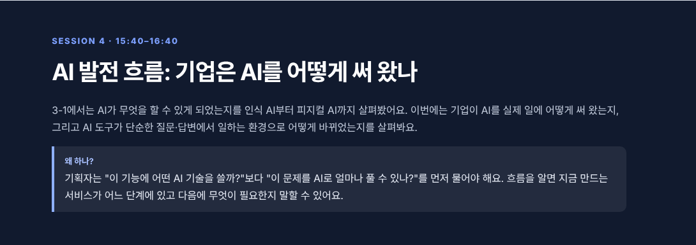
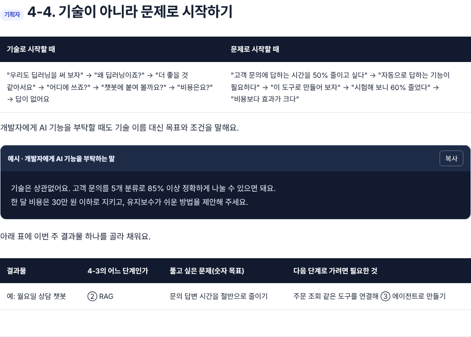

# 4주차 DAY5 SESSION 4 교체: 사람이 확인할 곳 → AI 발전 흐름 (2026-11-20 KST)

- 바꾼 파일: `261116-ai-pm-week4/d5-agent.html`
- 결과 페이지: https://loreenkim0301.github.io/swy-lecturenote/261116-ai-pm-week4/d5-agent.html#s4

## 바꾼 내용
1. SESSION 4(15:40–16:40) '사람이 확인할 곳 정하기'(쿠폰 사례, 확인 표)를 지웠어요.
2. 같은 시간에 'AI 발전 흐름: 기업은 AI를 어떻게 써 왔나'를 넣었어요. 내용은 로린님 슬라이드 교안 두 개에서 가져왔어요.
   - 「[AI_커리어_리부트_트랙2]_교안_15차시_260715」: AI·머신러닝·딥러닝, 기업 AI 활용 3단계(1990–2000년대 / 2010년대 / 2020년대 이후와 산업별 예), 기술 중심과 문제 중심 사고, 개발자에게 하는 부탁 예시
   - 「[AI_커리어_리부트_트랙2]_교안_18차시_260721」: 프롬프트 → RAG → 에이전트 → 컨텍스트, 사용자 기대치 변화, 컨텍스트 관리가 필요한 이유
   - 4-1 AI·머신러닝·딥러닝 / 4-2 기업이 AI를 써 온 세 단계 / 4-3 질문·답변에서 일하는 환경으로 / 4-4 기술이 아니라 문제로 시작하기(실습 표) / 4-5 결과
3. 이 변경을 따라 고친 곳: 사이드바, 시간표, 교육 목표, 수업이 끝나면 ⑤, 오늘의 결과물(2곳), 5-1 회고 표의 금요일 줄, 오늘의 규칙, 3-2 예약 작업 문단의 '4세션' 언급, 오늘의 단어(RAG·컨텍스트 추가)
4. 4-3의 '이번 주에 해 본 것' 칸은 이번 주 교안에 실제로 있는 활동만 적었어요. 월요일 9-2의 FAQ RAG, 목요일의 클로드 코드 확장 프로그램, 오늘 2세션의 스킬이에요.

## 확인 캡처

