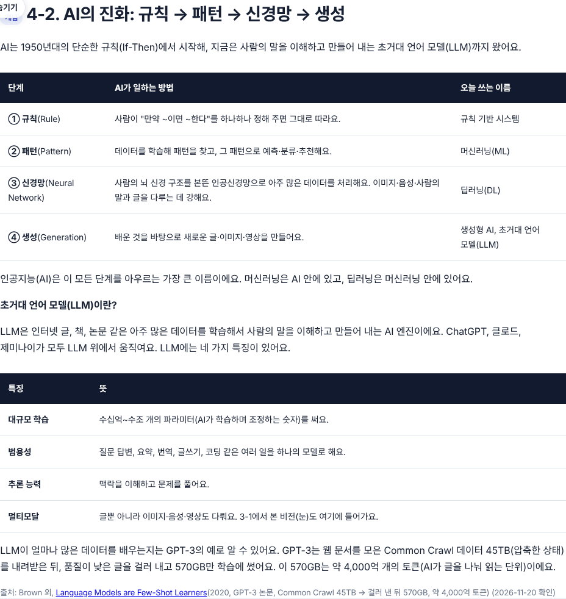

# 4주차 DAY5 SESSION 4: AI 발전 흐름 (2026-11-20 KST)

- 바꾼 파일: `261116-ai-pm-week4/d5-agent.html`
- 결과 페이지: https://loreenkim0301.github.io/swy-lecturenote/261116-ai-pm-week4/d5-agent.html#s4
- 이력: #224(사람이 확인할 곳 → AI 발전 흐름 1차, 머지됨) → #225(이 문서, 외부 특강 자료 반영)

## 바꾼 내용 (#225)
1. 처음 #225에 넣었던 구름 현직자 특강·잇타 10기·「서비스 기획자의 일」 특강 내용은 모두 뺐어요. 로린님이 말한 외부 특강은 이 셋이 아니었어요.
2. 대신 **성남시청소년청년재단 청년 사업 실무자 대상 AI활용교육 「실무자를 위한 인공지능의 이해」(2026-06-16)** 에서 가져왔어요.

| 절 | 가져온 자료 |
|---|---|
| 4-1 업무의 궤도가 바뀌었어요: 기계에서 AI 파트너로 | 성남 실무자 교육 Part1 '업무의 궤도가 바뀌다' |
| 4-2 AI의 진화: 규칙 → 패턴 → 신경망 → 생성 | 성남 실무자 교육 Part1 '인공지능의 진화', '초거대 모델(LLM)이란?', '초거대 데이터' + 트랙2 15차시 AI·ML·DL |
| 4-3 기업이 AI를 써 온 세 단계 | 트랙2 15차시(그대로) |
| 4-4 질문·답변에서 일하는 환경으로 | 트랙2 18차시(그대로) |
| 4-5 AI 도구가 갖추게 된 일곱 가지 기능 | 성남 실무자 교육 Part3 '핵심 활용 전략' 7가지(시스템 지침, 메모리, 맞춤형 챗봇, 스킬, 예약 작업, 외부 서비스 연동, 내 컴퓨터 다루기) |
| 4-6 기술이 아니라 문제로 시작하기(실습) | 트랙2 15차시(그대로) |

3. 슬라이드와 다르게 넣은 것
   - 'GPT-3 학습 텍스트 570GB'는 GPT-3 논문 기준으로 'Common Crawl 45TB(압축) → 걸러 낸 뒤 570GB, 약 4,000억 토큰'으로 풀어 썼어요. 슬라이드의 '책 58만 권, 397년'은 계산 기준(300쪽 책, 하루 6시간)을 원문에서 확인할 수 없어 넣지 않았어요.
   - '대표 기업 및 최신 모델(2026년 기준)' 표는 모델 이름이 자주 바뀌어 넣지 않았어요.
   - 4-5의 '이번 주에 해 본 것' 칸은 이번 주 교안에 실제로 있는 활동만 적었어요(월요일 시스템 프롬프트, 오늘 2세션 스킬, 3-2 커넥터·예약 작업·컴퓨터 유즈).

## 확인 캡처

